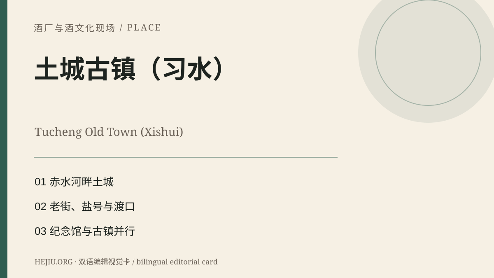

# 土城古镇（习水）

土城不是一座只靠“古镇”标签存在的旅游街。它先是赤水河上的盐运码头，后来成为四渡赤水的重要渡口与纪念地，今天又和习酒镇的酱香酒旅连在一起。逛土城要同时看两条线：一条是盐号、船帮、老街与吊脚楼的生活线，一条是纪念馆、渡口与长征叙事的历史线。只看其中一条，都会把这座镇读薄。

图：土城古镇（习水）专属双语视觉卡。项目自制双语视觉卡，用于识别主题，不是现场照片。

> **先给结论**
> **适合谁：** 想同时看赤水河盐运古镇与四渡赤水历史的人；适合与习酒镇串成两天。
> **不适合谁：** 只想要“拍照古镇”、不愿走坡道与看展的人；土城的历史密度不低。
> **一句话：** 先看纪念馆建立时间线，再走老街看盐运与生活，顺序不要倒。

## 古镇与纪念地双重身份

土城的空间可以分成三层：一层是赤水河码头与老街，盐号、船帮、商铺、吊脚楼和石阶构成生活与运输的肌理；一层是四渡赤水纪念馆与渡口遗址，负责解释 1935 年前后的军事行动；还有一层是今天的新镇与旅游服务，餐馆、客栈、停车场围绕前两层展开。三层不在同一个时代，却叠在同一条坡道上。先看纪念馆建立时间线，再走老街，看到盐号与码头时才知道它们为什么重要。

## 四渡赤水纪念馆看什么

纪念馆的价值不是把战役做成一条英雄口号，而是把移动、渡河、佯动与补给讲清楚。看展时抓三条线：部队如何在赤水河两岸来回机动，渡口与船只如何影响行动，地方社会如何被战争改变。地图与时间轴比单件展品更重要，先看地图再看实物。馆内拍照规则按现场标识，不要用闪光灯对着文献与织物。若带孩子，先把“为什么渡河、渡了几次、从哪里渡”讲清，再让他们自己在地图上找土城的位置。

## 老街、盐号与码头

土城老街沿坡而建，石阶、窄巷、木构与吊脚楼混在一起。盐运时代，盐号负责仓储、计价与批发，船帮负责运输，码头负责装卸；今天的商铺与客栈只是后来的功能。看老街时注意三件事：临河一侧的吊脚楼如何支撑，盐号的门面与仓房如何分开，石阶与排水如何应对坡地。不要只拍“古色古香”的门板；走进允许开放的展馆，看盐票、秤具、账册与船具，才能把“盐运古镇”落到实处。

## 怎么到、留多久

土城在习水县西部，赤水河畔，通常从习水县城、赤水或遵义方向进入；山路多，班车班次少，自驾要留时间。只看纪念馆与老街，约三小时；加渡口、周边展馆与午饭，半天；再和习酒镇串线，需要两天。古镇坡道与石阶多，穿防滑鞋；雨后地面湿，老人与孩子要慢走。停车按现场指引，不要把车开进老街窄巷。夏天河边湿热，带水和帽子。

## 和习酒镇串线

习水两天可以按“习酒镇—土城—赤水”走：第一天看习酒厂区与河谷，住习水；第二天上午到土城，先看纪念馆，再走老街与渡口，下午往赤水或遵义返程。反向走也可以，但把纪念馆放在上午，避免下午团队集中。吃饭可以试土城苕汤圆、习水羊肉粉、豆花与河鱼，配酱香酒时控制量。买特产看生产日期与包装，不要在山路摊点买来源不清的散装酒。

## 先建立时间线，再走空间

到土城不要直接从老街牌坊开拍。先进纪念馆，用地图和时间轴把四渡赤水的移动方向弄明白；再走到渡口与老街，看盐号、船帮与吊脚楼如何回应河运与坡地；最后再吃饭、买特产。这个顺序会让同一段石阶在你眼里变成“运输通道”，而不只是背景。若只留两小时，纪念馆加一段老街足够；若带孩子，把地图任务交给他，比逼他记年份有效。如果只做一件事，就在纪念馆的地图前花二十分钟，把四渡赤水的方向与土城的位置弄明白，再走老街；看见盐号与码头时，你会知道它们为什么落在那个坡上。老街石阶多，雨后慢走；纪念馆与老街之间不要来回折返，按“纪念馆—渡口—老街”单向走。午饭放在老街外缘，避开团队集中时段；返程班车提前问，别等到傍晚。纪念馆与老街之间不要折返，买票前问清是否含渡口；带老人备折叠凳，雨天不穿布鞋。

## 出发前核对

- 先看纪念馆再看老街
- 穿防滑鞋走石阶
- 馆内不用闪光灯
- 停车不要进老街窄巷
- 买散装酒先看来源
- 带孩子先讲渡河路线
- 雨季注意河边湿滑
- 返程班车提前问
- 纪念馆讲解场次看公告
- 老街商铺议价先问清
- 渡口不靠近水边
- 团队日避开十点入场
- 带老人走主街不穿小巷
- 雨天石阶扶稳栏杆
- 买特产看生产日期

## 这一页的边界与下一步

土城古镇的看点在盐运码头、老街与红军四渡赤水遗址，不是酒厂。它常与习酒厂区组成“一河两岸”的半日线，但两者之间需要过河和车程，步行无法直接串联。古镇坡道与石阶多，雨后湿滑，穿防滑鞋更稳。

镇区餐饮与住宿以本地小店和客栈为主，节假日容量紧张；部分旧址需要单独购票或预约讲解。参观时不要进入居民院内拍摄，码头上注意水位与船只。

这一页不把土城写成“白酒景点”。它适合理解赤水河的运输与历史，再回到酒厂看生产。若只对酒感兴趣，可以把时间留给厂区；若对古镇与历史感兴趣，至少留半天。

## 参考资料

- 习水县人民政府 — 县情概况 — https://www.xsx.gov.cn/zjxs/xsgk/jj2023/202605/t20260525_90206553.html（习水县人民政府，核对 2026-11-25）
- 习酒 — 公司简介 — https://www.gzxijiu.com/about/introduction?menuId=r_5uFQaERX42fDKDI7O2B（贵州习酒股份有限公司，核对 2026-11-25）
- 遵义市人民政府 — https://www.zunyi.gov.cn/（遵义市人民政府，核对 2026-11-25）
- GB/T 2260-2007 中华人民共和国行政区划代码（国家标准化管理委员会，核对 2026-11-25）

相关条目：[习酒厂区](ref:distillery)、[习水习酒路线](ref:route)、[贵州省](ref:region)、[中国](ref:regioncn)、[中国酒史纲](ref:history)、[酱香型白酒](ref:style)、[第一次喝白酒怎么选](ref:guide)、[习酒](ref:brand)。

## 相关图像

图：酱香型白酒。图片：Xiaomage de，CC BY-SA 4.0，via Wikimedia Commons（[原图页面](https://commons.wikimedia.org/wiki/File:Vertreter_der_vier_Baijiu_Kategorien.jpg)）。关联图像：土城古镇（习水）。
