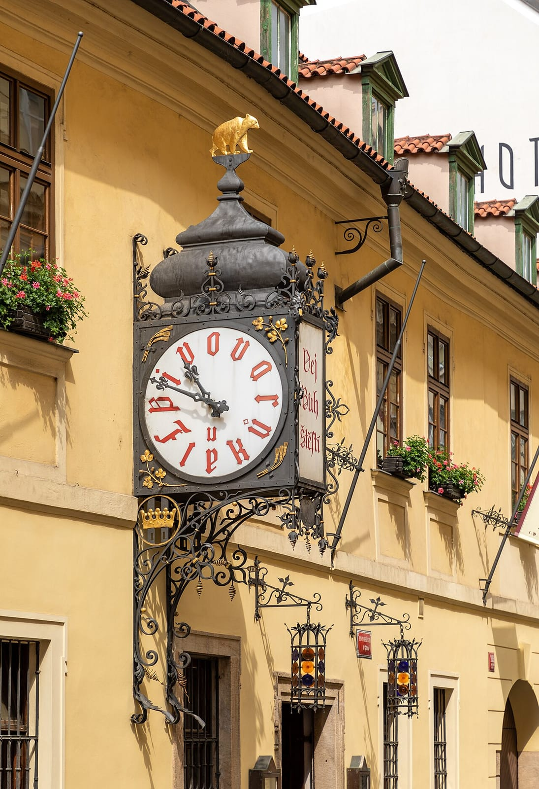
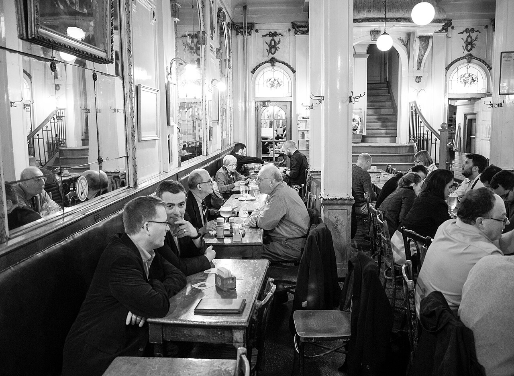

# 弗勒克啤酒屋

图：弗勒克啤酒屋。图片：Dietmar Rabich，CC BY-SA 4.0，via Wikimedia Commons（[原图页面](https://commons.wikimedia.org/wiki/File:Prag,_U_Flek%C5%AF_--_2019_--_6735.jpg)）。

## 1499 年：弗勒克啤酒屋的关键起点
弗勒克啤酒屋在布拉格新城的 Křemencova 11，离查理广场（Karlovo náměstí）不远，步行到查理大桥与老城广场大约十五分钟。1499 年，Vít Skřemenec 买下这处房产，文献第一次记载这里在酿酒；这也是品牌把 1499 年作为起点的依据。建筑地下保留更早的哥特式墙体，据布拉格旅游局的介绍，那里曾用于烘干与焙烤麦芽。

"U Fleků"这个名字来自 18 世纪买下房产的 Flekovský 家族。捷克语里 "U" 表示"在某人的地方"，所以字面意思是"在弗莱克家"。这个名字比正式商号更常用，也解释了为什么门面上写的是"U Fleků"而不是一串公司名。它常被称作"布拉格最古老的啤酒馆"或"持续经营最久的啤酒厂"，这些称号有各自的统计口径；更稳妥的说法是"有 1499 年文献记载、至今仍在原址酿酒的啤酒馆"。

19 世纪中期以后，酒馆逐渐固定为"一款深色拉格 + 捷克家常菜"的结构。今天它仍以自己的微型啤酒厂供应酒馆，酒在店里酿造，不靠外部品牌拼酒单。这种"单一酒款 + 老建筑 + 现场音乐"的组合，让它在布拉格旅游区里非常显眼，也让它同时承受"老字号"与"游客店"两种评价。

## 空间与酒单

建筑由多个厅堂与庭院组成，房间大小不一，木质护墙、拱顶与老式灯具保留下来，墙上挂着与酿酒、市民生活有关的旧物。不同房间的气氛差别很大：靠里的厅更安静，靠庭院与主通道的厅更热闹；旅行团多的时候，某个厅可能被整团占满。想安静吃饭，进门可以先看一眼各厅的情况再选座。

酒单几乎只有一款：Flekovský tmavý ležák 13°，深色、未过滤的拉格。"13°"是原麦汁浓度的捷克标注方式，不是酒精度；实际酒精度以现场标签或菜单为准。风味上，它有明显的麦芽甜、焦糖与烤面包香，苦度不高，泡沫细，温度比冰镇啤酒温和。酒直接从店内的啤酒厂供应，侍者用托盘端着小杯或大杯在桌间穿行。

食物是捷克家常菜：vepřo knedlo zelo（烤猪肉配酸菜与面包饺子）、svíčková（奶油腌牛肉配蔓越莓与奶油）、烤鸭、猪肘、香肠与土豆。分量偏大，口味偏咸，适合配深色拉格。菜单也有素食与冷盘，但第一次来最稳的仍是烤猪肉或烤鸭配饺子。具体菜式与价格以现场菜单为准。

## 第一次去怎么点

第一次来，先点一小杯深色拉格，配一份烤猪肉酸菜饺子；这是一套最能说明"这家店是什么"的组合。喝得惯再加杯，喝不惯就换矿泉水或点一份汤；不要因为"只卖一种酒"就觉得必须喝大杯。若同行者想比较，布拉格其他啤酒馆有淡色拉格与小厂季节款，可以另安排一顿。

点单时可以直接说 "tmavé"（深色）与杯型，侍者会记在桌卡上。这里的服务方式是"巡桌式"：侍者端着酒经过，可能直接把酒放到你桌上；如果你不想要，要及时、明确地说不，否则最后结账会出现你没点的杯数。结账前核对桌卡与实际杯数，是这家店最实用的一条经验。

现场常有手风琴演奏，气氛热闹，也可能很吵。想聊天选靠里的厅；想听音乐坐靠庭院的位置。音乐表演通常通过小费支持，给不给、给多少由你决定，不强制。旺季晚间与周末，旅行团多，等位与拼桌都常见。

## 弗勒克啤酒屋的地址与营业安排
**地址**：Křemencova 11, 110 00 Praha 1, Czech Republic。

**交通**：乘地铁 B 线至 Národní třída，步行约 5–6 分钟；或至 Karlovo náměstí，步行约 6–8 分钟；也可乘电车至 Myslíkova 或 Karlovo náměstí 后步行。布拉格老城适合步行，但从查理大桥过来要留出 15 分钟以上，石板路对拉行李箱不友好。具体线路与末班车以 DPP 当日信息为准。

**开放时间**：Prague City Tourism 页面列出每日 10:00–23:00。节假日、跨年与特殊活动会调整；本次访问 U Fleků 官网未返回可读正文，未能用官网二次确认，出发前请以官网或电话（+420 602 660 290）当日信息为准。

**门票与预约**：酒馆本身不收门票，按点单消费。啤酒博物馆（Pivovarské muzeum）与 Cabaret 表演需提前预订；具体票价、演出时段与是否含饮品未核验，须以官方渠道为准。散客现场找座，团体建议提前询问。

价格在布拉格属于旅游区中高水平：同样一杯啤酒，这里可能比居民区酒馆贵；食物分量大，两个人点一份主菜加两杯酒通常够。着装休闲，不需要正装。布拉格不少老店仍收现金，刷卡前先确认。

「弗勒克啤酒屋」的开放时间、价格与预约，以[官网](https://www.ufleku.cz/)的公开页面为准；核验日期为 2026-11-08，临时调整以官网当日公告为准。

## 礼仪与常见误区

第一，桌卡不是装饰。侍者会在上面记杯数，结账按记录算；看到不明项目要当场问清。第二，拼桌先问，得到允许再坐；不要把包放在整条长凳上。第三，小费不是强制，常见做法是凑整或加 5%–10%，结账时报出含小费的总额。第四，不要自带酒水与食物，也不要把酒杯带走。

常见误区有四个：把 1499 年当成"世界最古老啤酒厂"的唯一答案（不同统计口径差别很大）；以为"只卖一种酒"等于选择少、品质差；把巡桌送酒当成"强买强卖"（可以拒绝，但要明确）；把这里当成安静约会的地方。它的空间与服务是为大桌、团体与热闹的晚餐设计的。

不适合来这里的人：完全不喝深色拉格的人、怕吵的人、想安静工作的人、赶时间只想喝一杯就走的人。它更适合把它当成一顿完整的捷克晚餐，而不是"打卡喝一口"。

## 布拉格的周边街区
出门往南是查理广场与新城区的街道，往北步行可到查理大桥、老城广场与天文钟；再往西是伏尔塔瓦河与民族剧院一带。把弗勒克放在傍晚：先吃一顿捷克菜，再走到查理大桥看日落，最后去老城广场，路线顺而不绕。

布拉格旅游区的晚间人流集中在老城广场与查理大桥，弗勒克所在的 Křemencova 相对安静一点，但仍在步行范围内。安排上建议避开旅行团最集中的晚餐时段，或提前到店；如果只想喝一杯，下午比晚上更容易找到位置。若想把啤酒主题延伸，布拉格还有小型啤酒厂与啤酒馆，分散在不同城区，不必都挤在老城。

## 同城酒馆与延伸阅读
- [啤酒](ref:beer)：深色拉格在啤酒风格谱系中的位置。
- [拉格](ref:lager)：捷克与德国拉格的工艺差异。
- [酒吧与城市](ref:pub-and-city)：啤酒馆如何用座位、酒单与营业时间组织公共生活。

补充阅读：[A Ginjinha](ref:c-extra-1)、[À la Mort Subite](ref:c-extra-2)。

对照阅读：[啤酒](ref:beer)、[认识一座城，从一间酒馆开始](ref:pub-and-city)。

相关条目：[拉格啤酒](ref:lager)。

## 相关图像

图：À la Mort Subite 的室内：木镶板、镜子、长桌与布鲁塞尔老咖啡馆的拥挤气氛。图片：kishjar?，CC BY 2.0，via Wikimedia Commons（[原图页面](https://commons.wikimedia.org/wiki/File:A_La_Mort_Subite.jpg)）。关联图像：弗勒克啤酒屋。
