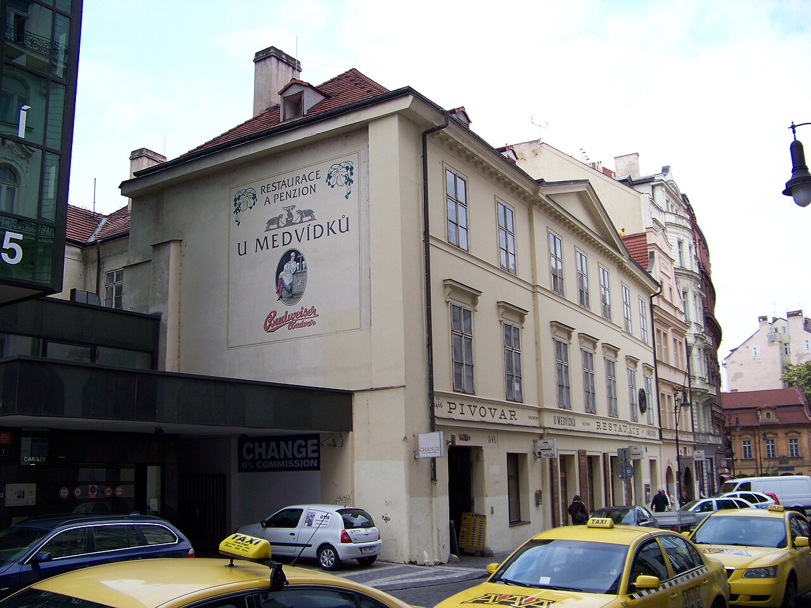

# 小熊酒馆

图：小熊酒馆。图片：ŠJů ( cs:ŠJů )，CC BY-SA 3.0，via Wikimedia Commons（[原图页面](https://commons.wikimedia.org/wiki/File:Na_Per%C5%A1t%C3%BDn%C4%9B_5,_U_Medv%C3%ADdk%C5%AF.jpg)）。

## 老城里的房子，1466 年的起点

小熊酒馆（U Medvídků）在布拉格老城边缘的 Na Perštýně 7，介于 Národní třída 与伯利恒广场之间，步行到老城广场约十分钟。它不是一个单一业态：临街是餐厅与酒馆，楼上是酒店，入口一侧是啤酒商店，后院与地下是微型酒厂。房子本身可追溯到 15 世纪初，名字来自早期业主 Jan Nedvídek，他在 1466 年开办酒厂，这一年份后来成为品牌最常引用的起点。

对布拉格人来说，“U Medvídků”首先是一个喝酒吃饭的地方，其次才是“景点”。它的位置刚好在旅游动线与居民生活区的交界：往西是 Národní třída 的剧院与商场，往东钻进小巷就进入老城的石砖路。这种位置让它既有游客，也保留本地客的日常时段。把这里和[弗勒克啤酒屋](ref:u-fleku)放在同一天，能清楚看到布拉格两类老酒馆的差别：一家只卖一款深色拉格，另一家把微型酒厂当成核心卖点。

## 从大酒馆到微型酒厂

这处房产酿酒到 1898 年。此后小酒厂无法与新建的工业啤酒厂竞争，业主们关闭作坊，合办位于 Holešovice 的城市啤酒厂；最后一位酿酒师 Karel Vendulák 成为新厂的第一任厂长。房子随后被改造成布拉格最早的大型酒馆之一，20 世纪初还开出布拉格第一家卡巴莱（tingl-tangl）表演场。

20 世纪 50 年代，房产在未获补偿的情况下被收归国有，建筑逐渐失修；1989 年之后归还给原业主的后人，随后进行大规模整修，加建了酒店。整修的最后阶段在 2005 年完成：原来的麦芽坊被改成“啤酒之家”，容纳啤酒商店、会议厅与微型酒厂。第一批酒在 2004 年 11 月 17 日完成，恰好是 velvet revolution 十五周年，这个日期是刻意选的。

## 空间与点单：酒馆、餐厅、酒店叠在一起

进门先看到的是餐厅与酒吧区，木质护墙、拱顶与老式灯具体量偏大，桌子挨得近，晚上很吵；再往里是几间小厅，适合聊天；庭院在天气好时开放。楼上是酒店，共 45 间房；另有一个约 100 个座位的剧场厅，用于卡巴莱演出。空间是叠在一起的，动线不复杂，但第一次来容易只看到门口那一间，以为店很小。

点单方式与捷克酒馆一致：坐下后报酒名与杯型，侍者记在桌卡上，最后一起结账。这里的酒全部来自店内微型酒厂，未过滤、未巴氏杀菌，所以口感比工业拉格更“厚”，也需要更注意新鲜度。菜单是捷克家常菜，烤猪肘、烤鸭、炖牛肉配面团子、香肠与酸菜都在；分量大，两个人点一份主菜加两杯酒通常够。具体菜式与价格以现场菜单为准。

## 酒单：从 13 度到 X-BEER 33

捷克用原麦汁浓度标注啤酒，“13 度”不是酒精度。Oldgott 是 13 度半深色拉格，在橡木桶中发酵与后熟，因此酒单上写“Barrique”，酒精度 5.2%；Medvídek 是 15 度淡色特酿，同样做桶内二次发酵，酒精度 6.2%；1466 是 14.66 度、双倍投花的未过滤拉格，酒精度 6.1%；Medvídkovské bílé 是 12 度小麦啤，酒精度 4.7%；Blackgott 是 14 度深色特酿，酒精度 5.8%。

真正的招牌是 X-BEER 33：官网称其为“世界最强啤酒”，在半深色拉格基础上于橡木桶中发酵 200 天，酒精度 12.6%。这类“最强”称号随纪录变化，应把它理解为酒馆的招牌产品与营销口径，而不是永久事实。它的甜感与酒精感都重，适合分杯慢喝，不适合空腹一口闷。店里的啤酒商店还卖 30 多种捷克与摩拉维亚啤酒，以及啤酒巧克力、啤酒冰淇淋与啤酒白兰地。

## 参观与预约

微型酒厂参观以“互动啤酒之旅”的名义提供，日期按需安排，需要打电话 +420 736 662 900 或发邮件到 restaurace@umedvidku.cz 预约；官网没有固定场次表，人数、语言与时长都要在沟通时确认。参观的核心不是大型发酵罐，而是“还能看到旧工艺”：250 升糖化锅、敞口发酵槽、500 升橡木桶、自然冷却与手工装瓶。年产上限只有 300 百升，规模小到可以把它当成一件仍在工作的展品。

只想喝酒吃饭的话不需要预约，直接到店找座即可；团体、啤酒品鉴套餐（官网列出的价格是每人 900 捷克克朗）与剧场演出建议提前问。这里的[拉格](ref:lager)走的是捷克低温长期储酒路线，和[比尔森啤酒厂](ref:pilsner-urquell-brewery)的工业规模形成对照：一个用规模保证稳定，一个用小车间的旧设备做风味差异。

## 实用信息与误区

**地址**：Na Perštýně 7, 110 00 Praha 1, Czechia。**交通**：地铁 B 线 Národní třída 步行约三分钟；电车 Národní třída 或 Národni divadlo 下车均可；从老城广场步行约十分钟。**开放时间**：餐厅每日 11:30–23:00，节假日可能调整。**人均**：主菜加两杯自酿啤酒大约在中档；品鉴套餐与演出另计。

三个常见误区：把“13 度”当成酒精度；以为 X-BEER 33 真是当今世界最高酒精度（纪录早已被刷新）；把这里当成安静的老酒馆（晚上有演出与团体，噪音不小）。另外，捷克酒馆常有“上不封顶”的续杯节奏，不想再喝要明确说“不用了”。想比较捷克小麦啤，可以点 Medvídkovské bílé，它与德国[小麦啤酒](ref:wheat-beer)的香蕉丁香调性相近，但酒体更薄、更解渴。布拉格所在的[捷克](ref:czechia)啤酒文化以拉格为中心，这家店的价值在于把“微型”与“旧工艺”同时保留下来。本页不列坐标，坐标以官方渠道为准。

对照阅读：[弗勒克啤酒屋](ref:u-fleku)、[拉格啤酒](ref:lager)。

相关条目：[比尔森啤酒厂：金色拉格的诞生地](ref:pilsner-urquell-brewery)。

**关键事实。**

| 项目 | 内容 |
| --- | --- |
| 一句话定位 | 布拉格老城 Na Perštýně 街上的历史酒馆、餐厅与微型酒厂，建筑酿酒史可追溯到 1466 年，以 250 升糖化锅、橡木桶后熟与 X-BEER 33 闻名 |
| 地址 | Na Perštýně 7, 110 00 Praha 1, Czechia |
| 城市/国家 | 布拉格 / 捷克 |
| 营业状态 | 已核验营业 |
| 官网 | umedvidku.cz |

**来源与边界。** 本页关于「小熊酒馆」的关键事实，主要由以下来源交叉核对：Hotel, restaurace a pivovar U Medvídků（餐厅、微型酒厂、酒店、啤酒商店与互动啤酒之旅的预约方式（电话 +420 736 662 900）；餐厅每日 11:30–23:00 的营业时间与庭院座位）、Prague City Tourism（老城步行范围与周边街区关系）。产品、地址或营业状态变化较快时，以 umedvidku.cz 的最新页面为准；价格、批次与状态会变，涉及这些字段时以页面所列来源的最新版本为准。正文为项目自写，来源只作核验，不复制原文。

**并读。** 把「小熊酒馆」与「弗勒克啤酒屋」、「比尔森啤酒厂：金色拉格的诞生地」、「拉格啤酒」放在一起读时，先确认它们是同一层级还是上下游关系：先确认地址与营业状态，再比较历史、空间与点单体验。本页负责给出场所的基本坐标，对照条目补上具体案例与差异；读完再回到本页，才能分清哪些差别属于场所本身，哪些只是产地、批次或品牌选择。
