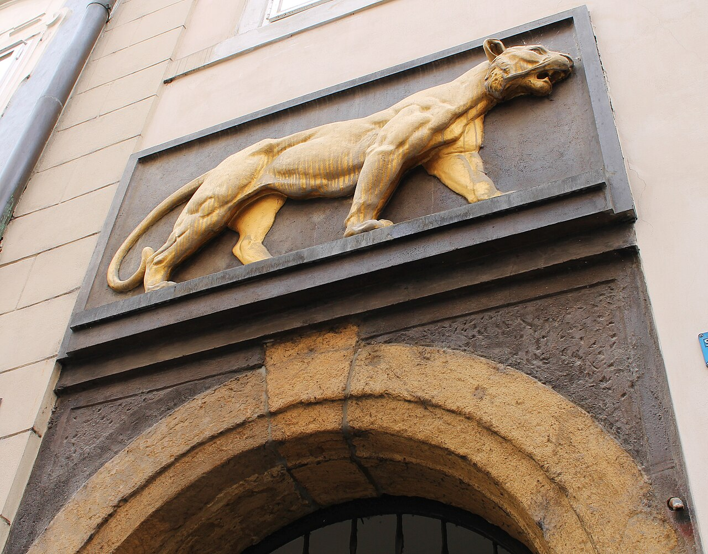

# 金虎酒馆

从布拉格老城广场往南，拐进胡索瓦街（Husova），走几分钟会看到一栋门口上方嵌着行走金虎浮雕的老房子。这里就是 U Zlatého tygra（“金虎酒馆”），布拉格最有名的啤酒馆之一。它没有斯拉维亚咖啡馆的高窗与镜面，也没有为游客设计的菜单；一张长桌、几排椅子、墙上的人物照片与不断续杯的皮尔森啤酒，构成了它的全部。

图：金虎酒馆门上的金虎市宅标志。图片：Sarah Stierch，CC BY 4.0，via Wikimedia Commons（[原图页面](https://commons.wikimedia.org/wiki/File:M%C4%9Bstsk%C3%BD_d%C5%AFm_U_zlat%C3%A9ho_tygra_-_Stierch.jpg)）。

## 1816–1994：金虎酒馆的历史节点
金虎所在房屋的历史可追溯到 14–15 世纪，与布拉格老城最珍贵的建筑群之一——昆什塔特与波杰布拉迪领主宫——相连。房屋旧名包括“黑虎”“挖土人”“克拉夫特家”，哥特式地窖的平面保留了文艺复兴与巴洛克改建的痕迹。18 世纪初，房子有了“金虎”店标；今天门口上方那块行走老虎浮雕，就是这一传统的延续。把“房屋历史”与“酒馆开业”分开看很重要：房子有 600 多年，酒馆作为啤酒馆的记载则晚得多。

19 世纪上半叶，这里是布拉格民族复兴运动者的聚会场所。官方历史提到，1816 年城市记录里已出现“啤酒厅”的记载；1830 年代，这里是有名的“Šochov 与 Šmiler 爱国咖啡馆”，房间像一间阅览室，马哈、蒂尔、帕拉茨基、萨宾纳、切拉科夫斯基等捷克民族复兴代表人物在此读欧洲杂志、交换政治与文化消息。后来咖啡馆变成啤酒馆，啤酒用深色陶罐从地窖打上来。这个转变说明，金虎的“文学性”最初来自咖啡馆与阅览室，而不是啤酒本身。

20 世纪，金虎的民主传统延续下来。战后，捷克演员、歌手与艺术家常坐在靠墙的长凳与长桌旁；入口右侧的桌子属于“金布拉格知识分子俱乐部”（Club of intelligence "Golden Prague"），成员包括画家、雕塑家、医生、经济学家与艺术工作者。俱乐部的终身主席是作家博胡米尔·赫拉巴尔（Bohumil Hrabal），他通常坐在靠后、靠近厨房入口的那张桌子。赫拉巴尔把这里当作会友的地方，也当作“创作工坊”；他的作品被译成 29 种语言，金虎因此成为布拉格文学地图上的一个点。

1994 年 1 月，哈维尔带美国总统克林顿到金虎喝啤酒；这件事后来被反复提起，成为“啤酒馆可以接待国家元首”的证明。官方历史还记着一段更早的轶事：法国总理赫里欧在战前隐姓埋名来喝酒，发现邻桌坐着议会主席、行政法院院长、画家与殡葬灯制造商，最后感叹“民主不在法国，在这里”。这些故事有传奇成分，但它们共同说明：金虎不是“高级场所”，而是一个把不同阶层放在同一张长桌上的地方。

## 空间与酒单

金虎的空间是“窄、旧、挤、热闹”。进门是一条窄通道，里面是长桌与靠墙长凳，墙上挂着赫拉巴尔、演员、画家与常客的照片；没有背景音乐，也没有菜单设计。桌子不按人数分配，陌生人拼桌是常态；坐下前点头示意，走时把椅子推回。卫生间在后方，地面旧、光线暗，别期待现代酒吧的整洁。

酒单极短：皮尔森乌尔奎尔（Pilsner Urquell）12° 啤酒，半升杯，泡沫厚、苦味干净；也有少量其他饮料与烈酒，但来这里的人几乎都点皮尔森。啤酒温度与打酒方式由酒馆控制，侍者会连续端杯，直到你用手势或账单示意停止。不要要求“试喝几款”或“推荐精酿”；这里不是精酿酒吧，单一品牌就是它的立场。

食物是捷克下酒菜：猪颈肉配面包与芥末、腌香肠、酸菜、土豆、烤面包、奶酪与洋葱。分量不大，适合配酒；想吃正餐，去附近的餐厅，不要在金虎点“完整晚餐”。价格按杯与按盘计算，属于布拉格老城中等偏低；只收现金是长期习惯，近年来可能支持刷卡，但不要假设一定可以。

## 第一次去怎么点

进门自己找空位，看到长桌有空位就坐下，先问一句“这里可以坐吗”；不要站在门口等带位。坐下后侍者会问你要几杯啤酒，直接说“一杯”或“两杯”，不要先看菜单半小时。啤酒端上来后，先喝一口，再决定是否续杯；不想喝了，把杯子往前推一点或用手势示意，侍者会懂。想尝食物，点猪颈肉或香肠配面包，够两个人下酒。

时段上，下午三点开门，前两小时最安静，常客与本地人多；傍晚六点后上班族与游客混在一起，声音变大；晚上九点后接近打烊，气氛更松。赫拉巴尔的桌子通常有预约或常客占用，不要为了拍照去坐；如果空着，先问侍者。克林顿来访的照片在墙上，但店内没有“克林顿套餐”，不要向侍者点“总统同款”。

费用与礼节：啤酒按杯计价，食物按盘计价；账单会写在纸上或口头报给你，小费通常按 5%–10% 留在桌上。只收现金时，提前在 ATM 取好捷克克朗；不要用欧元支付，汇率会吃亏。拼桌时不要把别人的杯子挪开，也不要把自己的外套放在邻座。

## 金虎酒馆的地址与营业安排
**地址**：Husova 17, 110 00 Praha 1, Czechia。从老城广场步行约 5 分钟；门牌在胡索瓦街，门口上方有金虎浮雕。看到“U Zlatého tygra”与窄门就对了。

**交通**：地铁 A 线 Můstek 站或 B 线 Národní třída 站，步行 8–10 分钟；电车到老城广场周边后步行。胡索瓦街是步行街，车辆不能停在门口；最近的下车点在民族大街或老城广场。

**营业时间**：每天 15:00–23:00；节假日可能调整，以官网或门口告示为准。`operating_status` 记为 `verified`，表示官网在 2026-11-20 仍显示营业；这不等于每天一定开门。电话 +420 222 221 111，可用于团体或特殊情况咨询。

**预订**：金虎通常不接受普通散客预订，长桌与拼桌为主；团体、赫拉巴尔桌位与特殊活动可以电话询问。没有 dress code，穿日常衣服即可；带小孩可以，但环境吵、空间窄，婴儿车不方便。

**价格**：啤酒与下酒菜属于布拉格老城中等偏低；具体价格以菜单或侍者报价为准。现金优先，刷卡可能受限；小费另计。不要在店内用大额欧元现钞找零，汇率与找零都不划算。

页面核验日期 2026-11-20；营业时间、价格与支付方式以官方渠道为准。

## 礼仪与常见误区

第一，不要把金虎当成“赫拉巴尔博物馆”；它是仍在营业的啤酒馆，常客在吃饭、喝酒、看报，不是展品。第二，不要为了拍照去占赫拉巴尔的桌子；那张桌子有常客与俱乐部的使用习惯，空着也要先问。第三，不要要求“多种啤酒试喝”；金虎以单一皮尔森品牌为立场，菜单极短，点一杯就够。

常见误区还有三个。其一，把“房屋 14 世纪”当成“酒馆 14 世纪开业”；房子老，酒馆作为啤酒馆的记载晚得多。其二，以为“只收现金”是绝对规则；长期习惯如此，但支付方式可能变化，进门先看一眼柜台标识。其三，以为“拼桌不礼貌”；在金虎，拼桌是常态，拒绝拼桌反而少见。

不适合来这里的情况：想安静吃一顿正餐的人；不喝啤酒的人；对拥挤、噪音与旧环境敏感的人。它适合“下午喝一杯、吃一点下酒菜、看本地人聊天”的场景，也适合想感受布拉格啤酒馆文化的人。

## 布拉格的周边街区
金虎在胡索瓦街，往北是老城广场与天文钟，往南是民族大街与斯拉维亚咖啡馆，往西是查理大桥方向。把金虎放在“老城广场—胡索瓦街—民族大街”这条线上：下午三点先喝一杯，四点去老城广场，六点到斯拉维亚吃晚餐或喝咖啡。走路约 20 分钟，不需要交通工具。

若想把“啤酒”作为主题，可以再去附近的乌弗莱库（U Fleků）或老城其他啤酒馆；金虎更小、更本地，乌弗莱库更旅游化、更有表演性。两家不要安排在同一晚，否则味觉与体验都会疲劳。

胡索瓦街窄，门口常有人站着喝酒，拍照要避让；晚上老城游客多，注意钱包与手机。若遇到门口有团体包场或拍摄，不要强行进入，改天再来。

## 同城酒馆与延伸阅读
- [酒吧与城市](ref:pub-and-city)：啤酒馆如何用长桌、拼桌与营业时间组织公共生活。
- [斯拉维亚咖啡馆](ref:slavia)：布拉格另一处文学与政治记忆，适合与金虎的“啤酒馆”气质对照。
- [皮尔森啤酒](ref:pilsner)：金虎只卖的这一类啤酒，了解它的苦味与泡沫。
- [啤酒](ref:beer)：从原料、发酵与侍酒方式理解啤酒馆文化。
- [哈维尔卡咖啡馆](ref:hawelka)：维也纳的家族咖啡馆，另一种“作家常客”传统。

相关条目：[认识一座城，从一间酒馆开始](ref:pub-and-city)、[斯拉维亚咖啡馆](ref:slavia)、[皮尔森啤酒](ref:pilsner)。
