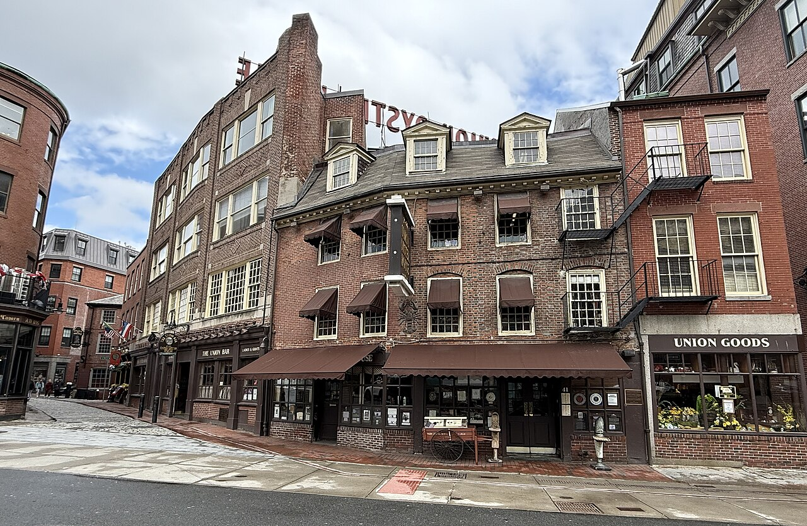

# 联合牡蛎屋

从波士顿 Faneuil Hall 往 Union Street 走，砖红色建筑群里有一栋三层半的乔治式老楼，门口挂着“est. 1826”的招牌，橱窗里摆着牡蛎壳与旧照片。这就是联合牡蛎屋（Union Oyster House）。它常被称作“美国连续营业最久的餐厅”，也是 Freedom Trail 上最容易“误以为只是游客店、结果发现真在营业”的一站：楼上是历史，楼下是真正在剥牡蛎、煮龙虾、端浓汤的餐厅。

图：波士顿 Union Street 的 Union Oyster House 砖砌立面与入口；餐厅 1826 年开业，所在建筑的历史可追到 18 世纪，照片不是 1826 年开业当天的原貌。图片：Seasider53，CC BY 4.0，via Wikimedia Commons（[原图页面](https://commons.wikimedia.org/wiki/File:Union_Oyster_House_2025.jpg)）。

## 1826 年：联合牡蛎屋的关键起点
联合牡蛎屋的官方历史把 1826 年当作餐厅起点：那一年，Capen 干草店结束营业，Atwood & Bacon 在这里开出一间牡蛎屋。建筑本身比餐厅老得多。官方说这栋楼在 Union Street 上已经站了 250 多年，但波士顿市府没有留下明确的建造记录；国家公园管理局与地方史料通常把主体追溯到 18 世纪上半叶。也就是说，“1826”是餐厅开业的年份，不是这栋楼诞生的年份，两者不能混写。

这栋楼在 18 世纪还做过别的生意。独立战争前后，Isaiah Thomas 的《Massachusetts Spy》曾在这里印刷；后来它成为干草与布匹商店，再后来才变成牡蛎屋。1826 年开张时，波士顿港的牡蛎供应充足，Union Street 又靠近码头与市场，生蚝、鱼和贝类自然成为主打。今天仍保留的半圆形牡蛎吧台，就是那个时代“站在吧台边快速吃一打生蚝”的空间遗存。

19 世纪的联合牡蛎屋是政治与商业的会面点。丹尼尔·韦伯斯特（Daniel Webster）常来这里吃牡蛎、喝白兰地；据说他一次能吃掉六打生蚝，再配一杯烈酒。这个数字未必精确，但它说明了餐厅在波士顿精英与港口工人之间的跨界位置。20 世纪，肯尼迪家族常在此用餐，楼上的“Kennedy booth”（肯尼迪包间）后来成了游客拍照点。2003 年，这栋建筑被列为 National Historic Landmark；2026 年，餐厅迎来 200 周年。

“美国牙签起源”是另一个常被提起的故事：19 世纪，Charles Forster 在缅因州生产牙签，为了打开美国市场，据说他雇哈佛学生到联合牡蛎屋吃牡蛎、故意要求牙签，从而让这种小木签流行起来。这个故事在地方史料与餐厅叙述中流传很广，但缺少完整的商业档案；把它当作“传说”而非已证实的单一事件更稳妥。

## 空间与酒单

餐厅占着一栋窄而深的老楼，进门后是忙碌的前厅，往里有通往楼上的木楼梯。最醒目的空间是半圆形牡蛎吧台：弧形的木质台面围着一圈高脚凳，吧台后面是剥蚝工位，生蚝按产地与大小排列。楼上更安静，桌距较宽，适合正餐；楼下靠近吧台的位置更适合一个人或两个人快速吃生蚝、喝一杯。

菜单以波士顿港口传统为主：生蚝与蛤蜊、龙虾（清蒸或水煮）、新英格兰浓汤、鱼排、龙虾卷，以及印第安布丁（Indian pudding）一类的老式甜点。酒单不算复杂，以啤酒、葡萄酒和经典鸡尾酒为主；吧台有生啤与瓶装啤酒，也可以点一杯马天尼或威士忌。这里不是“创意料理”餐厅，优势在于食材新鲜、做法传统、空间有历史感；若期待复杂的现代摆盘，可能会失望。

## 怎么喝

吃生蚝时，先问吧台今天有哪几种、产地与大小如何，再决定要半打还是一打。新英格兰风格通常配柠檬、辣酱或 mignonette（红酒醋葱汁），不需要把每种酱都加一遍；先尝一只原味，再按口味加。想喝得清爽，选一杯干型白葡萄酒、拉格或淡色艾尔；想配浓汤与龙虾，奶油感较强的白葡萄酒或琥珀色啤酒更合适。

若只想来一次“历史体验”，可以安排在工作日下午：点半打生蚝、一碗浓汤、一杯啤酒，坐在吧台看剥蚝，比楼上正餐更接近这间店的日常。正餐时段建议提前订位；周末与旅游旺季，门口排队会很长，吧台通常比桌位更容易等到。

## 联合牡蛎屋的地址与营业安排
地址是 41 Union Street, Boston, MA 02108。它就在 Freedom Trail 上，离 Faneuil Hall 与 Quincy Market 一个街区，最近的地铁站是 State Street 与 Government Center。营业时间通常为周日至周四 11:00–21:00、周五至周六 11:00–22:00，酒吧供应到午夜；节假日与私人活动会调整，以官网为准。

餐厅接受预订，正餐与团体建议提前订；吧台与部分散座不接受预订，先到先得。美国法定饮酒年龄为 21 岁，点酒需带证件。着装没有硬性要求，但它是正式餐厅与历史地标的混合体，晚餐时段穿商务休闲更合适。小费按税前 18%–20% 是常规；生蚝吧台若得到剥蚝师的特别服务，可以适当多加。

## 礼仪与常见误区

第一个误区是把“1826”当成“建筑建于 1826”。餐厅 1826 年开业，建筑主体可追到 18 世纪，二者相差近百年。第二个误区是把“美国最老连续营业餐厅”当成完全没有争议的纪录；更稳妥的说法是“常被称为连续营业最久的餐厅之一”，并说明它自 1826 年以来一直在 Union Street 这个地址经营。第三，生蚝不是“越大越好”：大小、产地与季节决定风味，先问吧台再点。第四，不要把肯尼迪包间当成随时可坐的普通桌；它通常需要预订或有最低消费，具体以餐厅安排为准。第五，这里是营业中的餐厅，拍照不要挡住端菜通道，也不要长时间占用吧台座位只拍照不点单。

## 从联合牡蛎屋延伸到钟声酒馆
从餐厅出来，往北两步就是 Faneuil Hall 与 Quincy Market，往南可到 Rose Kennedy Greenway 与海港，往西沿 Freedom Trail 走到 Boston Common。把联合牡蛎屋与[钟声酒馆](ref:bell)排在同一条 Union Street 步行线上最顺：先吃生蚝，再去酒馆喝一杯，或者反过来。想理解波士顿港口与糖蜜贸易的另一面，可以读[波士顿糖蜜洪水](ref:molasses)；想比较美国东北部的老酒馆与老餐厅，可以读[麦所利老啤酒屋](ref:mcsorleys)、[酒馆史](ref:taverns)与[认识一座城，从一间酒馆开始](ref:pub-city)。

## 参考资料
- [钟声酒馆](ref:bell)
- [麦所利老啤酒屋](ref:mcsorleys)
- [波士顿糖蜜洪水](ref:molasses)
- [酒馆史：从酒肆、客栈到酒吧](ref:taverns)
- [认识一座城，从一间酒馆开始](ref:pub-city)

本页于 2026-11-21 核对 Union Oyster House 官方页面。营业时间通常为周日至周四 11:00–21:00、周五至周六 11:00–22:00，酒吧供应到午夜；正餐建议订位，吧台与部分散座先到先得。1826 年是餐厅开业年，建筑主体可追到 18 世纪；“美国最老连续营业餐厅”与生蚝大小、肯尼迪包间的规则，正文已保留限定。本页图片是波士顿 Union Street 的联合牡蛎屋砖砌立面与入口，不是牡蛎吧台；图注已标摄影者与许可，文字许可见文末 rights 字段。

对照阅读：[钟声酒馆](ref:bell)、[波士顿糖蜜洪水 1919：一场工业酒精原料的灾难](ref:molasses)。

## 相关图像

图：1919 年 1 月 15 日糖蜜洪水后，波士顿北端高架铁路下的废墟。图片：BPL，Public domain，via Wikimedia Commons（[原图页面](https://commons.wikimedia.org/wiki/File:BostonMolassesDisaster.jpg)）。关联图像：联合牡蛎屋。
