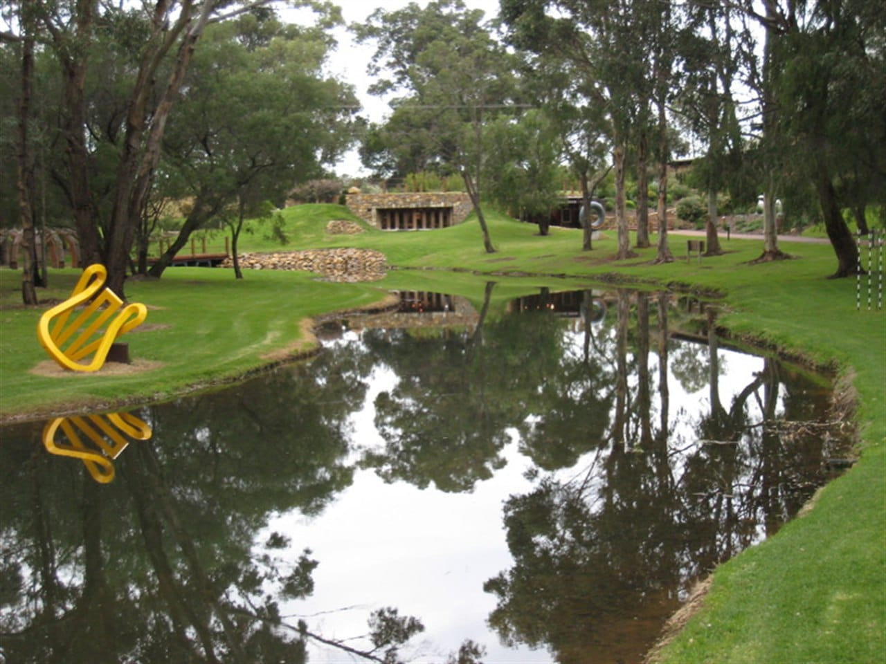

# 法塞尔酒庄

法塞尔是玛格丽特河第一个葡萄园与酒庄，1967 年由 Tom Cullity 在 Wilyabrup 种下第一批葡萄；它以赤霞珠、霞多丽和传统法起泡酒式的严谨酿造建立声誉，今天同时是酒庄、餐厅、美术馆与葡萄酒博物馆。

图：Vasse Felix：Vasse Felix Winery（Wikimedia Commons）。图片：Mark Pegrum，CC BY-SA 2.0，via Wikimedia Commons（[原图页面](https://commons.wikimedia.org/wiki/File:Vasse_Felix_Winery.jpg)）。

> **先给结论**
> **一句话：** 这页判断法塞尔酒庄值不值得专程去，以及到访前要核对什么。
>
> - **适合谁：** 正在计划去法塞尔酒庄、想知道值不值得专程安排半天到一天的人。
> - **不适合谁：** 只想要“必去榜单”、不准备核对预约、交通和开放时间的人。
> - **先看这两点：**
>   - 酒庄的参观核心是 cellar door、餐厅、美术馆与 The Vault 葡萄酒博物馆。
>   - 法塞尔位于西澳大利亚玛格丽特河产区北部的 Wilyabrup，距印度洋约四公里，距玛格丽特河镇约十五分钟车程。

## 1967 年：法塞尔酒庄的关键起点
法塞尔位于西澳大利亚玛格丽特河产区北部的 Wilyabrup，距印度洋约四公里，距玛格丽特河镇约十五分钟车程。酒庄的正式地址在 Cowaramup 的 Bussell Highway，入口从 Caves Road 转入以创始人命名的 Tom Cullity Drive；葡萄园、发酵间、酒窖、餐厅与美术馆集中在同一片坡地上，参观动线很短，却足以看清一座酒庄从葡萄到餐桌的完整链条。

1967 年，医生 Thomas Brendan Cullity 在 Wilyabrup 买下土地并种下葡萄，目标不是做一门稳赚的生意，而是证明这片靠近海洋、土壤贫瘠的地方能够酿出好酒。1972 年，法塞尔出产了玛格丽特河第一批严肃的葡萄酒：一款赤霞珠与马尔贝克混酿，以及一款雷司令。这个年份被视为产区商业酿酒的开端，也让“玛格丽特河可以酿出世界级红酒”从假设变成了可以品尝的事实。

此后的市场反馈来得很快。1973 年，法塞尔的赤霞珠在珀斯葡萄酒展拿到金牌；1979 年在纽约贸易展获得第二名，1985 年在伦敦贸易展被评为最佳红酒。对一个 1960 年代才起步的偏远产区来说，这些奖项不只是荣誉，也是对外部资本与消费者的证明。1987 年，Holmes à Court 家族接手酒庄，随后把重心逐渐收拢到玛格丽特河最擅长的两个品种：赤霞珠与霞多丽。

这段历史常被简化成“1967 年创立”，但真正塑造今天法塞尔的是三次选择：1970 年代用赤霞珠证明产区潜力，1980 年代由新业主重新定位品牌，2000 年代把酿酒与葡萄园管理专业化。理解这三次选择，比记住一串年份更能解释为什么法塞尔的酒单同时有旗舰款、单一园与入门款，也解释了它为什么在旅游与餐饮上投入如此之多。

## 葡萄园与风土

法塞尔目前围绕三片专门选择的葡萄园组织生产，核心是 1967 年种下的 Home Vineyard。它位于 Wilyabrup 的坡地上，距海约四公里，海风带来更长的成熟期；土壤是排水良好的砾石壤土，表层较瘦，根系必须往下扎。园中最老的一批赤霞珠与马尔贝克被称为 Tom’s Plots，是酒庄最珍贵的材料，也是 TOM CULLITY 这款旗舰酒的来源。

1998 年种下的 Adams Road Vineyard 位于更温暖的 Carbunup 一带，面积约 147 公顷，土壤以深红壤、砂壤土、砾石与黏土为主。这里的目标不是复制 Home Vineyard 的紧张感，而是提供更成熟、更圆润的果实，用于 Filius 与 Classic Collection 等更容易日常饮用的酒款。两片园子的差异，正好说明玛格丽特河并不是一个均匀的产区：离海距离、坡向与土壤，足以让同一品种呈现两种性格。

品种结构以赤霞珠为主，另有马尔贝克、小维多、西拉、霞多丽、长相思与赛美蓉。法塞尔保留了一批源自 19 世纪传入西澳的 Houghton 赤霞珠老克隆，种在自根砧上；这批材料以黑醋栗、浆果与细腻单宁著称，是玛格丽特河赤霞珠风格的重要基因来源。酒庄的葡萄园管理强调土壤健康、生物多样性与长期 vine longevity，并取得 Sustainable Winegrowing Australia 认证。

## 酿造与酒款

法塞尔的酿酒哲学可以概括为“少干预，但精确控制”。赤霞珠通常小批次野生酵母发酵，浸渍时间可长达三十天，随后用篮式压榨，进入法国橡木桶陈酿十二到十八个月。酒庄也试验大橡木桶、混凝土与陶罐，用不同容器比较氧化、纹理与果味表达；这些试验不会全部进入市售酒款，却解释了为什么同一片园的赤霞珠会有不同版本。

酒款结构大致分三层。最上层是 TOM CULLITY 赤霞珠马尔贝克与 Heytesbury 霞多丽、赤霞珠：前者来自 1967 年的原始植株，后者是酒庄对玛格丽特河经典风格的长线表达。中层是 Premier 系列，通常来自更明确的地块或克隆选择，风格更集中；入门层是 Filius 与 Classic Collection，果实来自 Adams Road 等较温暖地块，目标是易饮、稳定与适合餐厅日常销售。

法塞尔的霞多丽通常有清晰的柑橘、白花与榛子气息，酸度明亮，橡木使用克制；赤霞珠则以黑醋栗、黑莓、雪松与石墨为骨架，单宁细密，陈年后会出现烟草、皮革与雪松木香。这里的“旗舰”不是靠酒精度或新桶堆出来的，而是靠果实成熟度、酸度完整度与单宁质地。也正因为如此，法塞尔的酒在年轻时不一定最讨喜，却常有更长的陈年曲线。

## 参观与空间

酒庄的参观核心是 cellar door、餐厅、美术馆与 The Vault 葡萄酒博物馆。cellar door 每天开放，通常从上午十点到下午五点；餐厅中午到下午三点，耶稣受难日、圣诞节与节礼日闭馆。品鉴、餐厅与导览最好提前预约，团体与私人品鉴需要单独安排；收获季或周末，walk-in 的等待时间会明显变长。

建筑与空间值得慢慢看。发酵间、地下酒窖与品鉴室之间的动线，展示的是一条真实的生产链，而不是主题公园式的布景；美术馆与博物馆则把酒庄历史、酒标、旧设备与产区记忆放在一起。参观时注意工作区与游客区的边界：发酵间、酒窖和葡萄园作业区不是随时开放的拍照点，遇到收获季更要先问工作人员哪些区域可以进入。

如果只安排一次品鉴，建议先从一款入门霞多丽或 Filius 赤霞珠建立基准，再试 Premier 与旗舰款。这样你能喝出果实来源、桶陈与陈年潜力带来的差异，而不是被“旗舰”两个字直接带走。餐厅适合把酒与当地食材放在一起：玛格丽特河的海鲜、羊肉、奶酪与橄榄油，都能让酒的结构更清楚。

## 「法塞尔酒庄」的上桌方式
法塞尔的赤霞珠适合配红肉与带香料的菜：烤羊排、炖牛肉、鹿肉、黑椒与迷迭香调味都很稳；赤霞珠的单宁与酸度能切开油脂，黑醋栗与雪松味也能接住烤肉的焦香。霞多丽适合海鲜、白肉、奶油酱与蘑菇，但法塞尔的霞多丽酸度不低，配太重口的奶油酱时要注意平衡。入门 Filius 更适合日常餐桌， flagship 则适合有明确陈年计划的场合。

饮用温度上，赤霞珠大约十六到十八摄氏度，霞多丽大约十到十二摄氏度；温度太高会让酒精与苦味突出，太低则把香气关住。赤霞珠开瓶后可以先倒一小杯，等二十到三十分钟再判断；法塞尔的酒通常不需要长时间暴力醒酒，过度氧化反而会削弱酸度与果味。若在餐厅点酒，先问侍酒师这款酒来自哪片园、哪一年份，再决定是否加酒。

## 法塞尔酒庄的地址与营业安排
从玛格丽特河镇自驾到法塞尔约十五分钟，从 Bussell Highway 转入 Caves Road 后再进 Tom Cullity Drive；酒庄有停车位，但周末与活动日会比较紧张。品鉴、餐厅与美术馆可以排成半日，若加午餐与葡萄园散步，建议留三到四小时。不要把它和 Leeuwin Estate、Cape Mentelle 等酒庄硬塞进同一个半天；玛格丽特河的点与点之间看着近，实际车程、预约与品鉴时间很容易超预算。

开放时间、餐厅菜单、品鉴费用与预约规则都会变化，出发前以酒庄官网为准。带小孩或长辈同行时，先确认餐厅是否有儿童座椅、无障碍通道与休息区；葡萄园土路与石阶不一定适合推车。若遇到闭馆或临时取消，先查官网与电话，不要按旧攻略硬闯；把附近村庄或另一家酒庄写进备选，行程才不会被一个点拖住。

## 礼仪与常见误区

酒庄不是主题公园。按预约时间到达，穿能走葡萄园的鞋，不在工作区拍照，不碰设备，不把品鉴杯带走；带大型团体或小孩时，先问清楚是否接待。品鉴时把酒吐进吐酒桶是专业礼仪，不是失礼；如果开车，最好只喝一两杯，或者直接选择打包带走。

最常见的误区是把“法塞尔”只当成一个拍照点。它首先是一座仍在运转的酒庄：葡萄园、发酵间、酒窖与餐厅彼此相连，参观时要尊重生产节奏。另一个误区是把 Heytesbury、TOM CULLITY 与 Filius 当成同一层级；它们分别对应旗舰、单一来源与入门定位，价格与陈年潜力不同，不能只用“法塞尔”三个字概括。

## 从法塞尔酒庄延伸到玛格丽特河
法塞尔适合作为玛格丽特河北部路线的第一站：从酒庄出发，可以继续往南到 Leeuwin Estate、Cape Mentelle 或 Margaret River 镇，也可以往北接 Cowaramup 与 Gracetown 的海岸。若只有一天，建议“法塞尔 + 一家对照酒庄 + 午餐”，不要排四个点；法塞尔的建筑、美术馆与餐厅本身就需要时间，赶场会让体验变浅。

如果想把酒庄与产区一起理解，可以在法塞尔看历史与旗舰风格，再去一家更小、更家庭化的酒庄看另一种经营方式。玛格丽特河的“产区风格”不是一句口号，而是由离海距离、土壤、克隆、产量与桶陈共同组成的一组选择；把两家酒庄放在一起比较，比记住十个酒名更有用。

相关条目：[玛格丽特河](ref:margaret-river)、[澳大利亚](ref:australia)、[霞多丽](ref:chardonnay)。

## 参考资料
- 相关条目：[margaret-river](ref:margaret-river)、[australia](ref:australia)、[chardonnay](ref:chardonnay)、[cabernet-sauvignon](ref:cabernet)、[oak-ageing](ref:oak)。
- 本页不提供实时价格、菜单或营业状态；参观前以酒庄官网与产区协会为准。
- 想比较法塞尔的不同层级，最直接的方法是同一趟品鉴里选 Filius、Premier 与 TOM CULLITY 各一款，记录果味、酸度、单宁与桶味的差异。
