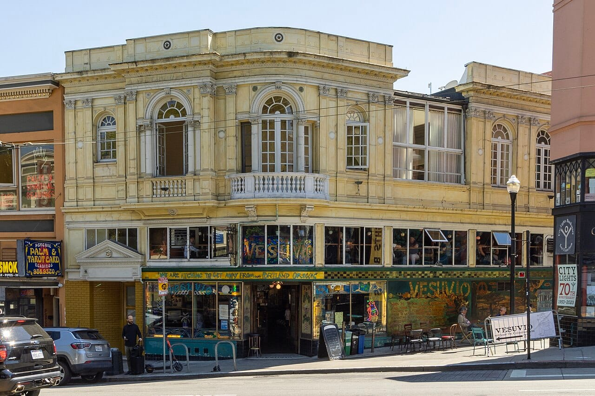
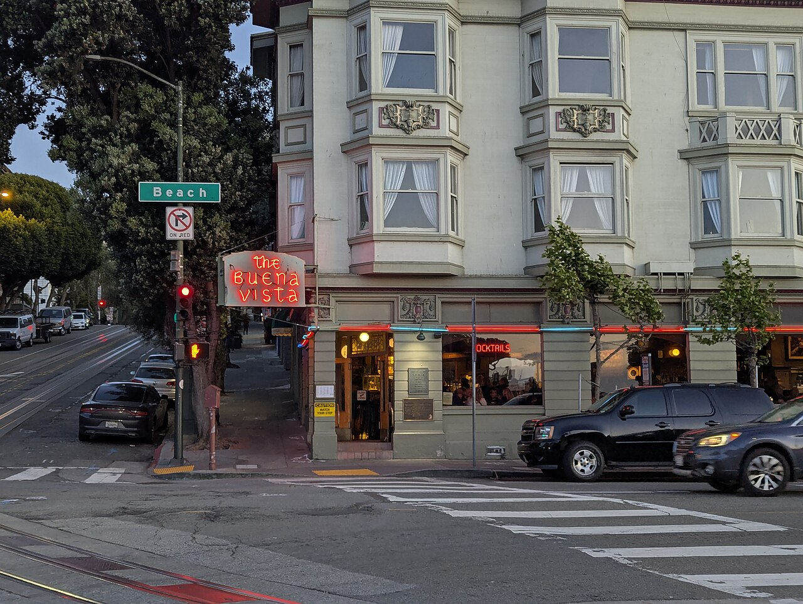

# 维苏威咖啡馆

旧金山 North Beach 的 Columbus Avenue 上，有一栋窄得像船头的三角建筑，底层是酒吧，门口上方挂着“Vesuvio”的招牌，侧面是彩绘玻璃与壁画。它对面就是 City Lights 书店，中间隔着一条窄巷——Jack Kerouac Alley。很多人把这里当作“Beat Generation 圣地”来打卡，但维苏威（Vesuvio Café）首先是一间仍在营业的社区酒吧：下午有人独自看书，傍晚有人站在吧台聊天，晚上则挤满游客与本地人。

图：旧金山 North Beach 的 Vesuvio Café 立面与招牌；酒吧 1948 年由 Henri Lenoir 开办，与 City Lights 书店隔 Jack Kerouac Alley 相望，照片为 2023 年街景。图片：The wub，CC BY-SA 4.0，via Wikimedia Commons（[原图页面](https://commons.wikimedia.org/wiki/File:Vesuvio_Cafe,_San_Francisco_2023-07-20.jpg)）。

## 1948 年：维苏威咖啡馆的关键起点
维苏威 1948 年开业，创办人是 Henri Lenoir。他不是典型的酒吧老板，而是一个法国-瑞士背景的艺术爱好者，喜欢把画家、作家、音乐家和“任何有趣的人”聚在一起。酒吧所在建筑更老：1913 年由意大利建筑师 Italo Zanolini 设计，属于意大利文艺复兴复兴风格，1918 年做过改造。Lenoir 接手后，把画作挂满墙面，装上演剧用品店买来的灯具，酒单保持简单——葡萄酒、啤酒、基本鸡尾酒，不靠复杂调酒吸引人。

1950 年代，Beat Generation 的作家开始把这里当作据点。Jack Kerouac、Allen Ginsberg、Neal Cassady 与 Lawrence Ferlinghetti 都曾在此出现；Ferlinghetti 在 1953 年开出 City Lights 书店，就在隔巷的对面。1955 年 10 月 7 日，Ginsberg 在 Six Gallery 首次朗诵《Howl》，据说朗诵会后的人群过街来到 Vesuvio 继续喝酒、争论。这个故事的具体细节有不同版本，但“朗诵会—City Lights—Vesuvio”这条文学动线，确实塑造了 North Beach 的文化身份。

酒吧与书店之间的巷子原来叫 Adler Alley，1988 年改名为 Jack Kerouac Alley；2007 年改造为步行街，地上刻着作家语句，墙上画有壁画。今天从 Vesuvio 门口穿过去，就是 City Lights 的橱窗；这种“一条巷子连接酒吧与书店”的空间关系，比任何文学纪念碑都更直接。

## 空间与酒单

维苏威的空间窄而深，进门是吧台，靠墙有高脚桌与卡座，二楼还有一个小区域。墙面几乎被画作、海报、旧照片与彩绘玻璃填满；光线偏暗，白天靠窗边才有自然光。它不是大型酒吧，座位不多，人多时走道会很挤；也正因为空间小，吧台与客人之间的距离很近，容易聊天。

酒单以经典鸡尾酒与意大利风格调酒为主：Vesuvio Americano（Aperol、Montenegro、苏打水、橙片）、House Boulevardier（波本、Carpano Antica、Select Aperitivo）、Breakfast Martini、Strawberry 75 等，也有啤酒、葡萄酒与简单高球。酒吧不供应正餐，只有少量零食或附近餐厅外送；若想吃饭，North Beach 周边有大量意大利餐厅。这里不收门票，也没有固定演出，日常以喝酒与聊天为主。

## 怎么喝

第一次来，建议下午到傍晚来，先沿 Jack Kerouac Alley 走一遍，看看书店与壁画，再进酒吧点一杯 Vesuvio Americano 或 House Boulevardier。Americano 酒精度低、气泡感强，适合白天；Boulevardier 更浓，适合傍晚。想喝经典，可以点威士忌高球或干马天尼，吧台会按传统比例做。

维苏威的体验不在“打卡清单”，而在“停留”：找靠窗的位置，带一本书，或者与吧台聊几句 North Beach 的变化。晚上与周末人多，想安静就别在那个时段来。若想听文学故事，不要要求店员表演“Beat 诗人”；他们更愿意聊今天的酒单与街区生活。

## 维苏威咖啡馆的地址与营业安排
地址是 255 Columbus Avenue（@ Jack Kerouac Alley），San Francisco, CA 94133。它位于 North Beach，步行可达 City Lights、Washington Square、Coit Tower 与唐人街。官方营业时间：周日到周四 11:00–01:00，周五至周六 11:00–02:00；节假日会调整。

酒吧通常不接受预订，先到先得；美国法定饮酒年龄 21 岁，点酒需带证件。没有着装要求，但 North Beach 晚上风大，带外套比穿短袖实用。小费按每杯 1–2 美元或账单 18%–20% 给。周边停车困难，建议步行、公交或网约车；不要把车停在居民车位或消防通道。

## 礼仪与常见误区

第一个误区是把维苏威当成“Beat 博物馆”；它是营业中的酒吧，文学历史是背景，不是展品。第二个误区是把 City Lights 与 Vesuvio 的关系说成“同一家”；两家独立经营，只是隔巷相望。第三个误区是只拍 Jack Kerouac Alley 而不消费；巷子是公共空间，但酒吧座位优先给客人。第四，不要堵塞巷口与书店门口；这里是居民与商户共用的通道。第五，不要复述未经证实的“某位作家每天都来”细节；Beat 作家的到访有记录，但频率与具体故事常有夸大。

Vesuvio 的文学地景与 City Lights 书店相邻，但酒吧不是书店的附属空间；把 Beat Generation 当成固定菜单或表演，会误解它的日常。

## 从维苏威咖啡馆延伸到美景咖啡馆
从酒吧出来，穿过 Jack Kerouac Alley 就是 City Lights，往北到 Washington Square 与 Coit Tower，往东到唐人街，往西可走到[美景咖啡馆](ref:buena-vista)与 Fisherman's Wharf。把维苏威放进“文学酒吧”路线，可以与[丽兹海明威酒吧](ref:hemingway)、[巴黎文学咖啡馆路线](ref:literary-route)和[Café Central](ref:cafe-central)对照；想理解酒吧与城市文化的关系，读[认识一座城，从一间酒馆开始](ref:pub-city)。

**关键事实。**

| 项目 | 内容 |
| --- | --- |
| 一句话定位 | 旧金山 North Beach 的 Vesuvio Café，1948 年由 Henri Lenoir 开办，是 Beat Generation 作家与 City Lights 书店之间的酒吧；彩绘玻璃、壁画与 Jack Kerouac Alley 构成它的文学地景 |
| 地址 | 255 Columbus Avenue, San Francisco, CA 94133, United States |
| 城市/国家 | 旧金山 / 美国 |
| 营业状态 | 已核验营业 |
| 官网 | vesuvio.com |

**来源与边界。** 本页关于「维苏威咖啡馆」的关键事实，主要由以下来源交叉核对：Vesuvio Cafe（地址、营业时间、1948 年起源与当前酒吧定位；Vesuvio Americano、House Boulevardier 等当代酒单；价格与供应会变）、National Trust for Historic Preservation（1948 年 Henri Lenoir、1913 年意大利文艺复兴复兴建筑、Beat Generation 常客与 City Lights 关系）、City Lights（仅）。产品、地址或营业状态变化较快时，以 vesuvio.com 的最新页面为准；价格、批次与状态会变，涉及这些字段时以页面所列来源的最新版本为准。正文为项目自写，来源只作核验，不复制原文。

**并读。** 把「维苏威咖啡馆」与「美景咖啡馆」、「丽兹海明威酒吧」、「认识一座城，从一间酒馆开始」放在一起读时，先确认它们是同一层级还是上下游关系：先确认地址与营业状态，再比较历史、空间与点单体验。本页负责给出场所的基本坐标，对照条目补上具体案例与差异；读完再回到本页，才能分清哪些差别属于场所本身，哪些只是产地、批次或品牌选择。

**适用边界。** 对「维苏威咖啡馆」而言，营业时间、预约方式与菜单会变；到访前以官网、电话或现场公告为准。

**更新提示。** 「维苏威咖啡馆」最近核对于 2026-11-21；地址、营业时间、门票与预约会变，出行前以官网当日公告为准。

## 参考资料
- [美景咖啡馆](ref:buena-vista)
- [丽兹海明威酒吧](ref:hemingway)
- [认识一座城，从一间酒馆开始](ref:pub-city)
- [Café Central](ref:cafe-central)
- [圣日耳曼文学咖啡馆路线](ref:literary-route)

最后核对：255 Columbus Avenue 的地址、与城市之光书店的相邻关系及酒单按官网查于 2026-11-21；“圣地/发源地”只在“垮掉的一代”语境中使用，不作城市官方称号。本页是“喝酒去”的旧金山咖啡馆条目，中文与英文版同步；文字许可见上方 rights 字段，图片署名与许可见各图注。

对照阅读：[美景咖啡馆](ref:buena-vista)、[认识一座城，从一间酒馆开始](ref:pub-city)。

## 相关图像

图：旧金山 Hyde 与 Beach 街角的 Buena Vista Café 外观；原建筑 1916 年由寄宿公寓一层改为酒吧，1952 年开始供应爱尔兰咖啡，照片为 2025 年街景。图片：BriefEdits，CC BY-SA 4.0，via Wikimedia Commons（[原图页面](https://commons.wikimedia.org/wiki/File:Buena_Vista_Cafe,_exterior,_San_Francisco_(May_2025)_03.jpg)）。关联图像：维苏威咖啡馆。
