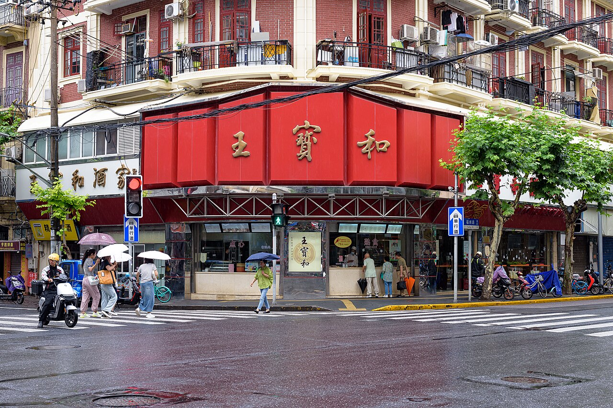

# 王宝和酒家

福州路靠近浙江中路的一段，是上海老书店、老饭店与老字号最密集的区域之一。603 号的王宝和酒家，门面挂着蟹与酒的招牌，里面是江南水乡风格的木饰、圆桌与包房。它始于 1744 年，是上海最早的一批酒家之一；今天人们来这里，多半为了两件事：王宝和黄酒，与大闸蟹。

图：上海福州路的王宝和酒家。图片：N509FZ，CC BY-SA 4.0，via Wikimedia Commons（[原图页面](https://commons.wikimedia.org/wiki/File:Wang_Bao_He_Restaurant_(20250610145416).jpg)）。

## 1744 年：王宝和酒家的关键起点
王宝和的时间线要分上海与绍兴两条。1744 年，乾隆九年，王桂臣在绍兴东浦镇林头村经营“王宝和”酿酒作坊；同年，他的儿子王仁山在上海南市咸瓜街开了一家王宝和酒店。这个“同年”很关键：绍兴是酿酒源头，上海是销售与餐饮的起点，两者共同构成“酒祖宗”的身份。1852 年，咸丰二年，酒店迁到盆汤弄（今南京东路山西南路一带）；1936 年，迁到福州路浙江中路现址，改名为“王宝和酒家”。所以“1744 年始创”指的是品牌与上海酒店的开端，“1936 年”才是今天这栋地址的起点。

20 世纪初，王宝和的绍兴黄酒已经很有名。它卖的不只是酒，还有“酒馆”的社交功能：曲尺柜台、酒客盈门、堂吃与外卖。旧时文人的《食谱开篇》把王宝和列为上海著名酒馆之一；第四代传人王耋夫自制的“耋酒”曾在西湖博览会上得奖；驻法大使顾维钧把王宝和老酒带到法国宴席上；书法家胡问遂品尝后写下“不醉无归”。这些故事说明，王宝和先是“酒”的品牌，后来才成为“蟹”的品牌。

蟹宴的转折在 1979 年 10 月。王宝和推出“菊花蟹宴”，把大闸蟹按部位、按菜式拆开，做成冷盘、热菜、大菜与点心，形成“一菜一格、蟹始蟹终”的宴席结构。这个创新让“酒祖宗”多了“蟹大王”的名号。2013 年，“王宝和蟹宴烹饪技艺”列入上海市非物质文化遗产代表性项目。今天王宝和不仅是酒家，还发展出王宝和大酒店、上海大酒店与王宝和酒业；福州路 603 号仍是酒家本店，九江路 555 号是酒店。

## 空间与菜单

王宝和酒家的空间是“老上海酒家 + 江南水乡”的混合：木饰面、深色家具、圆桌、屏风与包房；共 13 间特色包房，约 180 个餐位。大厅适合两三人点菜，包房适合家庭聚会与商务宴请。它不是网红店式的极简空间，也不是老式国营饭店的冷白灯光；装修刻意保留“老字号”的暖色调，蟹季时门口与电梯口会有蟹宴广告。

菜单分两条主线。第一条是蟹：清蒸大闸蟹、蟹粉豆腐、芙蓉蟹粉、蟹粉明虾卷、蟹黄牡丹虾、蟹膏银皮雪、蟹粉小笼、蟹粉两面黄、蟹壳黄；蟹宴按位或按桌计价，菜式随蟹季与规格变化。第二条是上海本帮菜与淮扬菜：葱油鸡、外婆红烧肉、干煎带鱼、响油鳝糊、上海大馄饨、油爆虾、红烧肉加蛋；午市有点心，蟹粉鲜肉月饼、鲜肉月饼、蟹粉汤圆、蟹壳黄、蟹粉小笼等。

酒单以王宝和黄酒为核心：太雕、花雕、金波、玉液、善酿、香雪、加饭，按年份与甜度分档；也有“蟹宴酒”这类专门搭配蟹的配制酒。黄酒通常温着喝，蟹季配姜醋与黄酒，是江南“去寒”的传统。除此之外，也有啤酒、白酒与饮料，但来这里不喝黄酒，等于少了一半。

## 第一次去怎么点

第一次去，先决定“吃蟹宴还是点菜”。蟹宴适合 4 人以上、想一次尝多种蟹菜的人，按位计价，菜量按人数配；点菜适合 2–3 人，点一只清蒸蟹、一道蟹粉菜、一道本帮菜、一份点心即可。想尝经典，点清蒸大闸蟹配姜醋，再加蟹粉豆腐与蟹粉小笼；想吃得舒服，点葱油鸡、红烧肉、干煎带鱼，蟹只点一只分食。

蟹季是关键。大闸蟹最肥在 10 月至 12 月，农历九月母蟹、十月公蟹；6 月至 8 月的“六月黄”是另一种风味，个头小、壳薄、黄嫩。非蟹季来，菜单仍有蟹粉菜，但鲜度与价格不如蟹季；想吃到好蟹，提前电话预订并问当日规格。午市有点心，适合不想吃大菜的人；晚市以正餐与蟹宴为主。

费用结构：蟹宴人均约 300 元起，单只清蒸蟹按规格与市价，通常 150–200 元一只；本帮菜人均约 100–200 元。包房可能有最低消费，预订时问清。服务费与茶位费按餐厅规定；蟹季周末与节假日建议提前 1–3 天预订。支付方式支持刷卡与移动支付，具体以现场为准。

## 王宝和酒家的地址与营业安排
**地址**：上海市黄浦区福州路 603 号，邮编 200001。位于福州路与浙江中路交叉口附近，靠近人民广场与南京东路；门口有“王宝和酒家”招牌与蟹形标识。

**交通**：地铁 1、2、8 号线人民广场站，步行约 5 分钟；地铁 2、10 号线南京东路站，步行约 8 分钟。福州路是主干道，出租车可以临时停靠，但高峰时段堵车；建议地铁出行。

**营业时间**：午市 11:00–13:30，晚市 17:00–21:00；全年无休，蟹季与节假日可能调整，以官方为准。`operating_status` 记为 `verified`，表示官网与上海市文旅推广网在 2026-11-20 仍显示营业；这不等于每天一定开门。电话 021-63223673。

**预订**：蟹季、周末与包房建议提前 1–3 天电话预订；普通工作日午市可 walk-in，但 13:30 后厨房收档，晚到可能吃不上。没有严格 dress code；包房与商务宴请客人会穿得正式一些。带小孩可以，餐厅有圆桌与包房，但蟹宴上菜节奏慢，小孩耐心要够。

**价格**：蟹宴人均约 300 元起；单只清蒸蟹 150–200 元，按规格与蟹季浮动；本帮菜人均约 100–200 元。包房最低消费、服务费与茶位费以预订确认为准。刷卡与移动支付可用。

页面核验日期 2026-11-20；营业时间、价格与蟹季安排以官方渠道为准。

## 礼仪与常见误区

第一，不要把“1744”当成“福州路 603 号开业年”；1744 年是品牌与上海酒店起点，1936 年才迁到现址。第二，不要把“蟹宴”当成“一桌全是蟹”；它也有本帮菜与点心，蟹宴是“以蟹为主”的宴席，不是“只有蟹”。第三，不要在没有预订的情况下蟹季周末直接上门；蟹的规格与桌位都有限，等位可能很久。

常见误区还有三个。其一，以为黄酒越陈越好；王宝和的黄酒按年份与类型分档，太雕偏甜、花雕偏醇、加饭偏厚，配蟹要看口味，不是“最贵最好”。其二，以为蟹粉菜可以替代鲜蟹；蟹粉是拆蟹肉与蟹黄做的，风味与整只清蒸蟹不同，二者都值得试，但不能互相替代。其三，以为“酒祖宗”只卖酒；王宝和是酒家，酒与菜一体，点菜时可以把酒作为配菜的一部分，而不是最后才加。

不适合来这里的情况：只想吃快餐的人；对蟹过敏或不爱吃蟹的人；预算很紧、只想点一碗面的人。它适合“蟹季认真吃一顿”的场景，也适合想体验上海老字号酒家与黄酒文化的人。

## 上海的周边街区
王宝和在福州路，往东是南京东路与外滩，往西是人民广场与上海博物馆，往南是豫园与城隍庙。把酒家放在“人民广场—福州路—外滩”这条线上：上午看博物馆，中午在王宝和吃蟹或本帮菜，下午逛福州路书店与南京东路，傍晚去外滩看夜景。走路约 30 分钟，地铁一站可达。

若想把“黄酒”作为主题，可以再去绍兴或泸州老窖、水井坊博物馆；上海本地的黄酒老店不多，王宝和是最方便的一站。若想把“蟹”作为主题，蟹季去阳澄湖或太湖是另一条路线，但那是产地体验，不是城市老字号。

福州路车流大，门口不好停车；蟹季门口等位的人多，拍照要避让。若遇到包场或婚宴，散客可能被安排到大厅或改日，预订时问清。

## 同城酒馆与延伸阅读
- [黄酒](ref:yellow-wine)：王宝和的核心酒种，理解它的原料、发酵与类型。
- [米酒](ref:rice-wine)：黄酒的近亲，比较稻米发酵酒的共同点与差异。
- [泸州老窖窖池群](ref:luzhou)：四川浓香型白酒的活态遗址，与江南黄酒形成对照。
- [水井坊博物馆](ref:shuijingfang)：成都的白酒遗址博物馆，另一条中国酒的空间叙事。
- [酒吧与城市](ref:pub-and-city)：酒家与酒馆如何用空间、菜单与营业时间组织城市生活。

相关条目：[黄酒](ref:yellow-wine)、[米酒](ref:rice-wine)、[泸州老窖窖池群](ref:luzhou)。
