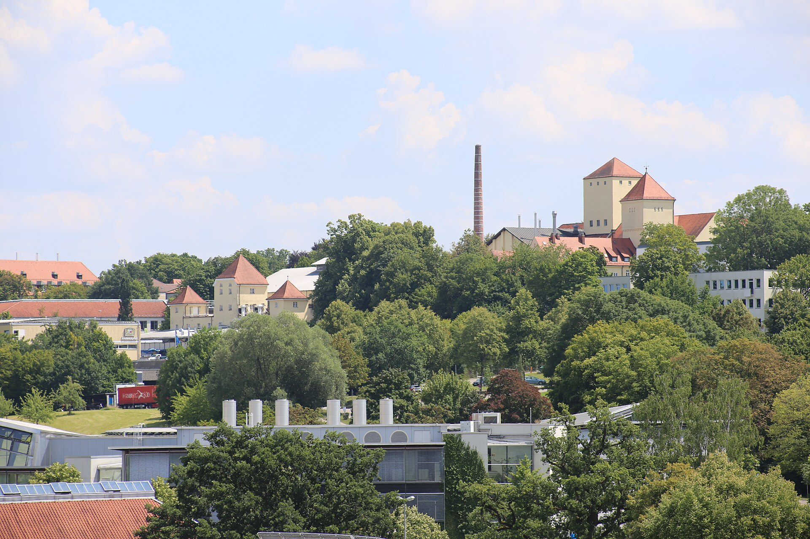

# 唯森啤酒厂

图：唯森啤酒厂相关实景照片。图片：Christian Schranner，CC BY-SA 4.0，via Wikimedia Commons（[原图页面](https://commons.wikimedia.org/wiki/File:%C3%9Cberblick_der_Bayerischen_Staatsbrauerei_Weihenstephan.jpg)）。

## 一座俯瞰弗赖辛的国有酒厂

唯森啤酒厂（Bayerische Staatsbrauerei Weihenstephan）在德国巴伐利亚州弗赖辛城西的 Weihenstephan 山上，门牌是 Alte Akademie 2。它不是一座孤立的景点：酒厂、慕尼黑工业大学 Weihenstephan 校区、园艺试验园与山下的 Bräustüberl 连成一片，构成一个以酿酒与食品科学为中心的小园区。从弗赖辛火车站步行上山约二十分钟，也可以坐公交到 Weihenstephan 再走一段上坡路；自驾可把车停在山下 Bräustüberl 旁的停车场，步行到厂区前台报到。

名称里的“Staatsbrauerei”是国立酒厂的意思，这决定了它的身份：它归巴伐利亚州所有，不是家族企业，也不是跨国集团的分厂。州立属性带来两件事：一是酒厂与高校、研究机构长期共用一座山，酿酒师培训与工艺研究在这里有制度性的位置；二是它对公众开放的方式偏保守，参观按固定场次、提前登记，不做随到随进的“沉浸式体验”。理解这一点，就不会把厂区当成主题公园。它首先是巴伐利亚[巴伐利亚](ref:bavaria)酿酒传统的一个公共机构，其次才是旅游点。

## “1040 年”与最古老的说法

1040 年，弗赖辛的修道院院长 Arnold 从城市取得酿酒与售酒权利，唯森把这一年作为酒厂的起点；山上的修道院活动还可以追溯到更早。今天常见的“世界最古老啤酒厂”说法，依据的是“同一地点持续酿酒、且有文献可查”这一口径。它不等于“从未中断”：1803 年的世俗化运动中，巴伐利亚的修道院被解散，酒厂转归国家，酿酒传统由国立机构接续下来。

这类“最古老”称号总有争议，有的按文献年份，有的按持续经营，有的按现存建筑。把它当成一个有史料支撑的说法，而不是终结讨论的结论，比较稳妥。对旅行者来说，年份的意义不在于争第一，而在于它解释了眼下的空间格局：修道院时期的砖砌部分被保留为博物馆，工业时期的糖化与储酒设备仍在运转，两者被一条参观动线串在一起。

## 参观：预约制与固定时段

酒厂参观必须提前预约。官方页面给出的常规时段是：周一 10:00 德语场；周二 10:00 英语场、13:30 德语场；周三 10:00 英语场。需要发邮件到 info@weihenstephaner.de 或打电话 +49 8161 536-0，说明日期、时段与人数；只有收到确认，报名才算成立。公共假日不安排参观，指定时段之外也不接待散客。

集合点在 Alte Akademie 2 的厂区前台，从 Bräustüberl 旁停车场上坡即到。行程从酒厂最老的砖砌部分、也就是小型酒厂博物馆开始，然后进入糖化、发酵与储酒区域，最后是带讲解的品鉴。六岁以下儿童不能参加，六至九岁与 17 岁以下需要成人陪同；部分房间只能走楼梯，轮椅通行不便，官方明确说明不适合无障碍参观。车间地面可能湿滑，要穿结实的鞋。费用、时长与语言场次会调整，以官方回复为准。

## 酒单：小麦啤酒与拉格的两种性格

唯森的招牌是小麦啤酒。Hefeweissbier 是带酵母的浑浊小麦啤，香蕉与丁香来自酵母，酒体柔和，泡沫厚；Dunkelweissbier 颜色更深，烤面包与焦糖更明显；Kristallweissbier 过滤后清澈，口感更轻；Vitus 是烈性小麦啤，酒体与酒精感都更强。小麦比例通常超过 50%，这是[小麦啤酒](ref:wheat-beer)的底层结构，也解释了它为什么和大麦为主的拉格在香气上分得那么开。

拉格一侧，Lagerbier Hell 是日常款，干净、麦芽甜、苦度低；Pilsner 更干更苦，收尾利落；Korbinian 是深色双倍博克，麦芽浓度高，适合冷天慢喝。把 Hell 与 Pilsner 并排喝，最能看出同一家厂在“柔和”与“锋利”之间的调节。它们的共同点是发酵与储酒都走[拉格](ref:lager)的低温路线，酵母管理与[发酵](ref:fermentation)温度决定了酒体是否干净。

## 1516 与 1906：法规怎样落在杯子里

1516 年的巴伐利亚《纯净法》规定啤酒只能用水、麦芽与啤酒花酿造，1906 年这套规则扩展到整个德意志帝国。它最初兼有税收与粮食政策的目的，后来成为德国啤酒的自我描述。对唯森这样的巴伐利亚酒厂，法规不是墙上的装饰：它限制了可用原料，也让“只用麦芽、不加辅料”成为默认工艺。

需要分清的是，今天的德国啤酒法规与 1516 年文本并不完全等同，欧盟法律也允许其他成员国的啤酒使用不同原料。把《纯净法》当成所有德国啤酒的法律定义会过头；更准确的说法是，它是巴伐利亚酿造传统的一条历史主线，而唯森的产品结构正好落在这条线上。喝的时候不妨留意：小麦啤的香蕉香来自酵母，不是添加剂；拉格的干净来自低温与时间，不是过滤得越狠越好。

## 山下的 Bräustüberl 与实用提示

如果不进厂区，山下的 Bräustüberl（Weihenstephaner Berg 10）是最容易到达的体验点：它是酒厂的“母屋”，每天 10:00 开门、23:00 结束；厨房周二至周六 11:30–21:00，周日 11:30–20:00；天气好时啤酒花园开放。这里据称是巴伐利亚奶酪酱 Obazda 的发源地，配椒盐卷饼与一杯 Hell 是标准组合。它比慕尼黑的[宫廷啤酒馆](ref:hofbrauhaus)安静，游客比例也低一些，适合把“看酒厂”变成一顿完整的巴伐利亚午餐。

实用提醒：厂区参观与山下酒馆是两套系统，在酒馆吃饭不能代替参观预约；假日与部分周一的安排会变，出发前查官网；从慕尼黑乘 S1 到 Freising 约 30–40 分钟，再步行或换公交上山；山上风大，冬天比市区更冷。本页不列坐标，坐标以官方渠道为准。

对照阅读：[小麦啤酒](ref:wheat-beer)、[巴伐利亚](ref:bavaria)。

相关条目：[拉格啤酒](ref:lager)。

**关键事实。**

| 项目 | 内容 |
| --- | --- |
| 一句话定位 | 位于德国弗赖辛 Weihenstephan 山上的巴伐利亚国立酒厂，以 1040 年的酿酒特许为起点，是“世界最古老啤酒厂”说法最常被引用的对象；参观需提前预约，山下的 Bräustüberl 常年营业 |
| 地址 | Alte Akademie 2, 85354 Freising, Germany |
| 城市/国家 | 弗赖辛 / 德国 |
| 营业状态 | 已核验营业 |
| 官网 | weihenstephaner.de |

**来源与边界。** 本页关于「唯森啤酒厂」的关键事实，主要由以下来源交叉核对：Bayerische Staatsbrauerei Weihenstephan（品牌名称、官方联系渠道与 1040 年酿酒特许的表述；官网部分页面要求年龄确认，正文未复制）、Bräustüberl Weihenstephan（山下酒馆地址 Weihenstephaner Berg 10、每日 10:00–23:00、厨房时段、啤酒花园与 Obazda 发源地的说法）、Stadt Freising（弗赖辛城市交通与酒厂位于城市西侧山丘的位置关系）。产品、地址或营业状态变化较快时，以 weihenstephaner.de 的最新页面为准；价格、批次与状态会变，涉及这些字段时以页面所列来源的最新版本为准。正文为项目自写，来源只作核验，不复制原文。
