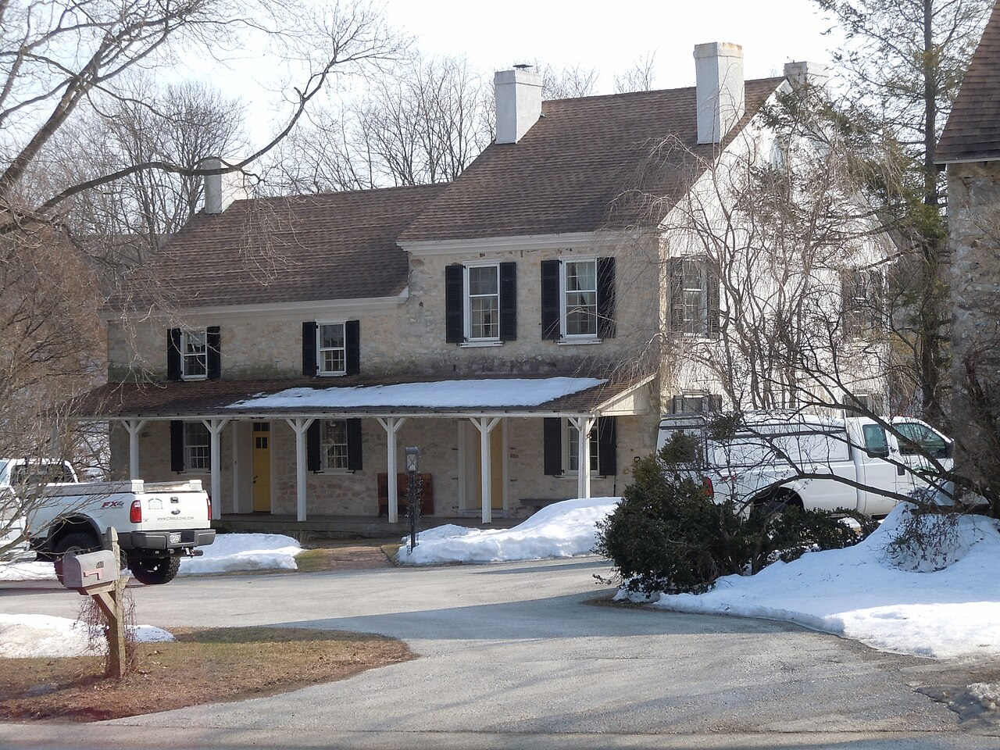

# 白马酒馆

白马酒馆（White Horse Tavern）位于纽约曼哈顿西村 567 Hudson Street，1880 年开业。它最初是哈德逊河码头工人下班后喝酒的地方，1950 年代逐渐变成作家、艺术家与音乐人的聚集地。今天它最出名的标签是“迪伦·托马斯的最后一站”：1953 年 11 月 3 日，这位威尔士诗人在这里喝酒，几天后去世。关于那晚“连喝十八杯威士忌”的说法流传极广，但目击者的说法从六杯到八杯不等，十八杯更像传说，而不是可核实的数据。

图：白马酒馆。摄影：White Horse Tavern PA。署名：Smallbones，CC0，来自 Wikimedia Commons（[来源](https://commons.wikimedia.org/w/index.php?curid=13351900)）。

## 1880 年：白马酒馆的关键起点
白马在 1880 年开业，最初服务的是附近哈德逊河码头的装卸工与船员，属于典型的社区酒馆。1950 年代，西村的房租与生活成本还允许作家、画家与音乐人聚在一起，迪伦·托马斯、杰克·凯鲁亚克、艾伦·金斯堡、詹姆斯·鲍德温等名字先后与这里发生关系。店方称它是“纽约第二古老的酒吧”，而麦克索利则自称“纽约持续经营最久的酒馆”；两套说法各有各的统计口径，听的时候要分清“建筑年龄”“连续营业”与“品牌叙事”。1953 年 11 月的那次到访，把白马从社区酒吧推成了文学地图上的坐标；但把它简化成“喝到死的酒吧”，既失真，也不尊重诗人。

## 空间与酒单

白马保留着原始的木结构、锡制天花板、长吧台与旧照片，空间比麦克索利宽一些，仍属于“老酒馆”而不是“精酿酒吧”。酒单以啤酒、威士忌与简单鸡尾酒为主，另有酒吧食物；它不是只卖艾尔的单一酒馆，也不是现代调酒实验室。你可以点一杯生啤、一杯威士忌，或让店员推荐当天酒款；食物以汉堡、薯条、汤与下酒菜为主，适合垫肚子，不适合正式晚餐。价格在西村属于中等水平，旅游旺季与周末夜晚可能上浮。

## 第一次来怎么点

第一次来，先绕吧台看一眼酒单，再决定坐吧台还是靠墙的桌子。想感受老酒馆气氛就坐吧台，想聊天就找角落。点单可以从一杯生啤开始；想喝威士忌，直接说品牌或风格，不要用“像迪伦·托马斯那样”来点单。若饿了，点一份简单酒吧食物配酒，比只喝酒更稳妥。工作日傍晚是最舒服的时段：本地常客还在，游客还没填满空间。周末夜晚非常拥挤，不适合第一次约会或安静谈话。

## 白马酒馆的地址与营业安排
地址是 567 Hudson Street, New York, NY 10014, USA，位于西村 Hudson Street 与 West 11th Street 附近；坐标 40.73571, -74.00620。地铁 1 号线到 Christopher Street–Sheridan Square 站，步行约 3 分钟；从 Washington Square Park 走过来约十五分钟。

官方页面列出的营业时间是周一至周三 12:00–24:00，周四 12:00–次日 02:30，周五与周六 12:00–次日 03:30，周日 11:00–24:00；节假日可能调整，以官方渠道为准。`operating_status` 为 `verified`，表示官网与联系页在 2026-11-08 仍正常、未见停业公告。这里没有门票；官网提供 Resy 预订入口，但多数座位仍以先到先得与现场安排为主，旺季与周末夜晚需要等位。电话 (212) 989-3956。着装 casual，没有硬性要求；支付方式以现场为准，带一张卡与少量现金更稳妥。价格按西村酒吧水平预期。空间有历史建筑的低层高与窄通道，行动不便者建议先确认。「白马酒馆」的开放时间、价格与预约，以[官网](https://www.whitehorsetavern1880.com/)的公开页面为准；核验日期为 2026-11-08，临时调整以官网当日公告为准。

## 礼仪与常见误区

这里首先是 neighborhood bar，其次才是文学地标。不要在吧台前长时间摆拍，也不要为了“打卡”而挡住店员取酒。想拍店内照片可以，但避开其他顾客正脸；拍店员前先问一句。小费按美国酒吧习惯给，刷卡时留意小费栏。最大的误区是把迪伦·托马斯的故事浪漫化：他当时已病重，十八杯的说法也没有可靠证据；把“喝到最后一刻”当成卖点，是对诗人与酒精问题的双重简化。另一个误区是把店方“第二古老”的说法当成绝对事实；纽约的“最老”称号有多套算法。名人到访是历史背景，不代表今天的服务质量。

1880 年开业与文人顾客是历史层；今天的菜单、营业状态与预订规则要另行确认。

迪伦·托马斯的故事属于酒吧传说；今天是否营业、是否接受团体，要先看官方信息。

## 什么情况不适合来

如果你想要完整的鸡尾酒单、安静谈话、精致晚餐或适合儿童的夜间环境，白马都不合适。大团体在周末夜晚很难找到连续座位；对无障碍通行有要求的人应先确认门口与店内动线。讨厌“文学酒吧”叙事、只想喝一杯便宜酒的人，可能会觉得这里游客太多。若你容易因名人故事而过度饮酒，最好把这里当成一次普通的酒吧访问，而不是朝圣。

## 从白马酒馆延伸到麦克索利老麦酒馆
从白马往西两个街区是哈德逊河公园，往东可到 Christopher Street、Stonewall Inn 与 Washington Square Park；Bleecker Street 一带的餐馆与唱片店也适合顺路逛。若想把纽约两间老酒馆放在一起看，可以再去东村的[麦克索利老麦酒馆](ref:mcsorleys)；两地相距约两英里，建议乘地铁。麦克索利只卖艾尔、空间更窄；白马酒单更宽、文学神话更重。两间店对照着看，能看出“老”并不等于同一种经营方式。

## 同城酒馆与延伸阅读
这里供应的啤酒属于更广的[啤酒](ref:beer)风格家族；把它放回[酒吧与城市](ref:pub-and-city)的脉络，更容易理解这类空间的待客方式。若想看另一种“只卖一种酒”的老酒馆，读[麦克索利老麦酒馆](ref:mcsorleys)。

补充阅读：[A Ginjinha](ref:c-extra-1)。

对照阅读：[啤酒](ref:beer)、[麦克索利老麦酒馆](ref:mcsorleys)。

相关条目：[认识一座城，从一间酒馆开始](ref:pub-and-city)，以及纽约老酒馆的常客文化。

**关键事实。**

| 项目 | 内容 |
| --- | --- |
| 一句话定位 | 纽约格林威治村的历史酒馆，1880 年开业，因诗人迪伦·托马斯等文人顾客闻名 |
| 地址 | 567 Hudson Street, New York, NY 10014, USA |
| 城市/国家 | 纽约 / 美国 |
| 营业状态 | 已核验营业 |
| 官网 | whitehorsetavern1880.com |

**来源与边界。** 本页关于「白马酒馆」的关键事实，主要由以下来源交叉核对：White Horse Tavern（创立时间、地址与历史背景；1880 年创立、码头工人客群、1950 年代文学艺术客群与店内原始木结构、锡制天花板）、City of New York（格林威治村与文学酒吧背景）、Bing Maps（坐标 40.73571, -74.00620 与 567 Hudson Street 门牌）。产品、地址或营业状态变化较快时，以 whitehorsetavern1880.com 的最新页面为准；价格、批次与状态会变，涉及这些字段时以页面所列来源的最新版本为准。正文为项目自写，来源只作核验，不复制原文。
