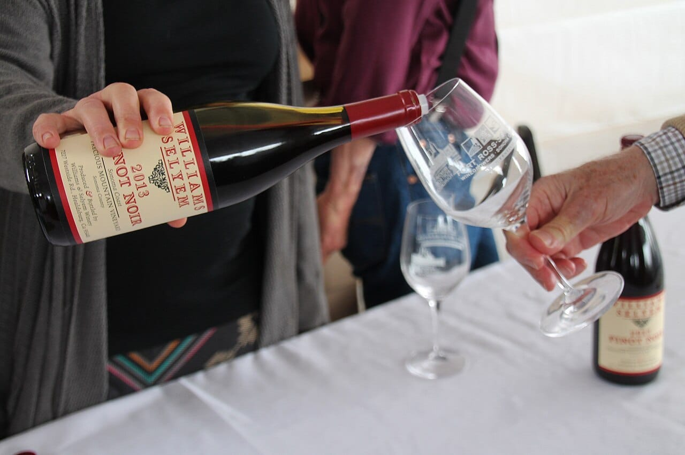

# 威廉姆斯-塞莱姆酒庄

威廉姆斯-塞莱姆是美国黑皮诺“车库酒”传统的起点之一：1978 年，旧金山纪事报的印刷工 Burt Williams 与会计师 Ed Selyem 在 Forestville 的车库里用借来的设备酿酒，后来把俄罗斯河谷推上了世界黑皮诺版图；今天酒庄仍在 Westside Road，用预约制与配额制维持那种“小而慢”的节奏。

图：威廉姆斯-塞莱姆酒庄。摄影：File:Williams Selyem wine at Fort Ross State Historic Park - Jenner, California - Stierch.jpg。署名：Sarah Stierch，CC BY 4.0，来自 Wikimedia Commons（[来源](https://commons.wikimedia.org/w/index.php?curid=44884501)）。

> **先给结论**
> **一句话：** 这页判断威廉姆斯-塞莱姆酒庄值不值得专程去，以及到访前要核对什么。
>
> - **适合谁：** 正在计划去威廉姆斯-塞莱姆酒庄、想知道值不值得专程安排半天到一天的人。
> - **不适合谁：** 只想要“必去榜单”、不准备核对预约、交通和开放时间的人。
> - **先看这两点：**
>   - 威廉姆斯-塞莱姆的参观必须预约，而且名额很少；常见形式是坐下来的品鉴，由酒庄团队带你喝当前 release 的几款酒，偶尔有 library 年份。
>   - 威廉姆斯-塞莱姆是小型生产者的品鉴室，不是大型酒庄的游客中心。

## 1979–2025：威廉姆斯-塞莱姆酒庄的历史节点
威廉姆斯-塞莱姆位于索诺马县俄罗斯河谷，酒庄在 7227 Westside Road，希尔兹堡以西。Burt Williams 白天在《旧金山纪事报》做印刷工，Ed Selyem 在 Speer’s Market 做葡萄酒采购与会计；两人都爱勃艮第，却买不起太多好酒，于是决定自己试。1979 年，他们用 Martinelli 家族 Jackass Hill 的仙粉黛在 Burt 家的车库里开酿，把一个改装过的奶罐当发酵槽，酒庄最初叫 Hacienda del Rio。

1982 年，第一个商业年份装瓶；1983 年，索诺马的 Hacienda Winery 发来停止使用“Hacienda”的信，他们干脆把两人的姓拼成 Williams Selyem，搬到 Fulton 一间租来的双车库继续做。1984 年，第一张 Williams Selyem 酒标贴上了瓶子，同年发布第一款 Rochioli 葡萄园黑皮诺——这被认为是加州“单一葡萄园”标签运动的早期样本。

1985 年的 Rochioli 葡萄园黑皮诺在 1987 年加州州立博览会葡萄酒比赛中拿下 Sweepstakes 大奖，从 2,316 款酒里胜出；Bon Appétit 也把 1982 Hacienda del Rio 黑皮诺评为年度最佳加州酒。需求迅速超过产量，酒庄由此建立了“等待名单”制度，最久要等两到三年。1989 年，他们搬到 Westside Road 的 Allen Ranch，Burt 与 Ed 辞掉白天的工作，全职酿酒；1995 年，酒庄的酒进入白宫。

1998 年，Burt 与 Ed 把酒庄卖给长期客户 John 与 Kathe Dyson；Burt 的最后一款酒是 1997 年份，Bob Cabral 接任酿酒师。Dyson 家族买下 Guerneville 的 Drake 地块，又在 2001 年买下 Litton 家族的土地，建立 Litton Estate。2021 年，Dyson 家族把少数股份卖给勃艮第的 Faiveley 家族；2025 年，酒庄迎来第 45 个年份。

## 葡萄园与风土

威廉姆斯-塞莱姆早年没有自己的葡萄园，全部靠与果农的长期关系：Rochioli、Allen、Olivet Lane 在俄罗斯河谷，Summa、Hirsch、Coastlands、Precious Mountain 在更冷更靠海的索诺马海岸，Heintz 提供霞多丽，Papera 提供仙粉黛。酒庄的风格不是“庄园统一味”，而是让每个地块尽量自己说话；同一款酒在不同年份的差别，往往比不同酒庄之间的差别还大。

俄罗斯河谷的核心是 Goldridge 砂壤土与太平洋雾：夏季白天温暖，傍晚海雾灌进来，夜晚降温，葡萄成熟慢、酸度高、果皮薄。Westside Road 一带离河近、离海不远，是黑皮诺的经典带；再往西到 Occidental、Freestone，气候更冷，果实更瘦、香料与泥土气息更明显。

酒庄后来拥有的 Estate 地块包括 Drake、Litton、Lewis MacGregor 等。Litton Estate 在 2004 年种下约两英亩的“Mass Selection”混种块，把十八个黑皮诺克隆混在一起，模仿旧世界的田间混选；这块地的 2007 年份黑皮诺拿到 Wine Enthusiast 100 分，是北美第一款获得主要酒评满分黑皮诺。

## 酿造与风格

威廉姆斯-塞莱姆的酿造方法从头到尾都很“轻”：黑皮诺靠脚踩破皮，用浅而宽的奶罐发酵，增加果皮与酒液的接触比例，同时避免过度萃取；发酵温度控制得低，压榨轻，橡木桶新比例不高，目的是保留果香与质地而不是做出桶味。酒庄至今仍保留 Burt 与 Ed 时代的奶罐与脚踩传统，只是设备更干净、温控更精确。

风格上，经典年份的黑皮诺带樱桃、覆盆子、野草莓、干花、泥土与香料，单宁细，酸度清楚，酒精度通常不夸张；霞多丽则带柠檬、白桃、榛子与湿石，桶味克制。仙粉黛（Papera 等）是酒庄少数非黑皮诺红，果味更甜熟，但仍有酸度托底。

酒庄的“配额制”不是营销噱头，而是产量太小、又坚持直接卖给消费者的结果。今天的大部分酒通过 mailing list 分配，少数进入餐厅；想买某款单一园，通常要先在名单上等，而不是到店就能买到。

## 参观与空间

威廉姆斯-塞莱姆的参观必须预约，而且名额很少；常见形式是坐下来的品鉴，由酒庄团队带你喝当前 release 的几款酒，偶尔有 library 年份。酒庄不接待大型团体，不设随到随喝的 standing tasting，也不鼓励把品鉴当成“喝一圈再买”的环节。

Westside Road 的酒庄建筑低调，周围是葡萄园与橡树；品鉴空间不大，重点在酒与讲解，不在建筑打卡。预约确认后会收到具体地址与停车指引；从希尔兹堡镇开车约十五分钟，从 101 号公路的 Westside Road 出口进来，路窄且多弯，晚上开车要慢。

如果想看葡萄园，最好在预约时问清楚是否有 estate walk；酒庄的 Estate 地块与品鉴室不总在同一处，临时要求通常无法安排。带小孩、宠物或无障碍需求，要在预约时提前说明，酒庄会按空间与人手决定是否接待。

## 「威廉姆斯-塞莱姆酒庄」的上桌方式
黑皮诺适合十四到十六摄氏度，开瓶后醒二十到四十分钟；老年份不要长时间醒，倒一杯、等几分钟、再决定。霞多丽适合十到十二度，冰过头会压住榛子与白桃；仙粉黛适合十六到十八度，配烧烤与香料菜。

配餐上，黑皮诺适合烤鸭、蘑菇、三文鱼、烤鸡、小牛肉与软质奶酪；它的酸度与细单宁不适合重辣、重酱或炭烤牛排。霞多丽适合龙虾、奶油意面、烤鱼与禽肉；仙粉黛适合 BBQ、 ribs、墨西哥菜与番茄基底菜。

威廉姆斯-塞莱姆的酒不适合“开瓶就灌”，温度与氧气给足，香气才会打开。如果只有一瓶，选 Russian River Valley 级别的黑皮诺配鸭或蘑菇；如果有单一园，先喝较冷地块的那款，再喝较暖地块，体会成熟度与香料差异。

## 威廉姆斯-塞莱姆酒庄的地址与营业安排
从旧金山出发，走 101 北到希尔兹堡约两小时；从希尔兹堡镇到 Westside Road 酒庄约十五分钟。品鉴通常九十到一百二十分钟，预约制，周末与 release 季很快满；没有预约不要直接上门，酒庄不接待 walk-in。

酒庄不提供正式餐饮，只有品鉴时的小食；午餐建议回希尔兹堡镇。买酒以配额与现场库存为准，热门单一园常常提前售罄；如果要寄送，先确认所在州是否允许，国际运输另算。酒庄道路窄，品鉴后不要急着赶下一个点。

## 礼仪与常见误区

威廉姆斯-塞莱姆是小型生产者的品鉴室，不是大型酒庄的游客中心。按预约时间到，不要带未登记的同伴；品鉴时把酒吐进吐酒桶是专业做法，开车的人只喝一两杯。不要临时要求参观发酵间，也不要拿别家酒庄的旗舰酒来比较；这里的节奏是少量、专注、慢慢聊。

最常见的误区，是把威廉姆斯-塞莱姆当成“俄罗斯河谷随处可见的黑皮诺”。它的产量小、渠道窄，很多酒在公开市场买不到；另一个误区是以为车库起家就一定“粗糙”：酒庄的轻萃取与低新桶是刻意选择，不是设备不足。还有人把“单一园”当成营销词，这里的单一园标签来自具体果农与地块，年份差异很大。

## 从威廉姆斯-塞莱姆酒庄延伸到索诺马
威廉姆斯-塞莱姆适合作为 Westside Road 半日路线的核心：上午从希尔兹堡出发，先到这里品鉴，中午回镇上吃饭，下午再去 Dry Creek 或 Alexander Valley 的一家对照酒庄。Westside Road 上还有 Rochioli、Hartford、Gary Farrell 等，但每家都要预约，一天最多排两家。

如果只有半天，选威廉姆斯-塞莱姆加希尔兹堡镇，不要再去第三个点；品鉴本身就要一个半小时，路上还要留缓冲。如果有一整天，可以把俄罗斯河谷与索诺马海岸分开：上午黑皮诺，下午去 Occidental 或 Freestone 看更冷的海岸带，再回 101。

相关条目：[索诺马](ref:sonoma)、[美国](ref:usa)、[黑皮诺](ref:pinot)。

## 参考资料
- 相关条目：[sonoma](ref:sonoma)、[usa](ref:usa)、[pinot-noir](ref:pinot)、[oak-ageing](ref:oak)、[region](ref:region)。
- 本页不提供实时配额、库存或营业状态；参观前以酒庄官网与预约确认邮件为准。
- 想理解这家酒庄，可以拿一瓶 Russian River Valley 级别与一瓶单一园对照，再与勃艮第夜丘的一级园比较，体会“果香透明度”与“泥土香料”各自来自哪里。
