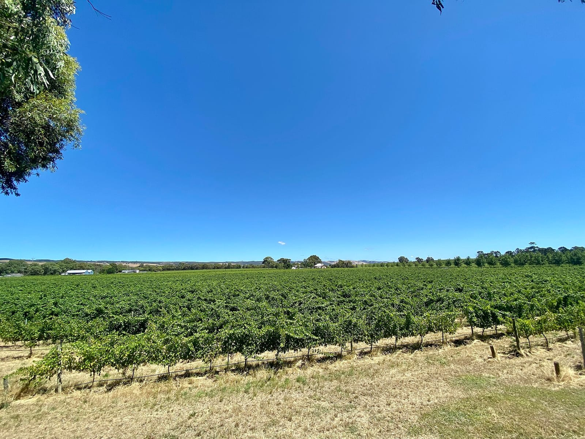

# 维拉维拉酒庄

维拉维拉是麦克拉伦谷最会讲故事的酒庄之一：1894 年由前州板球手 Robert Strangways Wigley 建起铁石酒窖，1936 年后荒废；1969 年 Greg 与 Roger Trott 两兄弟把废墟重新点着，1972 年酿出第一瓶 Church Block。今天它仍是“正经酿酒、认真玩乐”这种澳洲性格的代表。

图：维拉维拉酒庄相关实景照片。图片：No Swan So Fine，CC BY-SA 4.0，via Wikimedia Commons（[原图页面](https://commons.wikimedia.org/wiki/File:Wirra_Wirra_Vineyards,_Strout_Road,_McLaren_Vale_07.jpg)）。

> **先给结论**
> **一句话：** 这页判断维拉维拉酒庄值不值得专程去，以及到访前要核对什么。
>
> - **适合谁：** 正在计划去维拉维拉酒庄、想知道值不值得专程安排半天到一天的人。
> - **不适合谁：** 只想要“必去榜单”、不准备核对预约、交通和开放时间的人。
> - **先看这两点：**
>   - 维拉维拉的 cellar door 设在 1894 年的铁石酒窖里，参观本身就像走进一段产区史：老发酵槽、蓝石墙、钟楼与酒窖深处的品鉴室，都是原建筑的一部分。
>   - 维拉维拉位于麦克拉伦谷镇边缘的 Strout Road 山坡上，距阿德莱德约 45 分钟车程。

## 1894 年：维拉维拉酒庄的关键起点
维拉维拉位于麦克拉伦谷镇边缘的 Strout Road 山坡上，距阿德莱德约 45 分钟车程。酒庄的入口并不张扬：一片草坪、一栋铁石与蓝石砌成的老酒窖、一个钟楼，以及门口那台被 Greg Trott 念念不忘的“投石机”。但一走进酒窖，就能看到维拉维拉真正的性格：历史感很重，姿态却很轻。

1894 年，Robert Strangways Wigley 买下麦克拉伦谷 240 英亩土地，开始建酒庄。他是南澳州板球手，也是当地有名的怪人：学过法律与建筑，爱恶作剧，据说会因为不喜欢某个客人而拒绝卖酒。酒窖按 Dr A.C. Kelly 的分层设计建造，铁石与蓝石的结构在 1890 年代属于相当先进的酒厂建筑。Wigley 与 Alec Johnston 在 1897 年酿出第一批酒；到 1901 年，酒庄已有约 100 英亩葡萄，是麦克拉伦谷的重要生产者。

Wigley 在 1920 年代去世后，酒庄逐渐衰落，1936 年关闭，铁石酒窖在之后四十多年里只剩下残墙与一个顽固的板岩发酵槽。1969 年，Greg Trott 与堂兄 Roger Trott 买下这片废墟和周围七英亩土地，花了三年时间搬石、修墙、凑设备。他们没有等酒窖修好才酿酒：第一年就在废墟中间露天发酵，用一台老式 Bagshaw 破碎机、一个泵和一台旧法国压榨机，把维拉维拉重新开了起来。

Greg Trott 在 2005 年去世，但他留下的性格仍随处可见：钟楼、每天下午六点敲响的 Trott’s Bell、酒标上的玩笑、酒庄里那台投石机，以及“认真做酒，别把自己太当回事”的厂训。维拉维拉后来经历所有权变化，今天由多个家族与投资方共同持有，但酒庄的日常仍围绕麦克拉伦谷的葡萄与这套老酒窖展开。

## 葡萄园与风土

维拉维拉的葡萄园约 51 公顷，分布在麦克拉伦谷与阿德莱德山，核心地块包括 Scrubby Rise、Chook Block、’73 Block 与 Nocowie。麦克拉伦谷属于地中海气候：冬季湿润、夏季干热，海风与夜间降温让西拉保留酸度；土壤从北部的砂质壤土到南部的黏土与石灰岩不等，排水与持水能力差异很大。

Scrubby Rise 种于 1972 年，名字来自 Greg Trott 的澳洲式幽默：这片地平坦、几乎没有灌木，他却偏要叫它“灌木 rise”。地块下面是很古老的岩石，葡萄藤在贫瘠土壤里低产、慢熟，果实风味集中。Chook Block 与 ’73 Block 则是酒庄最老、最受重视的西拉与赤霞珠材料，部分地块已转为生物动力种植。

维拉维拉的葡萄园管理强调土壤健康、生物多样性与低投入，部分核心地块获得有机/生物动力认证。麦克拉伦谷的挑战不是“太冷”，而是热浪、干旱、采收期降雨与霜冻；海风能缓和夏季高温，但也会在花期与成熟期造成风害。酒庄通过遮阴、覆盖作物与水分管理，尽量让果实缓慢成熟，而不是靠灌溉把产量堆上去。

## 酿造与酒款

维拉维拉的酒款可以分成几条线。Church Block 是最有名的日常旗舰：1972 年 Greg Trott 用 Bethany 小教堂对面葡萄园的 Grenache 与 Shiraz 混酿出第一版，后来演变成 Cabernet Sauvignon、Shiraz 与 Merlot 的经典混酿，果味成熟、单宁圆润，适合餐厅与日常餐桌。RSW Shiraz 以创始人 Robert Strangways Wigley 命名，1992 年首次推出，是酒庄的旗舰西拉，通常经过 18–22 个月法国橡木桶陈年，风格集中、耐陈。

The Angelus 是单一园赤霞珠，名字来自酒庄的钟；Chook Block 与 ’73 Block 则代表更老、更有限的西拉与赤霞珠地块。Scrubby Rise 系列覆盖红白两款，定位更轻松；Woodhenge、Catapult、The 12th Man、Dead Ringer、Holy Thirst 等酒款，则各自对应不同地块、混酿或品牌故事。维拉维拉的酒单很大，但结构清楚：旗舰、单一园、日常线各司其职。

酿造上，维拉维拉的红酒通常在不锈钢或开放发酵槽中发酵，部分酒款使用整串比例，压榨后在法国橡木桶中陈年；白葡萄则强调清爽与果味，避免过重的橡木。酒庄的“严肃”体现在发酵控制、桶选与混酿比例上；“好玩”体现在酒名、厂训与酒庄体验上。两者并不矛盾，反而是维拉维拉品牌的核心。

## 参观与空间

维拉维拉的 cellar door 设在 1894 年的铁石酒窖里，参观本身就像走进一段产区史：老发酵槽、蓝石墙、钟楼与酒窖深处的品鉴室，都是原建筑的一部分。酒庄提供多种品鉴体验，从基础酒单到私人品鉴与酒窖导览，最好提前预约；周末与活动日会比较忙。

酒庄的空间不只是品鉴室。Harry’s Deli 以当地食材与酒庄蔬菜做简餐，适合把品鉴与午餐排在一起；草坪上的投石机是 Greg Trott 的“未完成梦想”的实体版本，后来真的被造了出来，成为酒庄最具辨识度的拍照点。每天下午六点的 Trott’s Bell 是另一项传统，纪念那些“白白死去的人”，也提醒访客：这是一座有性格的酒庄，不是标准化的游客中心。

## 「维拉维拉酒庄」的上桌方式
Church Block 适合十六到十八摄氏度，开瓶后二十到三十分钟即可；它果味成熟、单宁圆润，配烤羊排、炖牛肉、香肠、披萨与中式红烧肉都稳。RSW Shiraz 更集中，适合烤和牛、鹿肉、黑椒牛排与硬质奶酪；年轻时可以提前一小时开瓶，陈年后只需短暂醒酒。The Angelus 赤霞珠适合烤羊腿、炖牛尾与蘑菇料理。

维拉维拉的西拉通常带黑莓、李子、黑胡椒与摩卡气息，酒精度不低，配辣味时要小心：辣会放大酒精与苦味。配烧烤时，选果味更熟、单宁更柔的 Church Block 比旗舰 RSW 更轻松；配重口红肉时，RSW 的结构才撑得住。白葡萄酒如 The 12th Man Chardonnay 适合海鲜、白肉与奶油酱，饮用温度约十到十二摄氏度。

## 维拉维拉酒庄的地址与营业安排
从阿德莱德出发，沿 Southern Expressway 到 McLaren Vale，再转入 Strout Road；从市区大约 45 分钟，从麦克拉伦谷镇约五到十分钟。酒庄有停车位，周末与活动日会比较紧张。品鉴加午餐建议留三小时；如果要把维拉维拉、d’Arenberg 与 Wirra Wirra 周边酒庄排进一天，最多再加一站，不要排四个。

开放时间、品鉴费用、餐厅菜单与活动安排都会变化，出发前以酒庄官网为准。带小孩或长辈时，先确认儿童座椅、无障碍通道与休息区；老酒窖的石阶与不平整地面不一定适合推车。若遇到闭馆或私人活动，先查官网与电话，把麦克拉伦谷镇或其他酒庄写进备选。

## 礼仪与常见误区

酒庄不是主题公园。按预约时间到达，穿能走草地与石阶的鞋，不在工作区拍照，不碰设备，不把品鉴杯带走；带大型团体或小孩时，先问清楚是否接待。品鉴时把酒吐进吐酒桶是专业礼仪，不是失礼；如果开车，最好只喝一两杯，或者直接买瓶带走。

最常见的误区是把维拉维拉只当成“Church Block 的酒庄”。Church Block 是入口，但 RSW、The Angelus、Chook Block 与老藤西拉才是酒庄与麦克拉伦谷风土的上限；只喝一款混酿，很难理解它为什么能在产区里站住。另一个误区是把“好玩”当成不专业：维拉维拉的笑话与投石机是品牌性格，但酒窖里的发酵、桶选与混酿仍然是严肃工作。

## 从维拉维拉酒庄延伸到麦克拉伦谷
维拉维拉适合作为麦克拉伦谷一日路线的核心站：从酒庄可以继续到 d’Arenberg、Coriole、Samuel’s Gorge 等酒庄，也可以回镇上午餐。若只有半天，选“维拉维拉 + 一家对照酒庄 + 午餐”，不要再跨到 Adelaide Hills；若有一整天，可以把 McLaren Vale 与 Willunga 镇加进来，但要把车程与预约时间算足。

想把维拉维拉喝明白，最有效的方法是同一趟里选 Church Block 与 RSW 各一瓶，对比果味集中度、单宁、橡木与陈年潜力；再选一瓶 The Angelus 或 Chook Block，比较赤霞珠与老藤西拉的方向。差异清楚之后，你再去比较其他麦克拉伦谷酒庄，就不会只被“Church Block”一个名字带走。

相关条目：[麦克拉伦谷](ref:mclaren-vale)、[澳大利亚](ref:australia)、[红葡萄酒](ref:church-block)。

## 参考资料
- 相关条目：[mclaren-vale](ref:mclaren-vale)、[australia](ref:australia)、[red-wine](ref:church-block)、[syrah](ref:shiraz)、[cabernet-sauvignon](ref:cabernet)。
- 本页不提供实时价格、菜单、品鉴费用或营业状态；参观前以酒庄官网与 Wine Australia 为准。
- 想理解 Church Block 的演变，可以在品鉴时问清当年的混酿比例，再找一瓶 Original Blend Grenache Shiraz 做对照。
