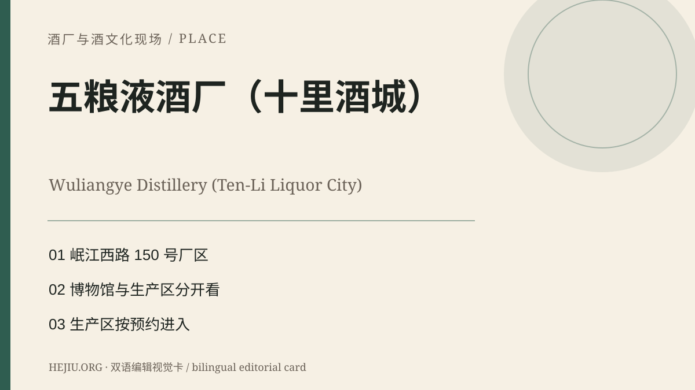

# 五粮液酒厂（十里酒城）

五粮液在宜宾不是一个孤立的“景点”，而是一整片沿岷江铺开的生产与展示空间。游客最容易把“厂区”“酒文化博览馆”“十里酒城”混成一个门，结果到了门口才发现，展馆可以按公告参观，正在运转的车间却要另走预约与门禁。把这三层关系先分清，行程才不会被“能不能进厂”卡住。

图：五粮液酒厂（十里酒城）专属双语视觉卡。项目自制双语视觉卡，用于识别主题，不是现场照片。

> **先给结论**
> **适合谁：** 想理解浓香型白酒大生产、又愿意提前预约的人；适合与宜宾酒文化博物馆串成半日到一日。
> **不适合谁：** 只想拍照打卡、不愿核对预约与门禁的人；生产区不是随心逛的工业景区。
> **一句话：** 先看馆、再看厂区外观，生产车间按官方安排进入，品鉴与购买分开处理。

## 先把三个空间分清

第一层是五粮液酒文化博览馆，位于岷江西路 150 号厂区内，按馆方公告开放，适合先建立浓香型白酒的原料、窖池、制曲与勾调框架。第二层是厂区外观与“十里酒城”的公共道路、门户和江边景观，能感受规模，但不等于可以进入车间。第三层是正在运转的制酒、包装、仓储区域，只有官方或授权参观线路才进得去。把“看展”“看厂”“进车间”分开，就不会把任何一张网图当成通行证。

## 十里酒城看什么

宜宾的空气里常年有酒糟味，厂区沿岷江展开，发酵池、制曲房、酿酒车间、陶坛库与包装线构成一条很长的生产链。对普通访客来说，最有信息量的不是“走了多远”，而是把浓香型白酒的连续生产看明白：老窖池靠窖泥里的微生物群落后天养出来，粮食蒸煮、摊晾、加曲、入窖、蒸馏一环扣一环，原酒再按等级入库陈放。看到陶坛库时，重点不是坛子多，而是容量、编号、库房温湿度和消防管理；看到包装线时，重点不是速度，而是灌装、贴标、装箱与批次追溯。

## 怎么到、留多久

从宜宾西站打车到岷江西路约半小时上下，五粮液机场在市区西北方向，车程视路况而定；公交线路会调整，以实时地图和站牌为准。只安排博物馆与厂区外观，半天足够；要把酒文化、老城与江景串起来，建议留一整天。厂区周边以工业和居住功能为主，不是连续逛街的商业街，走路时注意货运车辆与上下班人流。夏天酒糟气味重，敏感的人可以戴口罩；穿平底鞋比穿凉鞋稳。

## 生产区边界与品鉴

正在生产的车间有机械、蒸汽、高温管道和酒糟堆放，不能自行进入，也不要翻越围栏或跟着货车混进去。官方参观通常按团队、时段和线路组织，预约方式、是否开放、能不能拍照都以厂方公告为准。品鉴环节要问清酒精度、容量和是否收费；小杯慢饮，不空腹，不把“能喝”当成参与度。开车来的人应把品鉴交给同行者或不参加，宜宾市区代驾与出租车可用，但厂区门口高峰时段车辆集中。

## 周边怎么排

同一天可以按“博览馆—厂区外观—流杯池公园—冠英古街—合江门”走：流杯池与黄庭坚的宜宾记忆有关，冠英古街是老城街区，合江门看金沙江与岷江汇合成长江。多留一天可以去李庄古镇看抗战时期的建筑与学术史，或去蜀南竹海；这两处距离市区较远，需要单独半天到一天。吃饭可以试宜宾燃面、李庄白肉、竹荪与江鱼，配酒时控制量，下午还要走路就不要把品鉴排得太满。

## 把行程做成三种版本

只留半天，就把时间放在博览馆与厂区外观：先在馆里把浓香型白酒的原料、窖池、制曲、蒸馏与勾调看懂，再沿公共道路走到江边看厂区尺度，不追着车间拍照。留一天，可以加流杯池、冠英古街与合江门，把“酒厂—酒史—老城—江景”串起来；中午在市区吃饭，下午回厂区外观，避开上下班车流。留两天，再把李庄或蜀南竹海单独放一天，不要把远郊硬塞进厂区半日。三种版本都遵循同一原则：生产区只走官方线路，品鉴不安排给要开车的人，买酒留到行程最后。如果只安排半天，返程前留出二十分钟在江边坐一会儿，比多赶一个点更能感受酒城的尺度。厂区周边餐饮不多，午饭在市区解决，别把品鉴和正餐挤在一起；出发前一天再确认开放信息。

## 出发前核对

- 确认博览馆与厂区是否同日开放
- 生产区只走官方预约线路
- 穿平底鞋，夏天带口罩
- 品鉴前先吃饭，司机不喝
- 买酒留到最后并保留发票
- 江边与厂区道路注意货运车辆
- 不要把“十里酒城”当成步行景区
- 带长辈时减少厂区步行距离

## 这一页的边界与下一步

十里酒城是生产与展示混合的厂区，不是一座可以随意步行的公园。开放区域、参观线路和品鉴点会随生产安排调整，出发前以厂方或当地文旅的当日信息为准。若只想看博物馆，半天足够；若想理解浓香窖池与多粮酿造，需要把博物馆、厂区展示和品鉴分开安排。

交通上，宜宾市区到厂区有公交和出租，但厂区内部步行距离长，夏天湿热、冬天江风大。带长辈或孩子时，减少厂区步行、把重点放在博览馆和室内品鉴更稳妥。生产区不要越过指示线，也不要对着工人和窖池长时间拍摄。

买酒与参观要分开。厂区周边的价格不一定比市区商超或官方渠道更低，限量款也可能需要登记；先确认能否携带上飞机或寄送，再决定买多少。把发票和批次信息留好，后续核对更方便。

## 参考资料

- 国家文物局博物馆年报 — 五粮液酒文化博览馆 — http://nb.ncha.gov.cn/museumdetail.html?msg=695e97ba55204e019622a4a0c22255c5&nianfen=2025（国家文物局，核对 2026-11-25）
- 宜宾市人民政府 — 中国酒都宜宾 — https://www.yibin.gov.cn/xxgk/rdgz/202309/t20230911_1903005.html（宜宾市人民政府，核对 2026-11-25）
- Wuliangye Group — About us — https://www.wuliangye.com.cn/en/about/Introduce.html（Wuliangye Group，核对 2026-11-25）
- 四川省网上红色基地 — 五粮液酒文化博物馆 — https://hsjd.scdjw.com.cn/cover01.html?id=116（四川省网上红色基地，核对 2026-11-25）

相关条目：[五粮液酒文化博览馆](ref:museum)、[宜宾五粮液路线](ref:route)、[五粮液](ref:brand)、[五粮液集团](ref:producer)、[浓香型白酒](ref:style)、[四川省](ref:region)、[第一次喝白酒怎么选](ref:guide)、[中国酒史纲](ref:history)。

## 相关图像

图：五粮液。图片：东京村子，CC BY-SA 3.0，via Wikimedia Commons（[原图页面](https://commons.wikimedia.org/wiki/File:%E4%BA%94%E7%B2%AE%E6%B6%B2%E6%97%97%E8%88%B0%E5%BA%97_-_panoramio.jpg)）。关联图像：五粮液酒厂（十里酒城）。
