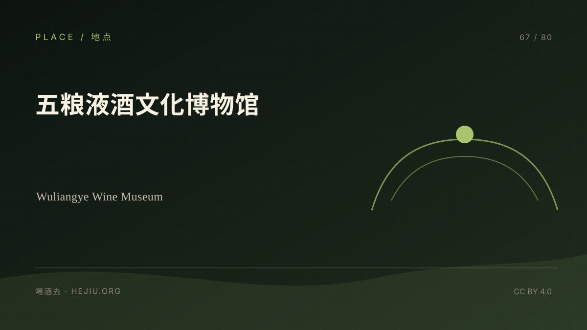

# 五粮液酒文化博物馆

五粮液酒文化博物馆在宜宾市翠屏区岷江西路 150 号的五粮液厂区内，官方名称是“五粮液酒文化博览馆”。它始建于 1988 年 3 月，展陈面积约 2400 平方米，馆方与地方政府都称它是中国酒业行业最早的酒文化博览馆。2022 年 7 月提档升级后，馆内按品牌、工艺、历史、发展、规划五个展厅重新组织，成为“十里酒城”工业旅游线路上的第一站。

> **到访信息**
> - 地址：四川省宜宾市翠屏区岷江西路150号。
> - 开放与预约：以[官方页面](http://nb.ncha.gov.cn/museumdetail.html?msg=695e97ba55204e019622a4a0c22255c5&nianfen=2025)为准；开放时间、场次和预约规则会随季节调整。
> - 交通与费用：出发前以官方页面为准，本页不承诺固定票价。
> - 营业状态：已核实；来源最近核对：2026-11-08。

图：五粮液酒文化博物馆栏目示意图。项目自产或类别插图，用于中国酒文化语境，不是该对象的实拍。

> **先给结论**
> **一句话：** 这页判断五粮液酒文化博物馆值不值得专程去，以及到访前要核对什么。
>
> - **适合谁：** 正在计划去五粮液酒文化博物馆、想知道值不值得专程安排半天到一天的人。
> - **不适合谁：** 只想要“必去榜单”、不准备核对预约、交通和开放时间的人。
> - **先看这两点：**
>   - 建议预留 1–1.5 小时看博物馆，2–3 小时看整个景区。
>   - 第一个误区是把“五粮液酒文化博物馆”与“五粮液酒文化博览馆”当成两个地方。

## 1988 年：五粮液酒文化博物馆的关键起点
1988 年 3 月 3 日，五粮液酒文化博览馆设立。它比许多酒厂后来兴建的“酒文化馆”早了十几年，因此“最早”这个说法在行业里有具体所指：不是中国最早的博物馆，而是中国白酒行业最早以酒文化为主题的博览馆。2006 年，它被四川省委、省政府评为四川省爱国主义教育基地，同时承担社会科普与青少年教育功能。2022 年 7 月，博览馆完成提档升级，展陈从早期的企业陈列转向“品牌—工艺—历史—发展—规划”五条线。

五粮液的历史叙事可以拉到很远。公司资料称五粮液“始于唐，兴于宋，成于明，得名于清”，并保存有始建于 1276 年的元代古窖池群，距今七百余年；集团目前拥有三万五千余口发酵池，古窖池群是其中最有文物价值的一部分。宜宾位于金沙江与岷江汇合成长江的地方，三江交汇带来湿润气候与便利水运，也为酿酒微生物的繁衍提供了条件。把博物馆放在宜宾，而不是放在一个抽象的“酒文化园区”，原因就在这里。

“五粮液”这个名字直接说明了配方：高粱、大米、糯米、小麦、玉米五种谷物。多粮配方让酒体比单粮浓香更丰满，香气里既有粮香，也有曲香与陈香；包包曲、续糟配料、跑窖循环等工艺，则决定了浓香型白酒的骨架。博物馆的工艺厅把这些步骤拆开讲，但真正的生产仍在馆外的车间里进行，参观时要分清“展陈的工艺”与“正在运行的工艺”。

## 空间与展陈

博览馆在五粮液厂区东大门一侧，与以五粮液产品包装为外观造型的直营店相邻。馆内面积约 2400 平方米，五个展厅按主题划分：品牌厅讲五粮液的品牌历史与荣誉，工艺厅讲五粮配方、制曲、发酵、蒸馏与勾兑，历史厅讲宜宾酿酒与古窖池，发展厅讲企业近几十年的扩建与产品线，规划厅讲未来的厂区与产业布局。展陈以实物、图片、影像与场景复原为主，信息密度不低，但动线不长。

馆外空间是理解五粮液的另一半。东大门进入厂区后，一侧是博览馆，另一侧是直营店；再往里是金杯林、书法长廊、瓶楼、523 车间与环保生态湿地。523 车间被介绍为全球规模最大的单体酿造车间，瓶楼是厂区的标志性建筑，金杯林与书法长廊则把企业荣誉与文化活动做成景观。是否能看到车间内部、能走多远的厂区线路，取决于当天的预约与生产安排，不能默认“进馆就能逛全厂”。

展品层面，最值得看的是“从一颗种子到一滴美酒”的链条：粮食样本、曲块、窖泥、蒸馏器模型、不同年代的酒瓶与酒标、企业档案与奖杯。它们不靠单件“镇馆之宝”制造惊喜，而是把浓香型白酒的生产逻辑拆成可理解的步骤。看完再去厂区看真实的窖池与车间，信息会闭合；只看展柜、不进厂区，容易觉得它像一间企业陈列室。

## 怎么参观

建议预留 1–1.5 小时看博物馆，2–3 小时看整个景区。比较顺的路线是：东大门→五粮液酒文化博览馆→金杯林与书法长廊→瓶楼→523 车间（如开放）→环保生态湿地。若只对酒文化感兴趣，博物馆加直营店即可；若想看生产，要提前确认车间是否对游客开放，以及是否有讲解陪同。

景区免费开放，但进入厂区与展馆通常需要提前预约，团队、研学与媒体参访要单独对接。预约方式与名额以景区官方公告为准；不要因为“免费”就临时到门口要求进入。讲解服务建议提前预约，散客可以按展板与导览牌阅读；馆内以中文为主，外文资料与讲解要提前询问。

品鉴与购买是两件事。直营店可以买到五粮液、五粮春、五粮醇等产品，是否有品鉴、是否收费，以现场安排为准；未成年人不得饮酒。参观生产区时不要穿拖鞋、凉鞋或高跟鞋，不要触碰设备与窖池，不要进入警戒线内；车间有噪音、蒸汽与酒糟气味，带小孩的家长要看住孩子。

## 五粮液酒文化博物馆的地址与营业安排
地址是四川省宜宾市翠屏区岷江西路 150 号（五粮液厂区东大门一侧）。国家文物局博物馆年报记载：博览馆全年开放（365 天），开放时间 8:30–17:30，免费开放；咨询电话 0831-3566777。年报的“预约参观信息”一栏记为“无”，即未登记统一预约要求；但进入厂区仍受门禁与生产安排管理，团队、研学与讲解建议提前联系景区确认。

门票：免费，无门票费用；景区内的讲解、品鉴、定制活动或特殊展览可能单独收费，预约时问清楚包含哪些内容。厂区直营店可购买五粮液、五粮春、五粮醇等产品，未成年人不得饮酒。

交通：宜宾市区不大，从宜宾站、宜宾西站（高铁）或五粮液机场打车到岷江西路都在可接受范围，具体时间看路况；公交线路与下车站点以实时地图为准（未逐条核验）。自驾可停景区指定停车场，不要把车开进生产区或装卸区。

本页不提供示意地图：宜宾五粮液酒文化博物馆的经纬度暂无公开可核验来源，frontmatter 留空；导航请用实时地图并到馆确认入口。

「五粮液酒文化博物馆」的开放时间、价格与预约，以[官网](http://nb.ncha.gov.cn/museumdetail.html?msg=695e97ba55204e019622a4a0c22255c5&nianfen=2025)的公开页面为准；核验日期为 2026-11-08，临时调整以官网当日公告为准。

## 礼仪与误区

第一个误区是把“五粮液酒文化博物馆”与“五粮液酒文化博览馆”当成两个地方。它们是同一座馆的不同叫法，官方名称是“博览馆”，本页按任务使用“博物馆”作为标题，并在别名中保留官方名称。第二，五粮液是浓香型白酒，不是酱香型；不要把它与茅台的生产工艺混为一谈。第三，免费开放不等于免预约，厂区仍有生产安全与门禁管理。

第四个误区是把“古窖池”简单理解成“老房子”。窖池的价值在窖泥中的微生物群落与连续使用的时间，窖池越老，微生物生态越稳定；参观时不要触摸窖泥，也不要往窖池里投掷物品。第五，白酒的酒精度通常在 52% 左右，品鉴时小口慢饮，不要空腹，更不要酒后驾车。

在厂区与馆内，遵守“不吸烟、不触摸设备、不进入非开放区、不在禁止拍照处拍照”的规则。生产区有机械与高温管道，穿凉鞋、拖鞋不安全；酒糟气味浓，敏感的人可以戴口罩。直营店购买酒类时注意携带与托运规定，不要把酒带上不允许携带的交通工具。

## 宜宾市的周边街区
五粮液景区适合与宜宾市区的酒文化与江景串成一日路线。宜宾市政府推荐的线路是：五粮液景区→流杯池公园→501 白酒文化圣地→冠英古街→合江门广场。流杯池公园与黄庭坚有关，501 白酒文化圣地是另一处酒文化空间，冠英古街是老城街区，合江门可以看到金沙江与岷江汇合成长江。把它们连起来，一天能看完“酒厂—酒史—老城—江景”。

如果多留一天，可以去李庄古镇看抗战时期的建筑与学术史，或去蜀南竹海看竹林景观；这两处距离市区较远，需要单独安排半天到一天。翠屏山、真武山在市区，适合傍晚散步。宜宾的食物也值得安排：燃面、李庄白肉、竹荪与江鱼，配白酒时注意量。

交通上，宜宾西站是高铁站，五粮液机场在市区西北方向；从任一交通枢纽打车到岷江西路都方便。公交班次与线路以实时地图为准，厂区周边以工业与居住区为主，不是逛街型街区。只停留半天的话，优先博物馆与厂区外观，不要把李庄或竹海硬塞进同一天。

## 同主题博物馆与延伸阅读
五粮液酒文化博物馆是理解[白酒](ref:baijiu)与[浓香型白酒](ref:strong-aroma)的一条入口，也把[宜宾](ref:sichuan)放进了长江上游的酿酒地理里。想看这款酒本身的信息，可以读[五粮液](ref:wuliangye)。

补充阅读：[A Ginjinha](ref:c-extra-1)。

相关条目：[白酒](ref:baijiu)、[浓香型白酒](ref:strong-aroma)、[四川省](ref:sichuan)。
