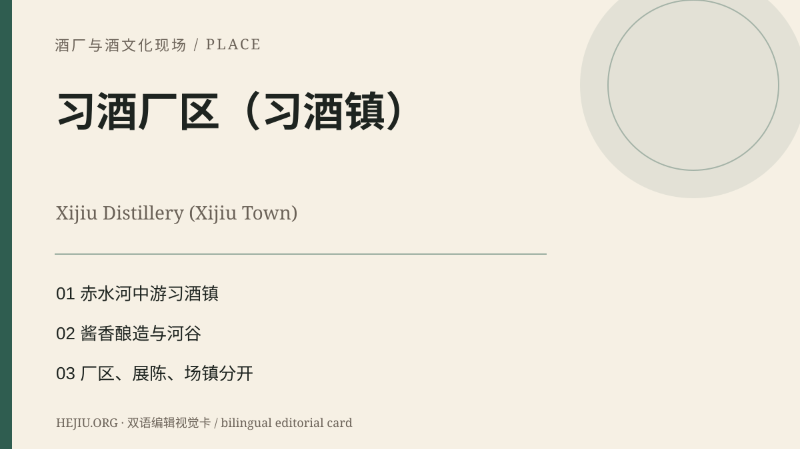

# 习酒厂区（习酒镇）

习酒镇在赤水河中游，河谷两边是贵州习水与四川古蔺的山地。很多人把它当成“路过郎酒庄园的下一站”，其实习酒厂区本身就是酱香型白酒河谷生产的一处完整样本：制曲、堆积、入窖、蒸馏、陈放都沿山坡展开。先分清厂区、展陈与镇上生活空间，再决定是专程参访，还是把它放进川黔酒旅的两天线路。

图：习酒厂区（习酒镇）专属双语视觉卡。项目自制双语视觉卡，用于识别主题，不是现场照片。

> **先给结论**
> **适合谁：** 走川黔酱香路线、想看赤水河中游生产的人；适合与土城、二郎镇串成两天。
> **不适合谁：** 只想在公路边拍照、不愿预约的人；厂区有生产门禁。
> **一句话：** 把厂区参访与习酒镇住宿分开订，品鉴不安排给司机。

## 厂区、展陈与场镇

习酒镇是生活场镇，有住宅、学校、菜市场、小餐馆与酒厂班车；贵州习酒的生产厂区是独立的工业空间，有制曲房、窖池、蒸馏车间、陶坛库与包装物流；展陈或接待空间则负责讲解历史、工艺与品牌。三者常在同一条山坡路上，却有不同的门禁。到游客中心先问清“哪里能进、哪里只能远观、哪里要预约”，不要拿着手机导航直接往车间走。镇上的坡道多，穿平底鞋比穿硬底鞋稳。

## 赤水河中游的酱香

酱香型白酒的工艺围绕高温制曲、重阳下沙、多次蒸煮与取酒展开，习酒镇河谷的湿热、风速与水质会影响制曲和堆积，但原料、工艺控制与长期陈放同样关键。看生产区时，重点看曲块的培养温度、高粱的破碎比例、糟醅堆积的疏松度、窖池的密封与轮次取酒；不要只记数字，要看数字如何落在具体班组与车间。若不能进车间，就在展陈里看剖面与流程图，再到观景台对照河谷朝向与厂区布局。

## 怎么到、住哪里

习酒镇在习水县东部，通常从遵义、泸州或重庆方向进入；山路多，雨雾天慢行，自驾要留足时间。班车班次少，出发前查实时信息。当天往返很赶，建议住习水县城或习酒镇一晚；镇上住宿以本地宾馆为主，厂区接待住宿另订，旺季与酒厂接待日会紧张。订房问清热水、停车、早餐与退房时间。行李尽量轻，坡道与窄巷多，大箱子不方便。

## 预约与品鉴边界

厂区参观通常按团队、时段与线路组织，是否开放、能否拍照、是否收费以官方公告为准。正在运转的车间有蒸汽、机械、叉车与酒糟堆放，不能自行进入，也不要翻越围栏。品鉴要问清酒精度、容量与收费，小杯慢饮，不空腹；司机不喝，品鉴后不要在山路自驾。买酒去官方店或授权店，保留发票；不要把“内部酒”“接待酒”当成捡漏，来源不清的酒不要带上车。

## 土城与赤水怎么串

习水酒旅可以把“习酒镇—土城古镇—赤水”串成两天：第一天看习酒厂区与习酒镇，住习水；第二天到土城看四渡赤水纪念馆与老街，再往赤水或遵义返程。跨县路线要确认班车与导航，雨季注意塌方与封路。吃饭可以试习水羊肉粉、豆花、腊肉与赤水河鱼，配酱香酒时控制量。若只留半天，就在镇上吃饭、看厂区外观与河谷，不要把土城和赤水都塞进来。

## 把习水当成“河谷里的两天”

第一天下午到习酒镇，先入住、走场镇、看厂区外观与河谷，傍晚吃饭；第二天上午按预约进厂区或展陈，中午退房去土城，下午看纪念馆与老街，傍晚往赤水或遵义走。这样的顺序把生产参访放在体力最好的上午，把长距离转场放在下午。若只有一天，选厂区外观加展陈，不要再加土城；若带着长辈，减少坡道步行，把展陈里的剖面先看懂，再到观景台对照。如果只做一件事，就在上午进厂区展陈，把制曲、堆积、窖池与蒸馏的流程看一遍，再到观景台对着河谷找车间位置；下午留给习酒镇与土城，不要在同一天塞进赤水。若遇雨雾，宁可少走一个点，也不要在山路赶夜路；品鉴后把车钥匙交给不喝酒的人。镇上餐馆多在饭点营业，过了午后选择变少，吃饭不要拖到两点以后；住宿订在县城，第二天要预留四十分钟到习酒镇，带一件薄外套，河谷早晚凉。到厂区门口不要买散装酒，来源不清的不带上车；提前问清洗手间位置，山路弯道不超车。

## 出发前核对

- 确认厂区参观是否开放
- 住镇内还是县城先定
- 品鉴后不在山路自驾
- 买酒只走官方或授权店
- 跨县班车提前查
- 雨季留意塌方与封路
- 坡道多，行李尽量轻
- 不要翻越厂区围栏
- 厂区参观以团队时段为准
- 山路会车减速
- 提前十分钟到集合点
- 住宿确认次日早餐

## 这一页的边界与下一步

习酒厂区沿赤水河展开，生产区、办公区与参观接待区分散，步行距离比地图上看起来长。参观通常需要预约或由对接人安排，散客开放范围有限；生产时段不要进入制曲、酿酒车间，也不要越过安全线。

从习水县城到习酒镇有班车和网约车，但班次受时段影响；从茅台镇过河过来也要预留检查与堵车时间。河谷湿热，夏天注意补水，冬天早晚温差大。品鉴后不要立即自驾。

这一页不承诺能看到特定车间或酒库。把厂区参观与土城古镇、赤水河谷风光分开安排，遇到临时管制时，优先服从生产安排。买酒与寄送规则以厂方和当地渠道为准。

## 参考资料

- 习水县人民政府 — 县情概况 — https://www.xsx.gov.cn/zjxs/xsgk/jj2023/202605/t20260525_90206553.html（习水县人民政府，核对 2026-11-25）
- 习酒 — 公司简介 — https://www.gzxijiu.com/about/introduction?menuId=r_5uFQaERX42fDKDI7O2B（贵州习酒股份有限公司，核对 2026-11-25）
- 遵义市人民政府 — https://www.zunyi.gov.cn/（遵义市人民政府，核对 2026-11-25）
- GB/T 2260-2007 中华人民共和国行政区划代码（国家标准化管理委员会，核对 2026-11-25）

相关条目：[土城古镇](ref:tucheng)、[习水习酒路线](ref:route)、[习酒](ref:brand)、[贵州习酒](ref:producer)、[酱香型白酒](ref:style)、[贵州省](ref:region)、[第一次喝白酒怎么选](ref:guide)、[中国酒史纲](ref:history)。
