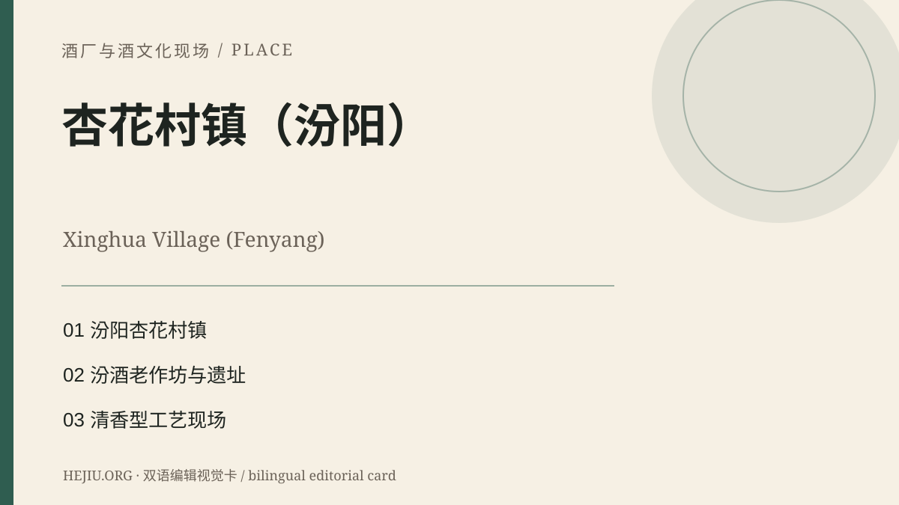

# 杏花村镇（汾阳）

“杏花村”在诗里是一个意象，在汾阳是一个镇。汾酒厂区、汾酒老作坊、杏花村遗址与酒文化展陈分布在镇内外，很多游客只到大门或拍一块碑，就以为看完了杏花村。真正值得看的是清香型白酒的制曲、地缸发酵、蒸馏与陈放，以及“诗酒”叙事如何落在一座酒镇。先分清厂区、遗址与展陈，再决定这趟是看工艺、看历史，还是两者都要。

图：杏花村镇（汾阳）专属双语视觉卡。项目自制双语视觉卡，用于识别主题，不是现场照片。

> **先给结论**
> **适合谁：** 想理解清香型白酒与“诗酒杏花村”的人；适合与汾阳、平遥或太原串线。
> **不适合谁：** 只想要一个“杏花村”牌坊拍照、不愿预约的人；厂区与遗址有边界。
> **一句话：** 先看老作坊与工艺，再读诗与酒史，最后把品鉴与买酒分开。

## 杏花村不是单一景区

杏花村的空间至少分四层：汾酒生产厂区、汾酒老作坊与遗址、酒文化展陈空间、杏花村镇的日常生活。厂区有制曲、地缸发酵、蒸馏、陶坛库与包装物流；老作坊与遗址负责说明历史与工艺传承；展陈空间解释品牌、诗酒文化与产区；镇区则有居民、餐馆、学校与道路。四层常被游客压成“杏花村”三个字，结果找不到入口。到游客中心先拿导览图，问清哪一处需要预约、哪一处只能远观。

## 汾酒老作坊与遗址

汾酒老作坊是理解清香型白酒传统生产的重要现场，重点看地缸、曲房、蒸馏设备与陈放空间。清香型白酒用地缸发酵，缸体埋在地下，便于控制温度与杂菌；制曲以低温、清茬为主，强调曲香清雅。看老作坊时注意三件事：地缸的排列与埋深，曲块的培养与储存，蒸馏与陈放如何衔接。遗址与碑刻能补充历史，但不要只看碑；把“地缸—曲—蒸馏—陈放”这条线看明白，比记年代更有用。

## 清香型工艺与诗酒

清香型白酒的“清”不是淡，而是干净、爽净、少杂味。工艺上强调低温制曲、地缸发酵、清蒸清烧与长期陈放；风味上以乙酸乙酯为主体，香气清雅，入口绵甜，尾味干净。参观时可以把工艺与诗酒叙事分开看：工艺靠车间与展陈里的剖面、器具和流程图，诗酒靠碑刻、诗文与酒史展陈。两者相互补充，但不要把“牧童遥指杏花村”当成工艺说明。若展馆有讲解，先听工艺部分，再听诗酒部分。

## 怎么到、留多久

杏花村镇在汾阳市东北，距汾阳城区不远，通常从太原、平遥或汾阳站转车；班次以实时查询为准。只看老作坊与展陈，约两到三小时；加厂区外观、镇区与品鉴，半天；再串汾阳老城或贾家庄，一天。厂区与镇区之间可打车，步行路线不长但货车多。夏天山西昼夜温差大，带外套；冬天路面结冰，穿防滑鞋。若从平遥过来，把杏花村安排在上午，下午回平遥或去汾阳老城。

## 汾阳与贾家庄

汾阳不只有杏花村：汾阳老城的文庙、城墙遗存与老街，贾家庄的乡村文化与电影相关空间，都能把“酒镇”放进晋中的生活里。半天可以按“老作坊—展陈—镇区”走；一天可以加汾阳老城与贾家庄。吃饭可以试汾阳旋粉、刀削面、过油肉与汾州家常菜，配清香型白酒时控制量。买酒去官方店或授权店，保留发票；不要把“内部酒”当成老作坊的延伸。若带孩子，先看工艺动画或模型，再进车间外观。

## 把杏花村读成“工艺 + 诗”

先到老作坊看地缸、曲房与蒸馏，把清香型白酒的“清”落在具体器具与流程上；再看展陈里的诗文、碑刻与酒史，理解“杏花村”如何从地名变成文化意象；最后在镇区吃饭、散步，不要急着买酒。若只有两小时，老作坊加一个展陈足够；若带孩子，先看模型与动画，再走车间外观。离开前把品鉴与买酒分开：先喝一小杯，再决定买不买，不要在讲解结束时被推销节奏带着走。如果只做一件事，就在老作坊看地缸、曲房与蒸馏，把清香型白酒的“清”落到器具与流程上；再去展陈读诗与酒史，最后才吃饭、买酒。若只留两小时，老作坊加一个展陈足够；若从平遥过来，把杏花村放在上午，下午回平遥或去汾阳老城。冬天路面结冰，穿防滑鞋；夏天昼夜温差大，带外套。提前问清洗手间位置，山路弯道不超车，车上备水。

## 出发前核对

- 确认老作坊与展陈入口
- 厂区不自行进入
- 地缸区不触摸缸体
- 品鉴后不开车
- 买酒只走官方或授权店
- 冬天穿防滑鞋
- 从平遥过来先查班车
- 带孩子先看模型再进现场
- 老作坊讲解先问场次
- 地缸区不揭盖
- 展陈内不触摸碑刻
- 镇区吃饭先问营业
- 买酒核对批次
- 冬天路面结冰慢走

## 这一页的边界与下一步

杏花村镇的核心是汾酒的老作坊、酒文化博物馆与镇区街巷，不是一座仿古商业街。参观时先分清“博物馆”“老作坊”“现代厂区”三个区域，各自开放时间与预约方式不同；生产区不能随意进入，老作坊更适合看工艺与空间。

从汾阳或太原方向到杏花村有公交和自驾路线，镇区步行范围不大，但展馆之间有一定距离。节假日的讲解名额紧张，提前预约比现场排队稳妥。当地餐饮以面食为主，品鉴前先吃点东西。

这一页不把杏花村写成“清香型唯一产地”。它适合作为汾阳路线的核心，再结合周边酒厂与晋中景点；若时间只够一处，优先博物馆与老作坊，不必强塞购物点。

## 参考资料

- 汾酒博物馆 — 汾酒集团 — https://www.fenjiu.com.cn/OnlineTour/2023-01-06/296.html（山西杏花村汾酒集团，核对 2026-11-25）
- 老作坊博物馆 — 汾酒集团 — https://www.fenjiu.com.cn/OnlineTour/2023-01-06/297.html（山西杏花村汾酒集团，核对 2026-11-25）
- 汾酒博物馆 — 全国博物馆年度报告 — http://nb.ncha.gov.cn/museumdetail.html?msg=ee70a34121f3498ca08d4ddede4701e5&nianfen=2022（国家文物局全国博物馆年度报告信息系统，核对 2026-11-25）
- 汾酒集团发展史 — 杏花村遗址与酒博物馆 — https://www.fenjiu.com.cn/developmentHistory/index.html（山西杏花村汾酒集团，核对 2026-11-25）

相关条目：[汾酒博物馆](ref:museum)、[汾阳杏花村路线](ref:route)、[汾酒](ref:brand)、[汾酒集团](ref:producer)、[清香型白酒](ref:style)、[山西省](ref:region)、[第一次喝白酒怎么选](ref:guide)、[中国酒史纲](ref:history)。

## 相关图像

图：汾酒。图片：N509FZ，CC BY-SA 4.0，via Wikimedia Commons（[原图页面](https://commons.wikimedia.org/wiki/File:Fen_Jiu_and_Chu_Yeh_Ching_Chiew_at_a_supermarket_in_Beijing_(20241109164541).jpg)）。关联图像：杏花村镇（汾阳）。
