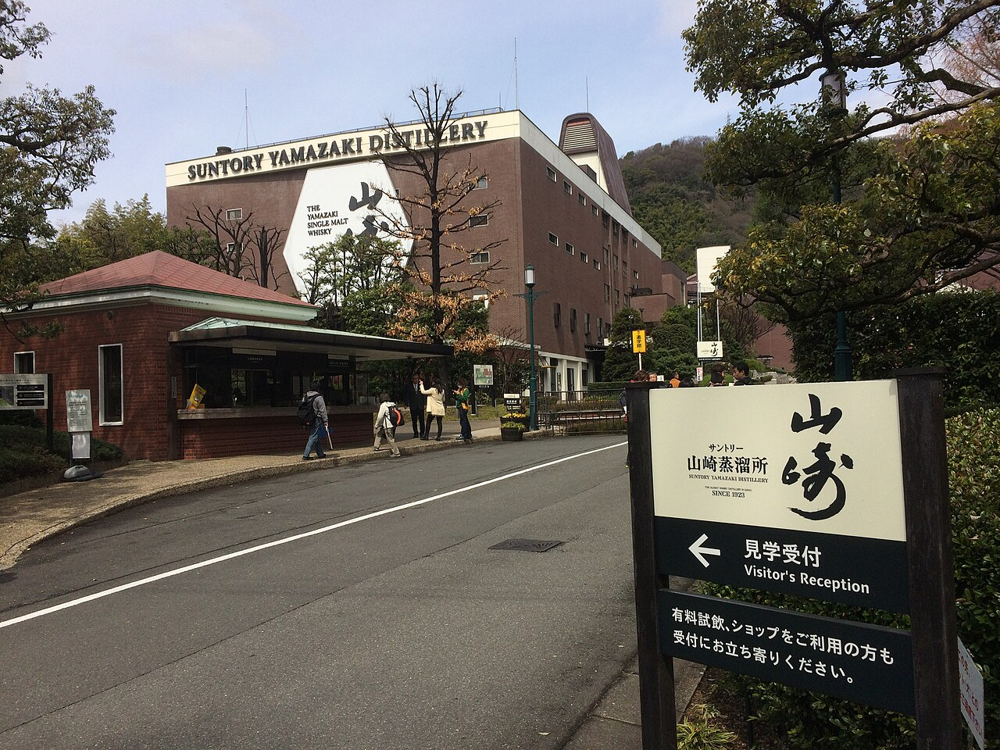

# 山崎蒸馏所

山崎蒸馏所在大阪府三岛郡岛本町山崎，天王山山脚，京都西南。1923 年动工，1924 年开始蒸馏，是日本最早的麦芽威士忌蒸馏厂，由三得利创始人鸟井信治郎推动。他的目标不是复制苏格兰，而是做出适合日本人口味的威士忌。厂址选在山崎，官方强调当地的水与四季气候适合麦芽威士忌的酿造与熟成。今天厂区约 11 万平方米，仍保留建厂初期的威士忌馆建筑。

图：山崎蒸馏所。图片：Ujigis，CC BY-SA 4.0，via Wikimedia Commons（[原图页面](https://commons.wikimedia.org/wiki/File:YamazakiDistillery_01.jpg)）。

## 1923 年：山崎蒸馏所的关键起点
日本威士忌的起点常被写成“模仿苏格兰”，但山崎的早期目标更具体：用日本的水与气候，做出比进口威士忌更柔和、更适合餐桌的酒。1923 年动工、1924 年蒸馏，这个时间点使山崎成为日本第一家麦芽威士忌蒸馏厂。建厂初期并不顺利，酒厂在设备、酵母与橡木桶上反复试验；今天的山崎风格——果香、蜂蜜、水楢桶的檀香与适度的烟熏——是长期调整的结果，不是一开始就设计好的。

厂区在京都西南的天王山山脚，靠近桂川、宇治川与木津川流域。官方把这里的水与四季变化放在介绍的核心位置；对参观者来说，这意味着山崎不是一个“把苏格兰设备搬过来”的复制厂，而是一个把当地环境写进酒里的地方。威士忌馆保留了建厂以来的建筑与部分设备，是理解这段历史最直接的入口。

## 空间与展陈

参观分两类。第一类是蒸馏所导览，付费，走糖化、发酵、蒸馏与仓库，能看到铜制蒸馏器、发酵槽与陈酿仓库；第二类是威士忌馆，免费，看展陈与品鉴，不进入生产流程。威士忌馆是厂内最早期的建筑之一，展出山崎的历史、原料、桶型与旧设备；品鉴区可以付费试饮山崎及三得利其他酒款。厂区还有商店与休息区。导览用耳机讲解，生产区不能自由走动；发酵槽、蒸馏器与仓库的尺度是参观的重点。

展陈的线索可以按“原料—工艺—桶—时间”来读。原料部分讲麦芽与水的选择；工艺部分讲糖化、发酵与两次蒸馏；桶部分讲波本桶、雪莉桶与水楢桶的差异；时间部分讲山崎仓库的熟成环境。把这四条线记住，品鉴时更容易分辨“甜味来自哪里”“烟熏来自哪里”“木质香来自哪里”。

## 参观或点单方式

所有访客都必须预约，包括只去商店或品鉴区的人；没有预约不能入场。蒸馏所导览采用抽选制，名额按月份放出，旺季很快满；威士忌馆参观免费，但也需要预约“威士忌馆见学”。预约在官网进行，参观当天带预约确认与身份证件；品鉴与买酒需年满 20 岁，开车、骑车或未成年人不能饮酒。

点单时可以先从山崎的基础款开始，再试不同桶型或年份；不要一次点太多，酒精度高的原酒会很快压住味觉。品鉴区通常提供小杯与吐酒桶，按自己的节奏来。商店的热门酒款库存不稳定，购买有数量限制与年龄核验，不能电话预留；如果只为买某一瓶而来，先看官网公告，避免白跑。

## 山崎蒸馏所的地址与营业安排
地址是大阪府三岛郡岛本町山崎 5-2-1，邮编 618-0001；电话 075-962-1423（10:00–17:00）。开放时间 10:00–16:45，最后入场 16:30；年末年始与蒸馏厂检修日闭馆，偶有临时休业，以官网为准。

预约：所有访客都必须预约，包括只去商店或品鉴区的人，没有预约不能入场；预约通过官网进行。蒸馏所导览采用抽选制、名额按月份放出，旺季很快满；威士忌馆参观免费，但也需要预约“威士忌馆见学”。入馆免费，部分导览团另行收费，价格以官网为准。品鉴与买酒需年满 20 岁并出示身份证件；不提供电话或邮件留货。

交通：从 JR 京都线“山崎”站或阪急京都线“大山崎”站步行约 10 分钟（官网 Access 页列有铁路交通，步行时间为约数、未逐项复核）。厂区没有一般停车场，禁止路边与周边公园停车，建议乘公共交通。

「山崎蒸馏所」的开放时间、价格与预约，以[官网](https://www.suntory.com/factory/yamazaki/)的公开页面为准；核验日期为 2026-11-08，临时调整以官网当日公告为准。

## 礼仪与误区

误区一是以为“到了就能进”。山崎是全预约制，连商店与品鉴区也要预约，临时到门口会被拒绝。误区二是把威士忌馆当成生产导览，它不进入糖化、蒸馏车间；想看生产必须预约蒸馏所导览。误区三是开车来还试饮，日本对酒驾严格，驾驶者与同车乘客都不能饮酒。误区四是以为商店一定买得到热门酒款，库存波动大，购买还有数量限制与年龄核验。

参观时按预约时间到，迟到可能不能入场；生产区不要触摸设备、不要越过黄线。品鉴时先闻后喝，需要吐酒时使用吐酒桶；不要喷浓香水，以免影响他人。带孩子的家庭要遵守年龄与陪同规定，婴儿车在部分区域不便通行。厂区内禁止外带饮食，宠物也不能进入，导盲犬除外。

## 岛本町的周边街区
山崎在京都与大阪之间，适合作为半日行程。上午参观蒸馏所，下午去对面的天王山或石清水八幡宫；也可乘 JR 到京都看伏见稻荷、清水寺，或回大阪。若对日本威士忌感兴趣，可继续去白州蒸馏所（山梨县）或余市蒸馏所（北海道），但都需要另安排一天。只在大阪市区活动的人，可把山崎与大阪城、梅田安排在一天，交通时间可控。

若想建立更完整的日本威士忌印象，可以把山崎与大阪市区的酒吧行程结合：白天在蒸馏所记住原酒与桶型，晚上在酒吧对比不同酒厂的风格。反过来先喝酒再参观也成立，但高强度原酒会影响味觉，第二天再进蒸馏所更稳妥。

如果只安排两小时，建议选威士忌馆而不是蒸馏所导览：展陈与品鉴更集中，也不用赶生产区的路线。若想理解工艺，导览更值得，但要留出半天，并把交通与预约时间算进去。周末与红叶季名额紧张，提前一个月查看官网比较稳妥。

## 同产区蒸馏厂与延伸阅读
山崎是[山崎单一麦芽威士忌](ref:yamazaki)的生产地，也是理解[日本](ref:japan)威士忌的起点；想先建立风味框架，可读[威士忌入门](ref:whisky-intro)，再回到[威士忌](ref:whisky)的分类。

补充阅读：[High Five 酒吧](ref:c-extra-1)。

对照阅读：[山崎单一麦芽威士忌](ref:yamazaki)、[日本](ref:japan)。

相关条目：[威士忌](ref:whisky)。
