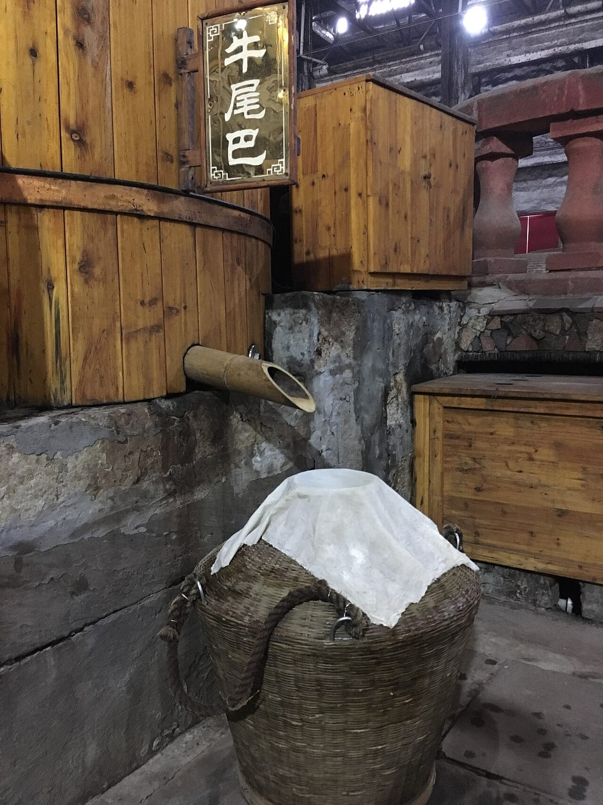

# 洋河酒厂文化旅游区

从宿迁市区往洋河镇走，路边的酒糟味会先于景区大门出现。这里不是一座“把酒厂封起来做博物馆”的园区，而是洋河酒厂仍在运转的生产基地：卡车、窖池、陶坛库、包装线与参观动线叠在一起。游客看到的是中国白酒工业化生产的一个超大规模样本，也是一段从 2006 年“工业旅游示范点”一路走到国家 4A 景区、国家工业遗产与全国重点文保的履历。

> **到访信息**
> - 地址：江苏省宿迁市宿城区洋河镇中大街118号。
> - 开放与预约：以[官方页面](https://ly.chinayanghe.com/)为准；开放时间、场次和预约规则会随季节调整。
> - 交通与费用：出发前以官方页面为准，本页不承诺固定票价。
> - 营业状态：已核实；来源最近核对：2026-11-21。

图：白酒固态发酵的酒醅（泸州老窖车间，示意图；并非洋河现场）。图片：Xiaomage de，CC BY-SA 4.0，via Wikimedia Commons（[原图页面](https://commons.wikimedia.org/wiki/File:Baijiu_Produktion_Luzhou_Laojiao.jpg)）。

> **先给结论**
> **一句话：** 这页判断洋河酒厂文化旅游区值不值得专程去，以及到访前要核对什么。
>
> - **适合谁：** 正在计划去洋河酒厂文化旅游区、想知道值不值得专程安排半天到一天的人。
> - **不适合谁：** 只想要“必去榜单”、不准备核对预约、交通和开放时间的人。
> - **先看这两点：**
>   - 第一，不要把景区当成“酒厂博物馆”。
>   - 官方简介把时间线写得很清楚：2006 年，景区被评为全国工业旅游示范点；2015 年创建为国家 4A 级旅游景区；2019 年入选第三批国家工业遗产。

## 2006–2021：洋河酒厂文化旅游区的历史节点
官方简介把时间线写得很清楚：2006 年，景区被评为全国工业旅游示范点；2015 年创建为国家 4A 级旅游景区；2019 年入选第三批国家工业遗产，同年“洋河地下酒窖”获批全国重点文物保护单位；2021 年，“洋河酒酿造技艺”入选第五批国家级非物质文化遗产名录。景区总占地面积约 4.5 平方公里，西枕骆马湖，东滨洪泽湖，古黄河、大运河与淮河环绕，官方把它的定位写成“以白酒酿造、品鉴体验为核心的特色工业旅游区”。

需要区分“景区”和“酒厂”。景区依托江苏洋河酒厂股份有限公司的生产基地，开放的是展览馆、包装物流中心、酿酒车间、陶坛库、美人泉、中央酒区与地下酒窖等节点；未开放的生产区、仓库与办公区不属于游客动线。也正因为它是活的生产基地，参观时间、封闭区域与安全规定会随生产与检修变化，不能按普通博物馆的“随时可看”来预期。

## 园区与建筑

园区的空间尺度是它最直接的冲击。31 连跨酿酒车间是核心节点：官方数据写总长 698 米、宽 133 米、占地约 9.3 万平方米，拥有窖池 4340 条。“跨”是白酒酿造场地的特殊单位，每跨约 3000 平方米；31 跨连成一片，形成一条看不到头的厂房。走进车间，白色钢架、成排窖池、行车与工人同时出现，酒糟的酸香与蒸汽把整个空间填满。

9 万吨陶坛库是另一个尺度：占地 85 亩，建筑面积 16.5 万平方米，可储 9 万吨高档原酒。一期 3 万吨库区建筑面积 6.9 万平方米，内有 3 万只陶坛，单只约储 1 吨；二期 6 万吨库区建筑面积 9.6 万平方米，分四个单体，入口有 2 万平方米主题广场与“天下第一坛”，可储原酒 100 吨。陶坛库的温湿平衡、冬暖夏凉，是洋河“绵柔”原酒老熟的空间条件；站在库区里，陶坛的土色与库房的深色形成一种安静的压迫感。

美人泉景观园是古址复建与扩建：美人湖、美人桥、美人岛、品泉轩、咏泉林、赏泉榭、古宅与半景酒街组成一条水与酒的景观线，再现洋河美人泉的历史风貌与古槽坊酿造工艺。梦之蓝中央酒区位于洋河核心酿酒区域，占地约 2 万平方米，由传统酿造技艺展示馆、梦之蓝手工生产区、古法酿酒遗址区与古窖池群组成；这里分布着 2020 口古窖池，手工酿酒技艺入选第五批国家级非遗。地下酒窖则是“国宝酒窖”：总占地 3322 平方米，总建筑面积 5658 平方米，窖内 3800 余只陶坛，坛龄多在百年以上，2011 年列为江苏省文物保护单位，2019 年列为全国重点文保与国家工业遗产。

## 展线与馆藏

一条完整的参观线通常从企业展览馆开始，先看洋河的历史、品牌与产区，再进入包装物流中心。一号包装车间分洗瓶、灌装、装箱、码垛四个功能区，八条流水线，每条每小时产能不低于 6000 瓶；一号智能化立体仓库占地 8309 平方米，可存放成品酒 85 万箱，自动化与无人操作是它的展示重点。对不熟悉白酒工业的人来说，这一段最能理解“一瓶酒如何从车间走到仓库”。

接着是 31 连跨酿酒车间与 9 万吨陶坛库。车间看的是“规模与手工”的并存：一边是巨大的厂房与行车，一边是工人翻糟、上甑、摊晾的传统动作。陶坛库看的是“时间”：新酒进入陶坛，在微氧环境中缓慢老熟，酒体从冲、辣转向绵、柔。然后是美人泉景观园与梦之蓝中央酒区，看古窖池、手工班与古法酿酒遗址；最后进入地下酒窖，看百年陶坛与“液体黄金”的储存环境。产品体验馆通常放在最后，用于品鉴与购买。

## 怎么参观

散客与团队是两套规则。官方在 2026 年 7 月 7 日与 10 月 28 日两次发布“关于散客入园时间调整的公告”，说明散客入园时段并非全年固定；常见参考时段是上午 8:00–10:30、下午 13:30–16:00，但必须以景区官网最新公告或电话确认为准。10 人以上、40 人以上团队通常需要预约，具体按景区规定办理；研学、酒厂开放日与节假日的安排又不同。

建议留 2–3 小时，按“展览馆—包装物流—酿酒车间—陶坛库—美人泉—中央酒区—地下酒窖—产品体验”的顺序走。车间与酒窖的光线、温度与气味差别很大，穿舒适鞋，夏天备水，冬天注意车间与窖内的温差。品鉴环节要量力而行：白酒度数高，不要空腹喝，也不要把它当成“无限畅饮”；司机与未成年人不要参与品鉴。园区较大，跟紧讲解员，不要擅自离开动线进入生产区。

## 洋河酒厂文化旅游区的地址与营业安排
- 地址：江苏省宿迁市宿城区洋河镇中大街 118 号。
- 坐标：33.789347, 118.381495。
- 电话：景区咨询 0527-84938052；宿迁市旅游局咨询投诉 0527-84338610；投诉 0527-84938894；救援 0527-84938119。
- 开放：散客入园时段以官网“关于散客入园时间调整的公告”为准；2026 年有两次调整，参考上午 8:00–10:30、下午 13:30–16:00。
- 门票：以景区公告与现场票务为准；部分活动（如 2026 年秋假省内中小学生免票）有单独规则。
- 交通：公交 108 路到“洋河酒厂站”；自驾走淮徐高速—洋河出口—洋河收费站左转—酒都大道—中大街—终点。
- 游览时长：2–3 小时；团队与研学可能更长。
- 无障碍：园区较大，部分车间与酒窖有台阶、坡道与狭窄通道，轮椅通行需提前电话确认。
- 周边：洋河镇、宿迁市区、骆马湖与洪泽湖方向都可延伸；不要把这里当成“只看一眼”的打卡点。

## 礼仪与常见误区

第一，不要把景区当成“酒厂博物馆”。它是仍在生产的企业基地，参观动线受生产、检修与安全规定限制；未开放区域不要进入。第二，不要把“4A 景区”理解成“随时可进”。散客时段在 2026 年被两次调整，出发前必须查官网公告或打电话。第三，不要把品鉴当成“免费喝酒”。品鉴是小杯、按流程、讲解带领的体验；司机、未成年人与身体不适者不要参与。第四，不要只拍“31 连跨”的厂房外观；真正值得看的是窖池、陶坛与地下酒窖的空间逻辑。第五，不要在车间里乱摸设备、跨越警戒线或对着工人近距离拍摄；这是生产现场，不是摄影棚。第六，不要把“洋河”与“洋河镇”混淆；景区在洋河镇，宿迁市区到景区还有一段车程。

## 从洋河酒厂文化旅游区延伸到茅台酒厂
从景区出来，可以在洋河镇吃一顿当地菜，再往宿迁市区看项王故里、骆马湖或三台山。把这一站放进“中国白酒工业旅游”长线，可以对照 [茅台酒厂](ref:maotai) 的河谷厂区、[五粮液酒文化博物馆](ref:wuliangye) 的宜宾产区、[古井酒文化博物馆](ref:gujing) 的亳州古井、[汾酒博物馆](ref:fenjiu) 的杏花村清香，以及 [泸州老窖窖池群](ref:luzhou) 的明代窖池。它们各自回答不同问题：茅台看河谷与酱香，五粮液看多粮浓香，古井看魏晋以来的酒史，汾酒看清香与诗酒，泸州看连续使用的老窖。

宿迁段建议自驾或打车；公交 108 路能到洋河酒厂站，但班次与末班时间要提前查。若从南京或徐州出发，高铁到宿迁站再打车约一小时；不要把“洋河镇”当成宿迁市中心，留足路上时间。

## 参考资料
- 洋河股份景区简介：<https://www.chinayanghe.com/culture/whzl/cqly/>，用于核对 4.5 平方公里、四项认定、31 连跨车间、9 万吨陶坛库、美人泉、中央酒区与地下酒窖数据。
- 景区官网：<https://ly.chinayanghe.com/>，用于核对官网入口、最大承载量、实时客流与公告入口。
- 官方资讯列表：<https://ly.chinayanghe.com/CommunityArticle/Index/27>，用于核对 2026 年 7 月 7 日与 10 月 28 日的散客入园时间调整公告。
- 洋河股份官网：<https://www.chinayanghe.com/>，用于交叉核对公司背景与产区信息。
- 白酒工业旅游对照：[茅台酒厂](ref:maotai)、[五粮液酒文化博物馆](ref:wuliangye)、[古井酒文化博物馆](ref:gujing)、[汾酒博物馆](ref:fenjiu)、[泸州老窖窖池群](ref:luzhou)。

## 相关图像

图：茅台酒厂（贵州茅台）相关实景照片。图片：Jula2812，CC BY-SA 4.0，via Wikimedia Commons（[原图页面](https://commons.wikimedia.org/wiki/File:Maotai_-_Kweichow_Moutai_Distillery_China,_Flasche_Etikett_Detail_(2).jpg)）。关联图像：洋河酒厂文化旅游区。
