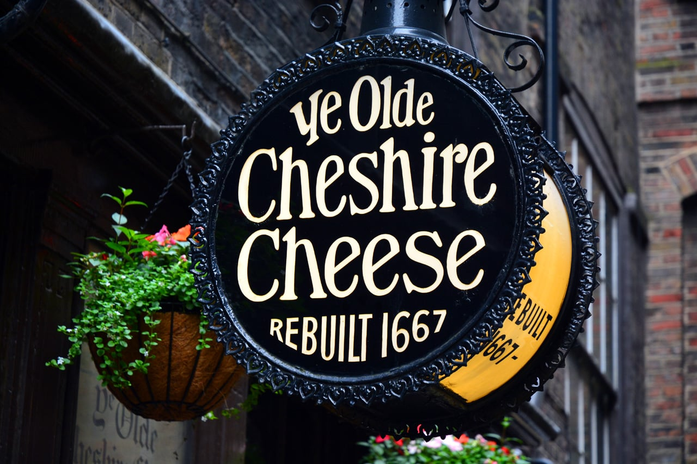

# 柴郡奶酪酒馆

舰队街 145 号的门口并不起眼，第一次来的人常常先经过一条窄通道，才意识到自己已经站在一间多层酒馆里。柴郡奶酪酒馆的吸引力不在“最古老”的招牌，而在它把几种互相拉扯的东西叠在同一栋建筑里：一场 1666 年大火之后的重建、舰队街印刷与报业的记忆、Samuel Smith's 的桶装艾尔，以及一套仍然按酒馆方式运转的多房间空间。

图：舰队街柴郡奶酪酒馆的悬挂招牌，写着店名与“Rebuilt 1667”。图片：Images George Rex，CC BY-SA 2.0，via [原图页面](https://commons.wikimedia.org/wiki/File:Ye_Olde_Cheshire_Cheese_rebuilt_1667_(14276567866).jpg)。

## 1667 年：柴郡奶酪酒馆的关键起点
这个地块上的酒馆记录可以追溯到 14 世纪，但今天看到的建筑以 1666 年伦敦大火后的重建为节点。火灾烧毁原建筑，酒馆在 1667 年重建；临街的黄色砖立面则通常被判断为 18 世纪末形成、19 世纪又经过改造和加高。1977 年被列入 Grade II 登录建筑，说明它被保护的理由不只是“老”，还包括街道立面、内部空间与城市肌理的完整性。

舰队街的印刷业从 1476 年卡克斯顿把印刷机带到英格兰开始，1500 年温金·德沃德又把印刷所设在圣布莱德教堂旁。此后几百年，这条街与报社、印刷厂、律师和教士紧密相连；1980 年代报业陆续迁往 Wapping，2016 年最后一批记者离开。柴郡奶酪酒馆的顾客结构也随之变化：从编辑、印刷工与文人，转向附近的律师、上班族与游客。街区史料把塞缪尔·约翰逊、狄更斯、弥尔顿、马克·吐温、P.G. 沃德豪斯、丁尼生与柯南·道尔列为常客；这类名单往往混合了确有到访与后世附会，更稳妥的读法是把它当作一种“文学传统”，而不是逐条可证的到访记录。

## 空间与酒单

酒馆从舰队街的窄门进入，侧面贴着 Wine Office Court；内部由多个低矮房间和楼梯串联，常见区域包括 Snug Bar、Johnson Bar、Cheshire Bar、Cellar Bar、Chop Room 与 Williams Room。每个房间的高度、光线和座位密度都不同：前厅更适合短饮与看人，地下酒窖更有“旧伦敦”的体感，Chop Room 则偏向坐下来吃饭。楼梯陡、门槛低、通道窄，这是历史建筑的真实限制，不是布景。

酒单的结构非常简单，而且这种简单是有意的。这里供应的是 Samuel Smith's 的酒，全部在该公司位于约克郡 Tadcaster 的老酿酒厂酿造，酒厂始建于 1758 年；桶装 Old Brewery Bitter 从酒馆地下室的橡木桶中打酒。菜单以“chop house”自居，招牌是牛排腰子布丁（steak & kidney pudding），也有派、烤肉与传统酒吧菜；葡萄酒只保留少量 house wine，烈酒选择也不追求时髦。与伦敦那些不断更换酒头的现代精酿酒馆相比，这里更像一个把供应链锁死、把价格压在中等水平、把注意力放在房间与食物上的老式酒馆。

## 怎么喝

第一次来，先点一杯 Old Brewery Bitter，半品脱或一品脱都可以。它是理解这家店的关键：温度偏 cellar cool，气泡细，麦芽与酒花的线条清楚，不靠强烈风味抓人。若想配餐，牛排腰子布丁比炸鱼薯条更能说明这里的“chop house”身份；两个人分一份，再加点一个派或沙拉，量比较合适。

选房间比选酒更重要。想看老木饰与壁炉，去 Johnson Bar 或 Cheshire Bar；想安静聊天，避开 12:30–14:00 与 17:30–19:30 的写字楼高峰；想感受地下空间，去 Cellar Bar。这里的点单方式就是酒馆方式：到吧台点、报桌号、自己端回去，没有餐桌服务。周日营业时间较短，晚上不要按工作日的时间表安排。

## 柴郡奶酪酒馆的地址与营业安排
地址是 145 Fleet Street, London EC4A 2BP, United Kingdom；入口在舰队街一侧的窄通道，也可以从 Wine Office Court 方向接近。最近的地铁站是 Temple（District、Circle 线，步行约 5–8 分钟）、Blackfriars（District、Circle 线及国家铁路，约 8–10 分钟）与 Chancery Lane（Central 线，约 8–10 分钟）；公交 11、15、17、23、26 路等沿 Fleet Street 一带设站。官方站点在 2026 年 11 月标注的营业时间为周一至周六 12:00–23:00、周日 12:00–22:30，电话 020 7353 6170。酒吧区通常直接到店入座，Chop Room 与团体包间可通过官方渠道询问；没有正式着装要求，按酒馆日常穿着即可。消费属于伦敦中等价位，桶装艾尔与布丁的价格明显低于西区同类历史酒馆。官方明确说明店内对轮椅“完全不可进入”，陡楼梯、低门洞与狭窄通道对行动不便者也不友好。圣诞节与银行假日可能缩短营业时间，以官方渠道当日公告为准。最新营业时间、包间与无障碍限制以 Ye Olde Cheshire Cheese 官方页面为准；页面核验于 2026-11-08。

## 礼仪与常见误区

这里首先是一间仍在营业的酒馆，不是可以自由参观的博物馆。不要推开写着员工区域的门，也不要站在窄通道里拍长时间的照片，后面的人可能正端着热汤。点单在吧台完成，坐下后不会有人来给你菜单；需要续杯就再去吧台。不要把“狄更斯喝过酒”当成可以逐条验证的史实，也不要期待墙上有一块解释所有房间由来的展板。

另一个常见误区是把“历史酒馆”理解成“精酿酒吧”。这里的魅力是有限选择与稳定供应：一款桶装 bitter、几款瓶装酒、少量葡萄酒，配传统食物。若你想要 20 种酒花风格、实验性酸啤或调酒，这里不是合适的地方。高峰期非常吵，座位也不舒服；想慢慢聊天，选下午三点左右的空档，体验会完全不同。

## 伦敦的周边街区
从 Temple 地铁站步行过来，可以先看 Temple Church，再沿 Fleet Street 到 145 号；喝完往北走几分钟是 Gough Square 的 Dr Johnson's House，往东是圣布莱德教堂（St Bride's Church），它的印刷业礼拜传统与舰队街的历史直接相关。再往东步行 15–20 分钟可到圣保罗大教堂。把酒馆放在这条路线中间，而不是专程折返，比较符合它作为“街区酒馆”的身份。

## 同城酒馆与延伸阅读
这里供应的啤酒属于更广的[啤酒](ref:beer)风格家族；把它放回[酒吧与城市](ref:pub-and-city)的脉络，更容易理解这类空间的待客方式。

补充阅读：[伦敦经典酒吧步行路线](ref:c-extra-1)、[A Ginjinha](ref:c-extra-2)、[À la Mort Subite](ref:c-extra-3)。

对照阅读：[啤酒](ref:beer)、[伦敦经典酒吧步行路线](ref:c-extra-1)。

把 Ye Olde Cheshire Cheese 放回伦敦酒吧步行线路，可对照[啤酒](ref:beer)与[伦敦经典酒吧步行路线](ref:c-extra-1)。

**关键事实。**

| 项目 | 内容 |
| --- | --- |
| 一句话定位 | 伦敦舰队街的历史酒馆，现建筑 1667 年重建，以木结构内饰和传统英式菜闻名 |
| 地址 | 145 Fleet Street, London EC4A 2BP, United Kingdom |
| 城市/国家 | 伦敦 / 英国 |
| 营业状态 | 已核验营业 |
| 官网 | ye-olde-cheshire-cheese.co.uk |

**来源与边界。** 本页关于「柴郡奶酪酒馆」的关键事实，主要由以下来源交叉核对：Ye Olde Cheshire Cheese（地址（145 Fleet Street, EC4A 2BP）、营业时间、Samuel Smith's 酒类供应、菜单与无障碍说明）、Historic England（登录建筑等级与建筑年代判断）、Fleet Street Quarter（舰队街背景、酒馆文学顾客名单与街区变迁）等 5 条来源。产品、地址或营业状态变化较快时，以 ye-olde-cheshire-cheese.co.uk 的最新页面为准；价格、批次与状态会变，涉及这些字段时以页面所列来源的最新版本为准。正文为项目自写，来源只作核验，不复制原文。

## 相关图像

图：认识一座城，从一间酒馆开始类型示意图。项目自制双语视觉卡，示意性编辑图，不是现场照片。关联图像：柴郡奶酪酒馆。
