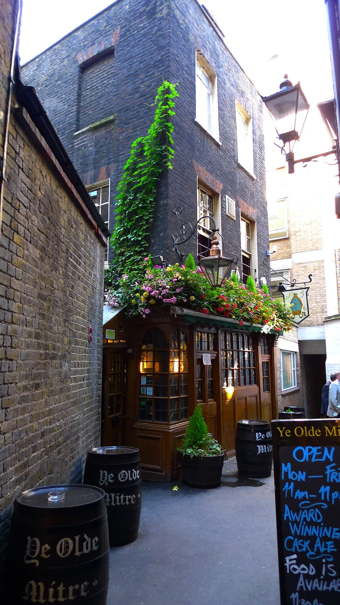
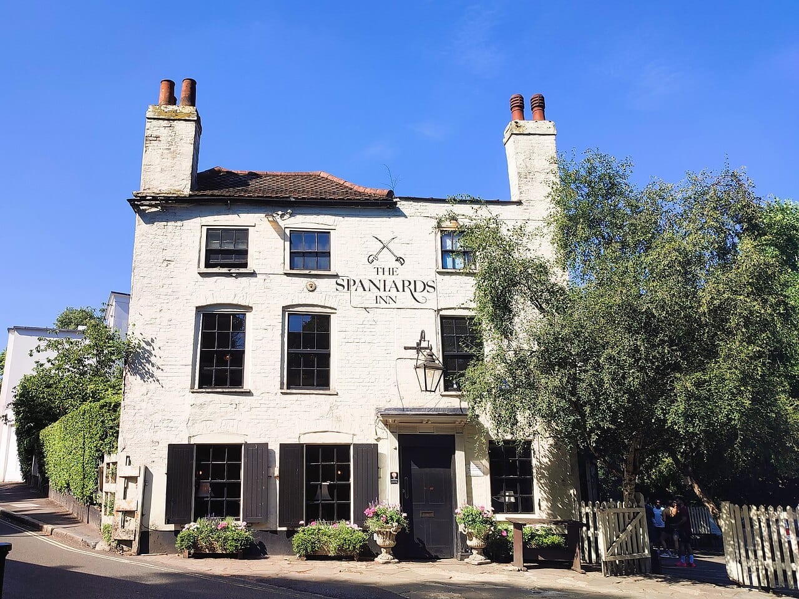

# 老主教冠酒馆

从哈顿花园的珠宝店之间拐进一条几乎只能侧身通过的小巷，走十几步，城市的车声突然退远，眼前出现一栋木饰面小楼和一块不大的庭院。老主教冠（Ye Olde Mitre）就是这样一个地方：它不在大街上，也不靠显眼的招牌招客，第一次来的人常常走过入口又折返。正因为它藏在 Ely Court 里，这间酒馆保存下来的不只是旧木头，还有一种“城市缝隙里的日常”。

图：从 Ely Court 窄巷看老主教冠酒馆的临街外观；酒馆 1546 年已有记载，现存建筑主体为 18 世纪，照片不是 1546 年原物。图片：Ewan Munro from London, UK，CC BY-SA 2.0，via Wikimedia Commons（[原图页面](https://commons.wikimedia.org/wiki/File:Ye_Olde_Mitre,_Hatton_Garden,_EC1_(4140007697).jpg)）。

## 1546 年：老主教冠酒馆的关键起点
酒馆官方与 CAMRA 都记载，这个地点从 1546 年起就有酒馆，最初服务于伊利主教（Bishops of Ely）的仆役；今天看到的建筑主要是 18 世纪的，不是都铎朝的原物。它过去属于剑桥郡伊利（Ely）的管辖范围，酒馆执照要跑到剑桥去办，这段行政飞地的历史常被当作趣谈。官方还讲了一个樱桃树的传说：伊丽莎白一世曾与克里斯托弗·哈顿爵士绕着这棵树跳舞，后来树干长进了酒馆正面。传说无法当作建筑断代依据，但它解释了为什么这间酒馆总被写成“伦敦最隐秘的老酒馆”之一。

补充一个常被忽略的细节：酒馆的名字“Mitre”指主教冠，直接来自伊利主教的纹章与领地；这也是为什么它虽然身在 London EC1，却长期与剑桥的 Ely 联系在一起。CAMRA 把它的木饰、隔断与小房间列入“全国重要历史内饰”，并指出现存建筑为 18 世纪；2009 年 Fuller's 接手后，酒馆仍保留客座酒与“从木桶出售”的传统。它曾在 2014 与 2019 年拿到 SPBW 伦敦年度酒馆，2020 年 Fuller's 的公告特别提到经理 Judith Norman 与团队。把这些时间点连起来，就能理解它为什么既是“隐巷酒馆”，也是一间被认真经营的传统 real ale 酒馆，而不是只靠外观吸引游客。

## 空间与酒单

酒馆藏在 Hatton Garden 与 Ely Place 之间的巷子里，门口就是那块狭长庭院。室内分成两个小酒吧和一个 snug（小隔间），墙面、隔断与吧台以深色木饰为主，空间不大，桌椅也偏紧凑；楼上还有一间小功能房，常用于小型聚会。酒单以传统英式 cask ale 为主，常见 Fullers 系与客座酒厂的桶装麦酒，店里有时会有从木桶（beer from the wood）出售的酒；吃的以 toasties、香肠卷一类吧台小食为主，通常供应到下午 5 点。它不是供应完整正餐的 gastropub，把它当成“喝一杯、吃点小食”的地方更准确。

## 怎么喝

第一次来，可以先点一款颜色较浅的 cask ale，再点一杯深色或苦味更明显的做对照；不确定时向吧台要一小口试饮，这是英国酒馆的常规做法。这里的节奏偏慢，适合半品脱（half pint）而不是一上来就大杯。工作日中午到下午较早时段最安静；官方列的营业时间是周一至周五 11:00–23:00，周末通常不营业，出发前仍应查官网，因为节假日与包场会改时间。若想体验“从木桶出售”的酒，可以直接问吧台今天有没有，不要默认每天都有。

## 老主教冠酒馆的地址与营业安排
地址是 1 Ely Court, Ely Place, London EC1N 6SJ。最近的车站是 Chancery Lane 与 Farringdon，官方说步行约 2 分钟；从 Hatton Garden 一侧进入，入口夹在珠宝店门面之间，看到“Ely Court”的窄巷标志再往里走。空间小、通道窄，不建议大队人马同时涌入，也不要把婴儿车或大件行李堵在巷口。酒馆不接受大型团体预订，楼上的小房间需另行询问。营业时间、酒单与是否供应食物都会变，以官网当日信息为准。

## 礼仪与常见误区

最常见的误区是把“1546”当成“这栋建筑建于 1546”。更准确的说法是：这个地点从 1546 年起有酒馆，现建筑主要是 18 世纪，立面与内部经历过多次改动。第二个误区是把樱桃树传说当成确凿史实；官方也只用“传说”来叙述，写作者应保留这个限定。第三，这里是仍在营业的社区酒馆，不是博物馆：不要为了拍照堵住巷口，也不要擅自进入楼上的非开放区域。第四，cask ale 的温度与气泡和瓶装啤酒不同，觉得“不够冰”不是酒坏了；可以请吧台推荐适合当天状态的酒。

“1546 年已有酒馆”说的是地址上的经营传统，不是现存建筑年代；现在看到的木构主体主要是 18 世纪。

## 从老主教冠酒馆延伸到兰姆与旗
从酒馆出来，Ely Place 本身就是一条安静的老街，街口有 13 世纪的圣埃塞尔德雷达教堂（St Etheldreda's），再往南是 Hatton Garden 的珠宝区，往西可走到 St Paul's。把这里放进一条半日步行路线很合适：先看 Ely Place 与教堂，再到这里喝半品脱，然后沿 Holborn 往西去 Covent Garden。若想比较伦敦几种不同的历史酒馆，可以继续读[兰姆与旗](ref:lamb-flag)与[西班牙人客栈](ref:spaniards)；想理解酒馆在城市中的角色，可读[认识一座城，从一间酒馆开始](ref:pub-city)与[酒馆史](ref:taverns)；完整步行顺序见[伦敦经典酒吧步行路线](ref:london-route)。

**关键事实。**

| 项目 | 内容 |
| --- | --- |
| 一句话定位 | 伦敦哈顿花园旁 Ely Court 内的历史酒馆，1546 年已有酒馆，现建筑为 18 世纪，以狭巷入口、木质内饰和传统英式麦酒闻名 |
| 地址 | 1 Ely Court, Ely Place, London EC1N 6SJ, United Kingdom |
| 城市/国家 | 伦敦 / 英国 |
| 营业状态 | 已核验营业 |
| 官网 | yeoldemitreholborn.co.uk |

**来源与边界。** 本页关于「老主教冠酒馆」的关键事实，主要由以下来源交叉核对：Ye Olde Mitre（地址、营业时间、酒单与酒馆特征；1546 年建馆、樱桃树传说、CAMRA 历史内饰与 SPBW 奖项；传说部分按“据说/传说”处理）、CAMRA（“1546 年已有酒馆、现建筑为 18 世纪”、历史内饰与 Fulller's 2009 年接手）、Fuller's（2019 年 SPBW 伦敦年度酒馆与啤酒从木桶出售的传统）。产品、地址或营业状态变化较快时，以 yeoldemitreholborn.co.uk 的最新页面为准；价格、批次与状态会变，涉及这些字段时以页面所列来源的最新版本为准。正文为项目自写，来源只作核验，不复制原文。

## 参考资料
- [认识一座城，从一间酒馆开始](ref:pub-city)
- [酒馆史：从酒肆、客栈到酒吧](ref:taverns)
- [伦敦经典酒吧步行路线](ref:london-route)
- [兰姆与旗](ref:lamb-flag)
- [西班牙人客栈](ref:spaniards)

本页于 2026-11-21 核对 Ye Olde Mitre 官方页面。常见营业时间为周一至周五 11:00–23:00，周末通常不营业，节假日与包场会改时间；入口在 Ely Court 窄巷内，不建议大队人马同时进入。1546 年是地点上的酒馆起始年，现存木构主体主要是 18 世纪；樱桃树传说官方也只用“传说”叙述，正文已保留限定。本页图片是从 Ely Court 窄巷看老主教冠酒馆的砖砌外观，不是店内；图注已逐张署名，图片许可见来源页。

对照阅读：[认识一座城，从一间酒馆开始](ref:pub-city)、[伦敦经典酒吧步行路线](ref:london-route)。

## 相关图像

图：Hampstead Heath 北缘的西班牙人客栈与门前道路；酒馆始于 1585 年，现存主体经过多次改建。图片：Ewan-M，CC BY-SA 4.0，via Wikimedia Commons（[原图页面](https://commons.wikimedia.org/wiki/File:Spaniard%27s_Inn,_Hampstead,_2026-07-11.jpg)）。关联图像：老主教冠酒馆。
