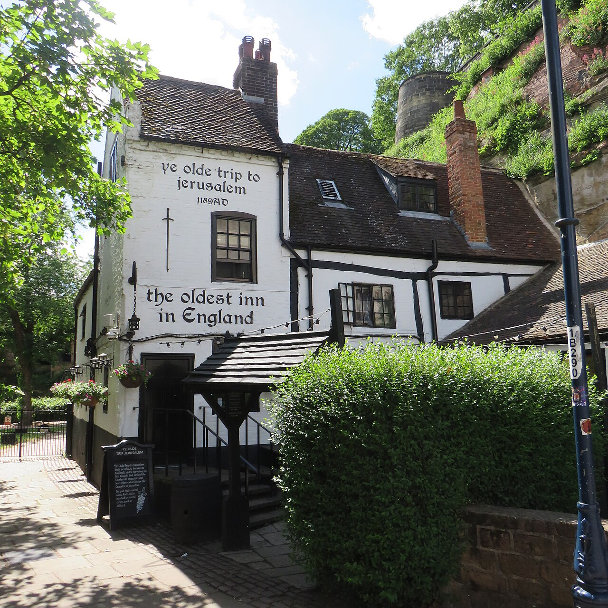
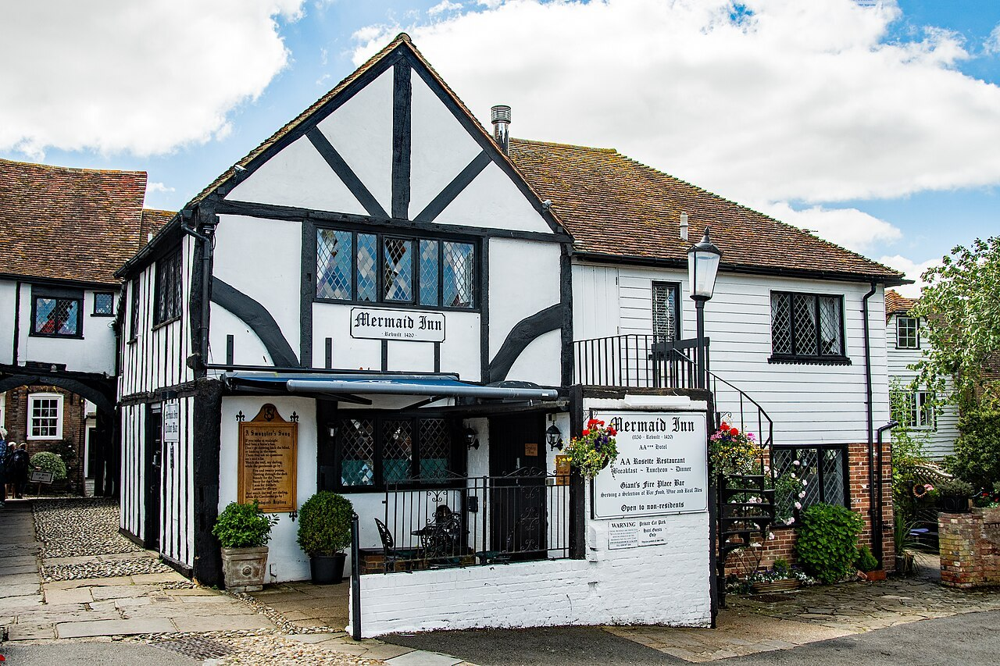

# 耶路撒冷之旅酒馆

在诺丁汉城堡岩的南侧，酒馆的门脸贴着砂岩山体，部分空间直接开凿在岩层里。耶路撒冷之旅酒馆最响亮的招牌是“英格兰最古老酒馆”，并把开业年份追溯到 1189 年；但只要把传说、建筑构件与最早的文字记录分开看，就会发现这家店真正的趣味不在“最老”这个结论，而在三套时间线如何被叠放在同一处洞穴与木构建筑里。

图：耶路撒冷之旅酒馆。图片：Richard Rogerson，CC BY-SA 2.0，via Wikimedia Commons（[原图页面](https://commons.wikimedia.org/wiki/File:Ye_Olde_Trip_to_Jerusalem,_Nottingham_-_geograph.org.uk_-_8356591.jpg)）。

## 1189 年：耶路撒冷之旅酒馆的关键起点
酒馆官方历史页面承认，支持“1189 年创立”的确凿证据已经难以寻找；它同时给出几条可以单独核对的线索：现存木构架大约建于 1670 年代，酒馆最早作为公共场所被记录是在 1760 年，由房东 William Marriott 取得执照。也就是说，传说把开业推到十字军东征，而建筑与文献分别指向 17 世纪与 18 世纪。更稳妥的表述是：酒馆“声称”或“传说”创业于 1189 年，实际空间经历过多次重建与改造。

店名通常被解释为十字军出发前的“耶路撒冷之旅”。官方历史把 “trip” 或 “Trypp” 解释为古老用法中的“停留、歇脚”，并提到理查一世（狮心王）及其部众可能在出发参加第三次十字军东征前经过这里。这个说法与酒馆和诺丁汉城堡的关系紧密，但同样属于传说层。另一条线索是：酒馆可能原名 “The Pilgrim”，18 世纪中后期被丝绸商人 William Standford 购入后改称现名；1799 年的 Willoughby's Directory 已记录今天的店名。名字的演变说明，它并不是一块从 1189 年原封不动传下来的招牌。

1894 年，房东 George Ward（常客称他为 “Yorkey”）接手酒馆，之后由 Ward 家族成员延续经营；今天店内仍能看到与他有关的痕迹。1952 年 8 月 11 日，酒馆被列为 Grade II 登录建筑，保护对象包括壁炉、护墙板与成片的岩凿酒窖。这个日期比“1189”晚得多，却是最能落地的官方认定。

## 空间与酒单

酒馆贴在 Castle Rock 的砂岩上，岩凿空间、通道与吧台区域构成它最不可替代的部分。Rock Lounge 是看岩壁与洞穴感的主要区域，Haunted Snug 则被官方拿来讲述“闹鬼”故事；吧台上方常被提到的 “Cursed Gallon” 也是这套叙事的一部分。室外有啤酒花园，夏天比室内更适合长时间坐着。木构架、低门洞与不规则墙面提醒你：这不是一间为现代客流设计的餐厅。

酒单是典型的 Greene King 连锁酒馆结构：桶装艾尔、葡萄酒、烈酒，以及相当完整的低酒精与无酒精选项；菜单以舒适食物为主，派、汉堡与可分享的酒吧菜比“精致料理”更符合场景。它的价格带在诺丁汉属于中等，不会因为“英格兰最古老”而收博物馆门票。与专做桶装艾尔的老式酒馆相比，这里的选择更宽、更家庭友好；与城市精酿酒吧相比，它的酒头数量与实验性又有限。真正让它有区分度的，是你可以端着杯子坐在砂岩洞穴里，而不是菜单本身。

## 怎么喝

第一次来，先问吧台当天有哪些桶装艾尔，再点一杯半品脱试味。诺丁汉一带的艾尔风格偏平衡，不需要复杂的品饮仪式；如果只是路过，一杯艾尔加一份派就足够。想坐洞穴区域，尽量避开周末晚间与比赛日，那些时段旅行团与本地家庭会把空间填满。夏天可以改坐啤酒花园，室内洞穴更适合秋冬或雨天。

人多时建议通过官方页面预订餐桌；普通两人桌通常可以现场解决，但不要假设一定有位。带小孩或狗都可以，酒馆明确标注家庭友好与 dog-friendly；如果同行者行动不便，要提前评估洞穴与通道的台阶、低顶与不平整地面。点单时不要把“最古老”当成服务承诺：它是一家连锁酒馆，不是历史主题餐厅。

## 耶路撒冷之旅酒馆的地址与营业安排
地址是 1 Brewhouse Yard, Nottingham NG1 6AD, United Kingdom，就在诺丁汉城堡下方的 Brewhouse Yard。官方页面在 2026 年 11 月标注的营业时间为每天 11:00–23:00，餐饮供应约 11:00–21:00（周日到 20:30）。从诺丁汉车站（Nottingham）步行约 15–20 分钟；乘 NET 有轨电车到 Old Market Square 后步行上坡约 8–10 分钟；多条公交在 Old Market Square 与 Castle Boulevard 一带设站。附近有付费街边停车，但旧城一侧车位紧张。圣诞节与比赛日可能调整时段，以官方渠道当日公告为准。

消费属于中等价位，桶装艾尔与酒吧菜是性价比最高的组合；没有必须预订的门槛，但团体与晚餐时段建议提前。没有正式着装要求，按酒馆日常穿着即可。酒馆提供低酒精与无酒精选项，对不喝酒的同行者比较友好。洞穴与楼梯不适合轮椅通行，推婴儿车也会吃力；这一点在计划行程时应优先考虑。最新营业时间、团体预订与无障碍信息以 Green King 官方酒馆页面为准；页面核验于 2026-11-08。

## 礼仪与常见误区

最常见的误区是把“英格兰最古老酒馆”当成已被证实的史实。官方自己都承认 1189 年缺乏确凿证据；更准确的问法是“它凭什么讲这个故事”，而不是“它是不是最老”。第二个误区是把洞穴当成可以攀爬的景点：岩壁、通道与家具都属于营业空间，不要为了拍照跨过围栏或触摸脆弱表面。

第三，鬼故事是酒馆叙事的一部分，不是历史结论；“Cursed Gallon”、Queen Isabella 的传说与 Haunted Snug 的名号，适合当作喝酒时的谈资。第四，这是一家 Greene King 连锁酒馆，服务与菜单有统一体系，不要期待“只卖一种自酿”的极致专门店体验。最后，高峰期的洞穴区很吵，若你想安静聊天，院子或非饭点更合适。

## 诺丁汉的周边街区
从酒馆出来，往上就是诺丁汉城堡（Nottingham Castle），旁边是 Brewhouse Yard 的 Museum of Nottingham Life；往下步行十分钟可到 Old Market Square、Lace Market 与 Robin Hood 雕像。把酒馆放在城堡与旧城之间的步行线上，比专程“打卡最老酒馆”更自然。若时间充裕，可以沿运河走到 Nottingham Contemporary，再折回 Lace Market 吃晚饭。

## 同城酒馆与延伸阅读
酒馆供应啤酒等饮品，适合把它放回[酒吧与城市](ref:pub-and-city)的脉络里理解，也可以对照[啤酒](ref:beer)的风格条目。

补充阅读：[美人鱼客栈](ref:c-extra-1)、[A Ginjinha](ref:c-extra-2)、[À la Mort Subite](ref:c-extra-3)。

相关条目：[啤酒](ref:beer)、[认识一座城，从一间酒馆开始](ref:pub-and-city)、[美人鱼客栈](ref:c-extra-1)。

**关键事实。**

| 项目 | 内容 |
| --- | --- |
| 一句话定位 | 位于英国诺丁汉城堡岩下的历史酒馆，自称英格兰最古老酒馆、创业于 1189 年；这一说法缺少同时代的确凿证据 |
| 地址 | 1 Brewhouse Yard, Nottingham NG1 6AD, United Kingdom |
| 城市/国家 | 诺丁汉 / 英国 |
| 营业状态 | 已核验营业 |
| 官网 | greeneking.co.uk |

## 相关图像

图：The Mermaid Inn, Rye - 20220620121757。图片：Herman.vandenbroeck，CC BY-SA 4.0，via Wikimedia Commons（[原图页面](https://commons.wikimedia.org/w/index.php?curid=122527773)）。关联图像：耶路撒冷之旅酒馆。
