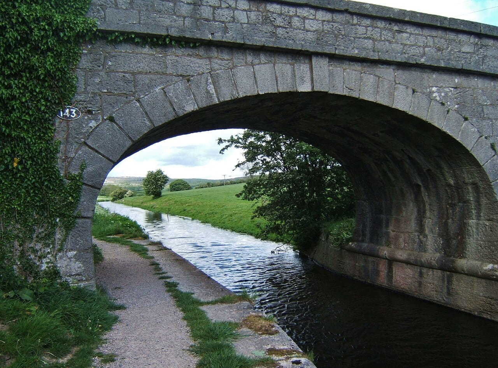
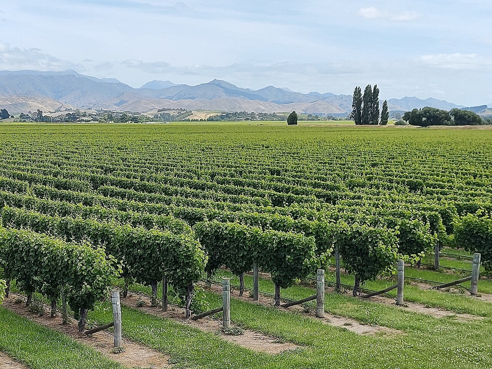

# 伊兰兹酒庄

伊兰兹在马尔堡的塞登，葡萄园紧贴海岸，风把海雾吹到藤蔓上。它的参观点不是一间藏在城市街角的酒窖，而是一套“海边农场加品鉴室”的组合：先看葡萄园与海岸，再回到室内喝一杯。酒庄 2008 年 8 月 8 日启用新厂，官方叙述把“从建厂第一天起就获得 Toitū 碳中和认证”写进品牌核心；这句话比任何风景照都更能解释它为什么把可持续当成参观点的一部分。

图：伊兰兹酒庄。摄影：File:Moss Bridge, Yealands Redmayne.jpg。署名：Barbara Carr，CC BY-SA 2.0，来自 Wikimedia Commons（[来源](https://commons.wikimedia.org/w/index.php?curid=41189386)）。

## Seaview 的海风与葡萄园

塞登位于马尔堡的 Awatere Valley 一带，官方产区描述把这里概括为更凉、更干、风更大，常有海拔变化，产量通常更低。海风与海雾会降低温度、延长成熟期，也让葡萄皮更厚；在长相思身上，这通常意味着更锐利的香气与更紧的酸度，而不是单纯的“果味更浓”。伊兰兹的葡萄园靠近海岸，部分藤蔓在天气合适时会被海雾覆盖，这种看似浪漫的画面，实际上是成熟节奏的一部分。

[马尔堡](ref:marlborough)的三个次级产区并不是质量等级，而是地理与气候概念。Wairau 的砾石排水快、升温早；Southern Valleys 的土壤更重、黏土更多；Awatere 更靠南、更干、风更大。伊兰兹站在最后一种条件里，所以它的酒往往比 Wairau 的同类更收束。把这一点记住，再看酒标上的“Seaview”或“Awatere”，就不会只把它当成风景名。

## 2008 年：从第一天起的碳中和

2008 年 8 月 8 日是酒厂启用的日子。官方与协会资料都强调，伊兰兹是“世界上第一家从建厂第一天起就获得 Toitū 碳中和认证的酒庄”。这个说法的重点在“从第一天起”：不是先生产、后补救，而是在建筑设计、能源与废弃物处理上从一开始就把碳排放纳入计算。对访客来说，这意味着厂区本身就是一个展示对象，而不只是品鉴室的背景。

需要区分“认证”与“具体做法”。认证说明酒庄核算并抵消了运营排放，具体做法则包括太阳能、风力涡轮、葡萄修剪枝条的利用与自制堆肥。不同年份的产量、能源结构与供应链会改变排放账本，认证也需要定期复核；本页不把某一年度的细节写成永久事实。想了解最新范围，应查 Toitū 与酒庄官方页面。

## 可持续不是口号：风、光、枝条与堆肥

酒庄的可持续项目被协会分成几个可核对的方向：太阳能发电、风力涡轮、葡萄修剪枝条作为能源、自制堆肥、土地养护与能源效率。它们的共同点是把“废弃物”重新放进生产循环：修剪下来的枝条不再全部焚烧，而是转化为能源或堆肥；厂区的电力尽量由现场可再生能源补充；葡萄园的土地管理以减少裸露与流失为目标。

这些做法不直接改变酒的味道，却改变了参观的看点。你会看到风塔、太阳能板、堆肥区与葡萄园边缘的原生植被，而不是只看不锈钢罐与橡木桶。对生产型酒庄来说，这种“把基础设施当展品”的选择并不常见；它也解释了为什么伊兰兹的参观点更像一次农场散步，而不是一场室内讲解。

## 品鉴室与 White Road

协会档案把伊兰兹的品鉴室描述为当代风格的品酒空间，提供 Seaview Estate 的精选酒款，包括单一葡萄园系列；现场有当地奶酪与腌肉，可以配一杯酒慢慢吃。另有一条免费的自驾 White Road，沿路穿过葡萄园、海岸与原生植被，适合在品鉴前后自己开车走一段。White Road 不是封闭的赛道，也不是无障碍步道；路况与天气会影响可行性，出发前要问清方向、车速与可停车的位置。

如果你只有一小时，优先品鉴室与一段短步行；如果有半天，再走 White Road。风大时不要撑伞，也不要站在没有护栏的海岸边缘拍照。酒庄是生产场所，品鉴室以外的区域要按现场标识行走；不要进入未开放的葡萄园行间、设备间或仓储区。

## 到访前必须确认的三件事

第一，开放时间。伊兰兹官网在核验时弹出年龄验证，无法读取当日门市时段；协会档案确认有品鉴室，但没有给出可核实的每日时间。本页因此把营业状态标为 unknown，不写“每天几点开门”这类未经确认的信息。第二，是否需预约。小团体、周末与旺季的规则可能不同，出发前通过官网或电话确认。第三，White Road 与餐饮是否开放。风、雨、收割或维护都可能临时关闭部分区域。

地址是 534 Seaview Road, Seddon, Marlborough 7285, New Zealand。从布伦海姆向东南约 40 分钟，沿海道路风大，骑行要谨慎；没有铁路接驳，回程叫车也不稳定。坐标以官方渠道为准，导航直接输入地址。若要把这一站与[云雾之湾](ref:cloudy-bay)放在同一天，先确认两边的时段，再安排[马尔堡葡萄酒路线](ref:route)的车程。

## 常见误区

第一，把“碳中和”当成“零排放”。认证通常包含核算、减排与抵消，不等于生产过程中没有任何排放。第二，把 White Road 当成固定景点。它受天气与农事影响，可能临时关闭。第三，以为海边酒庄一定更咸。海雾与风影响成熟与酸度，但“咸味”更多是感官比喻，不是海水进入酒里。第四，把 Awatere 与 Wairau 当成同一风格；两者的温度、风力与产量差异会直接改变酒体。第五，忽略官网的年龄验证；打不开页面不等于酒庄停业，但也不能凭猜测写营业时间。关于品种背景，可读[长相思](ref:sauvignon)与[白葡萄酒](ref:white-wine)。

对照阅读：[马尔堡](ref:marlborough)、[白葡萄酒](ref:white-wine)。

相关条目：[长相思](ref:sauvignon)。

**关键事实。**

| 项目 | 内容 |
| --- | --- |
| 一句话定位 | 新西兰马尔堡塞登 Seaview Road 的沿海酒庄，2008 年 8 月 8 日启用新厂，以从建厂第一天起获得 Toitū 碳中和认证与 White Road 自驾参观著称；品鉴室提供当地奶酪与腌肉，官方网站在部分地区受年龄验证限制，开放状态以官网或现场确认为准 |
| 地址 | 534 Seaview Road, Seddon, Marlborough 7285, New Zealand |
| 城市/国家 | 塞登 / 新西兰 |
| 营业状态 | 待核验 |
| 官网 | yealands.co.nz |

## 参考资料

本页依据新西兰葡萄种植者协会的伊兰兹档案、Toitū 认证条目、马尔堡产区页与伊兰兹官网入口核验，页面核验日期 2026-11-09。官网受年龄验证限制，开放时间与预约规则以能访问的官方页面或现场公告为准；营业状态标为 unknown，不提供 verified_at。

## 相关图像

图：马尔堡怀劳谷（Wairau Valley）的葡萄园，整齐的藤行伸向远处。图片：Jonathan Harker，CC BY 4.0，via Wikimedia Commons（[原图页面](https://commons.wikimedia.org/wiki/File:Wairau_Valley_vineyards_in_the_Marlborough_wine_region,_New_Zealand.jpg)）。关联图像：伊兰兹酒庄。
