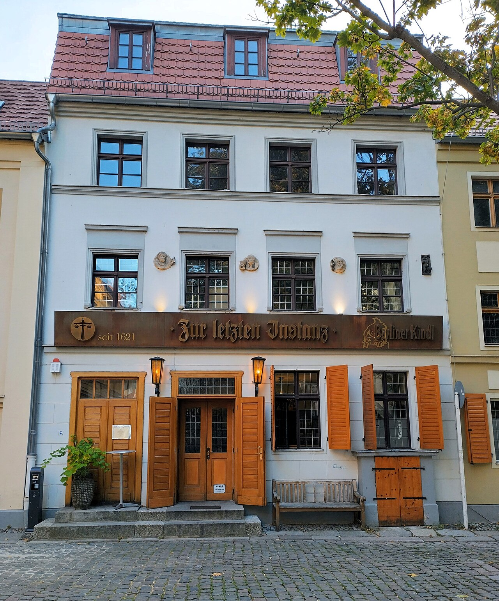

# 最后一审餐厅

柏林米特区（Mitte）的瓦伊森街（Waisenstraße）不长，一侧是旧城墙遗迹，一侧是低矮的老房子。14–16 号门口挂着“Seit 1621”的牌子，里面是 Zur letzten Instanz——字面意思是“最后一审”，常被译作“最后审判餐厅”或“最后一审餐厅”。它不是宫殿式的豪华餐厅，而是一栋把柏林历史压缩在木梁、砖地、旋转楼梯与瓷砖炉里的老房子。

图：柏林最后一审餐厅。图片：Julia Roessing，CC0，via Wikimedia Commons（[原图页面](https://commons.wikimedia.org/wiki/File:Zur_letzten_Instanz_Restaurant_Berlin_2026-09-29.jpg)）。

## 1621 年：最后一审餐厅的关键起点
餐厅的官方历史把时间分成几层：瓦伊森街的联排房屋建于 13 世纪，餐厅所在建筑最早见于 1561 年的文献；1621 年，一位选帝侯的前马夫在这里开了一家饮酒铺，餐饮传统从这一年开始；此后同一地址上出现过酒馆、餐馆与其他经营形态；1924 年起，店名固定为“Zur letzten Instanz”。所以“1621”是餐饮传统的起点，“1924”是今天这个名字的起点，“1561”是建筑文献的起点，三个数字不能混用。

店名的来源有一个流传很广的说法：附近利滕街（Littenstraße）法院里两户农民打官司，争到最后，在这家店里和解，于是店名成了“最后一审”。这是传说，不是档案事实；它之所以被保留，是因为它准确描述了这家店的气质——法律、市井、酒与和解，都在同一张桌子上。另一个更可靠的解释是，店名来自“最后的手段/最后的救济”这一德语表达，但官方叙述选择了传说版本，读者知道它是故事即可。

二战期间，建筑严重损毁；战后，瓦伊森街一带属于东柏林，餐厅在 1961–1963 年重建后重新开业。今天看到的木梁、砖地、巴洛克式旋转楼梯与两个餐厅，是那次重建与后续修缮的结果，不是 17 世纪原封不动的遗存。200 年的瓷砖炉是店内最常被提到的物件，官方说法半开玩笑地写“曾温暖拿破仑的心”；拿它当历史趣闻可以，不要当成拿破仑真的在这里吃过饭的证据。

2020 年，现任经营者从父母手中接过餐厅，成为第二代。这个家族经营背景解释了店内的尺度：两个餐厅、一个可坐 12 人的包间、一个啤酒花园，总共约 120 个座位；菜单以柏林菜与区域食材为主，而不是国际化的“酒店菜”。它不是博物馆，也不是主题餐厅，而是一家仍在日常运营的老店。

## 空间与菜单

空间的关键词是“旧、暖、窄、木”。进门后是砖地、木梁与深色木饰面，墙上挂着老照片与画；巴洛克式旋转楼梯通向二楼，瓷砖炉位于餐厅一角，冬天会点起来。两个餐厅的桌子不大，椅子是旧式木椅，包间适合家庭或小团体，啤酒花园在老树与城墙之间，夏天比室内更舒服。它不适合大型旅行团，也不适合追求“极简设计”的人；它的价值在于“柏林老餐馆”的整体感，而不是某一件家具。

菜单是柏林菜与北德菜的混合：酸豆酱肉丸（Königsberger Klopse）、醋渍牛肉（Sauerfleisch）配葡萄与白卷心菜、酿卷心菜配脆猪腹肉、烤猪肘配黑啤酒糖浆与红甘蓝、小牛肝配苹果与韭葱、芥末酱蛋配土豆泥；前菜有腌菜、咸鲱鱼配酸奶与红洋葱、山地奶酪饺子、萝卜炖土豆配牛肝菌；甜点是热苹果派配香草冰淇淋或浆果雪葩配蛋白霜。菜单随季节调整，野味、白芦笋、鹅肉在相应季节出现；不要拿旧菜单点菜，以当日菜单为准。

酒水以德国啤酒、葡萄酒与烈酒为主。柏林人喝啤酒通常点本地品牌或区域品牌，餐厅也会有季节限定；葡萄酒单以德国与欧洲酒为主，配菜以清爽型白葡萄酒、干型雷司令或轻酒体红葡萄酒为宜。想喝柏林特色，可以点一杯柏林白啤（Berliner Weisse）配糖浆，但要注意它酸、度数低，不是所有人都喜欢。餐厅不主打鸡尾酒，点单以“配菜”为原则，不要要求调酒师做复杂配方。

## 第一次去怎么点

午餐与晚餐的菜单不同：周五、周六中午 12:00–15:00 有午市，周一至周四只在 17:30 后开；周日休息。第一次去，建议点一道前菜加一道主菜，或直接点主菜加甜点。想尝柏林味，点酸豆酱肉丸或醋渍牛肉；想吃肉，点烤猪肘或酿卷心菜；想吃鱼，问侍者当天的鱼（餐厅与米里茨湖渔民合作）；想吃素，问当日素食选项，不要假设菜单上一定有。

两个人点菜可以一荤一素、一重一轻：烤猪肘分量大，配红甘蓝与土豆，适合分享；醋渍牛肉酸味明显，配白卷心菜与土豆泥，适合喜欢酸口的人；酸豆酱肉丸是柏林家常味，配土豆泥最稳。前菜不必每人一份，腌菜与奶酪饺子可以分食。甜点如果只点一份，苹果派配冰淇淋最适合分享。

预订很重要。餐厅只有约 120 个座位，周末与晚上容易满；包间适合 12 人左右，啤酒花园在天气好时很受欢迎。电话 +49 (0)30 242 55 28，或通过官网预订。没有严格 dress code，但晚餐时段客人会穿得比中午正式；不要穿工作服或泳装进餐厅。带小孩可以，但餐厅不是儿童乐园，婴儿车在窄门口不方便。

费用结构：前菜约 10–15 欧元，主菜约 20–30 欧元，甜点约 8–12 欧元；具体以菜单为准。德国餐厅通常按菜单价加小费，小费 5%–10% 直接告诉侍者或放在桌上。刷卡普遍可用，但小额消费备现金更稳。午市可能有套餐，问侍者“Tagesmenü”即可。

## 最后一审餐厅的地址与营业安排
**地址**：Waisenstraße 14–16, 10179 Berlin, Germany。位于米特区，靠近亚历山大广场与克洛斯特街区；从地铁 U2 线 Klosterstraße 站步行约 3 分钟，或从亚历山大广场步行 10 分钟。

**交通**：U2 Klosterstraße、U8 Heinrich-Heine-Straße 或 S-Bahn Alexanderplatz，步行 5–12 分钟；瓦伊森街窄，出租车不能停在门口，最近的下车点在利滕街或亚历山大广场。旧城墙一带石板路不平，穿高跟鞋要小心。

**营业时间**：周一至周四 17:30 起；周五、周六 12:00–15:00 与 17:30 起；周日休息。节假日与圣诞市场期间可能调整，以官网为准。`operating_status` 记为 `verified`，表示官网在 2026-11-20 仍显示营业；这不等于每天一定开门。

**预订**：强烈建议预订，尤其是周末、晚餐与包间。官网提供在线预订，电话 +49 (0)30 242 55 28；办公时间为周一、周二、周四、周五 09:00–14:00。没有最低消费，但大团体可能需要押金或套餐，预订时问清。

**价格**：柏林中高档家常菜价位，主菜约 20–30 欧元；烤猪肘、鹅肉等大菜更贵。小费 5%–10%，刷卡可用。啤酒花园在夏季可能加收户外座位费，以菜单为准。

页面核验日期 2026-11-20；营业时间、价格与菜单以官方渠道为准。

## 礼仪与常见误区

第一，不要把“1621”当成“建筑 1621 年建成”；建筑最早见于 1561 年，1621 年是餐饮传统开始。第二，不要把“拿破仑的瓷砖炉”当成史实；官方自己都用“温暖了拿破仑的心”这种半玩笑说法，读者应把它当趣闻。第三，不要以为店名“最后一审”有正式法律含义；它来自传说，不是法院名称。

常见误区还有三个。其一，以为餐厅在二战前原样保留；建筑在战争中严重损毁，1961–1963 年重建，今天看到的是重建后的版本。其二，以为“柏林最老餐厅”可以随便 walk-in；餐厅只有约 120 个座位，周末与晚上常满，预订更稳。其三，以为菜单全年不变；野味、芦笋、鹅肉按季节供应，点菜前看当日菜单。

不适合来这里的情况：只想吃快餐的人；对德语菜单不熟悉、又不愿意问侍者的人；带大型旅行团、要求“快速翻台”的人。它适合“坐下来吃一顿柏林家常菜”的场景，也适合对城市历史与老建筑感兴趣的人。

## 柏林的周边街区
餐厅在瓦伊森街，往西是克洛斯特街区与柏林电视塔，往南是亚历山大广场，往东是施普雷河与东边画廊方向。把餐厅放在“亚历山大广场—克洛斯特街区—瓦伊森街”这条线上：下午看街区与旧城墙，晚上在餐厅吃饭；走路约 20 分钟。若想看“另一家老餐厅”，可以转去马德里的博廷（Botin）或斯德哥尔摩的金色和平（Den Gyldene Freden），但那是另一座城市的故事。

白天瓦伊森街安静，适合拍建筑外观；晚上餐厅门口灯光暖，拍室内要先征得邻桌同意。圣诞市场期间亚历山大广场人多，提前订位并留出步行时间。若遇到门口有团体包场，不要强行进入，改约另一天。

## 同城酒馆与延伸阅读
- [酒吧与城市](ref:pub-and-city)：老餐厅与酒馆如何用空间、菜单与营业时间组织城市生活。
- [博廷餐厅](ref:botin)：马德里 1725 年的老餐厅，与柏林这家“最老”形成对照。
- [金色和平餐厅](ref:freden)：斯德哥尔摩 1722 年的老餐厅，另一座北欧首都的历史餐桌。
- [金虎酒馆](ref:tygra)：布拉格的啤酒馆，另一种“历史空间 + 日常饮食”的组合。
- [中央咖啡馆](ref:cafe-central)：维也纳的文学咖啡馆，说明“老店”不只有一种形态。

相关条目：[认识一座城，从一间酒馆开始](ref:pub-and-city)、[博廷餐厅](ref:botin)、[金色和平餐厅](ref:freden)。
