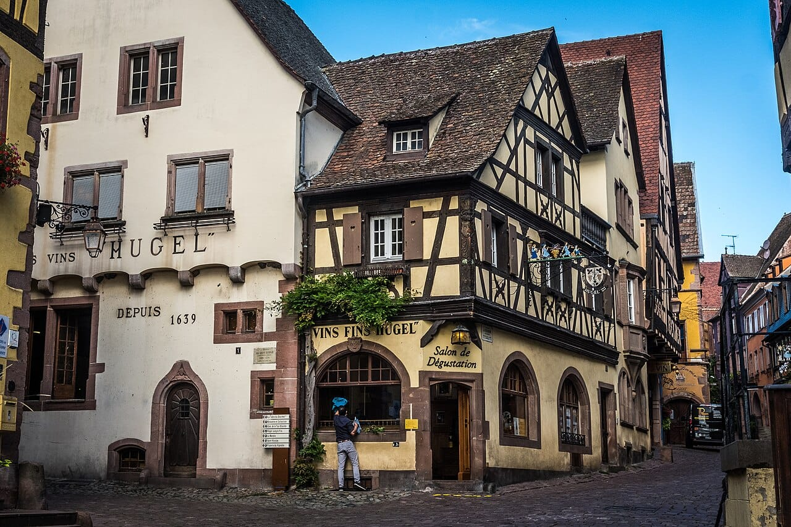
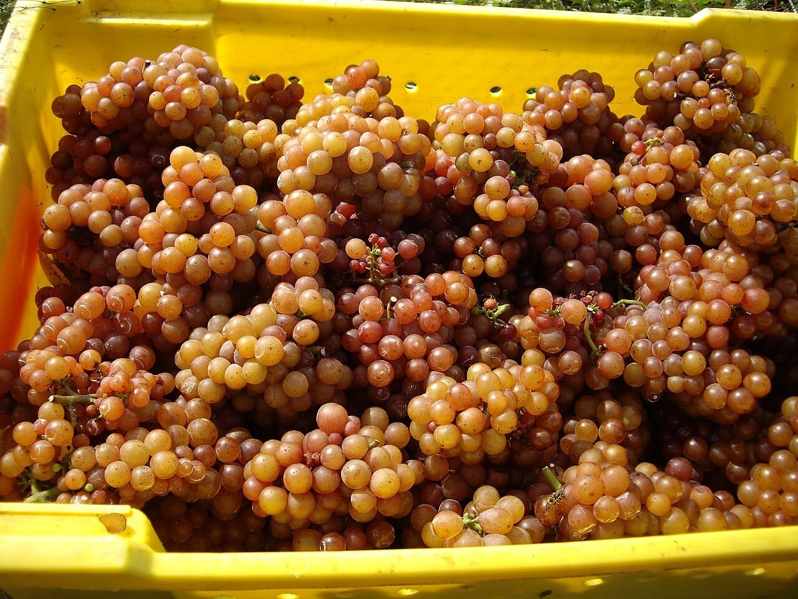

# 阿尔萨斯特级园路线：凯泽斯堡与里屈埃维尔

阿尔萨斯的酒村沿孚日山脉东麓排开，凯泽斯堡与里屈埃维尔相距不远，却代表两种酒庄形态：一座建在修道院旧址上、把生物动力法写进日常；另一座在城墙之内，用家族、出口与法规参与塑造了整个产区的标签语言。这条两站路线把[阿尔萨斯](ref:alsace)的雨影气候、51 个特级园与迟摘、贵腐精选的规则放在同一条车程里，适合作为第一次进入产区的骨架。

图：阿尔萨斯特级园路线：凯泽斯堡与里屈埃维尔所在的阿尔萨斯风貌配图。图片：Jorge Franganillo from Barcelona, Spain，CC BY 2.0，via Wikimedia Commons（[原图页面](https://commons.wikimedia.org/wiki/File:Colmar_(32350846618).jpg)）。这张照片用于说明产区环境与访问语境，不标定阿尔萨斯特级园路线：凯泽斯堡与里屈埃维尔的门店、酒庄或活动现场。

## 孚日山脉背后的雨影

阿尔萨斯是法国第二干燥的葡萄酒产区，原因在地形而不在纬度。西侧孚日山脉把大西洋的水汽挡在山上，东麓因此少雨、日照长、秋季稳定；葡萄可以慢慢成熟，酸度不至于掉得太快。山脉也带来地质的拼贴：花岗岩、石灰岩、泥灰岩与砂岩在很短的距离内交替，坡向与海拔又把微气候切成小块。

这解释了为什么阿尔萨斯酒标如此依赖地块名。同一个品种种在花岗岩坡与石灰岩台地，香气与结构会不同；同一个特级园边界内，坡上与坡脚也可能分成两种酒。理解雨影与地质，是读懂后面所有“Grand Cru”与“lieu-dit”的前提。

也需要提醒一点：雨影带来的是“少雨”，不是“没有风险”。冰雹、春季霜冻与秋季暴雨仍会打击产量，年份差异在阿尔萨斯比很多人想象中更大；这也是酒庄为什么反复强调采收日期与地块选择。把气候当成稳定的背景，是读阿尔萨斯最容易犯的错误。

## 第一站：凯泽斯堡的魏恩巴赫

第一站是[魏恩巴赫酒庄](ref:weinbach)，在凯泽斯堡（Kaysersberg）。庄园建在施洛斯山（Schlossberg）脚下，1612 年由嘉布遣会修士建立，后来由法勒家族接手；今天由 Eddy Leiber-Faller 代表酒庄。它的核心地块是 Clos des Capucins 与施洛斯山特级园，酒窖与住宅仍围着旧修道院展开，参观动线短，却能把“修道院—家族—特级园”三层历史一次走完。

酒庄自 1990 年代起转向生物动力法，官方叙述把“葡萄与环境的和谐”放在第一位。酒单从 Riesling、Pinot Gris、Gewurztraminer、Muscat 到 Pinot Blanc、Sylvaner，既有特级园，也有不标特级园的 cuvée。参观需预约，周一至周五 9:30–11:30、13:30–17:30，周六 9:30–11:30、13:30–17:00，周日关闭；这些时段以官方页面为准。

## 第二站：里屈埃维尔的雨格

第二站是[雨格酒庄](ref:hugel)，在里屈埃维尔（Riquewihr）。家族自 1639 年起在同一座小镇经营，自有约 30 公顷葡萄园，主要位于里屈埃维尔的特级园，另外与约 100 公顷的合同种植者合作。年产约 60,000 箱，其中 90% 出口到 100 多个国家；这组数字解释了为什么“Hugel”在不少市场几乎等于“Alsace”。

酒窖位于 16 世纪建筑之下，仍在使用超过一个世纪的大橡木桶，其中 1715 年的“S. Caterine”被当作仍在使用的古老酒桶。雨格家族也是 Primum Familiae Vini 的成员。它的黄标酒单只做阿尔萨斯的贵族品种，不靠橡木风味或加甜来塑造风格；这一点与酒庄参与制定迟摘、贵腐精选法规的历史互相呼应。

## Noble grapes：四种高贵品种的分工

阿尔萨斯把 Riesling、Gewurztraminer、Pinot Gris 与 Muscat 称为“noble grapes”，四者在酒标与特级园规则里享有更高地位。Riesling 给酸度、柑橘与矿物，适合干型与长陈；Gewurztraminer 给荔枝、玫瑰与香料，酒体宽，常配重口味；[Pinot Gris](ref:pinot-gris) 给梨、蜂蜜与烟熏感，既能干也能甜；Muscat 给葡萄本身的花香，通常做得轻而干。

其余品种并非“低级”，只是定位不同：Pinot Blanc 与 Sylvaner 多做日常干白，Auxerrois 常混在其中，Pinot Noir 则负责阿尔萨斯少量红葡萄酒。把四个高贵品种先喝一遍，再看特级园标签，就不会把“品种香”与“地块香”混在一起。

## Grand Cru 与 Vendanges Tardives 的标签逻辑

阿尔萨斯有 51 个特级园。Grand Cru 酒标必须同时写清特级园名与品种，且只允许规定品种；它不是“酒庄自封”，而是法定边界。特级园内部还常分 lieu-dit（小地名），同一特级园的不同小地块可以风格差异明显。买酒时先看特级园名，再看小地名与年份，比只看酒庄名更有效。

Vendanges Tardives（VT）与 Sélection de Grains Nobles（SGN）是另一套逻辑：前者要求迟采、糖度达到规定下限，后者要求逐粒挑选贵腐或过熟的葡萄。两者都必须是贵族品种，且不能通过加糖实现。1984 年的法规把这两类标签的条件固定下来，雨格家族在其中扮演了推动者。VT 可以是甜型也可以是较干的风格，SGN 则几乎总是浓郁甜酒；标签读法要看糖度与酸度的平衡，而不是只看“甜不甜”。

酒评人常把 VT 与 SGN 简化为“甜酒”，这会掩盖它们的差别：VT 的关键是迟采带来的熟果与蜂蜜，酸度仍在；SGN 的关键是贵腐菌带来的浓度与复杂度，产量极低。两款都可能陈年很久，但年轻时一个更易入口，一个更需要耐心。若在酒庄只能加购一款，先问当年是否采到了贵腐，再决定。

## 车程、预约与品鉴的安排

凯泽斯堡到里屈埃维尔约 10 至 15 分钟车程，沿 D28 与酒之路行驶，村内街道狭窄，停车应放在村外停车场。两家都需要提前联系：魏恩巴赫按预约接待，时段固定；雨格的品鉴室从复活节到圣诞每日 09:00–12:00、13:00–18:00 开放，酒窖参观则限工作日、避开采收期，且只接受预约的小团体。

品鉴时优先问清是否收费、是否含特级园、能否带儿童。阿尔萨斯酒庄的品鉴室通常不设门票，但会以购买或品鉴套餐结算；开车的人应吐酒。若只有半天，先魏恩巴赫、再雨格，把特级园与迟摘两类酒各喝一款，路线就完整了。

## 另见

- [魏恩巴赫酒庄](ref:weinbach)：1612 年的修道院、施洛斯山特级园与生物动力法。
- [雨格酒庄](ref:hugel)：1639 年的家族、S. Caterine 桶与迟摘法规。
- 背景可读[阿尔萨斯产区](ref:alsace)、[雷司令](ref:riesling)与[白葡萄酒](ref:white-wine)。

对照阅读：[魏恩巴赫酒庄](ref:weinbach)、[阿尔萨斯](ref:alsace)。

阿尔萨斯特级园路线涉及凯泽斯堡与里屈埃维尔，酒庄参观与圣诞市集期间的营业时间变化大；出发前查各酒庄官网与市集公告。核验于 2026-11-09。

## 相关图像

图：雨格酒庄。图片：Photo Claude TRUONG-NGOC，CC BY-SA 4.0，via Wikimedia Commons（[原图页面](https://commons.wikimedia.org/wiki/File:Hugel_et_Fils_Riquewihr_ao%C3%BBt_2020-3.jpg)）。关联图像：阿尔萨斯特级园路线：凯泽斯堡与里屈埃维尔。

图：Gewürztraminer grapes。图片：Robert Pitkin，CC BY-SA 2.0，via Wikimedia Commons（[原图页面](https://commons.wikimedia.org/w/index.php?curid=20125056)）。关联图像：阿尔萨斯特级园路线：凯泽斯堡与里屈埃维尔。
