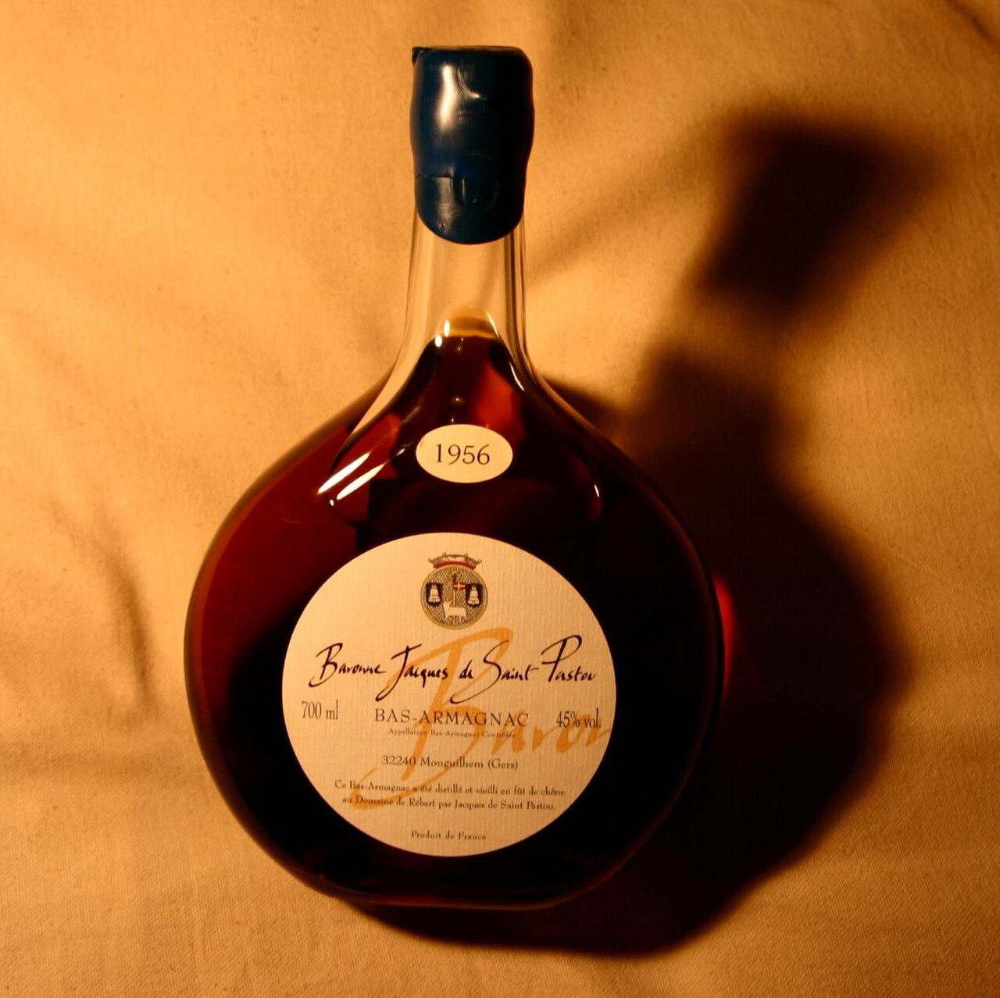

# 雅文邑路线：下雅文邑的单一庄园

下雅文邑的葡萄园没有围墙，一块接一块铺在热尔省与朗德省交界的缓坡上。这条路线选两座单一庄园：索尔贝的[洛巴德](ref:laubade)与阿尔泰兹达尔马尼亚克的[奥尼奥阿](ref:ognoas)。前者是 Lesgourgues 家族经营三代的私人庄园，后者是朗德省所有的公共庄园；两者都把葡萄、蒸馏、陈年与装瓶留在同一片土地，适合用一天半看“单一庄园”意味着什么。

图：雅文邑路线：下雅文邑的单一庄园所在的雅文邑风貌配图。图片：Rama，CC BY-SA 2.0 fr，via Wikimedia Commons（[原图页面](https://commons.wikimedia.org/wiki/File:Armagnac-img_0465.jpg)）。这张照片用于说明产区环境与访问语境，不标定雅文邑路线：下雅文邑的单一庄园的门店、酒庄或活动现场。

## 下雅文邑：沙质土铺出的东西向路

雅文邑分三个分区：西边的下雅文邑、中部的泰纳雷兹、南与东的上雅文邑。下雅文邑的土壤以“黄褐沙”（sables fauves）与砂质黏土（boulbènes）为主，混有铁质，排水快、春季升温早，葡萄成熟均匀，蒸出的酒液更细、果香更清，也最适合长期陈年。泰纳雷兹更饱满；上雅文邑更质朴。

产区横跨热尔、朗德与洛特-加龙三省，西受大西洋、东受地中海影响，葡萄园整体像一片葡萄叶。“单一庄园”不是只有一块地，而是葡萄、蒸馏、酒窖与装瓶都在同一座庄园，年份与批次可追。把[雅文邑](ref:armagnac)的分区图放在车上，再沿乡间公路向西，就能理解为什么同一条路两侧的酒风格会不同。

## 第一站：索尔贝的洛巴德

[洛巴德](ref:laubade)在热尔省索尔贝，1870 年建庄，创始人是政治家 Joseph Noulens 与其妻、巴黎时装设计师 Jeanne Paquin。1974 年 Maurice Lesgourgues 买下庄园，恢复蒸馏并重启年份装瓶；今天由 Denis 与姐妹 Jeanne、兄弟 Arnaud 经营。80 公顷葡萄园围绕城堡连成一块，土壤是高比例的黄褐沙与砂质黏土；田间用绿肥、行间机械除草与谷物轮作，养 600 只羊提供有机肥，保留 15 公顷加斯科涅橡木与 10 公顷杨树。

酒庄只用一台 1974 年定制的雅文邑式连续蒸馏器，把巴科、白玉霓、白福儿、鸽笼白与 Plant de Graisse 等品种分别蒸馏；葡萄压榨后不加硫，发酵一结束就进蒸馏。九座酒窖里放着约三千只 420 升的橡木桶，生命之水按品种与年份分开陈年，制桶用庄园内选材与风干的加斯科涅夏栎。2015 年获“活遗产企业”认证，2008 年起持有 ISO 9001，官方称已获约 250 个奖项。

参观分两档：入门款“Premiers pas”品鉴 3 款经典雅文邑；深度款“L'essence de Laubade”走访酒窖与葡萄园，看大型雕塑，最后品鉴 5 款。预约走 Rue des Vignerons 平台或电话 +33 5 62 09 06 02；办公室周一至周五 8:30–12:00 与 13:30–16:00，周末与节假日不办公。

## 第二站：阿尔泰兹达尔马尼亚克的奥尼奥阿

[奥尼奥阿](ref:ognoas)在朗德省阿尔泰兹达尔马尼亚克，地址是 1043 Route d'Ognoas。它的领地可追溯到 11 世纪末或 12 世纪初，曾属马尔桑子爵领；1240 年，子爵夫人 Matha de Mastas 与 Gaston VII Moncade 联姻，领地随贝阿恩家族一直到 1607 年。1274 年，Arnaud Bosquet 是唯一能以“奥尼奥阿领主”自称的人。1770 年 Etienne Lormand 买下领地，1775 年其子又购入 Tampouy；1847 年，最后一位 Lormand 无嗣，把庄园遗赠给教会，由艾尔-叙尔-阿杜尔主教区管理。

1905 年政教分离法把教区财产转交省府，庄园由此归朗德省所有。今天它是一座约 650 公顷的省立庄园，由朗德省议会负责，定位是“朗德风土的窗口”；主要产品是下雅文邑与 Floc de Gascogne。历史建筑已整体修复并开放，庄园与商店全年营业。与洛巴德的家族叙事相比，奥尼奥阿的故事更像一块被公共制度保留下来的土地：领主、教会、省府，三层身份叠在同一座酒窖上。

## 雅文邑式蒸馏器：一次蒸馏的取舍

雅文邑约有 95% 的酒液用雅文邑式连续蒸馏器（alambic armagnacais）完成。它是一套纯铜装置，1818 年由奥什的炉具匠 Sieur Tuillière 在路易十八治下定型，此后被本地蒸馏师不断改造。酒液从冷却器底部持续进料，酒精蒸气在塔板间上升、与酒液接触，再进入蛇形管冷凝。出酒酒精度在 52%–72% 之间，传统上多为 52%–60%。

这与干邑的二次壶式蒸馏是两条路。连续蒸馏一次完成，出酒酒精度较低、风味物质保留更多，酒体更厚，也更需要时间打磨。蒸馏必须在采收次年的 3 月 31 日前完成；不少酒农请流动蒸馏师把蒸馏器开到自家酒窖门口，蒸完立刻入桶。之后是陈年：400 升的“pièce”橡木桶，多取加斯科涅或利穆赞橡木；酒精度每年约降 0.5 度，这就是“天使的分享”；新桶用到萃取合适就换旧桶，最后进入玻璃坛（bonbonne）停止变化。把[蒸馏](ref:distillation)与[橡木桶陈年](ref:oak-ageing)分开看，就能明白雅文邑的“厚”不是缺点，而是工艺选择。

## 年份、等级与酒标怎么读

雅文邑的等级同样看最年轻成分：VS（三星）至少 1 年，VSOP 至少 4 年，XO 至少 10 年，Hors d'Age 的最年轻酒液也要超过 10 年。2010 年起，行业推动标签简化，但旧称仍常见。比等级更有产区特色的是年份（millésime）：它只指采收年份，装瓶前至少陈年 10 年；因为酒窖湿度高，年份酒常常不加水稀释，天然酒精度落在 40%–48% 之间。

年份酒不是质量保证，而是可追溯的某一年：成熟度、酸度、蒸馏批次与桶陈管理都会改变结果。洛巴德的“Celebration Vintages”覆盖陈年 15 至 50 年的年份；奥尼奥阿则把不同年份直接放在酒窖与商店里卖。看酒标时先确认是“年份”还是“调配”，再看酒精度与装瓶日期；两者没有高下，只看你要不要那一年的个性。若把[白兰地](ref:brandy)的整体分类放在旁边，雅文邑的位置会更清楚。

## 把两站接进加斯科涅的行程

两座庄园都在乡下，公共交通基本不可用，必须自驾。从波尔多或图卢兹方向进入，先到索尔贝，再向西北到阿尔泰兹达尔马尼亚克；沿途会经过欧兹、拉巴斯蒂德达尔马尼亚克、诺加罗与孔东这些加斯科涅小镇。欧兹是雅文邑的集镇，拉巴斯蒂德达尔马尼亚克是 13 世纪的 bastide，孔东有雅文邑博物馆；把它们当补给与过夜点，比硬塞进一天更合理。

春季与秋季最舒服，10 月采收，冬季蒸馏，酒窖最热闹也最冷。两站都需要预约，洛巴德走 Rue des Vignerons 或电话，奥尼奥阿按酒窖开放时间到访，周六下午需预约，5 月 2 日至 9 月 30 日的周末与节假日 14:00–17:30 开放，平日 9:00–12:00 与 14:00–17:30。奥尼奥阿的品鉴免费，洛巴德按线路收费；票价、场次与开放时间都会调整，以官方渠道为准。乡村道路夜间没有路灯，品鉴后不要开车。页面核验日期 2026-11-09。
