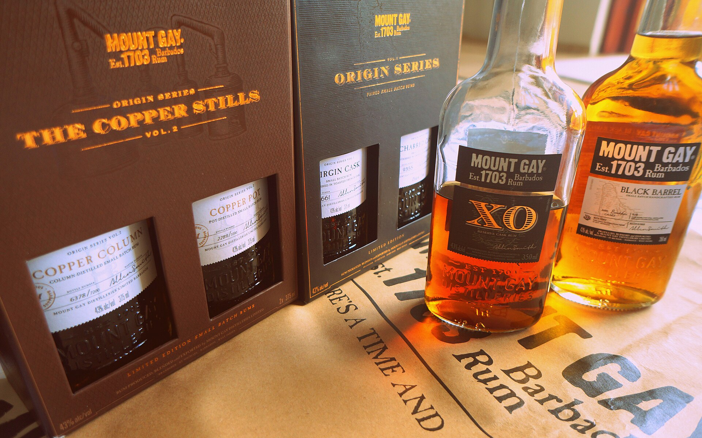

# 巴巴多斯朗姆路线：圣露西与圣菲利普的双厂车程

巴巴多斯朗姆路线在这里只取两站：北端圣露西的[芒特盖酒厂](ref:mount-gay)与东南圣菲利普的[四方朗姆酒厂](ref:foursquare)。两站隔着整座岛，车程约一小时出头，却代表两种做法：一边用 1703 年以来的自流井水与壶式、柱式并行的设备讲连续性，一边用旧糖厂的开放式参访与“不添加糖”讲透明度。比较的不是谁更好喝，而是同一座珊瑚石灰岩岛为何长出两套朗姆酒逻辑。

图：巴巴多斯朗姆路线：圣露西与圣菲利普的双厂车程所经地区的一处实景。图片：Aneil Lutchman，CC BY-SA 2.0，via Wikimedia Commons（[原图页面](https://commons.wikimedia.org/wiki/File:Mount_Gay_Distilleries_Origin_Series,_Black_Barrel_and_XO.JPG)）。这张照片用于说明巴巴多斯朗姆路线：圣露西与圣菲利普的双厂车程所经过的产区或城市环境，不标定其具体停靠点。

## 两站，一条从北到南的车程

第一站在圣露西教区，地址写作 Mount Gay, Saint Lucy, Barbados，没有门牌号，导航时不要把南岸的访客中心当成目的地。第二站在圣菲利普教区四路镇，地址是 Four Roads, Saint Philip, Barbados。两站沿岛内公路南下，正常路况约一小时多；北端放上午、东南放下午更合适。

方式写的是自驾，实际更推荐包车或请当地司机。岛上靠左行驶，乡道窄、转弯多，甘蔗收获季还会遇到拖拉机；务必指定当天不喝酒的人。公共交通班次稀，串起两站并不现实。时长按一整天排：芒特盖导览约两小时，四方留一小时到一个半小时。只有半天时，选其中一家。

## 为什么这条线只安排两家

巴巴多斯面积不大，但“北端”与“东南”是两个方向。芒特盖在圣露西，从布里奇顿北上约一小时；四方在四路镇，官方参考是从奥伊斯廷斯一带约 13 公里、二十分钟车程。两家都把生产现场开放给访客，节奏却相反：一家是预约制团队导览，一家是工作日自由进入。一天放两家，刚好对照“被讲述的历史”与“自己读到的现场”。

圣尼古拉斯修道院与西印度朗姆酒厂也值得去，但前者在东北，后者靠近布里奇顿，硬凑三点会让每一站都变短。这条线宁可少一站，也不要把时间花在路上。

## 圣露西：珊瑚石灰岩井水与 1703 年契约

芒特盖把 1703 年作为起点，依据是一份写明当地已开始蒸馏朗姆酒的契约；品牌因此自称世界上持续运营时间最长的朗姆酒蒸馏厂。参访时更值得看的是它如何把同一风格维持三百多年：水、糖蜜与设备。

厂区那口自流井同样从 1703 年挖起，今天仍在使用。巴巴多斯是珊瑚石灰岩岛，雨水渗入地下，穿过珊瑚岩层，汇入深处含水层；井水从数百英尺下抽出，等于经过整座岛的天然过滤。水直接参与糖化与发酵，水质稳定会影响发酵节奏，这也是厂方强调“本地水”的原因。

动线从大宅开始，经老井、发酵房、蒸馏室到陈年仓库。发酵使用本地与环境酵母，[糖蜜](ref:molasses)加水稀释后接种；蒸馏与陈年随后完成。走完这条动线，再看酒标上的“Barbados”，会明白它指的不只是产地。

## 壶式与柱式并行：一间蒸馏室里的两套逻辑

芒特盖同时使用铜制壶式与柱式蒸馏器。壶式间歇运行，一批一停，保留更多酯类与厚重酒体；柱式连续运行，酒液在塔板间上升，得到更干净、更轻盈的酒液。厂里那台 Coffey 柱式蒸馏器 1926 年购入，2019 年重新启用——柱式不是新发明，而是被弃用又被找回的工具。

两种原酒按比例调和，才形成品牌的基础风格。[壶式蒸馏](ref:pot-still)给厚度与香气层次，[柱式蒸馏](ref:column-still)给骨架与干净度。看清“间歇”与“连续”的差别，就能理解同一家厂为何能同时做出轻盈的日常款与更浓的限量款。

调和之后进入橡木桶。热带仓库没有温控，[橡木桶陈年](ref:oak-ageing)比温带快，颜色与香草、焦糖感在较短时间内出现；每年蒸发的“天使的分享”也更高，具体比例不必追问。

## 圣菲利普：旧糖厂里的“无添加糖”主张

四方的场地原本是糖厂，制糖史可追到 1636 年，糖厂运转到 1984 年；1996 年，R.L. Seale 家族在旧糖厂址建起今天的蒸馏厂。家族贸易史可追到 1820 年，理察·西尔（Richard Seale）是第四代经营者。

设备是铜制壶式与双柱式并用，酒厂把两种原酒调成“单一调和朗姆”，即同一产地内不同蒸馏方式的调和。[糖蜜](ref:molasses)发酵后蒸馏，再进桶陈年，部分产品线会做二次收尾。参访是开放式的：工作日办公时间直接进入，不需要预约，也没有固定导览，最后到品鉴室点酒；代价是没有讲解，出发前先读[朗姆酒](ref:rum)。

四方最常被讨论的是“不添加糖、不添加色素”。2020 年，四方、芒特盖与圣尼古拉斯修道院共同提出巴巴多斯朗姆酒地理标志方案，要点包括本地陈年、不添加糖、本地水源，以及只用壶式与柱式蒸馏；西印度朗姆酒厂公开反对，认为这会把二次陈年与加糖传统排除在外。这说明“无添加”是生产主张与市场定位，不是全岛法规。

## 车程、预约与品鉴安排

芒特盖必须提前在官网预约，标准导览约两小时，页面价格每人 60 美元，含欢迎饮品与数款酒品鉴；仅限 18 岁以上，儿童不得参加，着装要求遮臂、包脚防滑鞋，线路约一英里步行。开放时间通常为周一至周六 10:00–16:30，周日与银行假日关闭，以官方渠道为准。

四方不需要预约，但只在周一至周五办公时间开放；没有组织导览，品鉴室按现场酒单点单。两家都要自己解决交通：芒特盖不提供接送，北端叫车不便；四方从南岸打车约二十分钟，回程提前约。

品鉴时吐酒是正常做法，开车的人应当完全不喝。岛上乡道夜间照明有限，不要把最后一场排到天黑之后。

## 两瓶酒放在一起喝

把 Eclipse 与 Doorly's 或 Exceptional Cask 放在同一张桌上，差别很快出现：前者用壶式与柱式调和，美国威士忌桶陈年，香草、熟香蕉与黑巧克力更明显；后者年份标注更清楚，桶型与批次信息更完整。这不是“传统”对“现代”，而是两种建立信任的方式。

比较时先纯饮，再加几滴水。注意酒精感、甜感与木质感的顺序：甜味来得快、收尾却空，可能来自添加糖或过度调味；木质干涩、香气封闭，可能是桶陈或调配比例的问题。这些判断只是帮助你描述杯中发生了什么。

最后回到[巴巴多斯](ref:barbados)的框架：这个岛把甘蔗、糖厂、港口与朗姆酒连成产业链。走完这条线，你会更清楚自己喝的是水、糖蜜、蒸馏方式，还是一段被讲得很好的历史。
