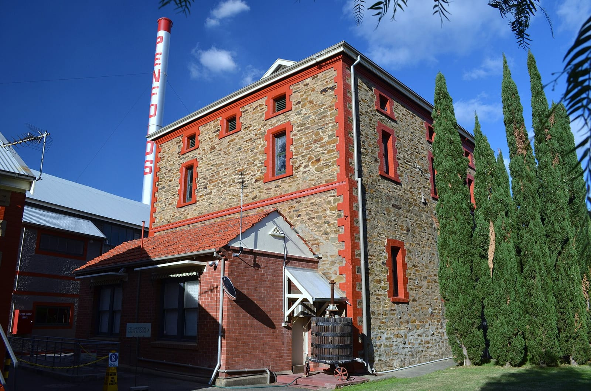
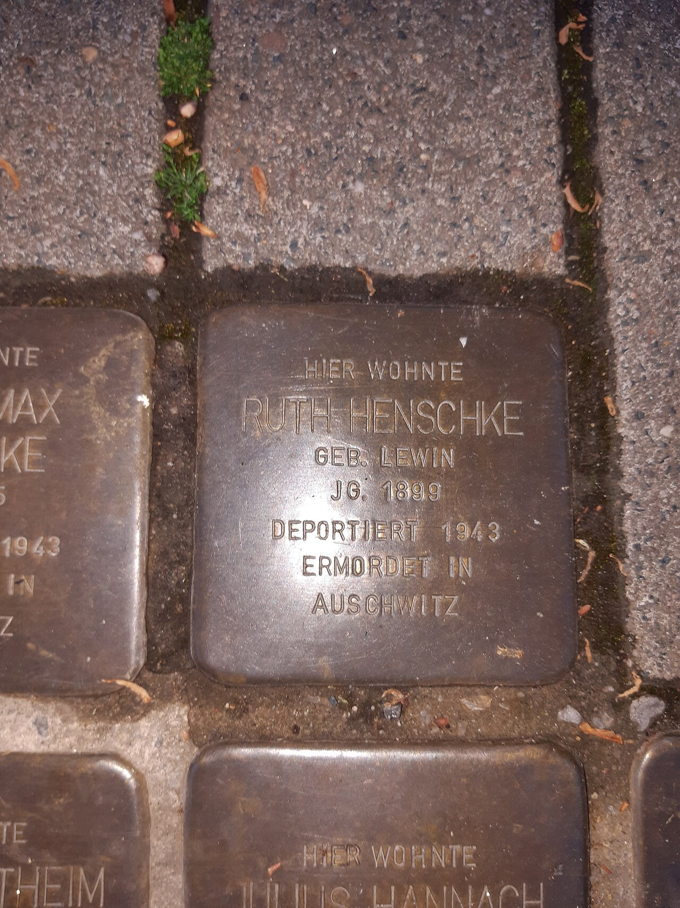

# 巴罗萨葡萄酒路线

这条路线把两个看似不在同一张地图上的点连起来：阿德莱德山麓的奔富玛吉尔庄园，以及伊甸谷基内顿的亨施克酒庄。前者在城市边缘，后者在丘陵深处；它们共享巴罗萨的移民史与西拉传统，却分别站在谷底热量与高海拔凉爽的两端。把车程控制在一小时内，就能在一天里读完海拔、老藤与试验精神这三条线索。

图：巴罗萨葡萄酒路线所在的巴罗萨风貌配图。图片：No machine-readable author provided. ScottDavis assumed (based on copyright claims).，CC BY-SA 3.0，via Wikimedia Commons（[原图页面](https://commons.wikimedia.org/wiki/File:Tanunda.jpg)）。这张照片用于说明产区环境与访问语境，不标定巴罗萨葡萄酒路线的门店、酒庄或活动现场。

## 两站之间的距离与顺序

- 第一站：[奔富玛吉尔庄园](ref:penfolds)，78 Penfold Road, Magill, South Australia 5072；距阿德莱德市中心约 8 公里，门市每周七天 10:00–17:00。
- 第二站：[亨施克酒庄](ref:henschke)，1428 Keyneton Road, Keyneton, South Australia 5353；从玛吉尔沿北东公路约一小时，进入伊甸谷。
- 方式：自驾。没有可依赖的公共交通串联两站，回程叫车也不稳。
- 顺序：先玛吉尔，后基内顿。先在 1844 年的城市葡萄园建立历史参照，再到高海拔的老藤地块看另一套成熟逻辑。
- 时长：一天可行；若要把餐厅、酒窖参观与两个品鉴都排进去，最好住一晚。

## 谷底与伊甸谷：两条海拔带

[巴罗萨](ref:barossa)在澳大利亚 GI 体系里是一个 zone，包含 Barossa Valley 与 Eden Valley 两个 region。Barossa Valley 的葡萄园分布在 112–596 米，谷底温暖，1 月均温约 21.9 摄氏度，生长季降雨约 220 毫米；Eden Valley 的葡萄园在 219–632 米，成熟期明显更凉，酸度保留更好。两区合计约 1.4 万公顷葡萄园，但海拔差让它们更像两种气候，而不是同一片田的两种叫法。

Barossa Valley 的 Shiraz 约占葡萄园的一半，成熟的黑莓、李子、甘草与饱满单宁是常见描述；Eden Valley 的 Shiraz 更紧致，香料与酸度更突出。理解这条路线，不需要背下所有地名，只要记住一件事：从玛吉尔向北爬升，温度下降，夜晚更冷，酒体从宽厚转向收束。

## 1840 年代移民与 Gründer 一代

巴罗萨的葡萄酒史与移民史绑在一起。1841 年，Johann Christian Henschke 从西里西亚的 Kutschlau 移民南澳，先落脚阿德莱德山，后来在巴罗萨的 Krondorf 与 North Rhine（后改名 Keyneton）购置土地；1868 年出现家族第一笔售酒记录。1844 年，Christopher 与 Mary Penfold 在玛吉尔种下从欧洲带来的葡萄插条，正式建立奔富。两家人一个来自德语路德派移民网络，一个来自英国殖民商业网络，却共同把这片谷地变成南澳的葡萄酒核心。

德语 Gründer 意为“奠基者”，这里借指 1840 年代抵达并留下葡萄园、教堂、农庄与酒窖的移民家庭。它不是官方头衔，也不构成质量等级；但它解释了为什么巴罗萨的村庄形态、石造酒窖与家族酒庄如此密集。看老建筑时，别只把它当背景，那些石墙与发酵间就是早期移民的技术选择。

## 老藤 Shiraz 与奔富的试验传统

Wine Australia 的记录显示，巴罗萨仍有 1843 年种植的 Shiraz，被认为是世界上最古老的 Shiraz 之一。2009 年，Barossa Grape & Wine Association 推行 Old Vine Charter，按 35 年、70 年、100 年与 125 年四档标记老藤；这是自愿性标识，不是法定质量等级。老藤能带来更稳定的产量与更复杂的根系，但年份、地块与酿造仍然决定酒的最终样子。

奔富的试验传统是另一条线索。1844 年建园后，酒庄在加强酒、克莱雷与雷司令上起步；1948 年 Max Schubert 出任首席酿酒师，1950 年代开始 Grange 的长期陈年试验，1959 年又以酒窖存放区命名了第一款 Bin 系列。这里的“试验”不是营销词，而是把不同产区、不同桶型与不同年份放进同一个品牌体系里反复比较。[西拉](ref:shiraz)与[橡木桶陈年](ref:oak-ageing)因此成为理解奔富的两把钥匙：前者提供骨架，后者决定时间如何被写进酒里，也共同塑造了这里[红葡萄酒](ref:red-wine)的结构与陈年潜力。

## 第一站：奔富玛吉尔庄园

玛吉尔庄园是奔富的起点，也是世界上少见的城市单一葡萄园之一。它距阿德莱德市中心约 8 公里，葡萄园、Grange Cottage 与石造酒窖仍在原址；1844 年的建园故事与后来的 Grange 试验共享同一片坡地。门市每周七天 10:00–17:00 开放，提供导览、品鉴与餐厅体验；Magill Estate Restaurant 与更轻松的 Magill Estate Kitchen 让这里不只是“看完就走”的酒庄。

体验按内容分档，价格从 60 澳元的 Magill Heritage 到 175 澳元的 Ultimate Penfolds，更高阶的收藏与签名项目需要另行预约或询价。第一次到访建议选带历史讲解与酒窖参观的项目，先把 1844 年、1948 年与 1959 年三个节点串起来；已经熟悉奔富的人，可以把重点放在老年份或实验性释放。地址与时段以官方页面为准，坐标以官方渠道为准。

## 第二站：亨施克酒庄

亨施克在基内顿，属于伊甸谷的高海拔带。家族自 1868 年有售酒记录以来已传到第六代，官方叙述把 Hill of Grace 与 Mount Edelstone 视为两座核心西拉葡萄园：前者与 1860 年前后种下的老藤相连，后者由第四代 Cyril Henschke 在 1950 年代推动成单一葡萄园酒。酒庄仍由家族经营，酒窖与葡萄园的距离很近，参观的重点是地块、桶样与家族记忆，而不是大型生产线。

酒窖门市周一到周六 9:00–16:30 开放，周日关闭，公共假日 10:00–15:00；官方明确写着因容量限制，到访必须预约。这个规则比玛吉尔更严格，临时开车过去很可能只能看风景。把预约确认、到达时间与品鉴时长写进行程，再安排回程；地址是 1428 Keyneton Road, Keyneton SA 5353，坐标以官方渠道为准。

## 酒庄之间的路、预约与季节

玛吉尔到基内顿约一小时，路线穿过阿德莱德山麓与伊甸谷的丘陵，部分路段窄、弯多，夜间没有路灯。采摘季通常在二月到四月，酒庄与道路都更忙；南半球春季与秋季温度适中，但早晚温差大，带一件外套。巴罗萨的节庆与酒庄活动集中在这些月份，具体日期以官方日历为准。

两站都要预约，但节奏不同：玛吉尔的门市与体验按场次释放，餐厅另有营业时间；亨施克因容量限制必须提前确认。不要把两场品鉴排得太紧，玛吉尔到基内顿的一小时只是车程，不含找路、停车与迟到缓冲。开车的人全程不喝酒，或把品鉴样品全部吐掉；乡村道路上，一杯就足以影响判断。

对照阅读：[奔富玛吉尔庄园](ref:penfolds)、[巴罗萨](ref:barossa)。

## 参考资料

本页依据奔富的 Magill Estate 门市页、联系页与品牌历史页，亨施克的联系页与家族史页，以及 Wine Australia 的 Barossa Valley 产区资料核验，页面核验日期 2026-11-09。开放时间、体验价格、预约规则与酒款会变化，以各官方渠道为准。

## 相关图像

图：奔富玛吉尔庄园相关实景照片。图片：Bahnfrend，CC BY-SA 3.0，via Wikimedia Commons（[原图页面](https://commons.wikimedia.org/wiki/File:Penfolds_Magill_Estate,_2014(2).JPG)）。关联图像：巴罗萨葡萄酒路线。

图：Henschke Ruth Stolperstein Magdeburg。摄影：Adnon，CC BY-SA 4.0，来自 Wikimedia Commons。。图片：Adnon，CC BY-SA 4.0，via Wikimedia Commons（[原图页面](https://commons.wikimedia.org/w/index.php?curid=90422028)）。关联图像：巴罗萨葡萄酒路线。
