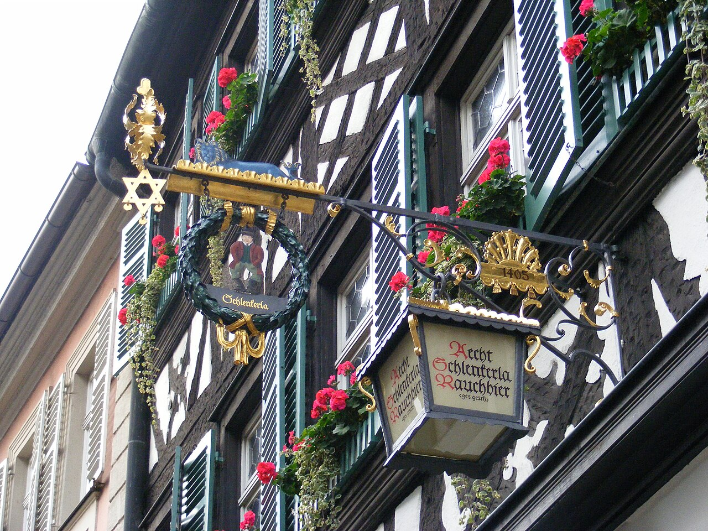
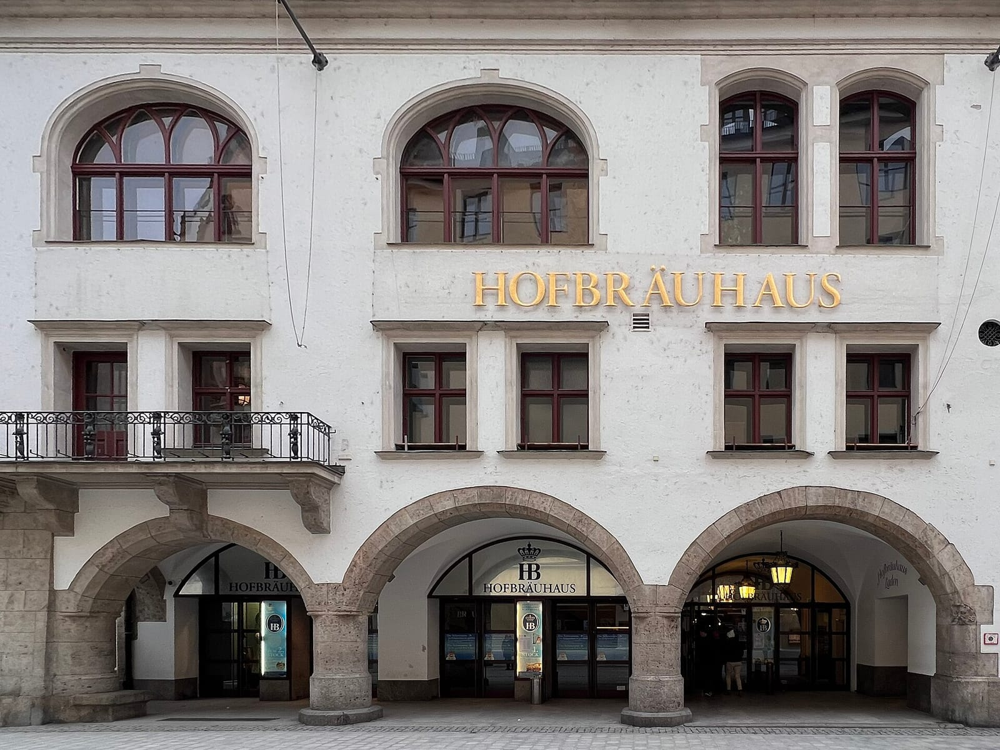

# 巴伐利亚啤酒路线：慕尼黑到班贝格

这条路线把巴伐利亚啤酒文化的三种空间放在一起：慕尼黑老城的州营啤酒大厅、慕尼黑西侧的家族啤酒厂厂区，以及班贝格老城里以烟熏啤酒为招牌的历史酒馆。两站在慕尼黑，一站在班贝格，中间隔着一段铁路。它适合愿意把一天半到两天交给啤酒的人，不适合想在半天内“打卡三城”的人。

图：栏目配图。摄影：见原图页。署名：Prsjl，CC BY-SA 4.0，来自 项目图库（类别配图）（[来源](https://commons.wikimedia.org/wiki/File:Oaxaqa_(41).jpg)）。这张照片仅为路线栏目配图，不标定巴伐利亚啤酒路线：慕尼黑到班贝格的具体停靠点或边界。

> **先给结论**
> **一句话：** 这页判断巴伐利亚啤酒路线：慕尼黑到班贝格怎么排、走多久、哪些点不能省。
>
> - **适合谁：** 想把巴伐利亚啤酒路线：慕尼黑到班贝格排成一日或两日行程、需要知道顺序与停留重点的人。
> - **不适合谁：** 只想看单个地点、不打算按路线走的人。
> - **先看这两点：**
>   - - 第一站：皇家啤酒屋，地址 Platzl 9, 80331 München，1589 年由巴伐利亚公爵威廉五世创立，1828 年向公众开放。
>   - 皇家啤酒屋代表“啤酒大厅”。

## 路线概览

- 第一站：[皇家啤酒屋](ref:hofbrauhaus)，地址 Platzl 9, 80331 München，1589 年由巴伐利亚公爵威廉五世创立，1828 年向公众开放。
- 第二站：[奥古斯丁啤酒厂](ref:augustiner)，地址 Landsberger Straße 31–35, 80339 Munich，品牌把 1328 年视为建厂年，现由瓦格纳家族经营。
- 第三站：[施伦克拉烟熏啤酒馆](ref:schlenkerla)，地址 Dominikanerstraße 6, 96049 Bamberg，1405 年首次见于文献，由 Trum 家族经营到第六代。
- 方式：慕尼黑市内步行、地铁与 S-Bahn；慕尼黑到班贝格乘火车；班贝格老城内步行。
- 建议时长：一天半到两天。慕尼黑两站放在第一天，班贝格一站放在第二天；若压缩成一天，时间会非常紧。

## 为什么是这几站

皇家啤酒屋代表“啤酒大厅”。它从宫廷啤酒坊起家，1828 年才开始向公众售酒，今天的建筑建于 19 世纪末，二战中严重受损后重建。长桌、木凳、大杯与乐队，是它为“很多人同时喝酒”设计的空间。它游客多、声音大，但也最直接地展示了巴伐利亚啤酒馆的公共性。

奥古斯丁啤酒厂代表“家族企业与生产空间”。它的源头可以追溯到 1328 年奥古斯丁修道院的酿酒活动，1803 年世俗化后转为私营，由瓦格纳家族经营至今。Landsberger Straße 的厂区是仍在运转的工业建筑群，不是主题公园；散客不能把它当成随时可进的展馆。它的价值在于让人看到：啤酒不只发生在酒馆里，也发生在厂区、装卸区与长期使用的建筑里。

施伦克拉代表“味道做到底”。它首先是一家历史啤酒厂附设酒馆，酒在店里酿造、从木桶直接打出。烟熏味来自用山毛榉木烟熏过的麦芽，不是上桌前添加的香精。把这三站放在一起，得到的是三种尺度：大厅的喧闹、厂区的沉默、老酒馆的专注。

## 第一站：皇家啤酒屋

为什么去：它是慕尼黑最容易到达、也最能说明“啤酒大厅”是什么的地方。酒馆在 Platzl 9，从玛利亚广场步行几分钟就到。主厅中央是乐队舞台，四周是长桌与长凳；地下是拱顶式的 Bierkeller，光线更暗、回声更强；此外还有适合小团体的侧厅。进门自己找空位，看到长桌有空就直接坐下，是这里的常规操作。

点什么：第一次来建议先点 0.5 升的 Hofbräu Original，确认自己喜欢淡色拉格的麦芽甜与温和苦味；想比较就再加一杯 Münchner Dunkel 或 Münchner Weisse，用同一顿饭完成淡色、深色、小麦三类的对照。点单时说清杯型与酒名，例如“ein Halbe Original”；侍者会记在桌卡上，结账时一起算。食物选烤猪肘配酸菜、白香肠配甜芥末，或 Obatzda 芝士酱配黑麦面包。

停留多久：九十分钟到两小时。乐队演奏时主厅很吵，想聊天就选侧厅或 Bierkeller；白香肠传统上在上午食用，中午点它并不“错”，但当地人会觉你点得不太对时辰。

实用提醒：乘 S-Bahn 或 U3/U6 到 Marienplatz，出站步行约五分钟。截至 2026-11-08，官方网站首页标注每日 11:00–24:00，节庆与演出日会调整。散客不需要订座，现场找位或拼桌；大型团体可以提前询问。啤酒按杯计价，食物分量大，两个人点一份主菜加两杯酒通常够。建议备些现金，小额结账更方便。

## 第二站：奥古斯丁啤酒厂

为什么去：这一站看的是“厂区”，不是“酒吧”。Landsberger Straße 31–35 的建筑、装卸区、烟囱与办公部分共同构成一个仍在运转的工厂；游客能进入的部分有限，能否参观、如何预约要以官方回复为准。把厂区当成啤酒博物馆会失望，把它当成城市工业遗产的一角，则能看到另一种慕尼黑。

点什么：厂区本身不设面向散客的常规酒吧，想喝这个品牌，通常去与酒厂相关的餐饮场所。Braustuben 在 Landsberger Straße 厂区一带，是最近的选择；Augustiner-Keller 在 Arnulfstraße 52，是带啤酒花园的大型餐饮点；市中心的 Augustiner am Platzl 则更容易到达。第一次接触这个品牌，最稳的比较是 Lagerbier Hell 与 Edelstoff 各一杯：前者告诉你“慕尼黑日常是什么味”，后者告诉你“同一家厂把酒体加厚会变成什么样”。Dunkel 与 Maximator 适合晚餐或冬天，Maximator 酒精度约 7.5%，不适合作为第一杯。

停留多久：九十到一百二十分钟。若只在厂区外观走一圈、再到 Braustuben 喝一杯，两小时足够；若想等官方回复、安排参观，就要单独留出时间。

实用提醒：乘 S-Bahn 至 Donnersbergerbrücke 后步行约十分钟，或乘市内公共交通到附近站点再走；具体线路以 MVV 当日查询为准。厂区的参观安排并非常常设项目，是否开放、如何预约、是否接待个人，都要以官方渠道回复为准。Braustuben、Augustiner-Keller 与市中心店的营业时间、菜单与是否接受预订各自独立，出发前分别查官方信息。着装没有要求；若获准进入生产区，需遵守安全规定，不要穿凉鞋、不要越过警戒线。

## 第三站：施伦克拉烟熏啤酒馆

为什么去：它把一种味道做成了一间店的性格。施伦克拉在班贝格老城的 Dominikanerstraße 6，位于主教座堂下方的小巷里；1405 年的文献第一次提到这处房产，今天由 Trum 家族经营到第六代。它保留木质护墙、老式灯具与深色家具，空间被分成几个大小不一的房间，桌椅紧凑；这不是博物馆式的复原，而是仍在营业的老房子。

点什么：先点一杯小杯的 Rauchbier Lager 或 Märzen，确认自己能接受烟熏强度，再决定要不要换 Weizen 或加大杯。Rauchbier Märzen 是招牌，深色、酒体中等，烟熏与麦芽甜同时出现；Rauchbier Weizen 是小麦版本，香蕉与丁香香气叠加烟熏，口感更柔；Rauchbier Lager 颜色较浅、烟熏较轻；Rauchbier Urbock 是季节性的烈性款，烟熏更厚。配餐选 Schäuferle 烤猪肩配酸菜与面包，或 Bratwurst 配酸菜；烟熏、烤肉、酸菜的酸度互相支撑。

停留多久：九十到一百二十分钟。中午与下午较早的时候更容易找到座位，晚上本地人与游客都多；旅游旺季周末建议预留等位时间。若同行者完全不接受烟熏味，这家店没有“无烟熏”的替代酒款，最好换一家。

实用提醒：从班贝格火车站步行到老城约十五到二十分钟，进入老城后按主教座堂方向走；公交与出租车可以到老城边缘，最后一段仍是步行。班贝格旅游局的页面曾列出每日 10:00–24:00 的营业时段，酒馆自身页面与季节、假日可能调整。价格在班贝格属于中等偏旅游区水平，啤酒按杯计价，食物分量实在；散客现场找座与拼桌，团体建议提前询问。德国不少老店仍偏好现金，备一些现金更稳妥。

## 顺序与交通

建议按“皇家啤酒屋 → 奥古斯丁啤酒厂 → 施伦克拉”的顺序走，但把前两站放在同一天、第三站放在第二天。第一站中午到达最顺：先吃白香肠或烤猪肘，再喝一杯 Original；下午乘 S-Bahn 或市内公共交通到慕尼黑西侧，在厂区一带走一圈，最后在 Braustuben 或 Augustiner-Keller 坐下。第二天从慕尼黑中央车站乘火车到班贝格，把施伦克拉放在中午或傍晚。

具体走法：

- 第一站到第二站：从 Marienplatz 乘 S-Bahn 到 Donnersbergerbrücke，再步行约十分钟到 Landsberger Straße 31–35；也可以从老城乘 U-Bahn 或电车到附近站点，具体换乘以 MVV 当日查询为准。厂区与 Braustuben 一带以办公和工业为主，不是逛街型街区。
- 第二站到第三站：从慕尼黑中央车站（München Hbf）乘 ICE 或 IC 前往班贝格，通常为直达或一次换乘；车次、用时与票价以德国铁路当日查询为准。到班贝格后，从火车站步行约十五到二十分钟进入老城，再按主教座堂方向找到 Dominikanerstraße 6。
- 班贝格老城内：街巷窄、坡道多，路线以步行为主；从主教座堂、旧皇宫到老市政厅都在步行范围内，不需要在市内再乘车。

如果坚持一天走完，顺序会变成“上午皇家啤酒屋、午后奥古斯丁、傍晚火车到班贝格、夜间施伦克拉”。这在纸面上可行，但每站只能停留很短，而且火车与等位会吃掉余量；更稳妥的安排是分两天，把啤酒与城市分开看。

## 时长与预算

一天半到两天是合理区间。第一天：皇家啤酒屋九十分钟到两小时，市内交通与换站约一小时，奥古斯丁厂区与餐饮九十分钟到两小时。第二天：慕尼黑到班贝格的火车、班贝格站到老城的步行，加上施伦克拉九十到一百二十分钟，半天到一天。

预算上，三站的单价都不算极端：皇家啤酒屋与施伦克拉属于当地中等水平，奥古斯丁相关餐饮点因位置不同略有差异，市中心店通常比厂区店贵一档。真正的变量是火车票与住宿：把班贝格放在第二天，意味着要么在班贝格过夜，要么当天往返、把时间压得很紧。控制预算的办法是每站只点一杯到两杯、把正餐放在其中一站，而不是每站都点整套菜。

## 适合与不适合

适合：对啤酒风格、酿造史与城市空间都有兴趣的人；愿意坐进长桌、和陌生人拼桌的人；接受“厂区不是景点”这一事实、愿意提前查官方信息的人；计划在巴伐利亚停留两天以上的人。

不适合：想在一天内跑完三地的人；只喝清淡啤酒、完全不接受烟熏味的人；期待固定时段导览、纪念品商店与“沉浸式体验”的游客；想直接走进车间拍照的人；把皇家啤酒屋当成高档餐厅、要求安静与正装的人；不愿提前查火车与营业时间的人。

带小孩的家庭要注意：啤酒馆可以进入，但主厅声音大、人多；厂区不是儿童游乐场所；班贝格老城石板路不平，推婴儿车不方便。

## 实用提示与核验说明

第一，先确认“喝”的地点。奥古斯丁的厂区不是常规酒吧，散客喝酒要去 Braustuben、Augustiner-Keller 或市中心店；把地址与营业时间分别查清，不要到了厂区门口才找酒。

第二，区分“可参观”与“只可外观”。厂区的参观安排不是常设项目，是否开放、如何预约、是否接待个人，都要以官方渠道回复为准；没有确认之前，不要把参观写进日程。

第三，啤酒按杯点、按桌卡结账。慕尼黑与班贝格的习惯接近：说清杯型与酒名，侍者记在桌卡上，最后一起结账；结账时报出含小费的总额，小费通常凑整或 5%–10%，不要把现金留在桌上走人。

第四，拼桌先问。走到长桌旁先问一句“Ist hier frei?”，得到允许再坐；不要把包放在整条长凳上，也不要把别人留下的杯子挪走。碰杯时说“Prost”，按当地习惯看着对方的眼睛。

第五，把历史年份读准。皇家啤酒屋的 1589 年是宫廷啤酒坊创立年，1828 年才向公众开放；奥古斯丁的 1328 年是修道院酿酒首次见于文献的年份，不是现代公司注册年；施伦克拉的 1405 年是房产与酒馆首次见于文献的年份，不等于“连续酿酒六百年”。

第六，本页只描述路线结构与可核查事实，不提供实时营业状态、车次与票价，也不提供地图与坐标：三处场所的经纬度在内容仓中保持为空，没有可核验的坐标来源，因此按项目规则不绘制示意地图。精确导航与车次请使用实时地图与铁路查询服务，并以现场标识为准。

补充阅读：[阿尔萨斯特级园路线：凯泽斯堡与里屈埃维尔](ref:c-extra-1)、[雅文邑路线：下雅文邑的单一庄园](ref:c-extra-2)。

相关条目：[皇家啤酒屋](ref:hofbrauhaus)、[奥古斯丁啤酒厂](ref:augustiner)、[施伦克拉烟熏啤酒馆](ref:schlenkerla)。

慕尼黑到班贝格的啤酒路线涉及多地铁路与酒馆营业时间；各店菜单、价格与预约以官方渠道为准，出发前查 DB 班次。核验于 2026-11-08。

## 相关图像

图：施伦克拉烟熏啤酒馆。图片：User:Mattes，Public domain，via Wikimedia Commons（[原图页面](https://commons.wikimedia.org/wiki/File:Schlenkerla_-_Nasenschild_in_Bamberg.JPG)）。关联图像：巴伐利亚啤酒路线：慕尼黑到班贝格。

图：皇家啤酒屋相关实景照片。图片：Burkhard Mücke，CC BY-SA 4.0，via Wikimedia Commons（[原图页面](https://commons.wikimedia.org/wiki/File:2023-02-03_Hofbr%C3%A4uhaus_am_Platzl_07.jpg)）。关联图像：巴伐利亚啤酒路线：慕尼黑到班贝格。
