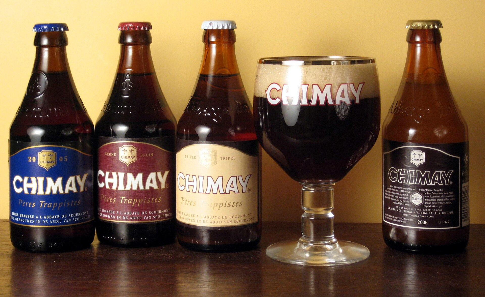
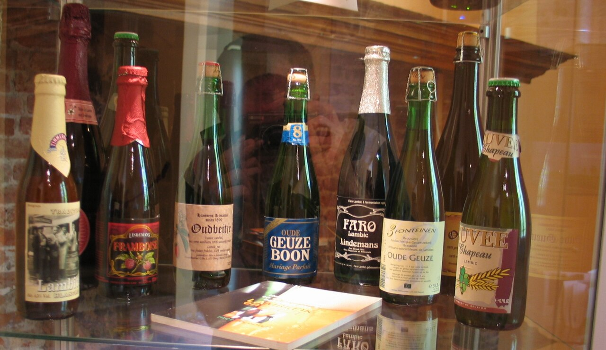
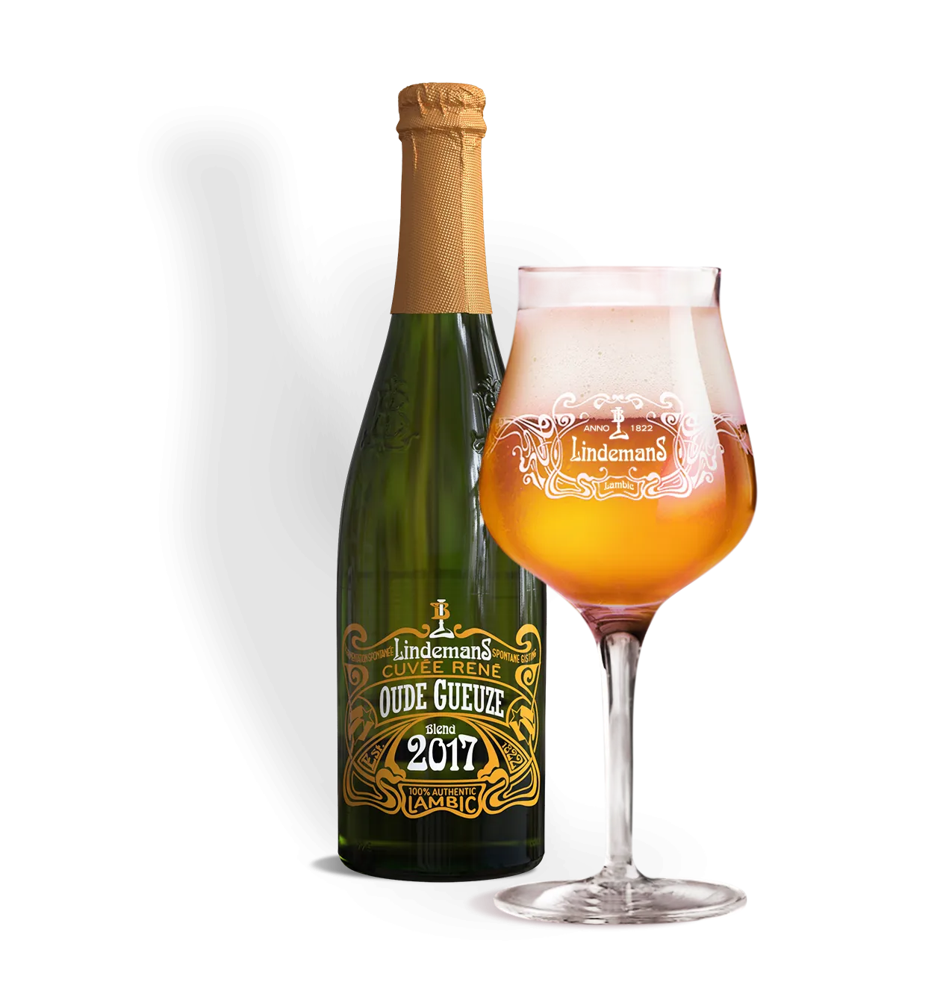

# 比利时啤酒路线：兰比克与布鲁日城市艾尔

这条路线只有两站，却跨了两座城市：布鲁塞尔西南安德莱赫特的康帝隆，和布鲁日老城的半月酒厂。前者把麦汁交给空气里的野生微生物，后者把选育好的酵母收进发酵罐；一个依赖时间与不可控，一个依赖设备与配方。两座城市之间乘火车约一小时，一天可以完成。它适合愿意早起、接受酸味、不把“比利时啤酒”当成单一味道的人。

图：比利时啤酒路线：兰比克与布鲁日城市艾尔所经地区的一处实景。图片：Uploaded by photographer.，CC BY-SA 3.0，via Wikimedia Commons（[原图页面](https://commons.wikimedia.org/wiki/File:Chimays.jpg)）。这张照片用于说明比利时啤酒路线：兰比克与布鲁日城市艾尔所经过的产区或城市环境，不标定其具体停靠点。

## 用一趟火车串起两种发酵

- 第一站：[康帝隆酒厂](ref:cantillon)，地址 Rue Gheude 56, 1070 Bruxelles，在安德莱赫特，靠近布鲁塞尔南站。
- 第二站：[半月酒厂](ref:halve-maan)，地址 Walplein 26, 8000 Brugge，在布鲁日老城中心。
- 方式：布鲁塞尔市内步行或地铁到南站，乘火车到布鲁日，再步行进城；全程不需要自驾。
- 建议时长：一整天。第一站一到两小时，到南站与候车约半小时，火车约一小时，布鲁日站步行约十五分钟，第二站一到两小时。

顺序不能反过来。康帝隆的开放日集中在工作日白天，周三与周日闭馆，周六只做预约导览；半月酒厂的导览按场次售票，下午与周末容易满。把康帝隆放在上午、半月酒厂放在下午，才留有余量；若当天是周三或周日，整条路线要改期。

## 安德莱赫特：把发酵交给空气

[康帝隆](ref:cantillon)在 1900 年建立，厂名沿用家族姓氏，后来由 Van Roy 家族经营。1978 年，酒厂与友人成立“布鲁塞尔贵兹博物馆”协会，把生产现场变成一座活博物馆：铜锅、冷却盘、橡木桶与堆到天花板的酒瓶同时是展品与设备。你看到的是当天正在使用的车间，也可能什么都看不到，因为工序不对外开放。

兰比克不接种商业酵母。麦汁糖化后泵入浅而宽的冷却盘，在夜间自然降温，空气中的野生酵母与细菌落入麦汁，随后进入橡木桶进行一年以上的发酵与熟成。桶壁微生物、酒窖温湿度与当年气候都会进入风味；橡木桶在这里是微生物的家，不是增添木味的工具。

酒单从最干的开始：未经调配的年轻兰比克酸度高、气泡少；贵兹由不同年份的兰比克混合后在瓶中二次发酵，气泡细、酸度立体；水果款用真实樱桃或覆盆子浸渍；Iris 是少见的干投酒花兰比克。品鉴从轻到重、从干到果，温度不要过低，过冰会压掉霉香与果香。酒窖温度低，夏天也要带件外套，地面湿滑，穿防滑鞋。

## 从南站上车

从康帝隆到布鲁塞尔南站，可以步行约十分钟，也可以坐地铁到南站；留出二十分钟买票、找站台与安检式验票的时间。南站站台信息常临时变更，进站先看大屏。到布鲁日后，从车站步行进城约十五分钟，经 't Zand 广场进入老城，石板路对拉杆箱不友好。也可以在南站寄存行李，轻装走完两站再回取；站台与车厢内饮酒以运营方规则为准。

## 布鲁日：把发酵收回罐里

[半月酒厂](ref:halve-maan)在 Walplein 26，酿酒活动在这块地点超过五百年，家族故事从 1856 年开始：Leon Maes 成为酒厂主人，按自己的配方酿酒。六代人经营至今，1981 年推出 Straffe Hendrik，2005 年推出 Brugse Zot，后者让酒厂的未来重新稳定下来。2016 年建成一条 3.3 公里的地下输酒管道，把市中心的酿造车间与城外装瓶厂连起来，减少老城里的运酒卡车。

参观分经典导览与更长的 XL 导览，经典场约四十五分钟，含一杯啤酒；全程有 220 级台阶，部分很陡，终点是屋顶，能看到布鲁日老城的 360 度全景。只有在这里能喝到未过滤的 Brugse Zot 与 Straffe Hendrik。导览按场次售票，周末与假期容易满，建议提前在线订票；行动不便者不适合全程。

酒单覆盖上发酵多个方向：Brugse Zot Blond 金黄平衡，Dubbel 焦糖与深色水果明显，Straffe Hendrik Tripel 更干更烈，Quadrupel 酒体厚，Heritage 桶陈。它们靠选育酵母在较高温度下工作，产生酯香，再经低温熟成，与康帝隆的野生发酵是两套控制方式。

## 兰比克、修道院与命名的边界

兰比克与贵兹不是同义词。兰比克是未经调配的自发发酵麦汁酒，贵兹是不同年份兰比克的混合并在瓶中二次发酵；欧盟对“Oude Geuze”“Oude Kriek”等传统名称有传统特色保证保护，具体范围以法规文本为准。看到“Oude”通常意味着更长的陈年与更酸的风格，没有这个词的贵兹可以更年轻、更甜。

修道院啤酒是另一条线。Trappist 标识只允许特定修道院的产品使用，受法律与协会规则约束；Abbey beer 则是更宽泛的商业类别，不要求修道院生产。半月酒厂是家族企业，不是修道院酒厂，所以它的 Tripel 与 Quadrupel 属于修道院风格的商业演绎，而不是 Trappist。把三者放在一张桌上，合法性来源就清楚了：野生环境、家族配方、修道院制度。

想把这条线继续延伸，可以读兰比克、贵兹与特拉普斯特三个条目，再回到发酵条目看“接种”与“不接种”的分岔。这也是比利时啤酒最难被一句话概括的原因。

## 订票、季节与返程

康帝隆平日自由参观，不需要预约，到门口买票即可；周六只提供导览，必须在线预约；周三、周日与公共假日闭馆，年底与夏天还有年度闭馆安排，出发前必须查官网。十人以上团体不能走自由参观，需要提前邮件预约。半月酒厂的经典与 XL 导览都建议提前订，周末与假期场次最先售罄；餐厅与酒馆有独立时段。

季节上，春秋最舒服：酒窖不闷，老城步行也不至于被人流推着走。夏天布鲁日游客密集，下午的导览容易满；冬天酒窖更冷，康帝隆的车间与半月酒厂的楼梯都需要保暖衣物。两座城市都可能下雨，带防水外套比带伞实用。

饮酒与安全：兰比克的酸度高，空腹喝容易胃不舒服，先在布鲁塞尔吃一顿早饭或早午餐；品鉴杯量虽小，三杯加起来也不少，两站之间至少留一小时走路与喝水。半月酒厂有 220 级陡台阶，喝过酒再爬要慢，穿防滑鞋。回程查好最后一班火车，不要把时间押在“应该还有车”上；比利时查酒驾严格，全程坐火车就不要租车。当天往返的话，回南站取行李再上车。

本页只写路线结构与可核查事实，不提供实时开放状态、导览价格与车次；开放日、预约与交通以两站及铁路运营方官方渠道为准，页面核验日期 2026-11-08。

补充阅读：[兰比克](ref:c-extra-1)。

相关条目：[兰比克](ref:c-extra-1)、[康帝隆酒厂](ref:cantillon)、[半月酒厂](ref:halve-maan)。

## 相关图像

图：兰比克。图片：Paul Hermans at Dutch Wikipedia，CC BY-SA 3.0，via Wikimedia Commons（[原图页面](https://commons.wikimedia.org/wiki/File:Bieren_uit_de_streek_rond_brussel.jpg)）。关联图像：比利时啤酒路线：兰比克与布鲁日城市艾尔。

图：贵兹。图片：Strangerhappenings，CC BY-SA 4.0，via Wikimedia Commons（[原图页面](https://commons.wikimedia.org/wiki/File:Oude_Gueuze_bottle.png)）。关联图像：比利时啤酒路线：兰比克与布鲁日城市艾尔。
