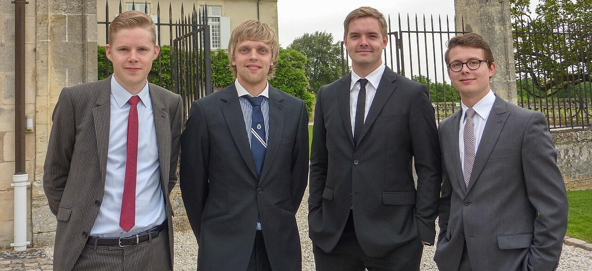

# 波尔多左岸路线：从葡萄酒城到波亚克两座一级庄

这条路线把三个尺度放在一条线上：一座讲“世界葡萄酒文明”的城市博物馆、一座 1855 年分级中的一级庄、以及另一座从二级庄升上去的一级庄。前两站在河与城之间，第三站才真正进入梅多克的砾石坡。它适合愿意用一整天到一天半理解“左岸”到底指什么的人，不适合把名庄当成拍照背景、到了门口才找入口的人。

图：波尔多左岸路线：从葡萄酒城到波亚克两座一级庄。摄影：The CBS Wine team at the 2012 Left Bank Bordeaux Cup。署名：Netapp Inc，CC BY-SA 3.0，来自 Wikimedia Commons（[来源](https://commons.wikimedia.org/w/index.php?curid=21313721)）。

## 路线概览

- 第一站：[波尔多葡萄酒城](ref:cite)，地址 134 Quai de Bacalan, 33300 Bordeaux，2016 年开馆，常设展约 3000 平方米。
- 第二站：[拉菲古堡](ref:lafite)，地址 Château Lafite Rothschild, 33250 Pauillac，112 公顷葡萄园，1855 年一级庄，1868 年由罗斯柴尔德家族购入。
- 第三站：[木桐酒庄](ref:mouton)，地址 Château Mouton Rothschild, 33250 Pauillac，1853 年改现名，1855 年二级庄，1973 年晋升一级庄。
- 方式：市区步行与电车 B 线；波尔多圣让站到波亚克乘区域列车；梅多克境内以出租车或自驾沿 D2 移动。
- 建议时长：一天半。第一天下午看葡萄酒城，第二天上午到波亚克；若压成一天，顺序仍然成立，但每站只能停留很短。

## 为什么走这条线

左岸的名气很容易被压缩成几个酒庄名字，真正难的是把名字放回地理与制度。葡萄酒城解决“框架”：它用地理、技艺、历史、生活艺术与跨产区比较，把葡萄酒讲成一种文明现象，而不是一张名庄排行榜。走进这里之前，先知道葡萄酒在世界范围内如何被种植、交易与饮用，到了波亚克才不会只看见大门与门牌。

拉菲解决“分级”。1855 年的梅多克分级是巴黎万国博览会配套的商业分类，按价格与声誉把酒庄排成五级；拉菲被列为一级，官方还在叙述里强调它在同级中的特殊位置。这个等级不是每年重评的质量榜，而是一份历史文件。理解这一点，再看它的 112 公顷葡萄园、深层砾石与以赤霞珠为主的品种结构，就会明白“一级庄”背后是土地、排水、采收与桶陈的长期工作。

木桐解决“等级会变”。它在 1855 年是二级庄，1973 年才晋升一级庄，是那次分级中唯一被升格的一级庄。它的另一条线是艺术：1945 年的“V”字酒标之后，酒庄每年邀请艺术家设计正牌酒标，1962 年又把葡萄酒艺术博物馆放进庄内。把拉菲与木桐放在同一天，看到的不只是两座名庄，而是同一套分级制度里“稳定”与“变动”的两种命运。

## 第一站：波尔多葡萄酒城

为什么去：它把波尔多从“产区”变成“入口”。建筑在加龙河左岸的巴卡朗码头，属于旧港区改造的一部分，外形由 XTU 建筑事务所设计，立面用丝网印刷玻璃与穿孔铝板，光线变化时轮廓也跟着变。馆内常设展分六大主题、18 个模块，覆盖五大洲，平均参观两到三小时；展线不是强制单行，可以按兴趣跳着看。

看什么：第一次来，先把“世界葡萄园”“技艺”“历史长河”走一遍，建立“风土—工艺—贸易—消费”的坐标；再把“波尔多”相关模块留到最后，避免一进门就陷进地方叙事。展项大量使用影像、气味与触觉装置，适合慢慢试，不适合赶场。八层的观景楼是参观的收尾，门票含一杯由侍酒师挑选的葡萄酒或葡萄汁，可以俯瞰城市与河流；它不是无限畅饮的酒吧，而是一段参观的句号。

停留多久：两到三小时。若另外报名品鉴工作坊，要预留半天，不要把工作坊与常设展压在同一小时里。带孩子的家庭可以走馆方设置的青少年路线，比全程硬走更轻松。

## 第二站：拉菲古堡

为什么去：它是“分级”最具体的样本。酒庄在波亚克北侧，名字常被追溯到加斯科方言里的“小山脊”；葡萄园 112 公顷，分三块，土壤是深层细砾石混风成沙，下层是排水良好的石灰岩。正牌以赤霞珠为主，只用十年以上葡萄藤，在新橡木桶中陈酿；副牌 Carruades de Lafite 来自另一块高原，梅洛比例更高。这些细节比“名庄”两个字更能解释它为什么长期站在一级。

看什么：这一站首先要接受“边界”。酒庄官网公告，古堡因整修暂停对访客开放至 2028 年 1 月，并建议改访同产区的 Château Duhart-Milon；联系页面还留有另一处“整修至 2026 年”的旧口径，两处说法不一致，出发前必须再确认。也就是说，这一站更现实的内容是看波亚克北侧的葡萄园、道路与庄园外围，理解 D2 沿线“酒庄之路”的空间关系，而不是走进酒窖。庄园是私人产业，不要把车停在葡萄园入口或私人车道，也不要翻越围挡。

停留多久：三十到六十分钟，取决于你愿意在葡萄园边停留多久。若已预约到杜哈米隆的替代参观，则要另加一到两小时。把拉菲写成“必进”的行程，在整修期是不准确的；把它写成“左岸地理的一站”，反而成立。

## 第三站：木桐酒庄

为什么去：它把“等级”“艺术”“家族”三条线缠在一起。1853 年，纳塔涅·德·罗思柴尔德男爵买下当时的 Château Brane-Mouton 并改为现名；1855 年列二级庄；1973 年晋升一级庄。1945 年起，正牌酒每年请一位艺术家设计酒标，原作集中在“酒标画作”展区；1962 年设立的葡萄酒艺术博物馆，则收藏与葡萄、葡萄酒有关的各时代器物。参观动线通常包含发酵车间、酒窖、博物馆与酒标展区，是否含品鉴要在预约时确认。

看什么：2013 年启用的新发酵车间值得留时间，64 个不同容量的发酵罐对应不同地块，木结构、钢柱与悬挂照明把“分地块处理”这件事直接摆出来；大酒窖负责正牌陈酿；博物馆与酒标展区则把品牌史按年份排开。不要只盯着酒标上的名画家，真正要看的是酒庄如何把一块块葡萄园拆开、再调配成同一款酒。木桐与拉菲同属罗斯柴尔德家族，却是不同公司，不要把两者混为一谈；Mouton Cadet 是独立的酒商品牌，也不是木桐正牌。

停留多久：一到三小时，取决于预约的项目。木桐只接受预约，官方要求至少提前两个月，采收期还会暂停参观；没有确认之前，不要把“进酒窖”写进日程。

## 交通与节奏

第一站到第二站之间，城市与产区的关系要用两段交通完成。葡萄酒城在巴卡朗码头，乘电车 B 线到“La Cité du Vin”站，步行约两分钟；从市中心过来也可以沿加龙河走。看展结束后回住处或去圣让站，第二天再从圣让站乘区域列车北上波亚克。波亚克有车站，但车站到酒庄仍有一段距离，需要出租车、自行车或自驾接驳；梅多克的出租车在旺季可能紧张，返程最好提前安排。

波亚克镇内与 D2 沿线不适合“硬走”。这条路是酒庄之路，也是农业道路，路肩窄、车流快，葡萄园耕作期还有机械进出。把“从拉菲走到木桐”想成散步，会低估距离与路况。更稳妥的做法是：在波亚克镇落脚，用出租车完成两座酒庄之间的移动，把步行留给镇内与葡萄园边缘的短段。

节奏上，第一天下午看葡萄酒城，晚上住波尔多；第二天上午坐车北上，中午在波亚克吃饭，下午按预约看木桐，拉菲只在外部停留。这样安排的好处是，把“信息密度最高”的博物馆放在体力最好的时候，把“需要预约、容易迟到”的酒庄放在第二天，误差空间更大。

## 季节与预约

波尔多的旅游旺季与葡萄生长季重叠。春季葡萄园发芽，夏季日照长，九月到十月是采收期；采收期酒庄人手紧张，部分参观会暂停或改线，木桐官方就明确提到采收期暂停参观。想避开人潮，晚秋与冬季更安静，但日照短、部分酒庄进入休整，预约前要逐家确认。

预约是这条路线的前提。拉菲在整修期不接待访客，公告建议改访杜哈米隆；木桐要求至少提前两个月，且视名额而定；葡萄酒城的常设展可以现场购票，但品鉴工作坊要单独订。把三件事分开确认：博物馆的展与工作坊、拉菲的整修状态与替代方案、木桐的预约时段。任何一个环节没确认，都可能让当天多出一段空等。

## 礼仪与边界

第一，分清“酒庄”与“景点”。波亚克的名庄首先是农业企业，其次才是参访地；没有预约就不要推门，不要走进葡萄园行间，不要触碰橡木桶与设备。第二，品鉴时使用吐酒桶，开车的人不喝；波尔多对酒驾执法严格，不要用“只喝一口”说服自己。第三，着装以整洁、舒适为主，葡萄园地面不平，避免高跟鞋；酒窖温度低，夏天也带一件薄外套。

第四，把历史年份读准。1855 年是分级年，不是酒庄创立年；拉菲的 1868 年是家族购入年；木桐的 1853 年是改现名年，1973 年才是晋升一级庄。第五，区分“正牌”“副牌”与“酒商品牌”。拉菲的 Carruades、木桐的 Le Petit Mouton 与 Mouton Cadet 不是同一层级的东西，购买与讨论时不要混用。第六，不要向工作人员要求“现场买一瓶正牌”；波尔多的正牌酒主要通过期酒与酒商网络销售，酒庄门口不是零售店。

## 替代与延伸

如果拉菲整修期无法进入，杜哈米隆是最直接的替代：同属 Domaines Barons de Rothschild (Lafite)，同在波亚克，预约渠道清楚。若想把“分级”看得更完整，可以在波亚克再加一座圣朱利安或玛歌的酒庄，但一天两座已经是上限，三座会变成赶场。若对城市与河流更感兴趣，把葡萄酒城与 Chartrons 旧酒商街区、Les Halles de Bacalan 市场串成半天，比多跑一座酒庄更从容。

往北可以延伸到圣埃斯泰夫，往南是圣朱利安与玛歌；这些村庄各自有酒庄与道路，但不要把梅多克当成一条可以“一路打卡”的主题公园。真正值得延伸的是阅读：把 1855 年分级的来龙去脉、砾石土壤与赤霞珠的关系、期酒制度如何运作弄清楚，再回到葡萄园边，看到的会完全不同。

相关条目：[波尔多葡萄酒城](ref:cite)、[拉菲古堡](ref:lafite)。

## 另见

- [波尔多葡萄酒城](ref:cite)：本条路线的框架站，适合安排在行程第一站。
- [拉菲古堡](ref:lafite)：分级、地块与整修公告的细节。
- [木桐酒庄](ref:mouton)：1973 年晋升、艺术家酒标与预约规则。
- 想继续读背景，可在内容仓中查阅波尔多产区、葡萄酒分级与“产地与工艺”三条条目；本页不再重复登记引用。

这条路线从波尔多葡萄酒城到波亚克两座一级庄，三处参观都需分别预约；酒城与酒庄的开放时间、票价以各自官网为准，精确导航用实时地图。页面核验于 2026-11-08。
