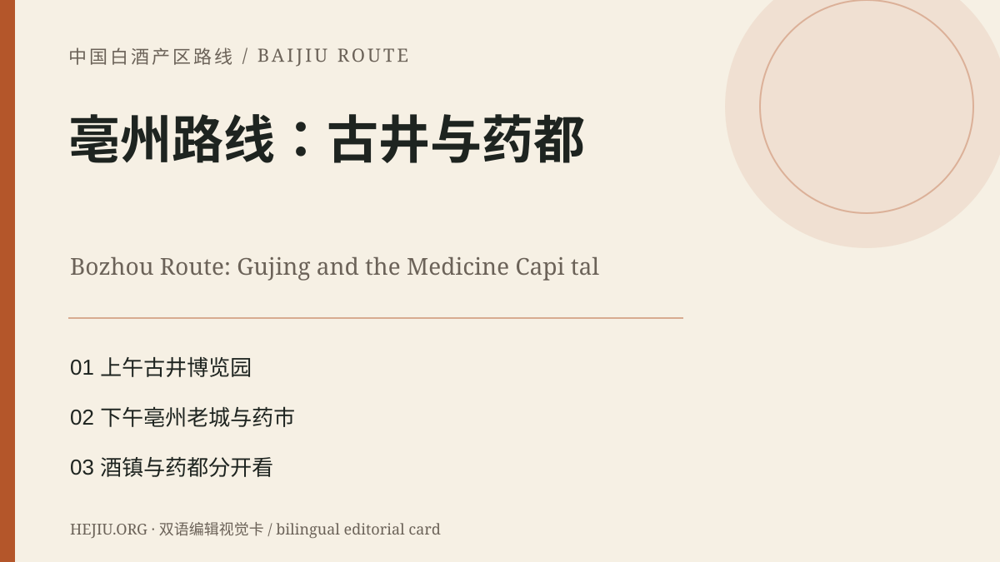

# 亳州路线：古井与药都

亳州把两种长周期的手上功夫放在同一座城：古井镇的浓香型白酒，与老城、药材市场的药都传统。很多人只把古井当成“一个酒厂”，或把亳州当成“一个药材市场”，结果两边都只看表面。这条路线把上午留给古井酒文化博览园与镇区，下午回到老城与药市，先酒后药，动线更顺。

图：亳州路线专属双语视觉卡。项目自制双语视觉卡，用于识别主题，不是现场照片。

> **先给结论**
> **适合谁：** 想同时看浓香酒镇与药都老城的人；适合从亳州站或机场出发。
> **不适合谁：** 只想要一个点深度停留、不愿转场的人；古井镇与老城需要车程。
> **一句话：** 上午博览园与镇区，下午老城与药市，品鉴后不开车。

## 路线逻辑：先酒镇后药都

古井镇与亳州老城是两套空间。古井镇围绕酒厂生长，博览园负责工艺与品牌，镇区负责生活与厂区外观；老城与药材市场围绕药都传统，花戏楼、老街、药市与炮制构成另一条线。把古井放在上午，是因为博览园需要连续时间；把老城与药市放在下午，是因为市场与老街适合傍晚收尾。中午在亳州吃饭，不要把两段车程压在饭点。

## 上午：古井酒文化博览园

博览园把古井贡酒的历史、工艺与品牌讲清楚。看展抓三条线：古井水系与当地粮食如何影响酿造，泥窖与糟醅如何工作，成品如何陈放与勾调。浓香型白酒用泥窖固态发酵，窖池连续使用越久、窖泥养护越稳定，窖香与己酸乙酯才容易出来；不要只记“古井”两个字，要看池壁、池底泥层、制曲房与陶坛库。展陈里的模型与剖面比单件酒瓶更有信息量，先看模型再看实物。生产区不自行进入，不翻围栏。

## 下午：亳州老城与药市

老城看花戏楼、曹操运兵道、华祖庵与老街，药材市场看交易、分级、仓储与炮制。药市不是“越野生越好”：产地、等级、炮制方式、储存条件都影响用途；不懂炮制就不要买散装药材，也不要轻信“特供”“野生”的话术。看市场时注意摊位分区、样品与货物是否分开、是否有明确标签；拍照先问，不要对着交易双方近距离拍。老街与药市之间步行或打车，按现场动线走，不要逆向穿行货车通道。

## 交通、预约与时间

古井镇在亳州谯城区西北，距市区约半小时上下车程，通常从亳州站或亳州机场转车；班次以实时查询为准。只看博览园约两小时；加镇区与品鉴，半天；再回老城与药市，一天。博览园、厂区与药市的开放、预约与收费各自独立，出发前一天分别确认。夏天皖北炎热，带水与帽子；冬天风大，穿防风外套。若从老城过来，把古井安排在上午，下午回老城，避免返程太晚。

## 品鉴、买酒与药材

品鉴要问清酒精度、容量与收费，小杯慢饮，不空腹；司机不喝，品鉴后不要开车。买酒去官方店或授权店，保留发票；买药材去正规市场，问清产地、等级与炮制方式，不要把“野生”“特供”当成唯一标准。吃饭可以试亳州牛肉馍、sa 汤、药膳与皖北家常菜，配浓香酒时控制量。若带孩子，先看博览园模型，再走老城；若带长辈，减少步行，把展陈与药市主街各选一段。

## 一日与半日版本

一日版按“博览园—古井镇—午饭—亳州老城—药市”走，上午不要把时间全花在展馆，镇区要留半小时。半日版只选博览园与镇区，或只选老城与药市，不要两头赶；若带长辈，减少步行，把展陈模型先看懂。若从老城过来，把古井放在上午，下午回老城。返程前买酒买药材分开，司机不参加品鉴；夏天带水与帽子，药市不轻信“野生”“特供”。若从亳州站出发，上午先到博览园，镇区留半小时，午饭在亳州，下午走老城与药市；若从老城出发，反向安排，但不要把博览园压到闭馆前。带长辈减少步行，把展陈模型先看懂；带孩子先看制曲与窖池模型，再走老城。博览园、厂区与药市的预约入口不同，出发前一天分别确认；如果只留半天，选博览园加镇区，不要硬加药市。买药材去正规市场，问清产地、等级与炮制；吃饭按本地饭点，记下停车点，提前准备，带好身份证与预约码；博览园与药市分别确认，买药材问清炮制，吃饭按本地饭点。

## 出发前核对

- 分别确认博览园、厂区与药市
- 上午古井，下午老城
- 品鉴后不开车
- 买酒只走官方或授权店
- 药材问清产地、等级与炮制
- 夏天带水与帽子
- 从老城过来先查车程
- 带长辈减少步行

## 这一路线不适合谁

这条路线把古井镇与亳州城区串起来，适合对浓香生产与药都历史都感兴趣的人。若你只想看酒，亳州城区的药材市场与古迹会占掉半天；若你不自驾，古井镇与市区之间的班车班次有限，返程要留足。

古井镇的参观以博物馆和老作坊为主，生产区是否开放要看当日安排；镇区餐饮与住宿选择不多，旺季回市区住更稳。亳州城区的景点之间可以打车或步行，但夏季炎热、冬季风大。

替代方案：只看古井酒文化博物馆，或只看亳州城区；若想把古井镇、双沟或洋河连起来，至少留两天。买酒比较厂区、市区与官方渠道，别把礼盒当成唯一选项。

## 参考资料

- 古井酒文化博物馆 — 亳州市人民政府 — https://www.bozhou.gov.cn/News/show/105123.html（亳州市人民政府，核对 2026-11-25）
- 古井酒文化博物馆 — 亳州市文化旅游体育局 — https://wlt.bozhou.gov.cn/News/show/367285.html（亳州市文化旅游体育局，核对 2026-11-25）
- 古井集团 — 企业简介 — https://gujing.com/about/index.html（安徽古井集团有限责任公司，核对 2026-11-25）
- 古井酒文化博览园门票价格收费标准延期的通知 — https://fgw.bozhou.gov.cn/News/show/685103.html（亳州市发展和改革委员会，核对 2026-11-25）

相关条目：[古井酒文化博览园](ref:park)、[古井镇（亳州）](ref:town)、[古井贡酒](ref:brand)、[浓香型白酒](ref:style)、[安徽省](ref:region)、[第一次喝白酒怎么选](ref:guide)、[中国酒史纲](ref:history)。

## 相关图像

图：古井酒文化博物馆类别配图。图片：Jeremy Thompson，CC BY 2.0，via Wikimedia Commons（[原图页面](https://commons.wikimedia.org/wiki/File:Bozhou_Railway_Station_(54488765713).jpg)）。关联图像：亳州路线：古井与药都。

图：安徽省。图片：xiquinhosilva，CC BY 2.0，via Wikimedia Commons（[原图页面](https://commons.wikimedia.org/wiki/File:Mount-huangshan_53319732882_o.jpg)）。关联图像：亳州路线：古井与药都。
