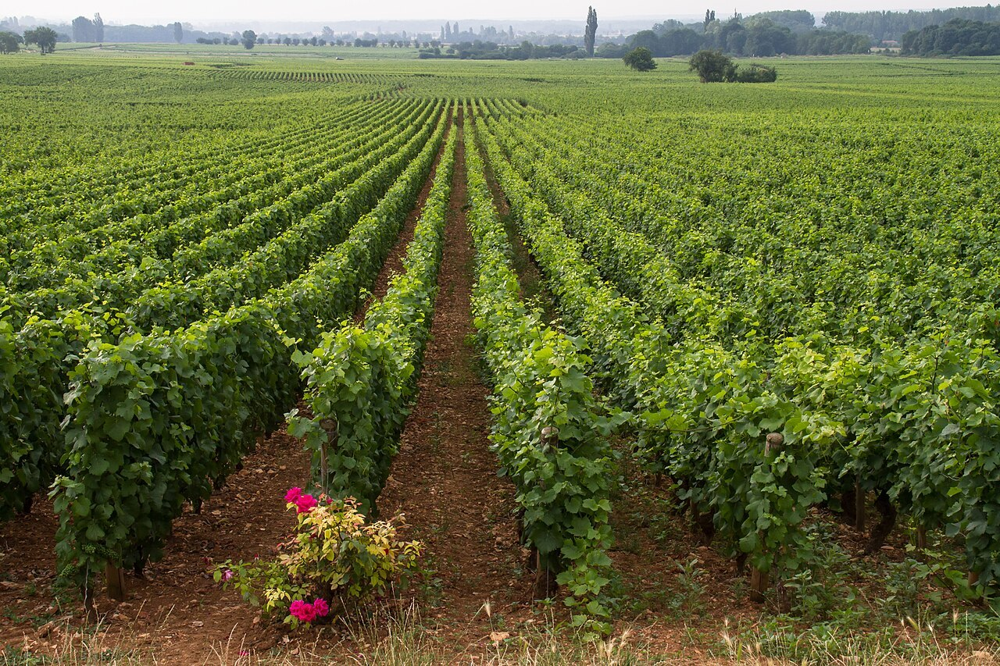

# 勃艮第路线：博讷老城、默尔索与酒商文化

这条路线把勃艮第的三处空间排成一个环：博讷老城的慈善医院、默尔索村边的城堡酒庄、以及博讷市内的家族酒商。它们看起来都“很勃艮第”，实际讲的却是三件不同的事——城市如何组织慈善与医疗，乡村庄园如何把地块变成酒，酒商如何在城市里完成买卖、熟成与出口。走完这一圈，比在酒单上记住几个特级园名字更能理解这个产区。

图：勃艮第路线：博讷老城、默尔索与酒商文化。摄影：Burgundy vineyards near Beaune, France。署名：Mark Gorzynski，CC BY-SA 4.0，来自 Wikimedia Commons（[来源](https://commons.wikimedia.org/w/index.php?curid=65061583)）。

## 路线概览

- 第一站：[博讷主宫医院](ref:hospices)，地址 2 Rue de l'Hôtel-Dieu, 21200 Beaune，1443 年创立，1980 年代初停止收治病人后转为博物馆。
- 第二站：[默尔索城堡](ref:meursault)，地址 Rue Charles Giraud, 21190 Meursault，位于博讷以南约 8 公里，葡萄园约 67 公顷，地下酒窖从 12 世纪延续到 19 世纪。
- 第三站：[约瑟夫杜鲁安酒庄](ref:drouhin)，地址 7 Rue d'Enfer, 21200 Beaune，1880 年创立，葡萄园约 100 公顷，另在 1 Place du Général Leclerc 设门市。
- 方式：博讷老城步行；博讷到默尔索自驾或打车，村内步行；回博讷后仍以步行为主。
- 建议时长：一整天。上午主宫医院，中午在博讷吃饭，下午默尔索，傍晚回博讷参加杜鲁安的酒窖导览；若导览时间不合，可与默尔索对调。

## 为什么走这条线

勃艮第的难，不在于记住“黑皮诺”和“霞多丽”，而在于理解“地块”与“人”的关系。这里很少有波尔多式的大宅与统一品牌，更多是村庄、climat、家族与酒商交织的网络。主宫医院提供城市史的入口：它让人看到博讷在 15 世纪如何靠慈善、宗教与公爵府的政治需要建立公共机构，而葡萄酒拍卖只是这家医院后来长出来的一条业务线。

默尔索城堡提供乡村庄园的入口：一片围合地块、一座 18 世纪意大利风格的宅子、从 12 世纪一直用到 19 世纪的地下酒窖，以及一百多块分散的葡萄园。它让人看到“城堡”在勃艮第并不是权力中心，而是酒庄的门面与接待空间；真正的工作发生在地块、发酵车间与酒窖里。

杜鲁安提供酒商文化的入口：它 1880 年创立，既拥有葡萄园，也从合作农户与酒液市场买酒，负责熟成、调配与销售。勃艮第的酒商不是“中间商”这么简单，他们掌握桶陈、调配与市场渠道，也决定了外界喝到的“勃艮第”是什么样子。把这三站放在一起，城市、土地与交易才连成一条线。

## 第一站：博讷主宫医院

为什么去：它是一座被完整保留的 15 世纪慈善医院，而不是一座以酒为主题的展馆。1443 年，勃艮第公爵府 chancellor 尼古拉·罗林与妻子吉戈娜·德·萨兰出资兴建，作为“穷人的宫殿”收治朝圣者、流浪者与无钱就医的人；修女在这里照护病人，建筑围绕庭院展开。1980 年代初停止收治后，它转入博物馆与遗产保护体系，今天的参观收入与捐赠继续支持医院集团的其他设施。

看什么：最醒目的是彩色琉璃瓦屋顶，红、棕、黄、绿的陶瓦拼成几何图案，属于勃艮第—佛兰德地区医院建筑的标志性做法。庭院一侧的“穷人厅”把长病床沿墙排开，木结构屋顶像倒扣的船体，让人直接看到“慈善照护”如何被空间组织。藏品中最重要的是罗希尔·范德魏登的《最后的审判》多联祭坛画，它把审判、救助与捐赠者的名字放在同一个视觉系统里；厨房、药房、放血与手术器械、挂毯与家具则补上日常医疗的一面。

还要看清一个边界：主宫医院是博物馆，不是酒庄。它确实拥有葡萄园，每年 11 月第三个周日举行慈善葡萄酒拍卖，1859 年首次拍卖；但拍卖是医院集团旗下酒庄的业务，日常参观没有常设品鉴。把这里当成“博讷酒庄第一站”会失望，把它当成“博讷为什么成为酒业城市”的前史，则非常合适。

## 第二站：默尔索城堡

为什么去：它把“城堡”与“酒庄”叠在一起。酒庄官方把历史追溯到 11 世纪，卡佩王朝的勃艮第公爵罗贝尔一世把 Moulin Foulot 封地授予侍从；1666 年，第戎议会律师 Pierre Blancheton 买下封地，葡萄园的线索逐渐清晰。1973 年 André Boisseaux 买下城堡并整修，才有了今天名称与规模的酒庄；2012 年底 Halley 家族收购，继续以一级园与特级园为经营方向。现存的城堡主体是 18 世纪意大利风格建筑，2024 年完成整修。

看什么：地下酒窖是这一站的重点。官方介绍称，西多会风格酒窖从 12 世纪一直开凿、使用到 19 世纪，面积约 3500 平方米，分布在城堡与附属建筑之下；较大的酒窖与历史酿造车间在整修时采用生物基材料，并依靠园内 26 口地热井控温。露台正对 Clos du Château 的葡萄园，这片约 8 公顷的围合地块种霞多丽，是酒庄旗舰白葡萄酒的来源之一。城堡、温室、地块与公园合计约 10 公顷，园内的栗树道、果园、池塘与老雪松构成参观的景观层。

喝什么：酒单以默尔索白葡萄酒为核心，同时覆盖金丘的红白两类。白葡萄酒常见 Meursault、Meursault Premier Cru Les Charmes-Dessus、Meursault Premier Cru Perrières、Puligny-Montrachet Premier Cru 等；红葡萄酒可见 Volnay Premier Cru Clos des Chênes、Pommard Premier Cru Clos des Epenots、Corton Grand Cru 等。第一次接触，先喝村庄级默尔索，再喝一级园，最后用一款红葡萄酒确认酒庄在结构上的处理。勃艮第的重点不是品种，而是地块之间的细微差别。

## 第三站：约瑟夫杜鲁安酒庄

为什么去：它把“酒商”这个角色放回城市。1880 年，约瑟夫·杜鲁安在博讷创立酒商行；当时的勃艮第已经有成熟的 négociant 体系，酒商从种植者手中买酒，负责熟成、调配与销售。杜鲁安很快把“买酒卖酒”与“自己拥有葡萄园”结合起来，逐步成为同时经营酒商、生产商与地主身份的酒庄。今天官方称其葡萄园约 100 公顷，覆盖从夏布利到马贡内的多个著名 climats，仍由家族经营。

看什么：7 Rue d'Enfer 的建筑群没有大型城堡的气派，价值在地下。官方介绍称，酒窖墙体可以追溯到十五个世纪前的罗马 castrum 基础，部分空间保留中世纪教堂与教士会的痕迹；酒庄收购的建筑中还包括 Maison du Diénat，历史学家推测它曾是教士会长的住所。更戏剧性的是，酒庄部分酒窖上方曾是勃艮第议会所在地，其中一间酒窖还曾作为法国国王的酒窖使用。参观时听到的这些地层关系，比酒标更能解释博讷为何是酒商体系的中心。

喝什么：酒单覆盖勃艮第的主要白与红两类。白葡萄酒包括 Chablis、Meursault、Puligny-Montrachet、Beaune Clos des Mouches 白等；红葡萄酒包括 Beaune Premier Cru Clos des Mouches、Gevrey-Chambertin、Chambolle-Musigny、Vosne-Romanée 等。第一次喝，建议从 Clos des Mouches 的红白各一杯开始，再对比一款夜丘与一款夏布利，这样能听出酒庄在不同产区的处理方式。导览结束后可以去 1 Place du Général Leclerc 的 Oenothèque，把“理解”与“购买”分开完成。

## 交通与节奏

博讷站到老城步行即可，主宫医院靠近 Place de la Halle，杜鲁安在 7 Rue d'Enfer，两地都在老城步行范围内。默尔索在博讷以南约 8 公里，沿 D974 南下；自驾最方便，打车也可行，公共交通班次不密，具体以当天查询为准。村内道路窄，城堡入口是步行通道，停车位在“栗树道”一侧；不要把车开进葡萄园或私人院落。

一天的顺序建议是“医院—午饭—默尔索—杜鲁安”。上午先看主宫医院，避开团队高峰；中午回 Place de la Halle 一带吃饭；下午开车去默尔索，按预约走城堡与酒窖；傍晚回博讷参加杜鲁安的导览。若杜鲁安只剩上午场，就把默尔索与它互换，先出城再回城，避免在两地之间来回折返。

这条路线不适合全程步行。博讷到默尔索的距离看起来不远，但中间是村道与酒庄道路，路肩窄、车流快，葡萄园耕作期还有机械进出。把“走路去默尔索”当成散步，会低估路况。更稳妥的是：城市段步行，乡村段开车或打车，品鉴后留出清醒时间。

## 季节与预约

勃艮第的旅游节奏跟葡萄生长季绑在一起。春季发芽，夏季日照长，九月到十月采收；采收期酒庄人手紧张，部分参观会暂停或改线。晚秋与冬季安静，但日照短，部分酒庄在周末或淡季减少场次。主宫医院在旺季与周末建议提前订票；默尔索城堡的预约制导览与免预约品鉴是两套安排；杜鲁安的酒窖导览按场次预约，旺季与周末要提前几天。

预约时确认三件事：语言、集合地点与时长。默尔索的导览通常为法语或英语，杜鲁安的场次说明也会标注语言；主宫医院的讲解团主题随年度计划变化。不要把三个预约排在同一小时，也不要把品鉴后还要开车的人安排进酒窖导览——这不是礼貌问题，是安全边界。

## 礼仪与边界

第一，分清“博物馆”“酒庄”“门市”。主宫医院没有常设品鉴；默尔索城堡是酒庄，参观动线与开放区域由经营方决定；杜鲁安的 7 Rue d'Enfer 是总部与历史酒窖，1 Place du Général Leclerc 是零售门市，预约导览与买酒是两件事。第二，酒窖不是摄影棚：不要触摸橡木桶、酒瓶与展品，不要用闪光灯，不要越过围栏。第三，品鉴时先闻后喝，少量慢饮，不想喝完就吐酒；不要喷浓香水，以免干扰别人判断。

第四，把年份读准。默尔索的 11 世纪是封地与土地史的起点，1973 年是现代酒庄名称与参观体系的起点，2012 年是产权变更；杜鲁安的 1880 年是创立年，不是葡萄园全部到位的年份；主宫医院的 1443 年是创立年，1980 年代初才是停止收治。第五，不要把“有机种植”等同于“自然酒”：默尔索自 2022 年份起在自有葡萄园实行有机种植，但酿造与酒款风格仍遵循勃艮第传统做法。

## 替代与延伸

若时间只够半天，保留主宫医院与杜鲁安，把默尔索留到下次：前两站都在博讷步行范围内，交通成本低，信息密度也足够。若更想看葡萄园与乡村庄园，则保留默尔索与杜鲁安，把主宫医院换成一次老城散步。若对拍卖感兴趣，可以在 11 月第三个周日前后到博讷，但那时老城非常拥挤，餐厅与停车都要提前安排。

往南可以沿 D974 延伸到 Puligny-Montrachet 与 Chassagne-Montrachet，往北可以到夜丘的 Gevrey-Chambertin 与 Vosne-Romanée；但这些村庄之间的距离不适合在一天里硬串。更合理的延伸是分开安排：一天给博讷与默尔索，另一天给夜丘，把“白葡萄酒的村庄”与“红葡萄酒的村庄”分开看。

相关条目：[博讷主宫医院](ref:hospices)、[默尔索城堡](ref:meursault)。

## 另见

- [博讷主宫医院](ref:hospices)：博讷城市史、慈善医疗与拍卖传统的入口。
- [默尔索城堡](ref:meursault)：默尔索的白葡萄酒、城堡建筑与地下酒窖。
- [约瑟夫杜鲁安酒庄](ref:drouhin)：博讷市内的家族酒商与酒商体系。
- 想继续读背景，可在内容仓中查阅勃艮第产区、白葡萄酒、红葡萄酒与葡萄酒分级条目；本页不再重复登记引用。

这条路线把博讷主宫医院、默尔索城堡与约瑟夫杜鲁安酒庄串在一天里；三处都需以官网确认当日开放与预约，精确导航用实时地图。页面信息核验于 2026-11-08。
