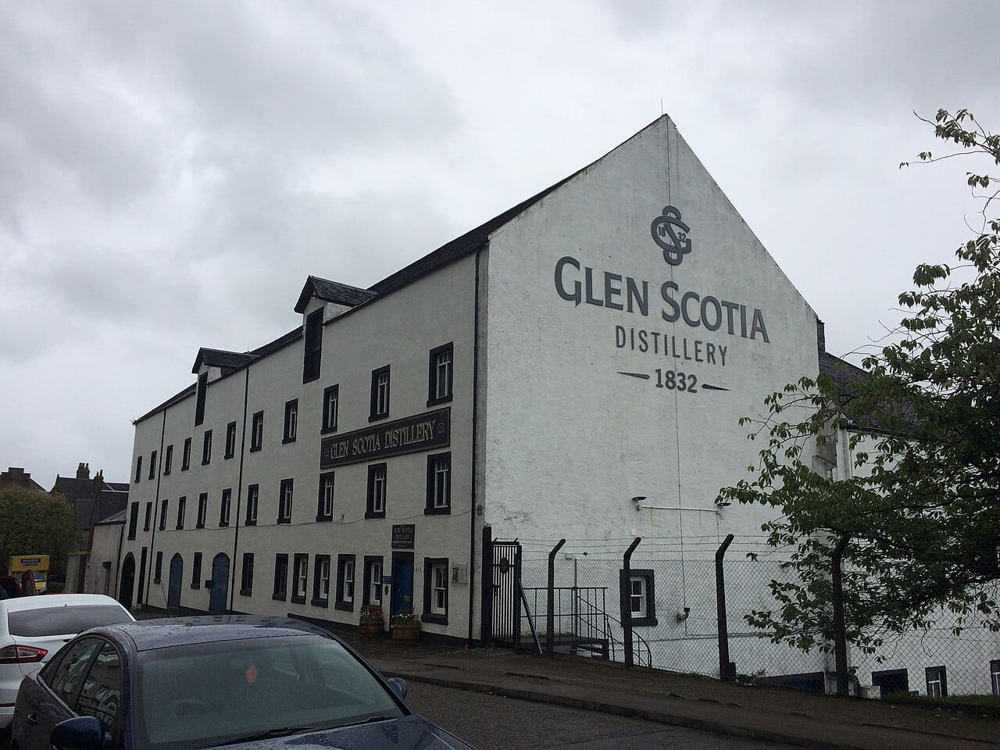
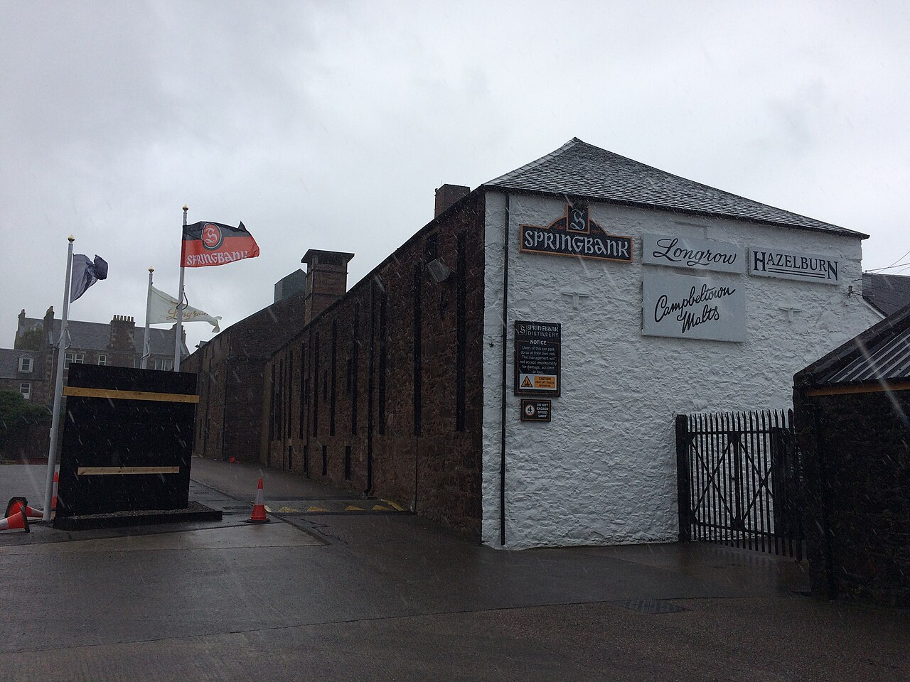

# 坎贝尔镇威士忌路线：两条街之间的两家酒厂

坎贝尔镇（Campbeltown）在苏格兰西海岸琴泰半岛的末端，是苏格兰威士忌五个法定产区里面积最小的一个。这条路线不安排长途驾驶，也不追求一天看三家：它只在镇中心走不到一公里，从 Well Close 的云顶走到 High Street 的格兰帝。两站之间隔着的不是距离，而是一百多年里这个产区从繁荣、收缩到重新站稳的全过程。

图：坎贝尔镇威士忌路线：两条街之间的两家酒厂。摄影：Glen Scotia Distillery, Campbeltown。署名：Lirazelf，CC BY-SA 4.0，来自 Wikimedia Commons（[来源](https://commons.wikimedia.org/w/index.php?curid=62323489)）。

## 一条用脚走完的法定产区

“法定产区”在苏格兰不是宣传词。法规把 Campbeltown 列为五个受保护产区之一，酒标上写这个名字，就要满足产地与工艺条件。产区的实际范围很小：今天只有云顶、格兰帝与 Glengyle 三家酒厂，前两家在镇中心，第三家在镇北。正因为小，它适合用脚走——不必租车，不必赶渡轮，预约两场导览，中间留出一顿饭的时间就够。走路也改变了看法：你会经过教堂、关掉的店铺、港口边的旧仓库，这些空间比展板更直接地说明，威士忌曾经怎样养活这座镇。

## 路线骨架：从 Well Close 到 High Street

- 第一站：[云顶酒厂](ref:springbank)，Springbank Distillery, Well Close, Campbeltown PA28 6ET。从 Longrow 街拐进 Well Close，门口就是厂区。
- 第二站：[格兰帝酒厂](ref:glen-scotia)，Glen Scotia Distillery, 12 High Street, Campbeltown PA28 6DS。沿主街向南，门口临街。
- 交通方式：全程步行。两站相距不到一公里，正常速度十到十五分钟；人行道窄，部分路段有坡度，雨天路滑。
- 建议时长：半天完成两场导览；一整天则把午饭、港口散步与镇上的酒类商店算进去。若还想看 Glengyle（Kilkerran），要另约一场，它在镇北，步行再多十几分钟。
- 顺序：先云顶、后格兰帝，因为云顶的导览多在上午，格兰帝下午仍有场次；具体以当天预约为准，反过来走同样成立。

## 为什么是这两家：一座镇子的兴衰样本

19 世纪的坎贝尔镇一度是英国按人均计算最富的城镇之一，港口排着装桶的船，镇上同时开着十几家酒厂。云顶在 1828 年拿到执照时，是镇上第 14 家合法酒厂。随后需求转向更清淡的调和威士忌，加上部分酒厂为赶产量牺牲质量，调酒商逐渐离开；到 1934 年，镇上只剩云顶与格兰帝两家。2004 年 Glengyle 复产，坎贝尔镇才重新以独立产区的身份被写回地图。

把这两家放在同一天，看的不是“两家酒厂”，而是一个产区如何从数量扩张走到质量自保：一家把整条生产线留在厂内，一家在多次易主后仍守着维多利亚时代的厂房。

## 第一站：云顶酒厂

为什么去：它是苏格兰少数把发麦、糖化、蒸馏与装瓶全部留在厂内的酒厂。1828 年，Archibald Mitchell 在自家私蒸旧址上取得执照；今天仍由 Mitchell 家族一脉的 J&A Mitchell 持有。2023 年，长期主持酒厂的 Hedley G. Wright 去世，公司所有权转入三个信托基金。

看什么：[发麦](ref:malting)地板是重点。大麦浸泡后铺成约六英寸厚，工人定时翻动，再用泥煤与热风烘干；糖化槽是铸铁的，发酵使用六只木槽，时间可长达 110 小时。厂内三只铜蒸馏器里，酒汁蒸馏器仍用明火加热。云顶本牌采用 2.5 次蒸馏，Longrow 为两次，Hazelburn 为三次——同一套厂房，靠麦芽处理与蒸馏次数分岔。

喝什么：先喝本牌，建立油脂感、柑橘与海盐的基准；再喝 Longrow（1973 年首次蒸馏，重泥煤、两次蒸馏），最后喝 Hazelburn（1997 年首次蒸馏，无泥煤、三次蒸馏）。三杯就能把“泥煤—蒸馏次数—酒体”的关系走一遍。酒厂不做冷凝过滤、不加焦糖色，低温下略显浑浊是正常的。

## 第二站：格兰帝酒厂

为什么去：它把坎贝尔镇的另一种性格留在石墙里。格兰帝 1832 年以 Scotia 之名创立，1928 年至 1933 年间停产，1939 年名字里才加上“Glen”；1996 年被 Loch Lomond Distillery Company 买下，今天属于 Loch Lomond Group。厂房围绕庭院展开，门槛、窄门与低矮仓库都还是十九世纪的尺度。

看什么：酒厂已不再自己发麦，糖化、发酵与蒸馏仍在厂内完成。参观时留意三件事：发酵槽不大，蒸馏器不多，仓库就在旁边——酒液从蒸馏到入桶的路径很短。仓库部分会讲到 palletised、racked 与 dunnage 三种堆放方式，它们对应不同的湿度与空气流动，也对应不同的[橡木桶](ref:oak-ageing)陈年结果。

喝什么：Double Cask 是起点，波本桶给香草与甜，雪莉桶补干果与香料；15 年更圆熟；Victoriana 刻意靠近维多利亚时代的厚重风格，酒精度更高；25 年属于高端线。格兰帝同时生产泥煤与非泥煤风格，泥煤酒通常每年只安排约六周，不要把坎贝尔镇简单等同于“重泥煤”。

## 预约、季节与镇上的节奏

两家酒厂的导览都要在官网预约，旺季与坎贝尔镇威士忌节期间名额很快售罄。预约时确认三件事：场次时间、语言、集合地点。云顶从 1 小时的标准团到 4.5 小时以上的完整工艺团都有，格兰帝也分常规导览、仓库体验与经理团，价格与内容差别很大，不要把它们当成同一种产品。

季节上，五月到九月日照长、交通相对稳定，但住宿与导览都紧张；冬季安静，日照短、风大，部分场次减少。坎贝尔镇住宿不多，节庆期间要尽早订房。到达方式通常有三种：从格拉斯哥乘长途巴士，车程数小时；自驾经 A82 到 Tarbert，再走 A83 绕过琴泰半岛；或乘飞机到坎贝尔镇机场，航班规模小、受天气影响大，不适合把酒厂预约排在抵达后的紧接时段。车次与开放时间会变，2026 年的安排也以官方渠道为准。

## 步行、饮酒与驾驶

镇内步行不难，但要把它当成海边小镇的步行：风大、雨多、路面可能积水，穿防滑鞋比穿皮鞋合适；部分人行道很窄，经过路口要看清来车。厂区地面湿滑，仓库温度低，带一件外套。

饮酒与驾驶要分开处理。品鉴含酒精，开车的人全程不喝；坎贝尔镇周边多为单车道公路，错车需要倒车让行，一杯酒就可能影响判断。最稳妥的做法是指定司机、预约出租车，或参加含接送的行程。若乘巴士来，返程班次不多，出发前先确认末班时间，不要把所有希望押在临时打车上。

## 与产区页、风格页的关系

这条路线是[坎贝尔镇](ref:campbeltown)产区页的“落地版”：产区页解释法定范围、历史与风格，路线页告诉你在哪两栋建筑之间能看到这些结论。往上一层是[苏格兰威士忌](ref:scotland)的法规框架，往下则是[单一麦芽](ref:single-malt)的工艺细节——发麦、蒸馏次数、桶型与陈年。读完再走，参观时更容易把讲解听成一条因果链，而不是一堆年份。

相关条目：[云顶酒厂](ref:springbank)。

## 相关图像

图：云顶酒厂。图片：Lirazelf，CC BY-SA 4.0，via Wikimedia Commons（[原图页面](https://commons.wikimedia.org/wiki/File:Springbank_Distillery,_Campbeltown.jpg)）。关联图像：坎贝尔镇威士忌路线：两条街之间的两家酒厂。

图：Glen Scotia Distillery, Campbeltown。摄影：Lirazelf，CC BY-SA 4.0，来自 Wikimedia Commons。。图片：Lirazelf，CC BY-SA 4.0，via Wikimedia Commons（[原图页面](https://commons.wikimedia.org/w/index.php?curid=62323489)）。关联图像：坎贝尔镇威士忌路线：两条街之间的两家酒厂。
