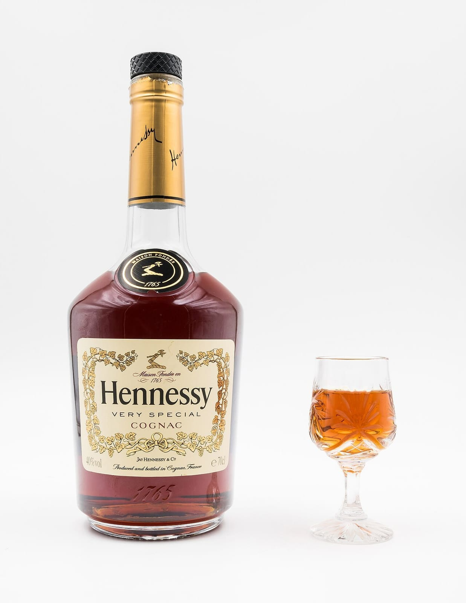

# 干邑路线：干邑镇与雅尔纳克之间的酒庄带

干邑镇到雅尔纳克之间，夏朗特河把十余公里葡萄园、酒窖与码头串成一条酒商带。这条路线只取两站，都在干邑镇内，相距两公里：理查·轩尼诗码头的[轩尼诗](ref:hennessy)游客中心，以及社会学街的[人头马](ref:remy)老宅。称它“干邑—雅尔纳克”路线，是因为雅尔纳克标出这条带的上游端；看点是两家酒商如何把同一套规则讲成两种叙事。

图：干邑路线：干邑镇与雅尔纳克之间的酒庄带所在的干邑风貌配图。图片：Didier Descouens，CC BY-SA 3.0，via Wikimedia Commons（[原图页面](https://commons.wikimedia.org/wiki/File:Cognac_glass.jpg)）。这张照片用于说明产区环境与访问语境，不标定干邑路线：干邑镇与雅尔纳克之间的酒庄带的门店、酒庄或活动现场。

## 一条河，两个码头

“干邑”这个名字先属于港口，再属于酒。19 世纪初，夏朗特河仍是外运主通道，干邑镇因码头成为集散地，酒也随地名一起被记住。轩尼诗 1765 年由爱尔兰人理查·轩尼诗创号，靠河岸仓栈把酒送到大西洋港口；人头马 1724 年由本地葡萄农起家，先有葡萄与蒸馏，再逐步建立商行。两条起点不同，却都把老城与河岸留成了参观点。

轩尼诗的游客中心在 Quai Richard Hennessy，正对夏朗特河；人头马老宅在 20 rue de la Société Vinicole，藏在老城街巷里。两处步行约二十分钟，途中经过石板路、旧仓墙与酒商招牌。若把车停在河边，先走完两站，再沿河向东十余公里到雅尔纳克，就能看见这条带的上游端：河面变窄，葡萄园退到坡上，酒商带让位给安静的镇子。

## 两站怎么排：先码头，后老宅

[轩尼诗](ref:hennessy)把参观做成了十条线路的矩阵。2026 年新增的 Flash Tour 为 19 欧元、1 小时，5 月至 10 月运营，含一杯 VSOP 调酒与一段河上船程；入门款 Initiation 为 25 欧元、1 小时 30 分，品鉴 VS 与 VSOP，适合家庭；沉浸式 Initiation 为 35 欧元、2 小时，在历史酒窖里加入 VR，最后品鉴 VSOP 与 XO。再往上，Prestige 60 欧元，看 James Hennessy、XO 与 XXO；蒸馏季（10 月至次年 2 月）的 Distillery Tour 85 欧元，能进正在运转的蒸馏车间；制桶工坊 170 欧元、鱼子酱品鉴 99 欧元、Paradis 私人线路 330 欧元、Richard Hennessy 私人线路 550 欧元。

[人头马](ref:remy)则把参观点拆成三处。老宅的 Anniversary Tour 为 35 欧元、2 小时，讲 1724 年以来的三百年；鸡尾酒工作坊 35 欧元、1 小时 15 分；LOUIS XIII The Introduction 300 欧元、2 小时；午间餐酒体验 110 欧元、4 小时。梅尔潘生产基地用电动小火车穿过大酒窖，25 欧元、1 小时 30 分；瑞亚克勒科克在大香槟区葡萄园里，60 欧元、2 小时，可步行或骑电动自行车。把老宅与生产基地串起来的“A Day at Rémy Martin”为 55 欧元。老宅与精品店周一至周六 10:00–18:00，预约可在到访前 72 小时免费更改或取消。

一天怎么排：上午进轩尼诗选 35 欧元沉浸式线路，午餐后步行到人头马选 35 欧元 Anniversary Tour。若在冬季且更想看工艺，就选轩尼诗 85 欧元蒸馏线路或人头马瑞亚克勒科克，老宅只看精品店。价格与场次以官网为准。

## 六大 cru：从 1860 年代的地图读起

干邑产区被分成六个 cru，这张地图不是营销分区，而是地质与品鉴共同写出来的。大香槟区（Grande Champagne）的表土薄、底下是白垩，酒液细、酸度高，最耐陈年；小香槟区（Petite Champagne）土壤相近，海洋影响更强，结构稍厚；边林区（Borderies）表层脱钙，酒香偏紫罗兰与鸢尾，成熟较快；优质林区（Fins Bois）北部是侏罗纪薄层石灰岩“groies”，南部进入白垩纪与第三纪地层，酒体圆、果味足；良林区（Bons Bois）地层杂，西边海洋性、东边大陆性，常带明显“风土味”；普通林区（Bois Ordinaires，也称 Bois à Terroirs）靠海并含两座岛，大西洋影响最重。

这张图来自 19 世纪的地质学家 Henri Coquand（1813–1881）。他在 1860 年前后研究土壤，并请品鉴者对照酒液，划出不同分区；1938 年 1 月 13 日的法令据此确定边界。更早的 1909 年 5 月 1 日法令则划定了干邑只能生产的范围：夏朗德、滨海夏朗德，以及多尔多涅与德塞夫勒的若干村镇。人头马只取大香槟与小香槟，其 Fine Champagne 要求全部生命之水出自这两个区，且大香槟至少占 50%——这是法律，不是形容词。把[干邑](ref:cognac)产区的条文放在手边，再看酒标，六个名字就不再是六个陌生地名。

## 白玉霓与两次蒸馏

干邑的葡萄以白玉霓（Ugni Blanc）为绝对主力，占产区葡萄园 98% 以上。它原产托斯卡纳，果粒中等、皮薄，酸高糖低，酿出的基酒只有 8%–9% vol，正好适合蒸馏。白福儿（Folle Blanche）在根瘤蚜之后锐减，如今不到 1%；鸽笼白（Colombard）补充香气与体积；2005 年才获准的 Folignan 上限为 10%。

蒸馏用夏朗德壶式蒸馏器做两次。第一次得到粗馏液，第二次（bonne chauffe）再切头、取心、断尾，只保留中段作为新酒。这套慢工艺效率较低，却留住了香气与酸度。新酒必须在法国橡木桶中连续陈年至少 2 年，装瓶酒精度不低于 40% vol。理解[蒸馏](ref:distillation)的切割与[调配](ref:blending)的组合，比记住某一款酒的年份更有用。

## 在杯子里读 VS、VSOP 与 XO

干邑的等级只规定“最年轻成分”的最低酒龄：VS 至少 2 年，VSOP 至少 4 年，XO 至少 10 年，XXO 至少 14 年。2018 年起，XO 的最低酒龄从 6 年提高到 10 年；这条改动让“XO”不再是模糊的老酒代称，而是一个明确门槛。等级不是质量排名，也不告诉你瓶中酒液的平均年龄——一瓶 XO 里可能同时有远高于 10 年的酒液。

试饮顺序建议从 VS 到 VSOP 再到 XO：VS 果味直接，带一点葡萄与花香；VSOP 开始出现香草、干果与香料，口感变圆；XO 的坚果、皮革与木质调更明显，酒精度仍是 40% vol 左右，靠质地而不是灼热感取胜。若在轩尼诗选沉浸式线路，会同时喝到 VSOP 与 XO；在人头马老宅，则适合把 Fine Champagne 的大香槟比例讲清楚。两家的风格目标不同：一家用广泛来源维持稳定，一家用两个分区收窄变量。

## 车程、预约与指定司机

干邑火车站到轩尼诗码头步行约 5 分钟；从昂古莱姆 TGV 站转乘约 45 分钟；波尔多与拉罗谢尔自驾各约 1 小时 30 分。人头马老宅在城内，步行可达；梅尔潘与瑞亚克勒科克在城外，必须开车或安排接送。干邑到雅尔纳克十余公里，车程约 20 分钟，沿途是河、葡萄园与低矮的酒商仓房。

两站都要预约，且规则不同：轩尼诗按线路与场次售票，旺季与周末很快满员；人头马按参观点分别集合，老宅、梅尔潘与瑞亚克勒科克不能混用一张票。预约时确认集合地点、时长、是否含品鉴、年龄限制与取消政策。饮酒后不开车是硬规则，老城停车位有限，最稳妥的是包车或指定司机；若自己开车，品鉴全部吐掉。开放时间、票价与交通以官方渠道为准，页面核验日期 2026-11-09。

相关条目：[干邑](ref:cognac)。

## 相关图像

图：葡萄酒调配实验的编辑插图：不同基酒在烧杯中对比，移液管用于小样调配；画面为 AI 辅助绘制，不是实验室实拍。。图片：Hejiu 编辑团队，使用豆包 Seedream 5.5 AI 辅助生成；项目自制，不是现场照片（[项目说明](https://hejiu.org/about/)）。关联图像：干邑路线：干邑镇与雅尔纳克之间的酒庄带。

图：2023 Hennessy V.S. Cognac。摄影：Jacek Halicki，CC BY-SA 4.0，来自 Wikimedia Commons。。图片：Jacek Halicki，CC BY-SA 4.0，via Wikimedia Commons（[原图页面](https://commons.wikimedia.org/w/index.php?curid=132066502)）。关联图像：干邑路线：干邑镇与雅尔纳克之间的酒庄带。
