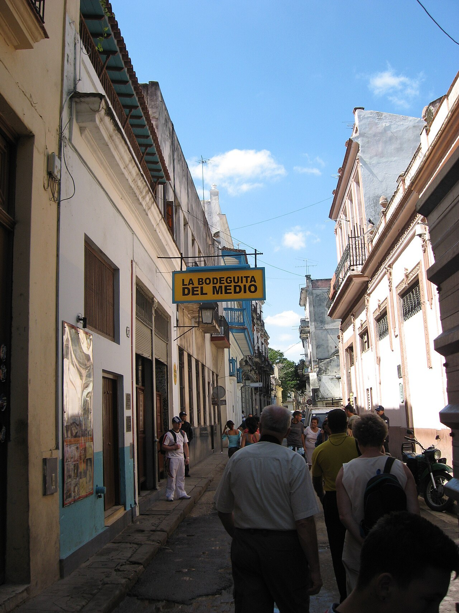
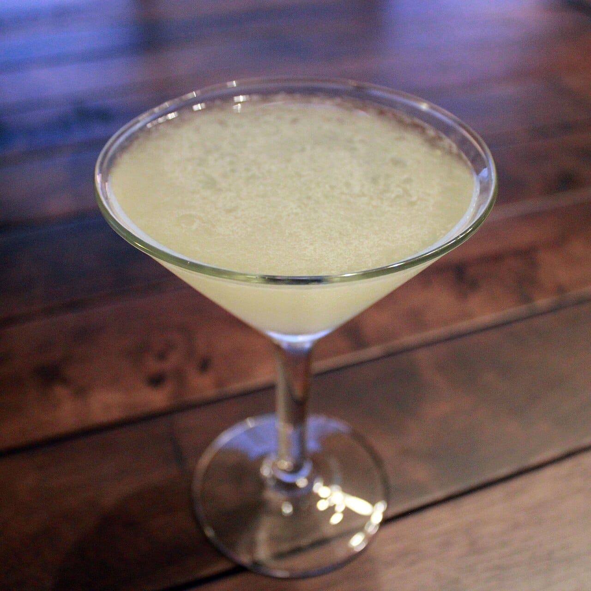
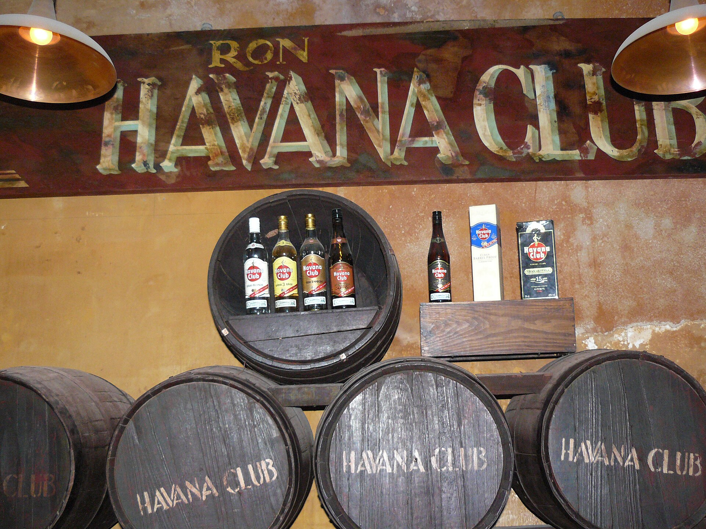

# 古巴朗姆路线：哈瓦那与圣地亚哥的两座朗姆博物馆

古巴朗姆路线指两座博物馆：哈瓦那老城港口大道 262 号的[哈瓦那朗姆酒博物馆](ref:havana)，与圣地亚哥-德古巴圣巴西利奥街 358 号的[圣地亚哥朗姆酒博物馆](ref:santiago)。两城相距八百多公里，共用一条线索：西班牙殖民时期限制殖民地蒸馏，19 世纪后半叶才形成真正的 ron；1862 年后圣地亚哥自称“轻朗姆摇篮”；1959 年革命与 1960 年国有化，又把品牌、酒厂与出口渠道重组成国家体系。这条线看的不是设备新旧，而是同一段历史如何在两座城市被讲述。

图：哈瓦那老城的 Bodeguita del Medio 酒吧外观，作为古巴朗姆路线中哈瓦那站点的氛围参考，不标定具体停靠点或边界。图片：Derek Blackadder from Cobourg, ON, Canada，CC BY-SA 2.0，via Wikimedia Commons（[原图页面](https://commons.wikimedia.org/wiki/File:Bodeguita_del_Medio,_Havana,_Cuba_9.jpg)）。

## 西端港口与东部山地之间

第一站在哈瓦那老城北侧、港湾附近，从圣弗朗西斯科广场步行可达；第二站在圣地亚哥历史中心，靠近塞斯佩德斯广场。两城公路距离八百多公里，中央公路车程以整天计，通常拆成两天，中途在圣克拉拉或卡马圭过夜；也可选国内航班，把时间留给两座馆。

mode 写 car，指两端城市内与周边的移动：哈瓦那老城适合步行加短途打车，圣地亚哥老城街窄、单行多，开车要先找车位。城际段开车还是飞，按当时航班、路况与租车条件决定，以官方渠道为准。两馆各留两到三小时，整条线至少三到四天。

## 从 aguardiente 到 ron：名称背后的工艺转折

西班牙殖民当局长期限制殖民地蒸馏，怕与本土烈酒竞争；直到 19 世纪后半叶古巴独立战争前后，朗姆酒产业才成长起来。早期加勒比把甘蔗汁或糖蜜蒸馏出的烈酒叫 aguardiente，意为“烧过的水”，它粗糙、刺激，还不是今天的 ron。

19 世纪后期，柱式蒸馏器进入古巴，生产者很快采用。连续蒸馏得到更干净、更轻盈的酒液，再用白橡木桶陈年、活性炭过滤，形成古巴“轻朗姆”的轮廓。[蒸馏](ref:distillation)改变酒体，市场决定方向：20 世纪初的古巴调酒师需要不压过柑橘与薄荷的基酒。

[甘蔗](ref:sugarcane)在 1492 年后引入古巴，到 1850 年，古巴供应了世界糖产量的三分之一。糖业规模决定了[糖蜜](ref:molasses)的充足与便宜，也决定朗姆酒从一开始就是糖业的副产品。

## 哈瓦那：港口大道 262 号的品牌叙事

哈瓦那朗姆酒博物馆在港口大道 262 号、索尔街转角，一栋 18 世纪殖民宅邸，2000 年 3 月 31 日开馆，由 Havana Club 运营。展线从甘蔗开始，经过一座比例很大的模型糖厂，再到发酵、蒸馏与陈年，最后落到酒吧与商店。模型糖厂带微型蒸汽机与传动装置，把“田间到糖厂”压缩成一眼看完的装置。

这座馆的立场很清楚：它讲 Havana Club 的品牌史，也讲古巴朗姆酒的大框架。品牌博物馆不是中立档案馆，选择哪些年份与人物本身就是叙事。基础导览约 45 分钟，含一杯品鉴；更长线路做三款对照、鸡尾酒或雪茄配对，以馆方票务页为准。

地址有 262 与 162 两种写法，本文采用官网报道的 262 号。

## 1862 年与“轻朗姆摇篮”的地方说法

1862 年 2 月 4 日，法昆多·巴卡第·马索（Facundo Bacardí Massó）在圣地亚哥买下一家小蒸馏厂，用两套原酒做实验：一套是更重、更有味道的 aguardiente，一套是重新蒸馏、更轻的酒液。把两者调和、过滤、陈年，得到更柔和的朗姆酒。这一年被视为古巴朗姆酒工业化的节点，也被圣地亚哥当作“轻朗姆摇篮”的起点。

要分清的是，“摇篮”是地方说法，不是排他性的法规结论。哈瓦那、卡德纳斯等地同样有重要酒厂。圣地亚哥官方旅游页把东部称为“自 1862 年以来的轻朗姆摇篮”，并强调当地甘蔗、低酸度糖蜜、活性炭过滤与白橡木桶陈年；这些是产区叙事，不是唯一配方。

今天古巴朗姆酒有原产地命名保护，2010 年获得 D.O.P. 认证；真正的古巴朗姆酒瓶身带绿色保证标，原料 100% 来自古巴。理解这套制度，再看酒标，更容易分辨产区规则与品牌故事。

## 圣地亚哥：圣巴西利奥街 358 号的产业记忆

圣地亚哥朗姆酒博物馆在圣巴西利奥街 358 号，夹在皮奥·罗萨多街与圣费利克斯街之间，占着一栋 1889 年的两层宅邸，1996 年 6 月 24 日开馆。六个展厅把“原料—生产—品牌—陈年—装瓶—地方史”串起来：第一厅讲甘蔗与制糖，第二厅用流程图解释酿造，第三厅陈列当代酒瓶，第四厅在庭院展示制桶与用桶，第五厅是 1930 年代的装瓶线，七台原装机器仍在，第六厅讲地方产业史，包括 Ron Caney 与 Matusalén 两家旧厂的模型。

与哈瓦那那座品牌博物馆相比，这里更像城市产业记忆的陈列室：展品更旧、更杂，建筑与街道的关系更紧。门票通常含讲解与一杯品尝，开放时间常见为周一至周六 9:00–17:00，约 2 欧元；价格、语言与场次会调整，以现场公示为准。

庭院里的桶、装瓶线机械与墙上的老照片，才是理解东部产业的关键。

## 国有化、出口体系与两座馆的分工

哈瓦那俱乐部品牌由阿雷查巴拉（Arechabala）家族在 1934 年创立，最初在卡德纳斯生产。1959 年革命后，1960 年私人家族企业被收归国有，品牌与酒厂转入国家体系；1970 年代起，国家出口机构把 Havana Club 卖到苏联与东欧。1993 年，Pernod Ricard 与 Corporación Cuba Ron S.A. 成立对半合资的 Havana Club International S.A.，负责全球销售。古巴朗姆酒大师（Maestros del Ron Cubano）的训练与代际传授也被写进品牌叙事，2022 年这套知识被联合国教科文组织列入人类非物质文化遗产代表作名录。

两座馆语气不同：哈瓦那馆由品牌运营，讲国家品牌如何走向世界；圣地亚哥馆从地方产业记忆出发，讲东部糖厂与旧品牌。国有化与出口体系决定了今天谁能使用“Havana Club”这个名字，也决定了哪些故事被放大。

不必在两种叙事里选边；把[朗姆酒](ref:rum)的类别、产区规则与品牌争议分开看，判断更稳。

## 城际移动、预约与到访节奏

哈瓦那到圣地亚哥通常选国内航班或长途巴士，自驾走中央公路要预留整日；班次会变，以官方渠道为准。两座馆都要提前预约：哈瓦那馆旺季与周末下午容易满场；圣地亚哥馆团队参观建议先电话联系。

到访时带身份证件，遵守拍摄提示；部分展厅有台阶，穿防滑鞋。品鉴不要空腹，先闻香再小口喝；如果还要开车，绝对不要饮酒。老城午后炎热，带水比赶场更重要。

最后留时间给城市：哈瓦那的酒吧与[代基里](ref:daiquiri)是朗姆酒的饮用面，圣地亚哥的广场与音乐是生活面。

对照阅读：[哈瓦那朗姆酒博物馆](ref:havana)、[朗姆酒](ref:rum)。

## 相关图像

图：代基里。图片：Will Shenton，CC BY-SA 3.0，via Wikimedia Commons（[原图页面](https://commons.wikimedia.org/wiki/File:Classic_Daiquiri_in_Cocktail_Glass.jpg)）。关联图像：古巴朗姆路线：哈瓦那与圣地亚哥的两座朗姆博物馆。

图：哈瓦那朗姆酒博物馆相关实景照片。图片：Antonio Bermudez Chi…，CC BY 3.0，via Wikimedia Commons（[原图页面](https://commons.wikimedia.org/wiki/File:Museo_Havana_Club_-_panoramio.jpg)）。关联图像：古巴朗姆路线：哈瓦那与圣地亚哥的两座朗姆博物馆。
