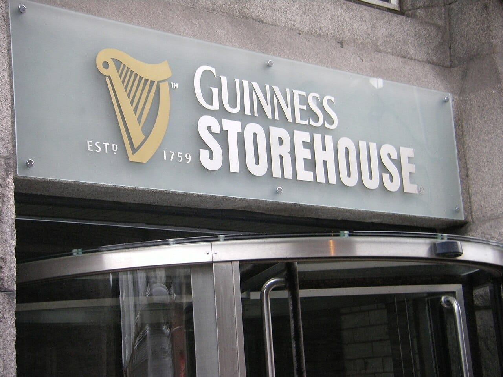
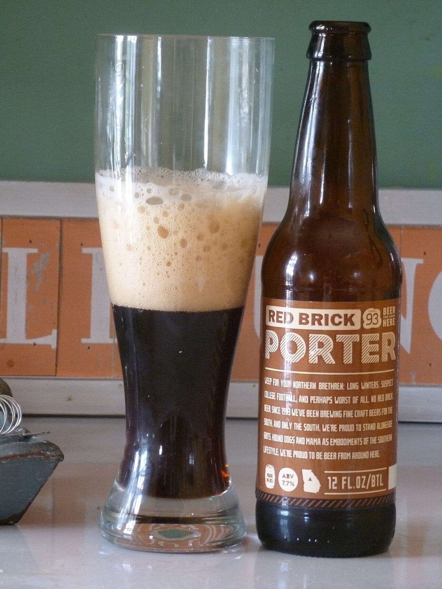

# 都柏林酒馆路线：从下桥街走到圣詹姆斯门

都柏林南岸这一段利菲河，把两种“喝健力士”的场所放在同一条步行线上：下桥街的老酒馆，和圣詹姆斯门的健力士仓库。前者仍在做日常生意，吧台后面是正常的生啤龙头；后者是旧发酵车间改成的访客中心，用七层展线和顶层酒吧讲品牌故事。两站相距约两公里，走得慢也只要半小时左右，半天可以走完。这条路线不处理“看遍都柏林”，只处理一个问题：同一杯黑色啤酒，被喝掉和被展示，是两件不同的事。

## 这条路线为什么成立

- 第一站：[铜头酒馆](ref:brazen-head)，地址 20 Lower Bridge St, Usher's Quay, Dublin 8, D08 WC64，位于马修神父桥南侧。
- 第二站：[健力士仓库](ref:guinness)，地址 St. James's Gate, Dublin 8, D08 VF8H，在同一片河岸向西约两公里处。
- 方式：全程步行。两站之间沿 Usher's Quay 与 Merchant's Quay 向西，不需要坐车。
- 建议时长：三到四小时。第一站六十到九十分钟，路上二十到三十分钟，第二站两到三小时。

两站都不是“顺路经过”的点，各自需要坐下来或走进去。合理的用法是先在酒馆吃一顿简单午饭，再沿河散步消食，最后用展馆顶层收尾：酒馆是生活，仓库是解释。

## 下桥街的那杯日常

铜头酒馆把开业时间追溯到 1198 年，现存建筑则是 1754 年的客栈。这个区别很重要：你坐进去看到的低天花板、石墙和深色木料，是 18 世纪的房子；而“同一地点长期招待人”的说法，比建筑本身更早。店方因此常自称“爱尔兰最老酒馆”，这类称号的统计口径并不统一，把它理解为“有长期文献记录的老店”更稳妥。

第一次来，点一杯正常的生啤就好。吧台会按两段式倒法打健力士：先倒到杯身大约三分之二，等泡沫沉降，再补满。这个等待不是表演，而是氮气酒液稳定的必要步骤。想少喝一点可以要 half pint，想比较可以再点一杯爱尔兰红艾尔。食物以炖菜、派、炸鱼薯条为主，分量不小，两个人点一份主菜加两杯酒通常够。

这里的节奏是“先到吧台点，再找位置”，不要坐下等服务员。晚上常有传统音乐 session，乐手坐在客人中间，不搭高台；想安静聊天，工作日下午比周末晚上合适。老建筑的门槛与通道不平，推婴儿车或轮椅出行前最好先问店方。铜头是路线的起点，它给你一个日常的基准，后面的展馆才有对照物。

## 沿利菲河南岸向西

从铜头出门右转，沿 Usher's Quay 向西，经过 Four Courts 一带，再接 Merchant's Quay，继续走到 St. James's Gate。全程约两公里，正常步速二十到三十分钟；沿途有人行横道与自行车道，过路口要看信号灯，不要边看手机边穿行。

如果不想走，Luas 红线可以坐一两站到 St. James's，但这段河岸本身就是路线的一部分：从旧码头、法院建筑到 Liberties 的排屋与厂房，城市纹理在半小时里换了几次。这一段也是理解都柏林的好位置：游客密集的 Temple Bar 在东边，西边是法院、旧工业与居民区交叠的地带。走到圣詹姆斯门附近，看到高耸的发酵罐与厂区围栏，就说明到了。

## 圣詹姆斯门的品牌剧场

健力士仓库建在旧发酵车间里，2000 年改为访客中心；普通门票是自助展线，不是进入生产车间的导览。展线从 1759 年阿瑟·健力士签下的租约讲起，经过原料、烘焙、发酵、运输与广告档案，最后到顶层的 Gravity Bar。七层动线把人流从地面带到高处，再让人一层层往下走，展览与城市景观被安排在同一条路径上。

值得慢看的是原料与烘焙部分：世涛的深色来自烘焙大麦，咖啡、可可与烤面包的气息由此而来，收尾却偏干。品鉴环节通常会引导人看泡沫、闻香、入口，门票含一杯健力士或无醇版本。顶层酒吧的视野是都柏林屋顶、教堂尖顶与远山，手里那杯酒更像一个位置标记。想进生产区，需要另购升级项目并提前确认名额，普通票不包含这部分。

门票建议按时间段在线预订，旺季下午人流最密，开门后一小时或傍晚相对从容。参观两到三小时是常见节奏；带孩子的家庭可以提前查楼层图与无障碍通道。酒吧只向达到法定饮酒年龄的访客供酒，证件要求以现场规定为准。

## 世涛与波特：两站之间的风格线

两站喝到的核心风格是世涛。它属于上发酵的深色艾尔传统，靠烘焙大麦给出颜色与焦香，酒花提供温和苦味，整体酒精度通常不高，适合连续喝几杯。健力士的现代版本用氮气侍酒，泡沫细密、口感柔滑，杯中气泡下沉的视觉效果也来自这套侍酒方式。

波特与世涛的历史纠缠常被简化。两者都源于 18 世纪伦敦的深色啤酒贸易，名称与配方在不同时期互相借用；今天把“波特更轻、世涛更重”当成定律并不准确，具体要看配方与酒精度。把[铜头酒馆](ref:brazen-head)里的一杯生啤，和[健力士仓库](ref:guinness)展线里的工艺说明放在一起，更容易理解：风格名是市场语言，工艺参数才是酒厂真正控制的东西。想在都柏林继续比较，可以另找一家供应本地精酿世涛的酒吧，或回到风格条目里读世涛与波特的边界。都柏林的酒馆文化属于爱尔兰的日常，不是展馆的附属品，这也是把酒馆放在第一站的原因。

## 时段、预约与喝完之后

时段上，建议中午到下午出发：先在铜头吃午饭，两点前后沿河走，三点左右进仓库，傍晚在顶层结束。夏季与圣帕特里克节前后拥挤，冬季河岸风冷，展馆最后入场时间要提前查。酒馆的散客不需要预订，大团体最好先联系；仓库的时段票、升级项目与闭馆安排以官网当日信息为准。

饮酒与安全：一杯 pint 的量不小，两站之间至少留出半小时走路与喝水；空腹喝氮气世涛容易觉得顺口而喝快，先吃点面包或热菜。回程若已超过两杯，坐 Luas 或出租车，不要自驾；都柏林市中心停车贵且难找。石板路与河岸风口在雨天湿滑，穿防滑鞋。夜间回住处走主路、结伴而行。带小孩的家庭更适合白天参观仓库。

本页只写路线结构与可核查事实，不提供实时营业状态、票价与车次；营业时间、菜单与预约以两站官方渠道为准，页面核验日期 2026-11-08。

补充阅读：[世涛](ref:c-extra-1)。

相关条目：[世涛](ref:c-extra-1)、[铜头酒馆](ref:brazen-head)、[健力士仓库：圣詹姆斯门的黑色啤酒叙事](ref:guinness)。

## 相关图像

图：Guinness Storehouse。图片：Greatal386 at English Wikipedia，CC BY 2.5，via Wikimedia Commons（[原图页面](https://commons.wikimedia.org/w/index.php?curid=12671330)）。关联图像：都柏林酒馆路线：从下桥街走到圣詹姆斯门。

图：一瓶 Red Brick Porter 与一杯深色酒液，杯口有米色泡沫。图片：Erik Cleves Kristensen，CC BY 2.0，via Wikimedia Commons（[原图页面](https://www.flickr.com/photo.gne?id=6175146624)）。关联图像：都柏林酒馆路线：从下桥街走到圣詹姆斯门。
