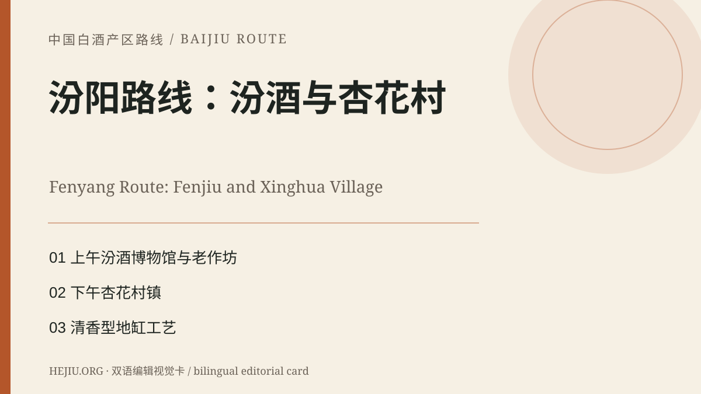
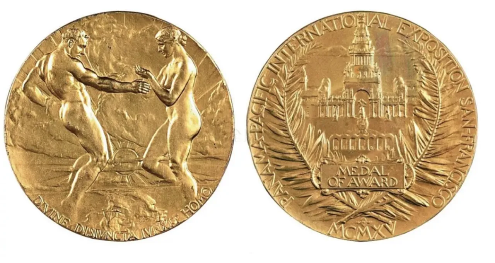

# 汾阳路线：汾酒与杏花村

杏花村在诗里是一个意象，在汾阳是一座酒镇。很多人到了汾阳，只在“杏花村”牌坊拍照，或把汾酒厂区当成一间大商店。这条路线把上午留给汾酒博物馆与老作坊，先看懂清香型白酒的地缸、制曲与蒸馏；下午再到杏花村镇看展陈、碑刻与镇区，把“诗酒”放回真实空间。

图：汾阳路线专属双语视觉卡。项目自制双语视觉卡，用于识别主题，不是现场照片。

> **先给结论**
> **适合谁：** 想理解清香型白酒与杏花村诗酒文化的人；适合从太原、平遥或汾阳出发。
> **不适合谁：** 只想要牌坊拍照、不愿预约的人；老作坊与展陈有各自入口。
> **一句话：** 上午博物馆与老作坊，下午杏花村镇，先工艺后诗酒。

## 路线逻辑：先工艺后诗酒

杏花村的叙事有两层：一层是清香型白酒的工艺，一层是“牧童遥指杏花村”的诗酒文化。先看工艺，是因为地缸、曲房与蒸馏需要用眼睛和流程去理解；后看诗酒，是因为碑刻、展陈与镇区需要在前者基础上才不会变成空泛的形容词。把博物馆与老作坊放在上午，展陈与镇区放在下午，中间在汾阳或杏花村吃饭，不要把两个空间压成一次拍照。

## 上午：汾酒博物馆与老作坊

汾酒以清香型为主，重点看地缸发酵、低温制曲、清蒸清烧与长期陈放。老作坊里注意地缸的排列与埋深、曲块的培养与储存、蒸馏设备与陈放空间如何衔接；博物馆里看剖面、器具与流程，把“地缸—曲—蒸馏—陈放”这条线连起来。清香型的“清”不是淡，而是干净、爽净、少杂味；不要只记“入口绵甜”，要看工艺如何控制杂味。地缸区不揭盖、不触摸缸体，展陈内不触摸碑刻与器具。

## 下午：杏花村镇

杏花村镇的展陈与碑刻负责诗酒叙事，镇区则负责真实生活。看碑刻时不要把诗句当成工艺说明；看展陈时把品牌史、产区史与酒史分开。镇区可以走主街，看酒厂如何与住宅、餐馆、学校、班车共生；不要进入未开放厂区或团队预约区。若展馆有讲解，先听工艺部分，再听诗酒部分；两者混在一起，容易把广告词当成历史。夏天山西昼夜温差大，带外套；冬天路面结冰，穿防滑鞋。

## 交通、预约与时间

杏花村镇在汾阳市东北，距汾阳城区不远，通常从太原、平遥或汾阳站转车；班次以实时查询为准。只看博物馆与老作坊约两到三小时；加杏花村镇与品鉴，半天到一天；再串汾阳老城或贾家庄，一天。博物馆、老作坊与厂区的开放、预约与收费各自独立，出发前一天分别确认。从平遥过来，把杏花村放在上午，下午回平遥或去汾阳老城，避免返程太晚。

## 品鉴、买酒与汾阳

品鉴要问清酒精度、容量与收费，小杯慢饮，不空腹；司机不喝，品鉴后不要开车。买酒去官方店或授权店，保留发票；不要把“内部酒”当成老作坊的延伸。汾阳不只有杏花村：老城的文庙、城墙遗存与老街，贾家庄的乡村文化空间，都能把酒镇放进晋中生活。吃饭可以试汾阳旋粉、刀削面、过油肉与汾州家常菜，配清香型白酒时控制量。若带孩子，先看工艺模型，再进镇区。

## 一日与半日版本

一日版按“博物馆—老作坊—午饭—杏花村镇—汾阳老城”走，上午不要把时间全花在展馆，老作坊要留出一小时。半日版只选博物馆与老作坊，或只选杏花村镇，不要两头赶；若带长辈，减少步行，把展陈模型先看懂。若从平遥过来，把杏花村放在上午，下午回平遥或去汾阳老城。返程前买酒，司机不参加品鉴；冬天路面结冰，穿防滑鞋，夏天带外套。若从太原出发，上午先到汾酒博物馆，老作坊留一小时，午饭在汾阳，下午到杏花村镇；若从平遥过来，反向安排，但不要把老作坊压到闭馆前。带长辈减少步行，把展陈模型先看懂；带孩子先看地缸与制曲的动画或模型，再进镇区。博物馆、老作坊与镇区的预约入口不同，出发前一天分别确认；如果只留半天，选博物馆加老作坊，不要硬加杏花村镇。买酒核对批次，镇区吃饭先问营业，山路弯道不超车，提前准备，带好身份证与预约码；博物馆与老作坊分别确认，镇区吃饭先问营业，冬天路面结冰慢走，夏天带外套，买酒核对批次，带水。

## 出发前核对

- 分别确认博物馆、老作坊与镇区
- 上午工艺，下午诗酒
- 地缸区不揭盖、不触摸
- 品鉴后不开车
- 买酒只走官方或授权店
- 冬天穿防滑鞋
- 从平遥过来先查班车
- 带孩子先看模型

## 这一路线不适合谁

这条路线以汾酒博物馆、老作坊与杏花村镇为核心，适合对清香工艺与晋中地方史感兴趣的人。若你只想拍照打卡，展馆之间的步行与讲解会显得慢；若你带着孩子，品鉴环节需要另行安排。

汾阳到杏花村有公交和自驾路线，镇区步行范围不大，但展馆之间有一定距离；节假日的讲解名额需要预约。当地餐饮以面食为主，品鉴前先吃饭，避免空腹。

替代方案：只看汾酒博物馆与老作坊，把周边酒厂另约；若想连晋中景点，至少留两天。买酒时比较厂区商店与市区渠道，注意携带和寄送限制。

## 参考资料

- 汾酒博物馆 — 汾酒集团 — https://www.fenjiu.com.cn/OnlineTour/2023-01-06/296.html（山西杏花村汾酒集团，核对 2026-11-25）
- 老作坊博物馆 — 汾酒集团 — https://www.fenjiu.com.cn/OnlineTour/2023-01-06/297.html（山西杏花村汾酒集团，核对 2026-11-25）
- 汾酒博物馆 — 全国博物馆年度报告 — http://nb.ncha.gov.cn/museumdetail.html?msg=ee70a34121f3498ca08d4ddede4701e5&nianfen=2022（国家文物局全国博物馆年度报告信息系统，核对 2026-11-25）
- 汾酒集团发展史 — 杏花村遗址与酒博物馆 — https://www.fenjiu.com.cn/developmentHistory/index.html（山西杏花村汾酒集团，核对 2026-11-25）

相关条目：[汾酒博物馆](ref:museum)、[杏花村镇（汾阳）](ref:village)、[汾酒](ref:brand)、[清香型白酒](ref:style)、[山西省](ref:region)、[第一次喝白酒怎么选](ref:guide)、[中国酒史纲](ref:history)。

## 相关图像

图：山西。图片：Underbar dk，CC BY-SA 4.0，via Wikimedia Commons（[原图页面](https://commons.wikimedia.org/wiki/File:Yanmenguan3.JPG)）。关联图像：汾阳路线：汾酒与杏花村。

图：汾酒博物馆藏 1915 年巴拿马万国博览会一等金质奖章。图片：汾酒集团文化中心，Public domain，via Wikimedia Commons（[原图页面](https://commons.wikimedia.org/wiki/File:%E5%B1%B1%E8%A5%BF%E6%B1%BE%E9%85%92%E8%8D%A3%E8%8E%B71915%E5%B9%B4%E5%B7%B4%E6%8B%BF%E9%A9%AC%E4%B8%87%E5%9B%BD%E5%8D%9A%E8%A7%88%E4%BC%9A%E7%9A%84%E2%80%9C%E4%B8%80%E7%AD%89%E9%87%91%E8%B4%A8%E5%A4%A7%E5%A5%96%E7%AB%A0%E2%80%9D_%E6%B1%BE%E9%85%92%E5%8D%9A%E7%89%A9%E9%A6%86%E8%97%8F.png)）。关联图像：汾阳路线：汾酒与杏花村。
