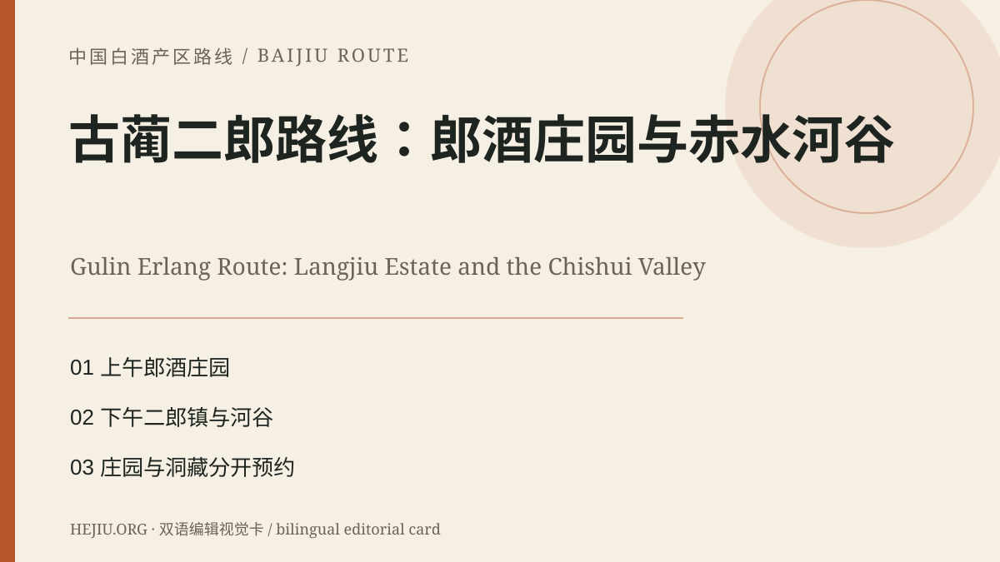

# 古蔺二郎路线：郎酒庄园与赤水河谷

二郎镇不是一座可以“顺路看一眼”的酒镇。赤水河把四川与贵州分开，郎酒庄园、生产厂区、天宝洞等地藏空间与场镇分布在窄谷里，门禁与预约各不相同。这条路线把上午留给庄园的酿造与洞藏，下午留给二郎镇的场镇与河谷，不追求一天看完所有点，而是让你理解“酒为什么长在这条河谷里”。

图：古蔺二郎路线专属双语视觉卡。项目自制双语视觉卡，用于识别主题，不是现场照片。

> **先给结论**
> **适合谁：** 想理解酱香型白酒、洞藏与赤水河左岸关系的人；适合从泸州或习水方向自驾。
> **不适合谁：** 不愿预约、只想当天往返的人；山路会把行程压得很紧。
> **一句话：** 上午庄园、下午场镇，山上住一晚，品鉴后不在山路自驾。

## 路线逻辑：庄园、场镇、河谷

二郎镇的参访空间分三层：郎酒庄园负责接待、展陈、部分品鉴与住宿；生产厂区负责酿造、制曲、蒸馏与仓储；天宝洞、地宝洞等洞藏空间负责长期储酒。场镇则是居民、学校、菜市场、餐馆与酒厂班车的生活空间。三层都在同一条山谷，却不能相互替代。上午先进庄园，是因为预约时段与导览多在白天；下午走场镇与河谷，是因为公共道路更适合傍晚看光影与厂区布局。

## 上午：郎酒庄园

庄园看三件事：酿造区如何沿坡布置，洞藏如何控制温湿度，品鉴如何与销售分开。酱香型白酒的制曲、堆积、入窖与多轮次蒸馏围绕季节展开；看车间时注意曲块培养、高粱破碎、糟醅堆积与窖池密封，不要只记“12987”这串数字。洞藏区看岩层、坛口封护、编号与消防通道；洞内光线暗、地面湿，穿防滑鞋，跟紧导览，不用闪光灯直照酒坛。品鉴要问清酒精度、容量与收费，司机不喝。

## 下午：二郎镇与河谷

二郎镇是酒业场镇，不是仿古景区。放下行李后走一圈：菜市场、学校、酒厂班车、河边通道与坡道上的住宅，能解释这个镇为什么围绕酒厂生长。看河谷时注意河面与公路的高差、厂区如何沿坡布局、跨省桥在哪里；傍晚在允许的公共路段看厂区灯光，不要下河滩、进入未开放码头或靠近施工边坡。雨季水位涨得快，远离边坡与施工区。镇上坡道多，穿平底鞋，拖行李箱不方便。

## 交通、住宿与预约

二郎镇在四川古蔺县，通常从泸州、叙永或贵州习水方向进入；山路多，雨雾天慢行，自驾要留足时间。庄园住宿与参观常绑定预约，房型、餐饮、接驳与品鉴套餐会调整，出发前看官方渠道并确认取消规则。当天往返很赶：从泸州到二郎镇单程就要数小时，建议山上住一晚，第二天再走。若不住庄园，二郎镇与习水县城有普通酒店，但早晚进出山要留时间。行李尽量轻，山路转车频繁。

## 品鉴、买酒与跨省

品鉴后不要在山路自驾，司机不喝；买酒去官方店或授权店，保留发票，不要把“内部酒”“接待酒”当成捡漏。若第二天过河去习水，确认桥梁、班车与导航是否绕行；跨省携带注意行李与托运规定。吃饭可以试古蔺麻辣鸡、赤水河鱼、豆花与腊肉，配酱香酒时控制量。若只留半天，就在庄园展陈与一段河谷，不要把二郎镇、习酒镇与土城都塞进来；山路会把每个点压成十分钟。

## 一日与两日版本

一日版只走“庄园展陈—一段河谷—镇上晚饭”，不要同时追洞藏、习酒镇与土城；两日版把第一天留给庄园与二郎镇，住山上，第二天过河去习水或土城。若遇雨雾，宁可少看一个洞藏点，也不要在山路赶夜路；带长辈时减少坡道步行，把庄园展陈与洞藏选一个。返程前买酒，司机不参加品鉴；跨省前确认桥梁与班车，行李尽量轻。若遇雨雾，宁可少看一个洞藏点，也不要在山路赶夜路；从泸州当天往返不现实，山上住一晚才能把庄园与场镇分开看。带长辈减少坡道，洞内跟紧导览；镇上餐馆按饭点营业，过了午后选择变少。住宿订庄园要确认接驳与早餐，订镇上要确认热水与停车；山路会车减速，洞里不打闪光灯，不要下河滩，提前准备，慢走，带好身份证与预约码；买酒核对批次，山路不夜间赶路，住宿确认早餐，洞里跟紧导览，过河前查桥，带薄外套。

## 出发前核对

- 分别预约庄园、洞藏与住宿
- 山路雨雾留机动时间
- 洞内跟紧导览，不触摸酒坛
- 品鉴后不在山路自驾
- 买酒只走官方或授权店
- 跨省前确认桥梁与班车
- 坡道多，行李尽量轻
- 雨季远离河滩与边坡

## 这一路线不适合谁

这条路线以二郎镇与郎酒庄园为核心，山路多、点位分散，不适合把行程压得很紧的人。庄园通常需要预约或接待安排，散客不一定能进入全部区域；若你追求“随到随看”，这里容易落空。

从古蔺或习水进入都要走盘山路，雨季有雾和落石，夜间驾驶风险高；镇区住宿与餐饮容量有限，旺季要提前订。品鉴后不能自驾下山，必须安排代驾或住宿。

替代方案：只看二郎镇与赤水河谷，不进入庄园；或把古蔺、习水、土城拆成两天。若时间只够一处，优先确认庄园预约，再决定是否绕行茅台。

## 参考资料

- 古蔺县人民政府 — 行政区划与人口 — https://www.gulin.gov.cn/mlgl/zjgl/hzqhyrk（古蔺县人民政府，核对 2026-11-25）
- 泸州市人民政府 — https://www.luzhou.gov.cn/（泸州市人民政府，核对 2026-11-25）
- 郎酒 — 郎酒集团 — https://www.langjiu.cn/（四川郎酒集团有限责任公司，核对 2026-11-25）
- GB/T 2260-2007 中华人民共和国行政区划代码（国家标准化管理委员会，核对 2026-11-25）

相关条目：[郎酒庄园（二郎镇）](ref:estate)、[二郎镇（古蔺）](ref:town)、[郎酒](ref:brand)、[酱香型白酒](ref:style)、[贵州省](ref:region)、[第一次喝白酒怎么选](ref:guide)、[中国酒史纲](ref:history)。
