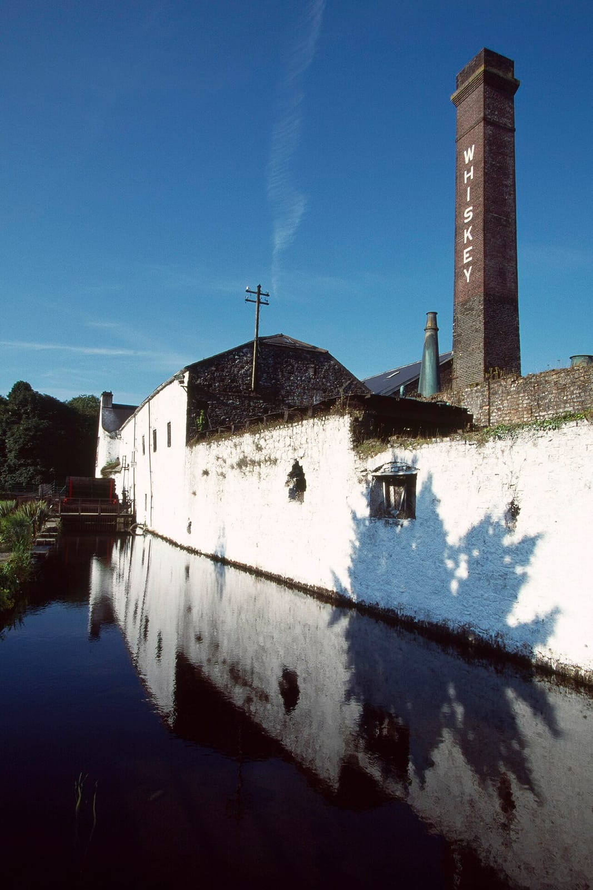

# 爱尔兰威士忌路线：海岸、城市与中部小镇

爱尔兰岛上的威士忌旅行很容易被写成“都柏林一日游”。这条路线把范围拉开：从北海岸的布什米尔斯出发，南下都柏林弓街，再折向中部 Westmeath 郡的基尔伯根。三站之间是两种货币、两套道路限速与三种酒厂状态——一座仍在生产，一座已停产改作展馆，一座靠社区修复重新出酒。

图：爱尔兰威士忌路线：海岸、城市与中部小镇所在的爱尔兰风貌配图。图片：Jeff Schmaltz，Public domain，via Wikimedia Commons（[原图页面](https://commons.wikimedia.org/wiki/File:Ireland_(MODIS).jpg)）。这张照片用于说明产区环境与访问语境，不标定爱尔兰威士忌路线：海岸、城市与中部小镇的门店、酒庄或活动现场。

## 三座酒厂，三种时间

布什米尔斯代表“连续的执照”：1608 年的蒸馏许可被当作起点，今天的厂房仍在运转。弓街代表“停下来的时间”：1780 年创立的城市酒厂在 1970 年完成最后一次壶式蒸馏，1997 年转为游客中心，设备还在，生产线不在了。基尔伯根代表“重新开始的时间”：1757 年取得执照的厂址在 1957 年停产，经社区修复后于 2007 年重新蒸馏。三种时间并置，主题就不是“喝三家”，而是同一门手艺如何被中断、保存与接续。

## 行程骨架：海岸、城市与中部

- 第一站：[布什米尔斯酒厂](ref:bushmills)，2 Distillery Road, Bushmills, Co Antrim BT57 8XH, Northern Ireland。从贝尔法斯特自驾约一小时，从都柏林约两个半小时。
- 第二站：[尊美醇弓街酒厂](ref:jameson)，Bow St, Smithfield, Dublin 7, D07 N9VH, Ireland。从布什米尔斯南下约两个半小时到三小时。
- 第三站：[基尔伯根酒厂](ref:kilbeggan)，Lower Main Street, Kilbeggan, Co. Westmeath N91 W7YY, Ireland。从都柏林走 M6 约一小时，在 Junction 5 下高速。
- 交通方式：自驾。三站跨北爱尔兰与爱尔兰共和国，涉及英镑与欧元、英里与公里，租车时确认保险覆盖跨境。
- 建议时长：两天是下限，三天更从容。第一天北海岸，第二天都柏林，第三天中部后返程。

## 为什么把这三家放在一条线上

爱尔兰威士忌在 19 世纪末曾是全球销量最大的类型之一，随后经历独立战争、贸易战、禁酒令与美国市场转向，酒厂数量大幅收缩。今天的“复兴”一部分靠老厂址与老设备被保存，一部分靠新资本重建产能；布什米尔斯、弓街与基尔伯根恰好对应持续生产、转为展馆、社区修复后复产三条路径。地理上也顺：北海岸靠近巨人之路与 Dunluce 城堡，都柏林段可步行与公共交通完成，中部段是车少的乡村公路。

## 第一站：布什米尔斯

为什么去：它把“最老的持照酒厂”落在一张 1608 年的执照上，同时仍是正常运转的生产单位。导览先讲村庄、布斯河与执照，再进入糖化、发酵、蒸馏与仓库。“最老”指同一地点上持续持有的蒸馏许可传统，不是一间 17 世纪的原厂房。

看什么：铜制壶式蒸馏器是重点。[爱尔兰威士忌](ref:irish-whiskey)常见三次蒸馏，布什米尔斯的单一麦芽以 100% 发芽大麦为原料，三次蒸馏带来更干净、果香更明显的新酒；并非法律强制。

喝什么：Bushmills Original 是调和款，轻、干净；Black Bush 麦芽比例更高，并用雪莉桶陈年，干果与香料更明显；单一麦芽序列从 10 年到 21 年。先喝 Original 建立基准，再用 Black Bush 与一款单一麦芽比较差别。

## 第二站：弓街

为什么去：它是一座不再蒸馏的“酒厂”。John Jameson 在 1780 年于弓街开始威士忌生意，19 世纪这里扩张成占地六英亩的城市酒厂；1970 年最后一次壶式蒸馏后，生产迁往科克的 Midleton，1997 年旧厂区改为游客中心。

看什么：保存下来的铜制蒸馏器、发酵与仓库展区，以及关于三次蒸馏与[壶式蒸馏](ref:pot-still)的讲解。部分场次会做爱尔兰、苏格兰、美国三杯对比。这里没有正在出酒的生产线，真正的生产在科克郡；想看运转中的设备，应去布什米尔斯或基尔伯根。

喝什么：Jameson Original 是典型调和，壶式蒸馏酒提供香料与油脂感，谷物酒提供轻柔甜味；Black Barrel 使用双重烧焦的波本桶，香草与焦糖更明显；18 年把陈年与桶型推到更高价位。加几滴水后，香料与谷物甜会分得更开。

## 第三站：基尔伯根

为什么去：它把“修复”变成可以看见的东西。1757 年，Matthias McManus 在此取得蒸馏执照，酒厂最初叫 Brusna Distillery；1878 年仓库失火，镇上的人把酒桶滚到街上，保住大部分库存；1957 年停产，1982 年当地人成立修复协会，2007 年在创立 250 周年时重新蒸馏。

看什么：木制水轮、传动轴、旧磨麦设备、蒸汽机与铜制壶式蒸馏器构成一条十九世纪的生产线。官方称厂内有一台仍在运行的老壶式蒸馏器，使用时间超过 180 年。看点不是现代化，而是“还能运转”。

喝什么：Kilbeggan Blended 顺滑、易饮；Single Pot Still 用发芽与未发芽大麦混合糖化，带香料、青草与油脂感，是理解[壶式蒸馏](ref:pot-still)的入口；Small Batch Rye 带来胡椒与干爽尾韵。调和不是低端代名词：在爱尔兰，调和与单一壶式是并行的两条传统。

## 车程、预约与季节

三座酒厂都要提前预约，旺季与周末容易满员。布什米尔斯的导览分不同档次，团体需提前联系；弓街的场次与语言随季节调整；基尔伯根的体验从 90 分钟常规团到 30 分钟装瓶体验都有，含品鉴的项目只对达到法定饮酒年龄的客人开放。

车程按实际驾驶估算：北海岸到都柏林要穿过边境，早晚高峰更久；都柏林到基尔伯根约一小时，但出城路段容易堵。五月到九月日照长、开放完整，也最拥挤；冬季安静，但乡村路段天黑早。把品鉴安排在行程末端，晚上住下来，比赶回城里安全。

## 驾驶、品鉴与边界

这是自驾线，最重要的规则只有一句：喝酒的人不开车。爱尔兰与北爱尔兰对酒后驾驶的容忍度都很低，乡村道路窄、弯多、路肩软，一杯就可能影响判断。可行方案有三种：指定司机全程不喝；把品鉴集中在一天，其余时间用公共交通；或参加含接送的酒厂行程。

跨境还有几个细节：北爱尔兰用英镑、以英里标示限速，爱尔兰共和国用欧元、以公里标示；租车保险是否覆盖跨境要提前确认。弓街在都柏林市区，Luas 红线 Smithfield 站步行约两分钟，市区段不需要开车。厂区是生产场所，没有预约不要进入，不要触摸蒸馏器、管道与桶架。

## 与爱尔兰产区页、风格页的关系

这条路线是[爱尔兰](ref:ireland)产区页的行程版：产区页讲清“爱尔兰岛蒸馏与陈年”的法律边界、壶式蒸馏酒的原料要求与三次蒸馏传统，路线页则让你在三座厂房里看到这些规则的过去、中断与重启。风格上，读[爱尔兰威士忌](ref:irish-whiskey)能分清调和、单一麦芽、单一谷物与单一壶式；读[壶式蒸馏器](ref:pot-still)能理解为什么同一套设备会做出厚、油、带香料的酒体。

对照阅读：[布什米尔斯酒厂](ref:bushmills)、[基尔伯根酒厂](ref:kilbeggan)。

## 相关图像

图：爱尔兰威士忌。图片：Hammersbach，CC BY-SA 3.0，via Wikimedia Commons（[原图页面](https://commons.wikimedia.org/wiki/File:GoodIrishWhiskeys.jpg)）。关联图像：爱尔兰威士忌路线：海岸、城市与中部小镇。

图：基尔伯根酒厂。图片：Whisky lover，Public domain，via Wikimedia Commons（[原图页面](https://commons.wikimedia.org/wiki/File:Old_Kilbeggan_Distillery_-_Low_Res.jpg)）。关联图像：爱尔兰威士忌路线：海岸、城市与中部小镇。
