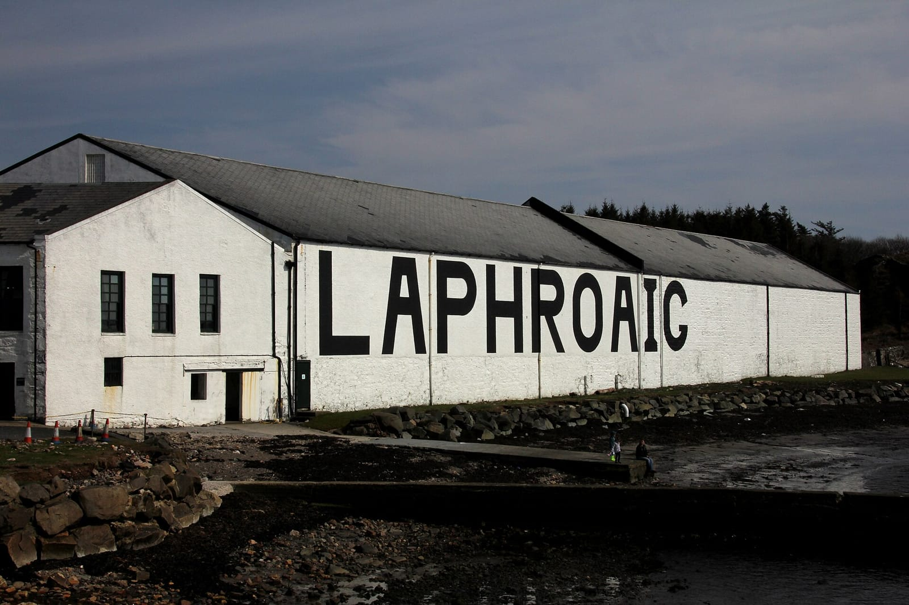

# 艾雷岛路线：南岸泥煤威士忌三家酒厂

艾雷岛南岸有一条很朴素的路线：从 Port Ellen 出发，沿着海岸向东，先到 Lagavulin，再到 Ardbeg，最后到 Laphroaig。三家酒厂之间由一条步道相连，走路大约三到四小时，开车则只要十几分钟。真正值得花时间的不是“打卡三家”，而是同一个海湾里，三家酒厂如何用不同的麦芽处理、蒸馏节奏与仓库位置，做出三种不同的泥煤。

图：艾雷岛路线：南岸泥煤威士忌三家酒厂所经地区的一处实景。图片：Bjarne Henning Kvaal…，CC BY-SA 3.0，via Wikimedia Commons（[原图页面](https://commons.wikimedia.org/wiki/File:Laphroaig_Distillery_-_panoramio_(4).jpg)）。这张照片用于说明艾雷岛路线：南岸泥煤威士忌三家酒厂所经过的产区或城市环境，不标定其具体停靠点。

> **先给结论**
> **一句话：** 这页判断艾雷岛路线：南岸泥煤威士忌三家酒厂怎么排、走多久、哪些点不能省。
>
> - **适合谁：** 想把艾雷岛路线：南岸泥煤威士忌三家酒厂排成一日或两日行程、需要知道顺序与停留重点的人。
> - **不适合谁：** 只想看单个地点、不打算按路线走的人。
> - **先看这两点：**
>   - - 第一站：Lagavulin 酒厂，Port Ellen, Isle of Islay PA42 7DZ，1816 年由 John Johnston 创立。
>   - 艾雷岛的旺季在五月到九月，日照长、渡轮班次多，但酒厂导览与岛上住宿都紧张；五月末的 Islay Festival（Fèis Ìle）是全年最忙的时候。

> **决策清单**
> 买之前、去之前，按这三步过一遍。
>
> - **路线概览：** 第一站：Lagavulin 酒厂，Port Ellen, Isle of Islay PA42 7DZ，1816 年由 John Johnston 创立，此前该地已有非法蒸馏活。
> - **交通与节奏：** 到艾雷岛通常从苏格兰 mainland 乘渡轮，CalMac 运营主要航线，船期受天气影响；2026-06-02 起 Port Ellen 码头关闭至 2029 年，Islay。
> - **为什么走这条线：** 艾雷岛的威士忌常被简化成“泥煤味”。

> **专题导航：艾雷岛泥煤威士忌**
> - [艾雷岛路线](https://atlas.hejiu.org/routes/islay-whisky-trail/)
> - [艾雷岛](https://beverages.hejiu.org/regions/islay/)
> - [阿贝蒸馏厂](https://atlas.hejiu.org/places/ardbeg-distillery/)
> - [拉弗格蒸馏厂](https://atlas.hejiu.org/places/laphroaig-distillery/)
> - [布赫拉迪蒸馏厂](https://atlas.hejiu.org/places/bruichladdich-distillery/)
> - [威士忌入门](https://hejiu.org/guides/whisky-intro/)
> - [苏格兰威士忌](https://beverages.hejiu.org/styles/scotch-whisky/)

## 路线概览

- 第一站：[Lagavulin 酒厂](ref:lagavulin)，Port Ellen, Isle of Islay PA42 7DZ，1816 年由 John Johnston 创立，此前该地已有非法蒸馏活动。
- 第二站：[Ardbeg 酒厂](ref:ardbeg)，Port Ellen, Isle of Islay PA42 7EB，1815 年创立，1981 年关闭，1989 年重启，现属 LVMH。
- 第三站：[Laphroaig 酒厂](ref:laphroaig)，Port Ellen, Isle of Islay PA42 7DU，1815 年由 Donald 与 Alexander Johnston 创立，保留地板发麦。
- 方式：渡轮到达 Port Askaig（2026-06-02 起 Port Ellen 码头关闭至 2029 年，Kennacraig–Port Askaig 约 1 小时 55 分），再乘巴士或出租车约四十分钟到 Port Ellen；镇内到三家酒厂以步道为主，回程可搭岛内巴士或预约出租车。
- 建议时长：一整天。上午走步道，中午在 Ardbeg 的旧窑咖啡屋吃饭，下午参观 Laphroaig，傍晚回 Port Ellen。

## 为什么走这条线

艾雷岛的威士忌常被简化成“泥煤味”。但泥煤不是一个味道，而是一套变量：麦芽用多少泥煤熏、泥煤来自哪一层、蒸馏器形状与蒸馏速度、仓库离海多远、桶陈多久。南岸三家酒厂恰好把这些变量拆开摆在同一个海湾里，走路就能比较。

Lagavulin 的关键词是“慢”。它的蒸馏器运行得慢，回流多，酒体厚，泥煤与海藻、碘、烟熏结合，16 年是其标志性酒款。Ardbeg 的关键词是“重与甜”：泥煤强度高，但酒体里有明显的柑橘、焦油与甜感，蒸馏器上装有 purifier，让回流与风味更复杂。Laphroaig 的关键词是“药味与海”：地板发麦、海边仓库与强烈的碘、消毒水、海藻气息，让它成为最容易辨认的艾雷岛酒之一。

这条路线也把“岛”讲清楚。艾雷岛不是一座交通便利的主题公园：渡轮受天气影响，岛内巴士班次不多，步道会经过牧场与海岸，路面有泥、有羊粪、有风。把交通与天气当成路线的一部分，而不是背景，才不会把一天排成不可能完成的任务。

## 第一站：Lagavulin 酒厂

为什么去：它把“重泥煤”与“慢蒸馏”放在同一个屋檐下。酒厂位于 Port Ellen 以东约三公里（两英里），海湾边的一排白色仓库直接临水，仓库门一开就是海风。1816 年，John Johnston 在这里建立合法酒厂；在此之前，这一带从 18 世纪中叶就有非法蒸馏，海岸、淡水与隐蔽的小海湾是当时的关键条件。

看什么：参观通常从游客中心开始，进入糖化、发酵与蒸馏车间，最后到仓库。重点看蒸馏器的形状与运行节奏：Lagavulin 的蒸馏器不是追求“快”，而是让蒸汽有更多回流，酒体更厚、更油。仓库靠海，橡木桶在潮湿、带盐分的空气里陈年，酒液会带上一点海藻与碘的气息。不要只问“多少 ppm”，泥煤强度只是起点，蒸馏与桶陈才决定最后的口感。

喝什么：16 年是核心酒款，甜、烟、海藻与长尾韵是常见描述；Distillers Edition 会经过二次熟成，带出更明显的甜味；特别装瓶与酒厂限定版则适合已经喝过基础款的人。第一次来，先喝 16 年，再喝一款桶强或特别版，比较酒精强度与风味厚度的关系。不要在参观前喝，鼻子会被烟熏味占满。

## 第二站：Ardbeg 酒厂

为什么去：它把“重泥煤”做出甜感与果味。酒厂 1815 年创立，1981 年关闭，1989 年由 Allied 重启，1997 年转入 Glenmorangie 公司，2005 年起属 LVMH。官方的参观体系分几种：标准的酒厂导览、更深入的“Deconstructing the Dram”一类品鉴，以及面向会员的活动；旺季要提前预约，临时到访不一定有位置。

看什么：Ardbeg 的蒸馏器上装有 purifier，这是一段让部分蒸汽回流的小装置，能增加回流、改变风味；发酵时间、泥煤强度与蒸馏器形状共同塑造了它的酒体。老窑（Old Kiln）与旧建筑被保留下来，改造成咖啡屋与接待空间，砖墙、烟囱与海岸线构成很好认的景观。站在海边看酒厂，能理解“仓库离海近”不是浪漫说法，而是湿度、盐分与温度的现实条件。

喝什么：10 年是入门，Uigeadail 与 Corryvreckan 是两款常见的进阶酒款，前者更甜、更油，后者更重、更辛辣；An Oa 则更柔和。第一次来，建议用 10 年与 Uigeadail 对比，再加一杯 Corryvreckan，三杯就能把“甜—重—辣”的谱系走一遍。酒厂限定版价格与供应变化大，不要为了“买到”而忽略喝懂。

## 第三站：Laphroaig 酒厂

为什么去：它把“药味”与“海”做到极致。酒厂 1815 年由 Donald 与 Alexander Johnston 创立，位于 Port Ellen 以东约五公里，紧邻海湾；它保留了自己的地板发麦，约 15% 的麦芽在厂内用泥煤熏干，其余从外部采购。水源来自 Kilbride 溪，流经泥煤与花岗岩，带出矿物与苔藓的气息。

看什么：地板发麦间是这一站的重点。麦芽铺在地板上，工人用木铲翻动，泥煤火在下方缓慢燃烧，烟穿过麦层；这套工艺效率不高，却让酒厂保留了对泥煤强度与烟熏风味的直接控制。仓库同样靠海，桶陈时酒液与海风、盐分、湿气长期接触；参观时留意仓库墙面、桶架与地面的盐霜，这些细节比“海边陈年”四个字更有说服力。

喝什么：10 年是标准款，Quarter Cask 用更小的桶加速熟成，带出更明显的椰香与甜味；Lore 与 Cairdeas 是更进阶的系列；1815 年版则向创立年份致意。第一次来，先喝 10 年，再喝 Quarter Cask，最后用一杯桶强收尾，比较桶型与酒精强度带来的差异。Laphroaig 的“药味”不是每个人都会喜欢，不需要勉强喝完，吐酒桶就是为此准备的。

## 交通与节奏

到艾雷岛通常从苏格兰 mainland 乘渡轮，CalMac 运营主要航线，船期受天气影响；2026-06-02 起 Port Ellen 码头关闭至 2029 年，Islay 航线改靠 Port Askaig，Kennacraig–Port Askaig 约 1 小时 55 分，下船后还要乘巴士或出租车约四十分钟到 Port Ellen。也可以从格拉斯哥或爱丁堡乘飞机到 Islay 机场。岛内交通班次不密，出发前要查好回程。三家酒厂之间的步道从 Port Ellen 出发，沿着海岸向东，路面有碎石、泥地、草地与公路段，走完单程大约三到四小时，回程可以继续走，也可以搭巴士或预约出租车。

节奏建议：早上从 Port Ellen 出发，先到 Lagavulin，参加第一场导览；中午走到 Ardbeg，在旧窑咖啡屋吃饭，参加下午的导览；下午继续走到 Laphroaig，参加最后一场景观与品鉴；傍晚搭巴士或出租车回 Port Ellen。若只安排两家，建议保留 Lagavulin 与 Laphroaig，一家看“慢蒸馏”，一家看“地板发麦”，风格差异最大。

不要把步道当成城市公园。艾雷岛天气变化快，风大、雨多，路面可能积水；步道穿过牧场，遇到羊群要让路，不要翻越围栏。穿防水鞋、带防风外套，手机信号在部分海岸段不稳定。若当天有强风或大雨，改为开车或打车，不要硬走。

## 季节与预约

艾雷岛的旺季在五月到九月，日照长、渡轮班次多，但酒厂导览与岛上住宿都紧张；五月末的 Islay Festival（Fèis Ìle）是全年最忙的时候，酒厂活动多、名额少，要提前几个月规划。冬季安静，但日照短、天气更不稳定，部分酒厂减少场次，渡轮也可能因风浪取消。

预约时确认三件事：参观类型、语言与集合地点。Lagavulin 的仓库品鉴、Ardbeg 的深度品鉴、Laphroaig 的地板发麦导览都是不同的产品，时长与价格不同；不要把“酒厂参观”当成一个统一的东西。品鉴后要开车的人不喝，岛上的道路窄、单车道多，酒后驾驶风险很高。

## 礼仪与边界

第一，酒厂是生产场所，不是酒吧。没有预约不要进入生产区，不要触摸蒸馏器、发酵槽、桶架与麦芽；地面湿滑，注意脚下。第二，品鉴时先闻后喝，少量慢饮，不想喝完就吐酒；不要喷浓香水，以免干扰别人判断泥煤与海风。第三，尊重岛屿生活：步道穿过牧场与私人土地，按标识行走，遇到羊群与农机让路，不要翻越围栏，不要在海边留下垃圾。

第四，把年份与所有权读准。Lagavulin 的 1816 年是合法建厂年，不是这一带蒸馏史的起点；Ardbeg 的 1815 年是创立年，1981 年关闭、1989 年重启、1997 年与 2005 年是所有权变化；Laphroaig 的 1815 年是创立年，地板发麦只覆盖部分麦芽。第五，不要用“泥煤值”给酒排队；ppm 只描述麦芽的酚含量，不描述你杯子里的味道。

## 替代与延伸

若天气不适合走步道，最直接的替代是开车或打车，三家酒厂之间十几分钟车程；但品鉴后不要开车，最好预约出租车或参加含接送的酒厂行程。若时间只够两家，保留 Lagavulin 与 Laphroaig，把 Ardbeg 留到下次；若更想看“重泥煤的甜感”，则保留 Ardbeg 与 Laphroaig。

往西可以延伸到 Port Charlotte 与 Bruichladdich，往北可以到 Bowmore、Caol Ila 与 Bunnahabhain；这些酒厂分布在岛的不同海岸，风格差异很大，不适合在一天里硬串。更合理的延伸是分开安排：一天给南岸三家，另一天给西岸与北岸，把“南岸的烟与海”与“西岸的泥煤与花”分开看。

相关条目：[乐加维林蒸馏厂](ref:lagavulin)、[阿贝蒸馏厂](ref:ardbeg)。

## 另见

- [Lagavulin 酒厂](ref:lagavulin)：慢蒸馏、海边仓库与 16 年。
- [Ardbeg 酒厂](ref:ardbeg)：重泥煤、purifier 与 Uigeadail。
- [Laphroaig 酒厂](ref:laphroaig)：地板发麦、海边仓库与药味。
- 想继续读背景，可在内容仓中查阅艾雷岛产区、苏格兰威士忌与“产地与工艺”条目；本页不再重复登记引用。

艾雷岛南岸三家酒厂之间车程不短，渡轮、参观场次与品鉴预约要分别确认；本页不画示意地图，精确导航用实时地图与现场标识。核验于 2026-11-08。
