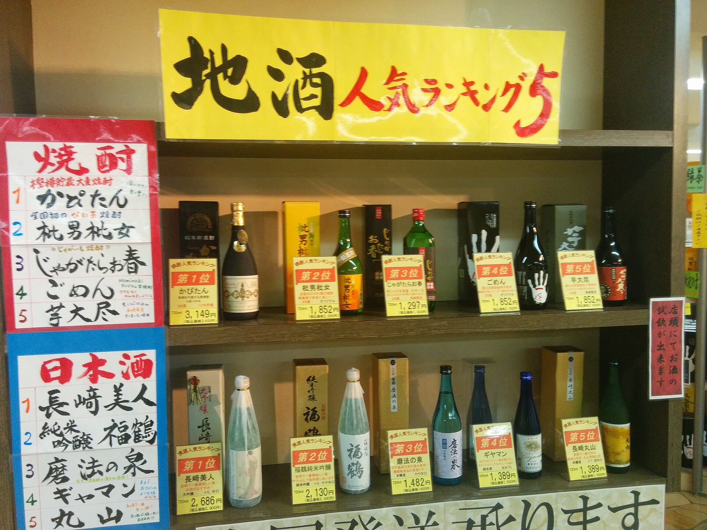

# 日本路线：从山崎蒸馏所到伏见、西宫的清酒酒藏

这条路线把两种发酵酒放在一起：山崎的麦芽威士忌与京都、西宫的清酒。它们看起来是两套体系，实际共享同一组条件——水、温度、微生物与木桶。山崎在京都与大阪之间的山麓，伏见在京都南部的水乡，西宫在兵库的滩五乡边缘；三地靠铁路连起来，一天半可以走完，但每一站都值得慢下来。

图：日本路线：从山崎蒸馏所到伏见、西宫的清酒酒藏所经地区的一处实景。图片：663highland，CC BY 2.5，via Wikimedia Commons（[原图页面](https://commons.wikimedia.org/wiki/File:Hakushika_Memorial_Museum02st3200.jpg)）。这张照片用于说明日本路线：从山崎蒸馏所到伏见、西宫的清酒酒藏所经过的产区或城市环境，不标定其具体停靠点。

> **先给结论**
> **一句话：** 这页判断日本路线：从山崎蒸馏所到伏见、西宫的清酒酒藏怎么排、走多久、哪些点不能省。
>
> - **适合谁：** 想把日本路线：从山崎蒸馏所到伏见、西宫的清酒酒藏排成一日或两日行程、需要知道顺序与停留重点的人。
> - **不适合谁：** 只想看单个地点、不打算按路线走的人。
> - **先看这两点：**
>   - - 第一站：山崎蒸馏所，大阪府三岛郡岛本町山崎 5-2-1，1923 年由鸟井信治郎创立，是日本最早的麦芽威士忌蒸馏所。
>   - 山崎的参观全年开放，但旺季（樱花季、红叶季、暑假）名额紧张，抽选落选很常见；预约时确认参观类型、语言与时长，不要把“博物馆自由参观”与“蒸馏所导览”混为一谈。

## 路线概览

- 第一站：[山崎蒸馏所](ref:yamazaki)，大阪府三岛郡岛本町山崎 5-2-1，1923 年由鸟井信治郎创立，是日本最早的麦芽威士忌蒸馏所。
- 第二站：[月桂冠大仓酒藏](ref:gekkeikan)，京都府京都市伏见区南浜町 247，月桂冠 1637 年在伏见创业，酒藏建筑与博物馆对外开放。
- 第三站：[白鹿纪念酒造博物馆](ref:hakushika)，兵库县西宫市库拉武町 8-21，白鹿 1662 年创业，博物馆由酒藏与酒器馆组成。
- 方式：JR 京都线到山崎站；京都站换乘 JR 或京阪到伏见；阪急线到西宫；站到酒藏以步行为主。
- 建议时长：一天半。第一天山崎与伏见，第二天西宫；若压成一天，建议只保留山崎与伏见。

## 为什么走这条线

日本酒与威士忌的对比，最容易被讲成“清酒清淡、威士忌浓烈”。真正值得看的是工艺的分岔：清酒是并行复发酵，曲菌把米里的淀粉糖化，酵母同时把糖变成酒精；威士忌是先糖化、再发酵、再蒸馏，最后在橡木桶里陈年。两条路线都要处理水、温度与微生物，但一个把时间花在“发酵与压榨”，一个把时间花在“蒸馏与桶陈”。

山崎提供“起点”的叙事。1923 年，鸟井信治郎在山崎建立日本第一座麦芽威士忌蒸馏所；这里位于京都西南、大阪东北，桂川、宇治川与木津川交汇，雾气与湿润气候影响陈年。山崎的泉水被酒厂视为重要条件，蒸馏所里的博物馆则把日本威士忌的早期历史、器具与广告材料摆出来。先看这里，再看清酒，会更容易理解“发酵”与“蒸馏”的分界。

伏见提供“水乡”的叙事。月桂冠 1637 年在伏见创业，伏见的地下水属于软水，矿物质少，发酵速度较慢，酒体更柔和；伏见的酒藏沿着运河与街道分布，白墙、土藏、酒桶与船运码头构成一套完整的酿造地理。西宫提供“滩五乡”的叙事：白鹿 1662 年创业，西宫与神户之间的滩五乡靠六甲山系的水与濑户内海的水运，成为江户时代重要的清酒产区。三站连起来，水、运输与城市的关系就清楚了。

## 第一站：山崎蒸馏所

为什么去：它是日本麦芽威士忌的原点，也是“山崎”这个品牌名的来源。蒸馏所位于大阪府三岛郡岛本町，从 JR 京都线山崎站步行约十分钟；官方地址是山崎 5-2-1，靠近天王山山麓与桂川。1923 年，鸟井信治郎在这里开始建造蒸馏所，1924 年投产；当时的日本还没有成熟的麦芽威士忌生产体系，酒厂从苏格兰请来技术顾问，逐步建立自己的设备与风格。

看什么：参观动线通常从接待楼开始，经过糖化、发酵、蒸馏与桶陈空间，最后到品鉴与博物馆。重点看蒸馏器的形状与数量：山崎使用不同形状、不同大小的蒸馏器，让同一批麦芽产生不同风格的原酒，再通过调配形成品牌风格。桶陈仓库里的橡木桶类型也值得留意，雪莉桶、波本桶与水楢桶带来的风味差异，是日本威士忌常见的话题。博物馆里有早期的广告、酒标与器具，能把“日本威士忌如何被做出来”讲成一条时间线。

喝什么：山崎的产品线从无年份的单一麦芽到 12 年、18 年、25 年，以及限定版。第一次来，先喝无年份或 12 年，建立对山崎风格的印象，再喝一杯雪莉桶或水楢桶的版本，比较桶型带来的差异。品鉴分量不大，不要急着喝完，先闻后喝；开车的人不喝。

开放与交通：2026-11-08 核验时，蒸馏所的开放时间为 10:00–16:45，最终入馆 16:30；馆内没有一般访客停车场，建议乘 JR 到山崎站后步行。所有访客（包括只逛商店的人）都需提前预约，旺季采用抽选。

## 第二站：月桂冠大仓酒藏

为什么去：它把“酒藏”从生产空间变成可读的建筑。月桂冠 1637 年在伏见创业，最初是酒商，后来在伏见建酒藏；大仓酒藏是保存下来的酒藏建筑之一，现在作为博物馆开放，地址在伏见区南浜町 247，从京阪中书岛站步行约七分钟，从 JR 稻荷站或京都站也可以换乘前往。伏见一带的水质属于软水，适合缓慢发酵，酒体柔和；酒藏沿运河分布，过去靠船运把酒送往京都与大阪。

看什么：酒藏建筑的土墙、厚屋顶与木梁是重点，它们负责隔热与湿度控制；酒桶、压榨工具、酿酒器具与招牌把清酒的生产流程摆出来。博物馆里还复原了酒藏的作业空间，能看到“藏人”如何在冬季低温下完成蒸米、制曲、发酵与压榨。不要只盯着酒瓶，先看建筑与工具，再看酒标与广告，最后再试饮。

喝什么：馆内的试饮通常提供几款月桂冠的代表酒，从普通酒到纯米酒、吟酿；第一次来，先喝纯米酒，感受米的甜味与酸度，再喝吟酿，比较香气与酒体的差异。伏见的软水让酒体偏柔和，不要用“淡”来形容，更准确的说法是“收尾干净、酸度温和”。试饮后如果还要开车或赶路，使用吐酒桶或只闻不喝。

开放与预约：2026-11-08 核验时，大仓酒藏的开放时间为 9:30–16:30（受付至 16:00）；8 月 13–16 日与 12 月 28 日至 1 月 4 日休馆，11 月 16–19 日另有临时休业；20 岁以上入场费 600 日元，馆内完全无现金，建议先在官网预约。休馆与活动安排会调整，出发前再查一次。

## 第三站：白鹿纪念酒造博物馆

为什么去：它把西宫的酿酒史与酒器收藏放在同一个院子里。白鹿 1662 年在西宫创业，品牌名来自中国“白鹿”的典故；博物馆位于西宫市库拉武町 8-21，从阪神西宫站步行约十五分钟，或乘巴士到“交通公园前”再步行约一分钟。西宫与神户之间的滩五乡靠六甲山系的伏流水与濑户内海的水运，江户时代成为清酒的重要产区；白鹿的博物馆由酒藏建筑与酒器馆组成，一部分空间保留了酿酒现场。

看什么：酒藏部分的木梁、土墙、酒桶与压榨设备，能看出“滩五乡”酒藏的规模感；酒器馆收藏从古代到近代的酒器，包括德利、猪口、銚子与酒注，把“怎么喝”这件事讲得很细。博物馆的名字里有“纪念”二字，说明它不只是展示酒，也在保存创业家族与地方产业的记忆。看展时留意“西宫”与“滩五乡”的地理关系，不要把西宫当成神户的附庸。

喝什么：馆内试饮通常提供白鹿的代表酒款，从普通酒到纯米酒、吟酿；第一次来，先喝纯米酒，再喝一款吟酿，比较香气与口感。白鹿的酒体通常比伏见更厚一点，酸度也更明显，这与滩五乡的水质与酿造传统有关。不要为了“喝回票价”而勉强，试饮是理解，不是比赛。

## 交通与节奏

山崎站在 JR 京都线上，京都与大阪方向都能到达；从车站到蒸馏所步行约十分钟，沿途有指示牌。伏见可以从京都站乘 JR 到稻荷站，再换京阪到中书岛，或直接从京都站乘京阪到中书岛；中书岛到月桂冠大仓酒藏步行约七分钟。西宫方面，官方指引为乘阪神本线到西宫站步行约十五分钟，或从阪急西宫北口站、JR 西宫站乘往 Marina Park 方向的巴士在“交通公园前”下车再步行约一分钟。白鹿纪念馆开放时间为 10:00–17:00（16:30 停止入场），周二休馆，遇节假日顺延；具体车次与换乘以当天查询为准。

一天半的节奏比较稳：第一天上午山崎，下午伏见，晚上住京都；第二天上午西宫，下午回大阪或神户。若压成一天，建议只保留山崎与伏见，因为山崎的预约与伏见的酒藏参观都需要时间，西宫再加进来会变成赶路。三站都不要安排在品鉴后立刻开车；这条路线以铁路与步行为主，本来就不需要自驾。

山崎的预约是硬门槛。官方规定所有访客（包括只逛商店的人）都必须提前预约，旺季采用抽选，通常提前两个月开放；没有预约不要直接去。伏见与西宫的酒藏博物馆一般可以现场购票，但团体、导览与试饮安排可能变化，出发前查官网。把“预约确认”当成路线的一部分，而不是临到场再想办法。

## 季节与预约

山崎的参观全年开放，但旺季（樱花季、红叶季、暑假）名额紧张，抽选落选很常见；预约时确认参观类型、语言与时长，不要把“博物馆自由参观”与“蒸馏所导览”混为一谈。伏见的酒藏博物馆在年末年初可能休馆，樱花季与红叶季人多；西宫的博物馆同样有休馆日，出发前查官网。清酒的酿造季在冬季，酒藏里的作业氛围在冬天更明显，但博物馆的展示全年变化不大。

天气方面，京都与大阪的夏天闷热，冬天寒冷；伏见与水乡近水，湿度高，冬天体感更冷。山崎在山麓，早晚温差比市区大，带一件薄外套。若当天下雨，山崎到车站的步行段有坡道，穿防滑鞋。

## 礼仪与边界

第一，蒸馏所与酒藏都是生产或保存场所，不是酒吧。没有预约不要进入生产区，不要触摸蒸馏器、酒桶、酒器与展品；酒藏地面可能有水，注意脚下。第二，试饮时先闻后喝，少量慢饮，不想喝完就吐酒；不要喷浓香水，以免干扰别人判断香气。第三，博物馆内拍照要看清标识，部分展品禁止闪光灯或禁止拍摄；不要越过围栏，不要把手伸进酒桶。

第四，把年份与身份读准。山崎的 1923 年是创立年，1924 年是投产年；月桂冠的 1637 年是创业年，大仓酒藏的建筑年代与博物馆开馆年不是同一年；白鹿的 1662 年是创业年，博物馆的展示体系是后来建立的。第五，区分“清酒”“烧酎”与“威士忌”：清酒是酿造酒，烧酎是蒸馏酒，威士忌是蒸馏后在橡木桶中陈年的烈酒；不要用同一套品鉴语言套在三者身上。

## 替代与延伸

若山崎预约不到，最直接的替代是京都或大阪的其他酒类博物馆与酒藏，但不要把“替代”写成“同样能看到山崎”；山崎的蒸馏所导览有明确的预约门槛，替代方案只能换主题，不能换体验。若时间只够两站，保留山崎与伏见：一站看蒸馏，一站看酿造，对比最清楚；西宫可以留到下次，与神户的滩五乡一起看。

往西可以延伸到神户的滩五乡酒藏，往北可以到京都北部的酒藏；往东可以到大阪的酿酒资料馆。更合理的延伸是分开安排：一天给山崎与伏见，另一天给西宫与神户，把“京都的水”与“兵库的水”分开看，不要在同一天里硬串三地。

相关条目：[山崎蒸馏所](ref:yamazaki)、[月桂冠大仓纪念馆](ref:gekkeikan)。

## 另见

- [山崎蒸馏所](ref:yamazaki)：日本麦芽威士忌的起点、蒸馏器与桶陈。
- [月桂冠大仓酒藏](ref:gekkeikan)：伏见的软水、酒藏建筑与清酒酿造。
- [白鹿纪念酒造博物馆](ref:hakushika)：西宫与滩五乡的酿酒史、酒器收藏。
- 想继续读背景，可在内容仓中查阅日本产区、清酒、威士忌与“清酒与烧酎”条目；本页不再重复登记引用。

山崎蒸馏所、伏见与西宫的清酒酒藏之间靠铁路衔接，见学与品鉴要分别预约；酒藏整修与班次会变，出发前查各官网。核验于 2026-11-08。

## 相关图像

图：清酒与烧酎：同为日本酒，工艺完全不同相关实景照片。图片：NevinThompson，CC BY-SA 4.0，via Wikimedia Commons（[原图页面](https://commons.wikimedia.org/wiki/File:Local_sake_and_shochu_on_display_in_a_shop,_Nagasaki,_April_2015.jpg)）。关联图像：日本路线：从山崎蒸馏所到伏见、西宫的清酒酒藏。

图：月桂冠大仓纪念馆相关实景照片。图片：663highland，CC BY 2.5，via Wikimedia Commons（[原图页面](https://commons.wikimedia.org/wiki/File:Gekkeikan_Okura_Sake_Museum02s4592.jpg)）。关联图像：日本路线：从山崎蒸馏所到伏见、西宫的清酒酒藏。
