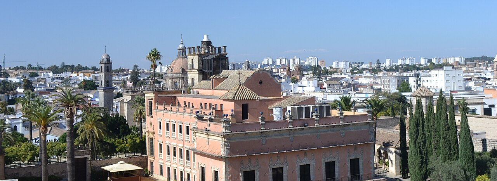
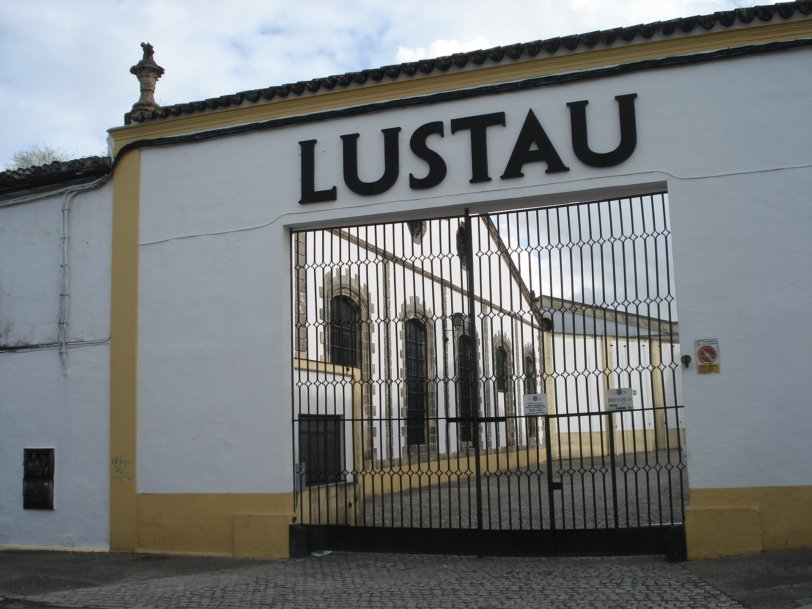

# 赫雷斯雪莉路线：一座城、两家酒庄与三条陈年路径

赫雷斯-德拉弗龙特拉常被当成一个酒的名字，其实它首先是一座城。雪莉酒三角区由赫雷斯、圣玛丽亚港与桑卢卡尔-德巴拉梅达三座城市围成，而这条路线只走赫雷斯城内的两家酒庄：阿科斯街的卢士涛与曼努埃尔·马利亚·冈萨雷斯街的冈萨雷斯·比亚斯。两站相距不足一公里，步行即可串联，却能看全 solera 叠桶、flor 生物陈年与氧化陈年三条路径。把两家放在同一天，比分别打卡更有用：一家从 almacenista 起家，习惯把不同储酒行的老酒摆上台面；另一家从 1835 年起就是城市酒窖的样板，用品牌把风格固定下来。

图："赫雷斯雪莉路线：一座城、两家酒庄与三条陈年路径"所在的赫雷斯风貌配图。图片：Annie and Andrew，CC BY 2.0，via Wikimedia Commons（[原图页面](https://commons.wikimedia.org/wiki/File:(Jerez_de_la_Frontera)_DSC_0560_(6271831479)_(cropped).jpg)）。这张照片用于说明产区环境与访问语境，不标定"赫雷斯雪莉路线：一座城、两家酒庄与三条陈年路径"的门店、酒庄或活动现场。

> **先给结论**
> **一句话：** 这页判断赫雷斯雪莉路线：一座城、两家酒庄与三条陈年路径怎么排、走多久、哪些点不能省。
>
> - **适合谁：** 想把赫雷斯雪莉路线：一座城、两家酒庄与三条陈年路径排成一日或两日行程、需要知道顺序与停留重点的人。
> - **不适合谁：** 只想看单个地点、不打算按路线走的人。
> - **先看这两点：**
>   - 两家都用 solera，但呈现方式不同。
>   - 两站都在赫雷斯老城，步行是最合理的走法。

## 两站、一座城与一条主线

- 第一站：[卢士涛](ref:lustau)，Calle Arcos 53, 11402 Jerez de la Frontera, Cádiz, Spain。1896 年以 almacenista 身份起家，2000 年买下阿科斯街的六座 19 世纪酒窖。
- 第二站：[冈萨雷斯·比亚斯](ref:gonzalezbyass)，Calle Manuel María González 12, 11403 Jerez de la Frontera, Cádiz, Spain。1835 年由曼努埃尔·马利亚·冈萨雷斯创立，以 Tío Pepe 与 La Concha 闻名。
- 顺序：上午卢士涛，下午冈萨雷斯·比亚斯。反过来走也可以，但先看“储酒行的老酒”，再看“品牌的完整体系”，比较会更顺。
- 时长：每站 2–3 小时；两站之间步行 10–15 分钟，若行李多或天气热，打车 5 分钟。
- 主线：solera 如何持续补液、flor 如何决定生物陈年、加强到 15% 还是 17% 如何把酒推向两条路。

## 第一站：卢士涛的六座大教堂

卢士涛在阿科斯街 53 号，离阿雷纳尔广场与圣地亚哥区都不远。它不是一个带葡萄园的庄园，而是一整片嵌在城市街区里的酒窖建筑群：六座 19 世纪酒窖，占地约 2 万平方米，屋脊很高，侧窗靠近屋顶，地面铺 albero 沙土。走进酒窖，温度会立刻降下来，空气里有旧木桶、酒花与潮湿沙土的味道。

历史线索要抓住两点。第一，它 1896 年由何塞·鲁伊斯-贝尔德霍以 almacenista 身份起家，只把酒卖给更大的酒商；1931 年女儿玛丽亚把 solera 迁到更靠市中心的小酒窖，1940 年代丈夫埃米利奥·卢士涛·奥尔特加又迁到圣地亚哥区，1945 年才开始用自己的品牌销售。第二，2000 年它买下阿科斯街的六座 19 世纪酒窖，把这里变成主要陈年与参观空间。今天看到的“大教堂”，是这两段历史叠出来的。

这一站的重点不是“老”，而是“层级”。酒庄同时在赫雷斯、圣玛丽亚港与桑卢卡尔-德巴拉梅达三城陈年，海风、湿度与温度差异会让同一套 solera 逻辑产生不同风味。产品线也把层级摆得很清楚：Jarana 是 Fino，Escuadrilla 是 Amontillado，Península 是 Palo Cortado，Emperatriz Eugenia 是 Oloroso，Emilin 是 Moscatel，San Emilio 是 Pedro Ximénez；Almacenista 系列把合作储酒行的单一 solera 单独装瓶，VORS 则平均陈年超过 30 年。

参观三条线路：约 60 分钟、26 欧元的“葡萄酒的大教堂”，含 5 款雪莉与一款味美思；约 75 分钟、36 欧元的“雪莉的符号”，含 5 款高端酒与 2 款 VORS；约 90 分钟、60 欧元的“圣器室”，先在酒窖喝 2 款，再专喝 VORS。全部要预约，入口在 lustau.es，也可发邮件到 visitas@lustau.es 或拨打电话 956 341 597。

## 第二站：冈萨雷斯·比亚斯的城市酒窖

从阿科斯街出来，沿老城往西走，十几分钟就到曼努埃尔·马利亚·冈萨雷斯街 12 号。冈萨雷斯·比亚斯 1835 年由曼努埃尔·马利亚·冈萨雷斯创立，英国合伙人罗伯特·布莱克·比亚斯后来加入，商号因此成为双姓。这里同样不是葡萄园，而是一片城市酒窖：庭院、鹅卵石小巷、白墙高窗的酒窖与花园连在一起，阿尔卡萨就在几百米外。

这一站最值得看的是 La Concha。它的平面接近圆弧，内部跨度约 28 米，屋架像贝壳一样从两侧向中间收拢，里面横排放着 214 只 Amontillado 酒桶。站在门口先看屋顶，再看桶，最后才看酒，顺序不要反过来。其他酒窖如 La Constancia、Los Apóstoles、La Cuadrada 与 Lepanto 各有用途，合在一起才构成“城市酒窖”的完整样本。

品牌是这一站的另一条线。Tío Pepe 是 Fino 的基准，干、咸、带酵母气息；Viña AB 是 Amontillado；Alfonso 是 Oloroso；Apostoles 是甜化的旧式 Palo Cortado，属 VORS；Noé 是 Pedro Ximénez。第一次来，用 Tío Pepe 与 Alfonso 对照，比记住一串名字更有用。导览按官网时段预订，通常含品鉴，不同套餐的时长与酒款不同，预约时逐项确认。

## solera、flor 与氧化：两家怎么对照

两家都用 solera，但呈现方式不同。卢士涛把“储酒行”的传统保留下来：Almacenista 系列把某一家储酒行的单一 solera 单独装瓶，喝到的是一套具体的补液历史；冈萨雷斯·比亚斯则把 solera 收进品牌体系，Tío Pepe 的稳定风格来自长期、规模化的叠桶管理。一个强调“这一桶是谁的”，一个强调“这一杯永远像 Tío Pepe”。

flor 与酒精度的分岔在两家都能看到。基酒完成发酵后，准备走生物陈年的酒液强化到约 15%，酒花在表面形成薄膜，隔绝氧气，带来面包、杏仁与海盐；准备走氧化陈年的至少 17%，酒花无法存活，酒液直接与氧气接触，颜色变深，出现榛子、焦糖与旧木。Fino 与 Manzanilla 走前者，Oloroso 走后者，Amontillado 与 Palo Cortado 则先生物、后氧化。

把两家的酒放在同一张桌上，对照会更清楚：卢士涛的 Jarana 对冈萨雷斯·比亚斯的 Tío Pepe，都是 Fino；卢士涛的 Emperatriz Eugenia 对 Alfonso，都是 Oloroso；卢士涛的 Escuadrilla 对 Viña AB，都是 Amontillado；卢士涛的 Península 对 Apostoles，都是 Palo Cortado 的不同表达。先喝干型，再喝氧化型，最后喝甜型，味觉的界线会自己浮出来。

## 步行与短途车程：实际怎么走

两站都在赫雷斯老城，步行是最合理的走法。从阿科斯街 53 号到曼努埃尔·马利亚·冈萨雷斯街 12 号不足一公里，经阿雷纳尔广场一带，正常速度 10–15 分钟。路面多为石板与鹅卵石，穿防滑、好走的鞋；夏季午后高温，把步行安排在上午或傍晚，正午留在酒窖里。

如果一天只安排这两站，节奏可以是：上午 10 点左右的卢士涛导览，午餐在老城，下午 3 点左右的冈萨雷斯·比亚斯导览。两家都需要提前订位，不要把时间压得太紧；导览迟到可能被缩短或拒绝进入。行李多、带长辈或天气不好时，打车 5 分钟即可，不必勉强步行。

到达赫雷斯的方式也简单：火车站到卢士涛步行约 15 分钟；机场开车约 15 分钟；从塞维利亚开车约 90 公里，从加的斯约 35 公里。老城路窄，自驾要预留找车位的时间。

## 预约、季节与酒窖现场

两家都必须预约，没有“到门口买票”的散客导览。卢士涛通过 lustau.es、visitas@lustau.es 或电话 956 341 597 预订，三条线路按场次开放；冈萨雷斯·比亚斯按官网时段预订，电话 +34 956 357 016，导览分档，是否含品鉴与酒款数量按套餐而定。

季节上，春秋最舒服；夏季午后高温，酒窖里反而凉快；圣周、赫雷斯节庆与邮轮停靠日老城人多，名额紧张。采收期通常在八月下旬至九月，酒庄最忙，葡萄园与酒窖的现场感也最强，但参观安排可能减少，出发前先确认。

酒窖是生产场所，不是酒吧。按预约时间到达，不要迟到；不要触摸酒桶、管道与展品；拍照前看陪同人员的提示，闪光灯与三脚架通常不受欢迎；不要喷浓香水。酒窖地面是沙土或夯土，穿深色、好打理的鞋；品鉴时吐酒是正常做法。

## 喝法、配餐与驾驶边界

Fino 与 Manzanilla 冷藏到 7–10 摄氏度，开瓶后尽快喝完；Oloroso 与 Amontillado 适合 12–15 摄氏度；Pedro Ximénez 可以再低一点，但不要冰到压住香气。配餐上，Fino 配火腿、炸鱼与橄榄，Oloroso 配野味、菌菇与硬质奶酪，Pedro Ximénez 配蓝纹奶酪与巧克力。

两站之间步行，听起来像“喝完走一走就醒了”，实际上酒精不会因为走路而消失。品鉴时把酒全部吐掉，或提前指定不喝酒的司机；西班牙对酒后驾驶有明确限制，具体数值与执法以当地法规为准。最稳的安排是住在老城，全天步行，晚上不再开车。

## 与产区页、风格页的接口

[赫雷斯](ref:jerez)产区页讲 albariza 白垩土、赫雷斯与曼萨尼亚两个法定产区，以及酒花如何随湿度变化；[雪莉](ref:sherry)风格页讲从 Fino 到 Pedro Ximénez 的谱系；[加强](ref:fortification)酒页讲强化的基本原理；[solera](ref:solera)词条讲叠桶与补液；[flor](ref:flor)词条讲酒花；[氧化](ref:oxidation)词条讲氧气如何改变颜色与香气。把这几页读过再走，酒窖里的桶列会从“很多桶”变成一套可以读的系统。

这条路线的作用，是把三家知识页面的抽象词放进同一座城：一处看储酒行的单一 solera，一处看品牌化的稳定风格；一处强调三城差异，一处把城市酒窖做成样板。走完两站，雪莉不再是一种“甜酒”或“餐前酒”，而是一套由酒花、酒精度与补液共同决定的陈年制度。

## 相关图像

图：埃米利奥·卢士涛酒庄相关实景照片。图片：El Pantera，CC BY 3.0，via Wikimedia Commons（[原图页面](https://commons.wikimedia.org/wiki/File:Lustau-DSC07720.JPG)）。关联图像：赫雷斯雪莉路线：一座城、两家酒庄与三条陈年路径。

图：赫雷斯 Lustau 酒窖内的雪莉酒桶与拱廊。。图片：Anual，CC BY-SA 4.0，via Wikimedia Commons（[原图页面](https://commons.wikimedia.org/wiki/File:Lustau_003An2019.jpg)）。关联图像：赫雷斯雪莉路线：一座城、两家酒庄与三条陈年路径。
