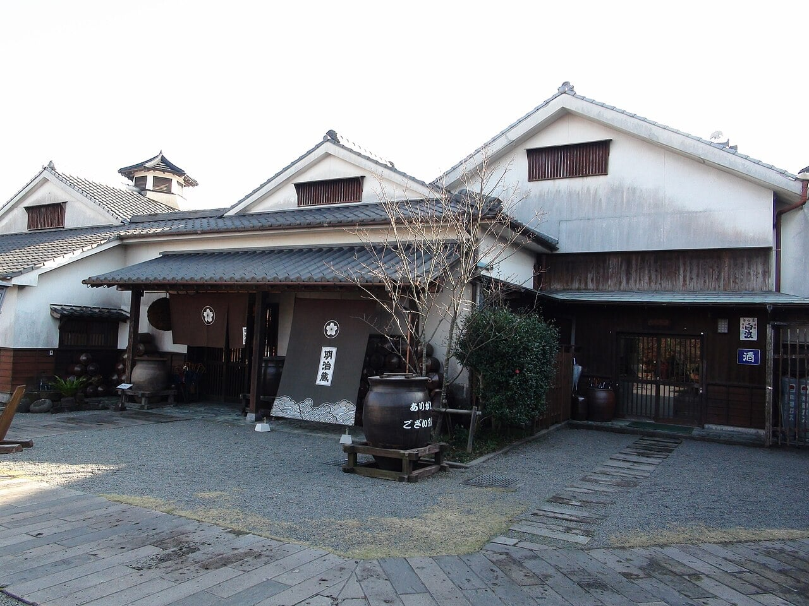

# 鹿儿岛烧酒路线

鹿儿岛烧酒路线把两座性质不同的烧酒设施放在同一趟自驾里：枕崎的花渡川蒸馏所明治藏，是仍靠甕与人力运转的老藏；都城市志比田町的雾岛工厂花园，是设计过的步行工厂与观光园区。两站都用甘薯，却分别展示“单式蒸馏的传统工序”与“规模化生产的体验化表达”。一条线走完，能把芋烧酒的原料、曲、蒸馏与度数一次讲清楚。

图：枕崎花渡川蒸馏所的明治藏，入口悬挂“明治藏”招牌，庭院里放着陶制酒瓮。图片：Sakaori，CC BY 3.0，via [原图页面](https://commons.wikimedia.org/wiki/File:Satsuma_Shuzo's_Kedogawa_Shochu_factory_and_museum,_Meijigura.JPG)。

## 路线概览

- 第一站：[明治藏](ref:meijigura)，枕崎市立神本町 26 号；9:00–16:00，免费入馆，12 月 30 日至 1 月 3 日休馆。
- 第二站：[雾岛工厂花园](ref:kirishima)，宫崎县都城市志比田町 5480 番地；见学每天五个场次，约 45 分钟。
- 方式：自驾。两站之间隔着南萨摩与雾岛山麓，车程两小时上下，按导航与当日路况调整。
- 建议时长：一天。上午明治藏，午后雾岛；若想把鹿儿岛市或指宿也加进来，至少留两天。
- 先确认：见学场次与临时休业以官网为准，出发前打电话最稳。

## 芋烧酒的地理：萨摩半岛与雾岛山麓

芋烧酒的“芋”是甘薯，不是马铃薯。鹿儿岛县南部与宫崎县南部是[日本](ref:japan)的主要产区，枕崎在萨摩半岛最南端，海风大、湿度高；都城在雾岛山系西侧的内陆盆地，水与田野的条件不同。两个地方相距不远，却代表了两种生产尺度：一边是港口边的小藏，一边是占地广阔的工厂花园。

这条线不适合“打卡式”赶场。从鹿儿岛中央站到枕崎约一小时，从枕崎到都城还要一个多小时，返程若回鹿儿岛市又要再开一段。合理的安排是前一晚住鹿儿岛市或枕崎，早上先到明治藏，午后沿南萨纵贯道北上，傍晚到雾岛工厂花园，最后住都城或直接回鹿儿岛机场。全程自驾，乡间道路夜间照明少，不要把最后一场排到天黑之后。

## 第一站：明治藏

明治藏是萨摩酒造的花渡川蒸馏所，地址在枕崎市立神本町 26 号。它保留了明治时代延续下来的藏屋与手艺，今天仍由杜氏与藏人按传统工序酿造本格烧酒；参观者可以近距离看到制曲、发酵与蒸馏，而不只是隔着玻璃看展板。开馆 9:00–16:00，入馆免费，12 月 30 日至 1 月 3 日休馆；馆内商店卖 25 度的白波、黑白波与 37 度原酒。

这里的看点不是“老”，而是“还在用”。甕壺仕込、木桶、蒸笼与单式蒸馏器按实际工序摆放，部分区域因安全与卫生限制不能久留；试饮空间可以比较白曲与黑曲的差别。先看白波，再看黑白波，同样 25 度，前者清爽、后者浓厚，差别来自曲种与发酵管理，而不是原料产地。若开车，全程不试饮。

## 第二站：雾岛工厂花园

第二站是雾岛酒造的“烧酎之里 雾岛工厂花园”，地址在宫崎县都城市志比田町 5480 番地。它不是雾岛酒造本社，也不是鹿儿岛县雾岛市的行政区内；从本社向西约十分钟车程，与国道 10 号沿线的 KIRISHIMA GREENSHIP icoia 也相隔约五分钟车程，导航要直接输入设施名。园区把步行工厂、博物馆、餐厅、面包房与商店放在一起，适合家庭与团体。

KIRISHIMA WALK FACTORY 每天五个场次：10:00、11:00、13:30、14:30、15:30，约 45 分钟，需提前电话预约。动线用“看、听、香、味、触”组织，从甘薯与制曲讲到蒸芋、发酵与蒸馏；试饮免费，也能试吃甘薯、试饮雾岛裂罅水。与明治藏的“藏屋尺度”相比，这里更像一座产业公园，信息密度高、节奏快，适合放在一天的后半段。

## 白曲与黑曲：两条发酵路线

鹿儿岛烧酒的曲分白曲与黑曲。白曲源自鹿儿岛，柠檬酸生成能力强，能在酸性环境中抑制杂菌，发酵稳定，成品香气较轻、入口干净；黑曲更早从冲绳泡盛系统传来，酶系与酸度不同，酿出的酒更厚、更带泥土与浓郁香气。明治藏的白波与黑白波，正好把两条曲路并排放在同一货架上；雾岛的主力产品则多以白曲为主，走清爽、适合兑热水与加冰的路线。

曲的选择会一路影响后面的工序：酸度高，发酵更安全，但也会改变香气走向；曲种不同，蒸芋与二次仕込的比例、温度与时间都要调整。所谓“鹿儿岛风味”不是单一味道，而是甘薯、曲、水与蒸馏方式共同作用的结果。把两家酒造的酒并排喝，比背产区标签更容易理解这一点。

## 常压与减压蒸馏

本格烧酒采用单式[蒸馏](ref:distillation)，常见设备是[壶式蒸馏器](ref:potstill)，与连续式蒸馏的甲类烧酒不同。单式蒸馏保留更多原料香气与微量成分；常压蒸馏在接近沸点的条件下进行，得到的酒更厚、更带甘薯与谷物气息；减压蒸馏在较低温度下进行，杂味与刺激感更少，成品更清爽。酒造可以按产品定位选择压力与切酒点，同一原料也能做出不同风格。

[日本烧酒](ref:shochu)的分类里，甲类与乙类不是“好与坏”，而是设备与目的不同：连续式蒸馏追求效率与纯净，单式蒸馏追求原料个性。芋烧酒的主体是后者，所以香气更贴近甘薯本身。参观时若看到蒸馏器与冷却槽，注意酒液被分成酒头、酒心与酒尾，切酒点决定成品是更香还是更干净。

## 25 度、20 度与甕贮藏

日本酒税法对烧酒的课税以 20 度为基准：每千升 200,000 日元，酒精分超过 20 度后每增加 1 度加算 10,000 日元。25 度是本格烧酒长期沿用的标准装瓶度数，也是多数酒藏的主力规格；20 度则贴着课税基准，酒体更轻、更适合佐餐。两档之间的价差不只来自原料与工时，也来自这条按度累加的税则。买酒时看度数，比看“原酒”二字更能判断税负与风格。

甕贮藏是另一条共同线索。陶甕透气、导热慢，温度变化比不锈钢罐温和，酒液在甕中完成发酵与初步熟成；微氧交换削弱新酒的尖锐感，也让甘薯的甜香更圆。但贮藏不是越久越好，香气会从新鲜转向熟成，太长则失去芋烧酒最讨喜的那一面。明治藏与雾岛工厂花园都能看到甕或贮酒设施，一个强调传统，一个强调体验，指向的是同一种“时间成本”。

## 自驾与预约

两站之间没有方便的铁路组合：枕崎有 JR 指宿枕崎线，但从枕崎到都城要换车、绕行，时间不可控；自驾或包车最稳。从鹿儿岛机场到枕崎约一百分种，从枕崎到都城一个多小时，从都城回鹿儿岛机场也要一个多小时，行程要按“三角形”而不是“直线”来排。乡间道路夜间照明少，天黑后不要赶路。

明治藏入馆免费，但团体与见学最好提前电话确认；雾岛工厂花园的见学要提前电话预约，电话 0986-21-8111，接听 9:00–17:00。预约时确认场次、集合地点、是否含试饮与所需时间；遇到台风季或临时检修，以官网公告为准。开车的人全程不试饮，把样品交给同行者，或干脆把试饮留到住宿地。

相关条目：[萨摩酒造明治藏](ref:meijigura)、[雾岛酒造雾岛工厂花园](ref:kirishima)。

## 参考资料

- [花渡川蒸溜所 明治蔵](https://www.meijigura.com/)，萨摩酒造，核验地址、开馆时间、免费入馆与产品度数。
- [アクセス](https://www.kirishima-fg.jp/access/)，雾岛工厂花园，核验都城市志比田町地址与周边距离。
- [営業時間・お問い合わせ](https://www.kirishima-fg.jp/contact/)，雾岛工厂花园，核验五个见学场次与设施时间。
- [焼酎王国！](https://www.kagoshima-kankou.com/gourmet/shochu/siru)，鹿儿岛县观光联盟，核验甘薯原料与产区背景。
- [酒税率一覧表](https://www.nta.go.jp/taxes/sake/shiori-gaikyo/shiori/2026/pdf/05_01.pdf)，国税厅，核验烧酒以 20 度为基准的课税结构。

页面核验日期 2026-11-09；开馆时间、见学场次与营业安排以官方渠道为准。
