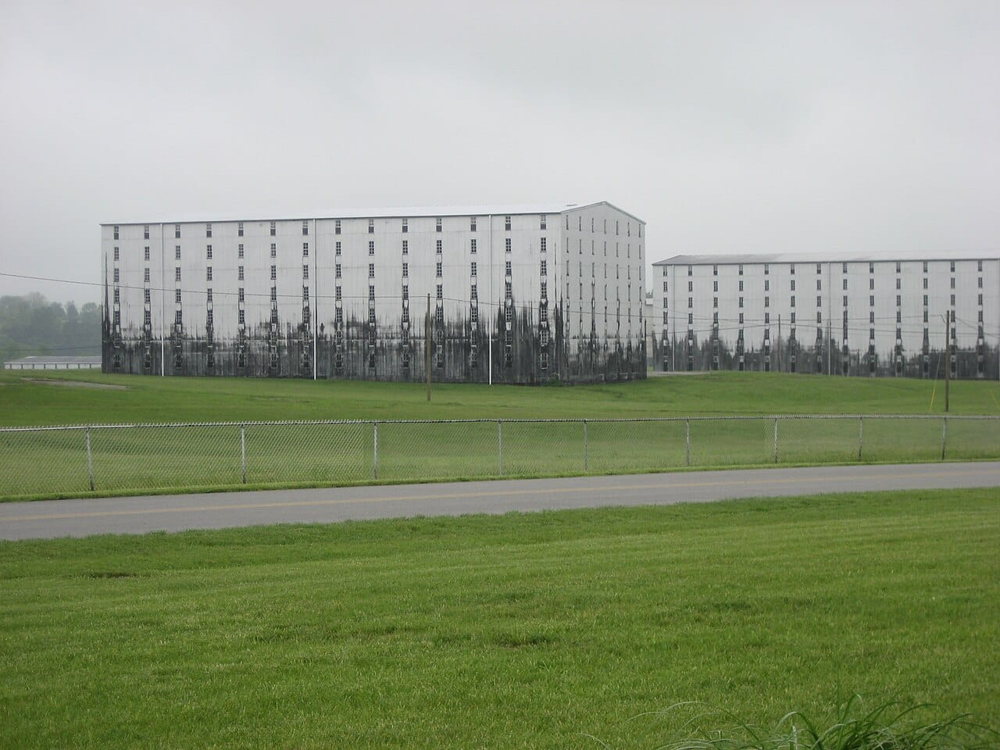
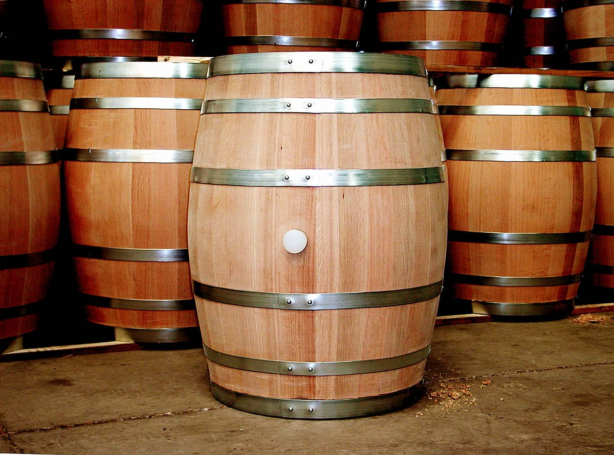

# 肯塔基波本路线：法兰克福、巴兹敦与洛雷托的三座厂区

肯塔基波本路线不是一条法定界线。“Kentucky Bourbon Trail”是肯塔基蒸馏者协会的推广项目，成员酒厂散布在全州；决定一条线好不好走的，是厂区距离、预约时段和谁来开车。这一条只取三家：法兰克福的水牛足迹、巴兹敦的天堂山、洛雷托的美格，三站构成一个三角。

图：肯塔基波本路线：法兰克福、巴兹敦与洛雷托的三座厂区所经地区的一处实景。摄影：Heaven Hill distillery, Bardstown, Kentucky。署名：Shadle，CC BY-SA 3.0，来自 Wikimedia Commons（[来源](https://commons.wikimedia.org/w/index.php?curid=4136725)）。这张照片用于说明肯塔基波本路线：法兰克福、巴兹敦与洛雷托的三座厂区所经过的产区或城市环境，不标定其具体停靠点。

## 路线概览

- 第一站：[水牛足迹](ref:buffalo-trace)，113 Great Buffalo Trace, Frankfort, KY 40601；从路易斯维尔沿 I-64 约一小时。
- 第二站：[天堂山](ref:heaven-hill)，1311 Gilkey Run Rd, Bardstown, KY 40004；从法兰克福约一小时。地址是体验中心，蒸馏在别处。
- 第三站：[美格](ref:makers-mark)，3350 Burks Spring Rd, Loretto, KY 40037；从巴兹敦约半小时，最后一段是丘陵乡村路。
- 方式：自驾或包车。三站之间公共交通基本不可用，洛雷托的叫车服务尤其不可靠。
- 建议时长：两天最稳；一天只能保住两场导览加一段回程。

## 为什么是这三家

美国法规对波本的要求很具体：醪液里玉米至少 51%，在新烧焦的橡木桶中熟成，装瓶酒精度不低于 40%；标为 straight 的酒还要至少陈放两年。规则对三家企业完全一样，答案却不同。水牛足迹属于 Sazerac，同一厂区里跑着黑麦配方、小麦配方与黑麦威士忌，用多品牌与实验仓库消化产能；天堂山是家族企业，用多个品牌覆盖不同配方，并把保税装瓶做成产品线；美格只做一条主线，用红冬小麦替掉黑麦，把农场、转桶与蘸蜡变成参观点。

比较的不是“谁更好喝”，而是规模差异：大厂展示连续蒸馏与实验仓库，家族企业展示配方矩阵，农场展示原料与能源。

## 第一站：水牛足迹

第一站放在法兰克福，因为它最适合建立时间轴。厂址从 1775 年的 Leestown 聚落算起，1870 年 E.H. Taylor Jr. 买下酒厂并扩为 O.F.C.，1883 年的糖化与发酵翼楼、1885 年的 Warehouse C 至今还在用。1999 年改名 Buffalo Trace，2013 年列为国家历史地标，同年建起实验性的 Warehouse X。参观时会同时经过石墙、红砖与不锈钢，这种不整齐本身就是内容。

Trace Tour 约 75 分钟，全程无障碍，适合第一次来；Old Taylor Tour 同样 75 分钟，围绕旧宅与 Warehouse C；Hard Hat Tour 105 分钟，进生产区看糖化锅、微型蒸馏器与 Dryhouse。导览、品鉴与停车都免费，名额最多提前八周开放，每周三上午十点（东部时间）再放一周。旺季抢不到是常态，先定日期，再排另外两家。

喝什么：Buffalo Trace 是基准，焦糖、香草、橡木与一点柑橘皮；Eagle Rare 10 年更干、更偏香料；Blanton's 以单桶装瓶，桶间差异明显；W.L. Weller 走小麦配方，口感更圆。用基准款与 Eagle Rare 对比年份，再用 Weller 体会“黑麦换小麦”的质地变化。品鉴受牌照限制，每人每天最多 1¾ 盎司，开车的人应当直接跳过。

## 第二站：天堂山

第二站往南到巴兹敦。天堂山 1935 年由 Shapira 五兄弟与本地投资人创立，最初只有 12 名员工；它从一开始就走多品牌路线，黑麦波本、小麦波本、玉米威士忌与黑麦威士忌共用一套仓库与装瓶体系。1996 年 11 月 7 日的大火烧毁了原蒸馏厂与七座仓库，约 100,000 桶酒受损，蒸馏随后转到路易斯维尔的 Bernheim；2025 年，Springs 新厂让生产回到巴兹敦。

所有导览从体验中心集合，再乘接驳车去两英里外的 Springs，访客不能自行进入生产区。这是最容易忽略的一点：地址写的是体验中心，不是蒸馏车间。Magic of the Mashbill 约 45 分钟，用五款不同配方的酒建立对照；You Do Bourbon 约一小时，包含调配、装瓶与贴标。

天堂山也是理解 Bottled-in-Bond 的好地方。1897 年的《保税装瓶法》要求同一蒸馏季、同一酒厂、在保税仓库至少陈放四年、以 100 proof 装瓶，不得混入其他酒液。这条规则原本服务于质量与税收透明，今天则是一类风格标签。喝什么：Evan Williams 是日常主力，Elijah Craig 偏橡木与焦糖，Larceny 走小麦配方，Rittenhouse 与 Pikesville 是黑麦。

## 第三站：美格

第三站往西南到洛雷托。美格 1952 年由 Bill Samuels Sr. 在 Star Hill Farm 创办；1953 年他烧掉家族旧配方，改用红冬小麦替代黑麦；Margie Samuels 设计了瓶身、标签与红蜡；1958 年第一瓶手工蘸蜡的酒上市；1980 年酒厂以 Burks' Distillery 之名列为国家历史地标。它的叙事不是“更老”，而是“更窄”：一条主线，把配方、农场与手工动作做到可辨认。

厂区值得看的是几个动作：仓库里人工定期转桶；每瓶酒在厂内手工蘸红蜡；仓库用太阳能供电；酒糟喂牲畜，粪便回到田里。经典导览约 1 小时 15 分钟，走完历史、糖化、发酵、蒸馏与仓库，最后品鉴。到场提前 15 分钟，带证件，目前以刷卡为主、不收现金；必须穿闭趾鞋。停车场免费，但 Uber 与 Lyft 在洛雷托不可靠，回程要提前安排。

喝什么：经典款是纯小麦配方，玉米给甜味，红冬小麦给柔软口感，没有黑麦的胡椒感；Maker's 46 在熟成后加法国橡木条，香草、焦糖与香料更明显；Cask Strength 保留原桶强度；Private Select 由顾客选择十根不同烘烤程度的橡木条。

## 车程、预约与指定司机

法兰克福到巴兹敦约一小时，巴兹敦到洛雷托约半小时，洛雷托回法兰克福一个多小时；乡村道路夜间没有路灯，不要把最后一场排到天黑之后。大型车进入美格时要注意 Maker's Mark Road 的窄弯。

三站都要预约，规则不同。水牛足迹免费但名额紧，按周放号；天堂山按场次售票，体验中心与生产区分离；美格在官网预约，旺季与周末很快满员。预约时确认时长、是否含品鉴、年龄限制、集合地点与取消政策。

最重要的一条是饮酒后不开车。一杯就可能影响判断，乡村道路容错更低。最稳妥的安排是包车、指定司机，或参加含接送的行程。若自己开车，品鉴时全部吐掉，或把样品交给同行者。

## 季节、住宿与延伸

旺季在五月到九月，日照长，但肯塔基的夏天湿热，仓库与厂房里更闷；春季与秋季最舒服，也是酒厂活动集中的时段。巴兹敦每年九月有波本主题节庆，日期与票务以官方日历为准，那几天住宿与导览都紧张。

住宿可以放在巴兹敦、路易斯维尔或列克星敦：巴兹敦离天堂山最近，后两地餐饮与航班选择更多。只有一天时，建议保留水牛足迹与美格，把天堂山留到次日；或改走 Woodford Reserve、Four Roses 与 Wild Turkey。

## 另见

- [水牛足迹](ref:buffalo-trace)：1775 年以来的厂址、1870 年的 O.F.C.、1999 年改名与实验仓库。
- [天堂山](ref:heaven-hill)：1935 年创立、1996 年大火、2025 年 Springs 新厂与保税装瓶。
- [美格](ref:makers-mark)：1952 年建厂、红冬小麦、手工转桶与 1980 年国家历史地标。
- 想补背景，可在内容仓中查阅肯塔基产区、波本风格与橡木桶陈年条目。

对照阅读：[水牛足迹酒厂](ref:buffalo-trace)、[美格酒厂](ref:makers-mark)。

肯塔基三座厂区之间以自驾最方便，酒厂参观需提前订票；开放时间、场次与路线以各酒厂官网为准。核验于 2026-11-08。

## 相关图像

图：天使分享（angel's share）。图片：Gerard Prins，CC BY-SA 3.0，via Wikimedia Commons（[原图页面](https://commons.wikimedia.org/wiki/File:Oak-wine-barrel-at-toneleria-nacional-chile.jpg)）。关联图像：肯塔基波本路线：法兰克福、巴兹敦与洛雷托的三座厂区。

图：水牛足迹酒厂。图片：Kittugwiki，CC BY-SA 3.0，via Wikimedia Commons（[原图页面](https://commons.wikimedia.org/wiki/File:Buffalo_Trace_Tower.jpg)）。关联图像：肯塔基波本路线：法兰克福、巴兹敦与洛雷托的三座厂区。
