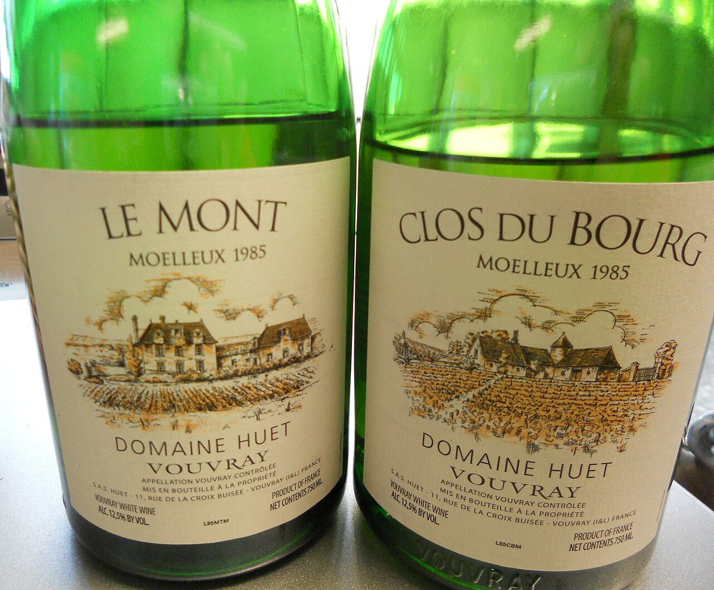
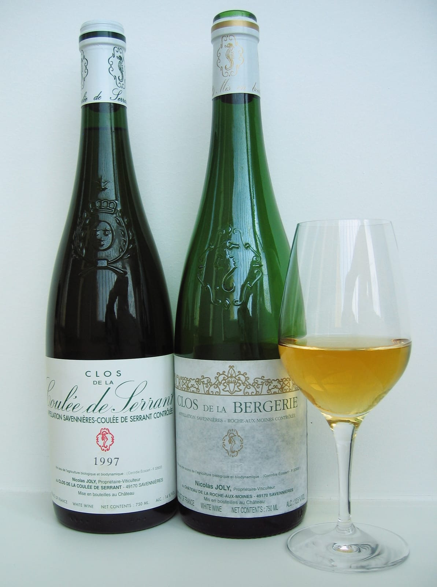

# 卢瓦尔白诗南路线：武弗雷与萨韦尼耶尔

白诗南（Chenin Blanc）在卢瓦尔河中段有两种完全不同的性格：武弗雷（Vouvray）把它做成从干型到贵腐、从静止到起泡的全套；萨韦尼耶尔（Savennières）则把它收进更窄的干型与陈年框架。这条两站路线从武弗雷的休埃酒庄出发，沿河南下到萨韦尼耶尔的塞朗河畔坡地，用同一品种的两种极端，解释[白诗南](ref:chenin)为什么难写、也为什么值得专门跑一趟。

图：卢瓦尔白诗南路线：武弗雷与萨韦尼耶尔所在的卢瓦尔河谷风貌配图。图片：Wikimedia Commons contributor，CC BY-SA 3.0，via Wikimedia Commons（[原图页面](https://commons.wikimedia.org/wiki/File:Azay_le_rideau.jpg)）。这张照片用于说明产区环境与访问语境，不标定卢瓦尔白诗南路线：武弗雷与萨韦尼耶尔的门店、酒庄或活动现场。

## 白诗南的多面性：干型、半干、贵腐与起泡

白诗南的高酸是它的底盘，也是它多面性的来源。同一块地可以在采收早期做出干型、清脆的静止酒，也可以在秋季等待贵腐菌，做出蜂蜜与杏干的甜酒；如果提前采收并保留酸度，还能按传统法做成[起泡酒](ref:sparkling)。在武弗雷，这些不是“不同产品线”，而是同一品种在不同年份、不同地块与不同采收时点的自然结果。

多面性也带来读标的困难。Vouvray 的 sec、demi-sec、moelleux、liquoreux 与 pétillant 各自对应不同的残糖与工艺，酒标上不一定写全；同一酒庄的“Vouvray”可能是干型，也可能是半干。最稳妥的办法是看背标残糖或直接问酒庄，而不是凭酒庄名推断。白诗南的酸度会把甜感压低，喝起来往往比糖度数字更“干”。

## 第一站：武弗雷的休埃与三块地

第一站是[休埃酒庄](ref:huet)，在武弗雷。酒庄由 Victor Huet 与儿子 Gaston 于 1928 年创立，今天约有 30 公顷白诗南，分成三块核心地：Haut-Lieu、Le Mont 与 Clos du Bourg。Haut-Lieu 是历史地块，土壤为棕色黏土，酒偏果味与清新；Le Mont 在 1957 年加入，燧石与绿黏土给酒更锋利的矿物感；Clos du Bourg 于 1953 年购入，薄层黏土与石灰岩、凝灰岩底土给酒密度与陈年能力。

三块地是理解休埃的钥匙：同一品种、同一村庄、不同土壤，风格差异却清晰。酒庄从 1988 年起转向生物动力法，官方叙述强调“让葡萄在自然环境中找到平衡”。这里的酒单覆盖干型、半干、甜型与起泡，年份差异很大；到访时不要只点一款，至少把三块地的干型放在一起对比。

## 第二站：萨韦尼耶尔的塞朗河畔坡地

第二站是[塞朗河畔坡地](ref:coulee)，在萨韦尼耶尔。它只有 7 公顷，却是一个独立的 AOC——Coulée de Serrant，由乔利（Joly）家族独占。葡萄园由西多会修士于 1130 年种植，现存的葡萄藤多为 35 至 80 年；坡地直接俯视卢瓦尔河，坡度陡，部分作业只能靠人工与马匹完成。这样的地块在卢瓦尔并不多见，也解释了它为什么能独立成一个产区。

1984 年起，整个庄园转向生物动力法，Nicolas Joly 是法国这一运动最知名的推动者之一。酒庄生产三款酒：Coulée de Serrant（AOC Coulée de Serrant）、Clos de la Bergerie（AOC Savennières-Roche aux Moines）与 Les Vieux Clos（AOC Savennières）。三款都来自相邻坡地，却因土壤与坡度不同而分工；把三款放在一起，能看出“同一庄园内部”的法定边界如何塑造风格。

## Vouvray 与 Savennières 的法定差异

两个产区的共同点是白诗南与高酸，差异在法定框架。Vouvray 允许干型、半干、甜型与起泡，甜度与采收季的关系更灵活；Savennières 以干型为主，强调陈年后的蜂蜜、坚果与湿石感，甜型不是主流。Savennières 还有 Roche aux Moines 与 La Roche aux Moines 等细分地块，Coulée de Serrant 则是单独命名的 AOC。

法规之外还有风格差异：武弗雷的坡地多为黏土与石灰岩，酒体更圆，适合早饮或中等陈年；萨韦尼耶尔的坡地更陡、更靠近河，酒更紧、更咸，需要时间打开。INAO 的 AOC 边界决定了酒标能写什么，酒庄的选择决定了酒实际长什么样；两者要分开看。

还要注意，甜度标签在武弗雷并不总是写在正面：同一款“Vouvray”在不同年份可能从干型变成半干，酒庄有权按当年条件调整。购买时看背标或直接问残糖克数，比记住某个酒名更可靠。萨韦尼耶尔则相反，干型是默认，遇到甜型要特别确认，因为它往往是特定年份或特定地块的例外。

## 生物动力法在两座酒庄的实践

两座酒庄都把生物动力法当作核心，但路径不同。休埃从 1988 年开始，强调葡萄园内的生态平衡与长期观察，三块地的管理按各自土壤调整；塞朗河畔坡地从 1984 年开始，更强调制剂、星象与整个庄园的一致性，Nicolas Joly 的著作与演讲让这里成为生物动力法的标志性地点之一。

生物动力法不是“更好喝”的保证，它改变的是耕作与决策方式：更少的化学投入、更细的物候观察、更依赖人工。访客不必把它当成神秘学，也不必把它当成营销词；看酒园里的植被、土壤与葡萄状态，比看标签上的认证更能说明问题。

## 沿卢瓦尔河的车程与预约

武弗雷到萨韦尼耶尔约一小时车程，沿卢瓦尔河与 D952 行驶，途中可以停在昂热（Angers）休息。休埃的官方页面以酒庄介绍与销售为主，参观与品鉴需先通过邮箱确认；塞朗河畔坡地的官方页面写明品鉴开放时间为周一至周六 09:00–12:00、14:00–17:30，无需预约。具体时段仍可能调整，出发前应再查一次官网。

两家都不适合“顺路进去看看”的心态：休埃按预约接待，塞朗河畔坡地虽可直接到访，但品鉴台可能同时接待多组客人。开车的人应吐酒，卢瓦尔河两岸的乡道在傍晚视线不佳。若只有一天，上午休埃、下午塞朗河畔坡地，回程避开晚高峰。

## 另见

- [休埃酒庄](ref:huet)：1928 年创立、三块地与 1988 年起的生物动力法。
- [塞朗河畔坡地](ref:coulee)：7 公顷独占 AOC、1130 年种植与 1984 年起的生物动力法。
- 背景可读[卢瓦尔产区](ref:loire)、[白诗南](ref:chenin)与[起泡酒](ref:sparkling)。

卢瓦尔白诗南路线串联武弗雷与萨韦尼耶尔，酒庄预约、品鉴价格与开放时间以各官网为准；乡村交通以实时地图为准。核验于 2026-11-09。

**关键事实。**

| 项目 | 内容 |
| --- | --- |
| 一句话定位 | 从武弗雷的休埃酒庄到萨韦尼耶尔的塞朗河畔坡地，两站沿卢瓦尔河中段展开；这条路线用白诗南的干型、半干、贵腐与起泡多面性，以及两座酒庄的生物动力法实践，串起 Vouvray 与 Savennières 两种截然不同的白诗南表达 |
| 站数 | 2 |
| 交通 | 自驾 |
| 停靠顺序 | 休埃酒庄、塞朗河畔坡地酒庄 |

## 相关图像

图：休埃酒庄。图片：jamesonf，CC BY 2.0，via Wikimedia Commons（[原图页面](https://commons.wikimedia.org/wiki/File:Vouvray_AOC_moelleux_Domaine_Huet_1985.jpg)）。关联图像：卢瓦尔白诗南路线：武弗雷与萨韦尼耶尔。

图：塞朗河畔坡地酒庄相关实景照片。图片：Tomas er，CC BY-SA 3.0，via Wikimedia Commons（[原图页面](https://commons.wikimedia.org/wiki/File:Coul%C3%A9e_de_Serrant_and_Clos_de_la_Bergerie.jpg)）。关联图像：卢瓦尔白诗南路线：武弗雷与萨韦尼耶尔。
