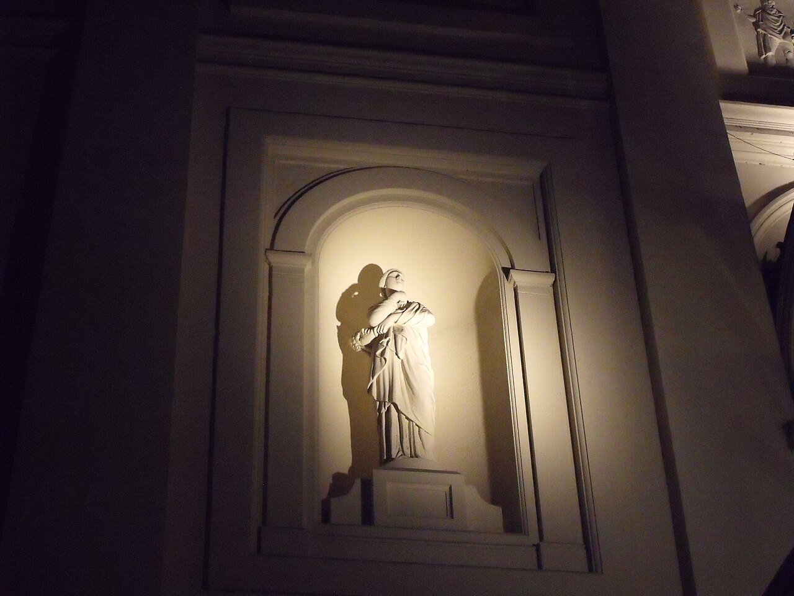

# 伦敦经典酒吧步行路线

这条路线把伦敦的四间“喝一杯”的地方排成一个傍晚到夜间的顺序：先从萨沃伊酒店的美式酒吧开始，再到梅费尔的康诺特酒吧，随后走进圣詹姆斯的杜克斯酒吧，最后以舰队街的柴郡奶酪酒馆收尾。前三站都是酒店酒吧，各自代表一种不同的待客方式；最后一站是仍在营业的历史酒馆。把它们放在同一条线里，看的不是“哪杯最好喝”，而是伦敦如何用空间、礼仪与酒单来区分不同的喝酒场合。

图：伦敦经典酒吧步行路线。摄影：Royal Opera House - Bow Street, London - statue (6446853425)。署名：Elliott Brown from Birmingham, United Kingdom，CC BY 2.0，来自 Wikimedia Commons（[来源](https://commons.wikimedia.org/w/index.php?curid=22459244)）。

> **先给结论**
> **一句话：** 这页判断伦敦经典酒吧步行路线怎么排、走多久、哪些点不能省。
>
> - **适合谁：** 想把伦敦经典酒吧步行路线排成一日或两日行程、需要知道顺序与停留重点的人。
> - **不适合谁：** 只想看单个地点、不打算按路线走的人。
> - **先看这两点：**
>   - - 第一站：萨沃伊美式酒吧，地址 The Savoy, Strand, London WC2R 0EZ，1893 年开业，位于酒店底层。
>   - 三间酒店酒吧的差别，不在于价格高低，而在于它们各自把“仪式”放在什么位置。

> **决策清单**
> 买之前、去之前，按这三步过一遍。
>
> - **路线概览：** 第一站：萨沃伊美式酒吧，地址 The Savoy, Strand, London WC2R 0EZ，1893 年开业，位于酒店底层。
> - **顺序与交通：** 建议按“美式酒吧 → 康诺特 → 杜克斯 → 柴郡奶酪”的顺序走，原因是营业时间与节奏：美式酒吧中午就开门，康诺特要到 16:00 才开门，杜克斯 15:00 开门、22:00。
> - **为什么是这几站：** 三间酒店酒吧的差别，不在于价格高低，而在于它们各自把“仪式”放在什么位置。

> **专题导航：伦敦经典酒吧与一杯鸡尾酒**
> - [伦敦经典酒吧步行路线](https://atlas.hejiu.org/routes/london-classic-bar-walk/)
> - [萨沃伊美式酒吧](https://atlas.hejiu.org/places/american-bar-savoy/)
> - [《萨伏伊鸡尾酒书》](https://culture.hejiu.org/books/savoy-cocktail-book/)
> - [伦敦干金](https://beverages.hejiu.org/styles/london-dry-gin/)
> - [伦敦金酒路线](https://atlas.hejiu.org/routes/london-gin-route/)
> - [调酒基础](https://hejiu.org/guides/cocktail-basics/)
> - [干马天尼配方](https://hejiu.org/recipes/dry-martini/)

## 路线概览

- 第一站：[萨沃伊美式酒吧](ref:american-bar)，地址 The Savoy, Strand, London WC2R 0EZ，1893 年开业，位于酒店底层。
- 第二站：[康诺特酒吧](ref:connaught)，地址 The Connaught, Carlos Place, London W1K 2AL，2008 年开业，位于梅费尔。
- 第三站：[杜克斯酒吧](ref:dukes)，地址 35 St James's Place, London SW1A 1NY，官方以 1908 年为其历史起点。
- 第四站：[柴郡奶酪酒馆](ref:cheshire)，地址 145 Fleet St, London EC4A 2BU，现建筑在 1666 年大火后于 1667 年重建。
- 方式：步行与短程出租车混合。第二站到第三站可以步行，第一站到第二站、第三站到第四站视体力与时间选择步行或打车。
- 建议时长：五到六小时，从下午晚些时候开始，到夜间结束。

## 为什么是这几站

三间酒店酒吧的差别，不在于价格高低，而在于它们各自把“仪式”放在什么位置。美式酒吧的仪式是历史与配方：它从 1893 年一直经营到现在，菜单把经典鸡尾酒、以酒店住客与员工命名的特调、以及陈年烈酒放在一起。康诺特酒吧的仪式是设计和服务：2008 年开业，空间由 David Collins Studio 完成，核心动作是调酒师把马天尼手推车推到桌边，让客人先选基酒与苦精。杜克斯酒吧的仪式被压缩到一杯酒：冷冻的杯子、冷冻的酒、不加冰，服务生在你面前把酒倒进杯里。

第四站的意义在于把这套“酒店式”的节奏打断。柴郡奶酪酒馆不是酒店空间，它没有带位、没有桌边服务，也不卖精心编排的鸡尾酒；客人到吧台点单，自己端回座位，喝的是 Samuel Smith's 的桶装艾尔。把前三站与它放在一起，路线就有了对照：一边是被设计过的安静与正式，一边是历史建筑里嘈杂、直接、按酒馆方式运转的日常。

这四站也共享一个地理逻辑：前三站都在伦敦西区与圣詹姆斯一带，彼此距离不远；第四站向东到舰队街，刚好把“西区的夜晚”接到“老城边缘的收尾”。这不是一条按地铁站排列的路线，而是一条按喝酒节奏排列的路线。

## 第一站：萨沃伊美式酒吧

为什么去：它是这条路线里历史叙事最重的一站。酒吧 1893 年随萨沃伊酒店开门，20 世纪初由艾达·科尔曼（Ada Coleman）担任首席调酒师，Hanky Panky 的名字与她的配方一起留下来；接替她的哈里·克拉多克在 1930 年出版《萨沃伊鸡尾酒书》，把大量配方固定成文本。坐在这里，喝的不只是酒，也是伦敦鸡尾酒史的一段被持续维护的传统。

点什么：第一次来最稳的是“一杯经典加一杯当季特调”。先点 Hanky Panky 或 White Lady，确认温度、稀释与装饰的基本功；再请调酒师按口味推荐一杯自家创作。不要一次点很多杯，这里的酒体与糖分都实在，节奏放慢才喝得出区别。若坐吧台，可以看摇酒与滤冰；想聊天就选桌位，吧台位少，晚餐后尤其紧张。

停留多久：六十到九十分钟足够。拍照、看菜单、喝两杯，再留一点时间给酒店大堂与河岸方向的街道。

实用提醒：地址是 The Savoy, Strand, London WC2R 0EZ。最近的地铁站是 Charing Cross、Embankment 与 Temple；从 Embankment 上来沿泰晤士河走到 Savoy Court 约几分钟。官方页面在 2026 年 11 月标注的营业时间为周一至周六 12:00–24:00、周日 12:00–22:00，年龄限制 16 岁以上，着装要求是“优雅得体”，运动服与球衣可能被拒绝。热门时段建议通过酒店官方渠道提前几天预订。

## 第二站：康诺特酒吧

为什么去：它代表伦敦“新一代酒店酒吧”的做法。康诺特酒店在梅费尔的卡洛斯广场，酒吧 2008 年随酒店整修开业，空间由 David Collins Studio 设计，官方说法是融合 1920 年代英国与爱尔兰立体主义艺术。它没有百年老店的叙事，而是把设计、服务与调酒师风格放在同一个房间里；2026 年的 The 50 榜单把它列在第 8 位，说明它长期留在讨论之中。

点什么：核心是手推车马天尼。先选金酒或伏特加，再从几款自制苦精里挑一支，常见方向有佛手柑与人参、零陵香豆、薰衣草、芫荽籽和小豆蔻。调酒师在桌边把酒液从搅拌杯“抛”进马天尼杯，最后表达一片柠檬皮。第二杯可以选“Masterpieces”一栏里的自家作品，或问当季的低酒精与长饮选项。配酒的 canapés 分量不大，适合两人分食。

停留多久：七十五到九十分钟。手推车服务需要时间，点单与制作都不快；如果同行者不喝烈酒，这一站可以缩短，把时间留给下一站。

实用提醒：地址是 The Connaught, Carlos Place, London W1K 2AL。最近的地铁站是 Bond Street 与 Green Park，步行约五到八分钟。官方页面列出的营业时间是周一至周六 16:00–01:00，周日休息；不接受预订，全部现场入座。价格属于伦敦高端酒店酒吧的最高一档，个别陈年鸡尾酒标价很高；点单前问清价格与分量，不要默认每一杯都在同一价位。官方页面没有列出硬性着装要求，按酒店酒吧惯例穿 smart casual 到 elegant 更稳妥。

## 第三站：杜克斯酒吧

为什么去：它把“只做一件事”做成了招牌。杜克斯酒吧在圣詹姆斯广场附近的杜克斯酒店内，官方把历史写作“自 1908 年起坐落于圣詹姆斯”。房间小，座位以扶手椅和沙发为主，地毯、深色扶手椅与墙上的肖像画构成接近私人俱乐部的气氛。伊恩·弗莱明与“shaken, not stirred”的关联属于店方与媒体反复讲述的传说，官方措辞也把它放在“legend has it”的层面；把它当文化背景就好，不必当成操作说明。

点什么：一杯 Dukes Martini 就够了。先选金酒或伏特加，再告诉服务生要柠檬皮还是橄榄；如果对苦艾酒敏感，可以直接说“very dry”或“just a rinse”。做法是把酒连瓶放在冷冻室，杯子也预先冷冻，倒酒时不加冰、不加水，因此没有常规摇酒带来的稀释。酒劲很足，入口比常温马天尼更紧、更烈，慢慢喝，不要急着追加第二杯。两个人可以分别点金酒与伏特加，交换一口比较差别。

停留多久：六十到七十五分钟。这里不适合大声聚会，也不以快速出杯为目标；坐下、喝一杯、说几句话，就是它的正常节奏。

实用提醒：地址是 35 St James's Place, London SW1A 1NY。最近的地铁站是 Green Park，步行约五到七分钟；从 Piccadilly Circus 走过来约八到十分钟。官方页面列出的营业时间是周一至周六 15:00–22:00，最后点单 22:00，22:30 关门；周日未列出营业时段。酒吧只接受 walk-in，繁忙时段可能需要在门口等位。着装要求是 smart casual：运动装、短裤与 T 恤不允许，短袖有领衬衫是例外；客人须年满 18 岁。2026-11-08 核验时，杜克斯酒店因改造暂时关闭，但 Dukes Bar 仍自 15:00 起营业，Delany Drawing Room 也开放；入口与无障碍通行安排可能调整，出发前查看官方公告。

## 第四站：柴郡奶酪酒馆

为什么去：它是这条路线里唯一一间“仍在按酒馆方式运转”的场所。柴郡奶酪酒馆在舰队街 145 号，现建筑在 1666 年伦敦大火后的 1667 年重建，临街立面通常被判断为 18 世纪末形成、19 世纪又经过改造，1977 年被列入 Grade II 登录建筑。内部由多个低矮房间与楼梯串联，常见区域包括 Snug Bar、Johnson Bar、Cheshire Bar、Cellar Bar、Chop Room 与 Williams Room。它不提供博物馆式的说明牌，历史藏在窄通道、陡楼梯与磨损的木桌里。

点什么：先点一杯 Samuel Smith's 的 Old Brewery Bitter，半品脱或一品脱都可以。它从酒馆地下室的橡木桶中打酒，温度偏 cellar cool，气泡细，麦芽与酒花的线条清楚。想配餐，牛排腰子布丁比炸鱼薯条更能说明这里的“chop house”身份；两个人分一份，再加一个派或沙拉，量比较合适。葡萄酒只保留少量 house wine，烈酒选择也不追求时髦。

停留多久：六十到九十分钟，最好留出吃饭的时间。选房间比选酒更重要：想看老木饰与壁炉，去 Johnson Bar 或 Cheshire Bar；想安静聊天，避开 12:30–14:00 与 17:30–19:30 的写字楼高峰；想感受地下空间，去 Cellar Bar。

实用提醒：地址是 145 Fleet St, London EC4A 2BU；入口在舰队街一侧的窄通道，也可以从 Wine Office Court 方向接近。最近的地铁站是 Temple（约五到八分钟）、Blackfriars 与 Chancery Lane。官方站点在 2026 年 11 月标注的营业时间为周一至周六 12:00–23:00、周日 12:00–22:30。点单在吧台完成，没有餐桌服务；酒吧区通常直接到店入座，Chop Room 与团体包间可通过官方渠道询问。官方明确说明店内对轮椅“完全不可进入”，陡楼梯、低门洞与狭窄通道对行动不便者也不友好。

## 顺序与交通

建议按“美式酒吧 → 康诺特 → 杜克斯 → 柴郡奶酪”的顺序走，原因是营业时间与节奏：美式酒吧中午就开门，康诺特要到 16:00 才开门，杜克斯 15:00 开门、22:00 最后点单，柴郡奶酪营业到 23:00。下午先在第一站坐稳，再向西到梅费尔，正好赶上康诺特开门；之后步行到圣詹姆斯，最后打车或步行向东到舰队街。

具体走法：

- 第一站到第二站：从 Savoy Court 出来，经 Strand、Covent Garden 与 Mayfair 步行约二十五分钟，或乘短程出租车。若乘地铁，可从 Charing Cross 或 Embankment 到 Green Park，再步行到 Carlos Place。
- 第二站到第三站：从 Carlos Place 经 Mount Street、Berkeley Square 走到 St James's Place，步行约十分钟。这一段适合走路，街区安静，也能看到梅费尔与圣詹姆斯的建筑差别。
- 第三站到第四站：从 St James's Place 经 Piccadilly、Strand 到 Fleet Street，步行约三十分钟，或乘短程出租车。晚间步行会经过剧院区，人多、路口复杂；赶时间就直接打车。

地铁只能解决“到达”，不能解决“换站”：这四站之间没有一条最顺的地铁线，硬套地铁反而会增加上下楼与换乘。把步行与短程出租车结合，才符合这条路线原本的距离关系。具体出入口、无障碍路线与当日交通状况，以伦敦交通官方查询与现场指引为准。

## 时长与预算

五到六小时是合理区间。第一站六十到九十分钟，步行或打车到第二站，第二站七十五到九十分钟，步行十分钟到第三站，第三站六十到七十五分钟，最后打车或步行到第四站，留六十到九十分钟吃饭与喝艾尔。若每站只喝一杯、不吃饭，可以压缩到四小时左右；若在柴郡奶酪点完整正餐，时间会自然拉长。

预算的重心在前三站。三家酒店酒吧的单杯价格属于伦敦高端一档，另计服务费；第四站是中等价位，桶装艾尔与布丁明显低于西区同类历史酒馆。控制预算的办法不是少去一站，而是每站只点一杯、把正餐放在最后一站；这样既完成了对照，也不会把账单堆在三杯高价鸡尾酒上。

周日不建议走这条线：康诺特周日休息，美式酒吧周日 22:00 关门，杜克斯周日未列出营业时段。周一至周六的傍晚是最稳的安排。

## 适合与不适合

适合：想在同一晚比较“酒店酒吧”与“历史酒馆”的旅行者；两到四人的小团体；愿意为座位、服务与空间付费，并且接受着装要求的人；对伦敦鸡尾酒史、酒店服务与 pub 文化都有兴趣的人。

不适合：想用最低预算喝很多杯的人；十几人的大团体（杜克斯房间小，康诺特不接受预订，柴郡奶酪通道窄）；只想站着喝、不想坐下的客人；对西装外套、领口与安静氛围反感的人；行动不便者（柴郡奶酪明确不适宜轮椅进入，杜克斯与康诺特的空间也不宽敞）；把这条线当成“打卡拍照路线”的人。

带小孩的客人也要注意：美式酒吧允许 16 岁以上，杜克斯要求 18 岁以上，康诺特允许儿童入场但需成人陪同且没有放置婴儿车的空间。四站里没有一站适合推婴儿车长时间停留。

## 实用提示与核验说明

第一，先确认营业日。康诺特周日休息，杜克斯周日未列出营业时段，美式酒吧周日提前关门；把路线安排在周一至周六，能避免走到门口才发现不开。

第二，区分“可预订”与“只接受现场”。美式酒吧建议提前通过酒店官方渠道预订；康诺特与杜克斯不接受预订，全部现场入座。最从容的时段通常是刚开门，或晚上较晚的时候；周五、周六晚间要有等位准备。

第三，着装按较高标准准备。美式酒吧要求“优雅得体”，杜克斯要求 smart casual 且不接受运动装、短裤与 T 恤；康诺特没有硬性规定，但酒店酒吧的惯例仍是整洁、低调。穿得比白天逛街正式一点，能减少门口的判断成本。

第四，结账时确认服务费。英国酒店酒吧常在账单里加服务费，额外小费不是必须；酒馆的账单规则不同，按现场菜单与账单为准。

第五，把名人故事当背景，不当承诺。美式酒吧的文学与调酒史、杜克斯的邦德传说、柴郡奶酪的文人顾客名单，都属于历史叙事；它们解释这些地方为什么出名，不代表今天的服务质量，也不保证能坐到“某某坐过的位置”。

第六，本页只描述路线结构与可核查事实，不提供实时营业状态，也不提供地图与坐标：四处场所的经纬度在内容仓中保持为空，没有可核验的坐标来源，因此按项目规则不绘制示意地图。伦敦经典酒吧步行路线的停靠顺序只作阅读顺序；精确导航请用实时地图并以现场标识为准。

补充阅读：[阿尔萨斯特级园路线：凯泽斯堡与里屈埃维尔](ref:c-extra-1)。

相关条目：[萨沃伊美式酒吧](ref:american-bar)、[康诺特酒吧](ref:connaught)、[杜克斯酒吧](ref:dukes)。

伦敦经典酒吧步行的各店营业时间、菜单与预约规则不同；出发前查各店官网，临时活动以店内公告为准。核验于 2026-11-08。
