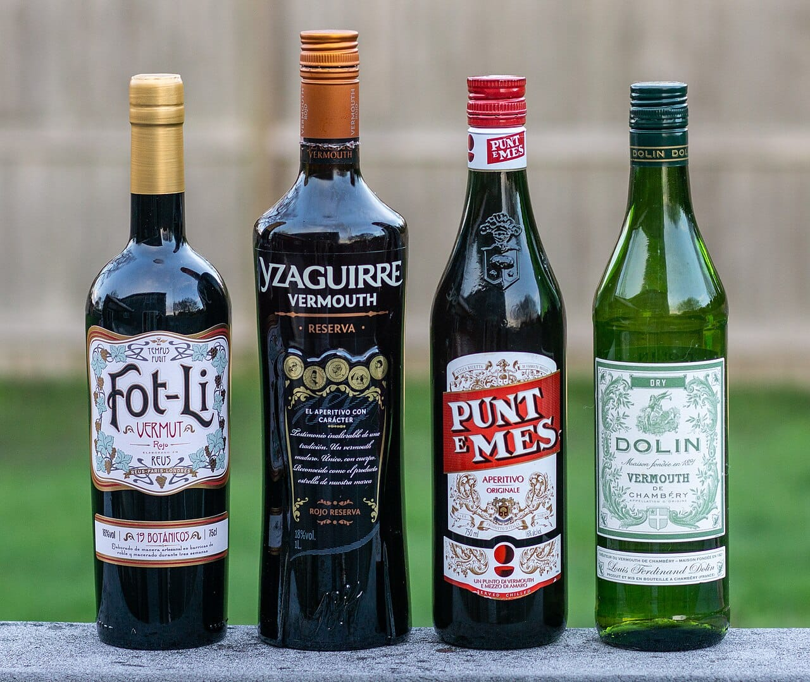

# 伦敦金酒路线

这条路线用两家酒吧读伦敦金酒：萨沃伊酒店的美式酒吧看 19 世纪末到 1930 年代的鸡尾酒传统，圣詹姆斯广场的杜克斯酒吧看一杯桌边调制的马天尼如何成为伦敦的仪式。全程步行约 1.5 公里，重点不是喝多少杯，而是比较同一瓶伦敦干金在不同酒吧里被如何对待。

图：London Gin Route：DecaturGins（Wikimedia Commons）。图片：Decatur Wine & Spirits，CC BY-SA 3.0，via Wikimedia Commons（[原图页面](https://commons.wikimedia.org/wiki/File:DecaturGins.jpg)）。

## 路线总览

建议 17:00 从萨沃伊酒店的美式酒吧开始，先喝一杯金汤力或经典鸡尾酒，听钢琴、看酒单，约一小时；18:15 沿 Victoria Embankment 或 Northumberland Avenue 走到圣詹姆斯，途中经过 Trafalgar Square 与 Pall Mall，约 25 分钟；18:45 到杜克斯酒吧，点一杯桌边调制的马天尼，配小食，19:45 左右在圣詹姆斯或 Covent Garden 吃晚饭。如果只想喝一杯，选杜克斯的马天尼；如果想看完整的鸡尾酒传统，两家都去。

这条路线适合第一次来伦敦、又想理解“金酒为什么是英国酒”的人。它不是酒吧打卡清单，而是两个空间对照：美式酒吧大、亮、有音乐与长酒单；杜克斯小、暗、安静，几乎只围绕马天尼。两家都要求着装与预约，临时到店常常没位。

## 金酒背景

金酒在 17 世纪末从荷兰传入英国，18 世纪上半叶爆发“金酒热”：便宜、易得、无需陈年，伦敦街头出现大量小蒸馏坊与劣质酒。1751 年的 Gin Act 与 Hogarth 的《Gin Lane》把金酒钉在道德恐慌的叙事里，但也促使议会与酒厂开始区分“好金酒”与“劣质烈酒”。19 世纪连续蒸馏器普及，让更干净、更稳定的基酒成为可能；今天的 London Dry Gin 要求在蒸馏过程中加入杜松子与其他植物，成品不添加糖、色素或香精，杜松子必须主导香气。

伦敦干金不是“产自伦敦”的同义词，而是一种蒸馏与配方标准；可以在其他地方生产。它的风格从极干、胡椒感强的现代款，到柑橘、花香、香菜籽更突出的传统款都有。金汤力的比例通常是 1 份金酒配 2–3 份汤力水，先放冰再倒酒，最后挤柠檬或葡萄柚皮；马天尼则是金酒与干味美思的比例游戏，从 5:1 到 15:1 都能成立，关键是温度、稀释与搅拌/摇匀的选择。

## 第一站：萨沃伊美式酒吧

萨沃伊酒店在 Strand，美式酒吧 1893 年开业，1930 年代改成今天的 Art Deco 风格；Harry Craddock 在 1930 年出版《Savoy Cocktail Book》，把大量经典配方固定下来，让这里成为“英式鸡尾酒传统”的代名词。酒吧有现场钢琴、长酒单与穿着礼服的调酒师，气氛比杜克斯明亮、社交。

点酒可以从金酒基底开始：一杯 Dry Martini 看酒吧对温度与稀释的控制，一杯 Gin Fizz 或 White Lady 看柑橘与蛋白的平衡，一杯 Negroni 看金酒与苦味酒的比例。如果不想喝烈酒，问调酒师要一杯低酒精的 gin-based cocktail，不要只点“最烈的”。酒单很长，第一次来可以先告诉调酒师你喜欢杜松子还是柑橘，让他选。

美式酒吧有着装要求，smart casual 即可，不要穿短裤、拖鞋或运动装；周末与演出前后人多，最好提前订位。钢琴声大，适合聊天但不太适合安静品鉴；如果想慢慢喝，选工作日下午早一点。

## 第二站：杜克斯酒吧

杜克斯酒店在 35 St James’s Place，酒吧从 1908 年起营业，是伦敦最小的酒店酒吧之一。它的招牌是桌边调制的 Dukes Martini：调酒师推着小车到桌边，用冷冻过的酒杯、金酒与少量味美思，现场搅拌或摇匀，不加冰，让酒保持极低的温度与较高的浓度。Ian Fleming 曾是这里的常客，传说《007》里的“Fleming Martini”就与这里有关，但酒吧本身并不靠邦德营销。

杜克斯没有长酒单，重点在马天尼、金汤力与少数经典鸡尾酒；空间小、灯光暗、座位少，通常要预约。点马天尼时告诉调酒师你要“wet”还是“dry”、要柠檬皮还是橄榄；如果不确定，选经典配方，不要要求加果汁或糖浆。这里的马天尼浓度高，喝两杯就够，不要把它当普通鸡尾酒灌。

杜克斯的着装要求更正式，男士最好穿外套，女士避免运动装；酒吧没有大桌，超过四人很难安排。拍照可以，但不要用闪光灯，也不要对着其他客人拍；这里的气氛是低声聊天，不是派对。

## 步行与晚餐

从萨沃伊到杜克斯约 1.2 英里，步行 25 分钟：沿 Victoria Embankment 向西，转 Northumberland Avenue 到 Trafalgar Square，再沿 Pall Mall 走到 St James’s Palace，拐进 St James’s Place。这条路线经过伦敦一些最正式的建筑与俱乐部，傍晚光线好，适合走路；如果下雨或穿高跟鞋，打车约 10 分钟。

晚餐可以在圣詹姆斯、Mayfair 或 Covent Garden。圣詹姆斯有不少老牌餐厅与俱乐部，Mayfair 更贵、更国际，Covent Garden 更热闹、选择多；如果已经喝了两杯马天尼，选一家能走到的餐厅，不要再跨城。晚餐点清淡的鱼、烤肉或意面，不要点太重辣的菜，酒精与辣椒会让味觉更累。

## 季节与礼仪

伦敦全年多雨，秋冬下午四点半天黑，路线最好从 10 月到 3 月提前到 16:30 开始；夏天白天长，可以 18:00 再从萨沃伊出发。周五与周六晚上酒吧最忙，预约要更早；12 月与节日季，酒店酒吧常有活动，出发前看官网。

两家酒吧都有着装要求与预约规则，不要带大件行李或湿伞进酒吧；把伞放在门口，外套交给衣帽间。点酒时不要替别人点，也不要把马天尼当成“越贵越好”；告诉调酒师你的口味与酒量，比点最贵的酒更专业。结账时服务费通常已包含，额外小费按服务决定。

这条路线不画地图，也不提供实时价格；营业时间、预约规则与酒单会变，出发前以两家酒店官网为准。如果一家满位，不要硬等，去另一家或改天；伦敦的金酒酒吧很多，没必要把一晚耗在门口。

相关条目：[萨沃伊美式酒吧](ref:american)、[杜克斯酒吧](ref:dukes)、[英国](ref:uk)。

## 延伸阅读与另见

- 相关条目：[american-bar-savoy](ref:american)、[dukes-bar](ref:dukes)、[united-kingdom](ref:uk)、[gin](ref:gin)、[vermouth](ref:vermouth)。
- 想继续深入，可以把这条路线与伦敦的蒸馏厂参观结合：白天看金酒怎么做，晚上看它怎么被调成鸡尾酒。
- 如果只有一晚，选杜克斯；如果有两晚，第一晚美式酒吧，第二晚杜克斯，顺序不要反过来。

**关键事实。**

| 项目 | 内容 |
| --- | --- |
| 一句话定位 | 以梅菲尔与圣詹姆斯的两家经典酒吧为停靠点，读伦敦金酒从 18 世纪蒸馏立法到当代金汤力的变化；重点不是喝多少杯，而是看酒单如何把杜松子、柑橘与香料写成不同风格 |
| 站数 | 2 |
| 交通 | walk |
| 停靠顺序 | 萨沃伊美式酒吧、杜克斯酒吧 |

## 相关图像

图：金酒。图片：Decatur Wine & Spirits，CC BY-SA 3.0，via Wikimedia Commons（[原图页面](https://commons.wikimedia.org/wiki/File:DecaturGins.jpg)）。关联图像：伦敦金酒路线。

图：味美思。图片：Kenneth C. Zirkel，CC BY-SA 4.0，via Wikimedia Commons（[原图页面](https://commons.wikimedia.org/wiki/File:Four_bottles_of_vermouth.jpg)）。关联图像：伦敦金酒路线。
