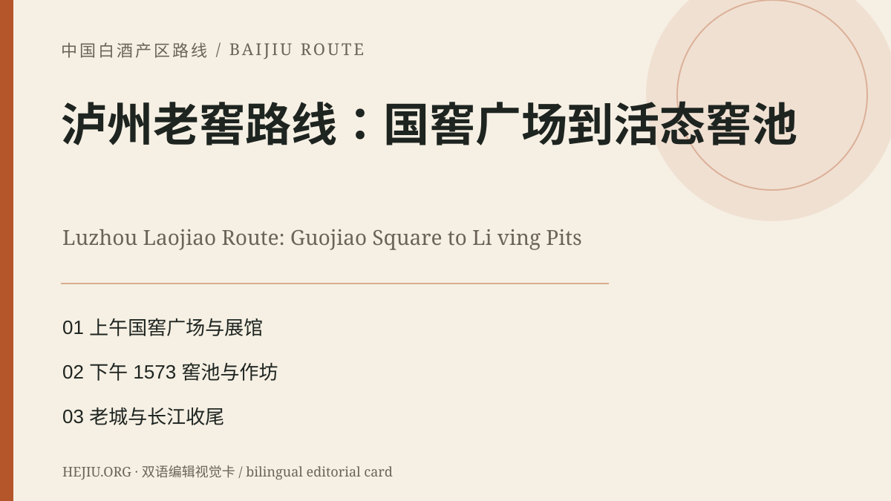

# 泸州老窖路线：国窖广场到活态窖池

泸州的酒旅有两个常见误区：一是只看国窖广场的门面，二是把“1573”当成一口可以随便参观的井。这条路线把一天分成“展馆建立框架”和“现场看活态遗产”两段：上午先把浓香型白酒的窖池、窖泥、糟醅与蒸馏弄明白，下午再到国宝窖池群与明清作坊对照，最后用老城与长江把“酒城”放回城市。

图：泸州老窖路线专属双语视觉卡。项目自制双语视觉卡，用于识别主题，不是现场照片。

> **先给结论**
> **适合谁：** 想理解浓香型窖池遗产与泸州城市关系的人；适合自驾、打车或公交加步行。
> **不适合谁：** 只想买酒、不愿预约与走路的人；展馆、窖池与作坊各有入口。
> **一句话：** 上午看展馆与广场，下午看窖池与作坊，品鉴后不开车。

## 路线逻辑：先展馆再窖池

泸州老窖的遗产不是孤立的“老池子”，而是窖池、作坊、城市与酒业共同形成的系统。先看展馆，能把“浓香型白酒为什么用泥窖、窖泥为什么重要、糟醅如何入窖与蒸馏”这些问题建立起来；再看现场，才知道一口窖池在车间里如何被使用、被养护、被记录。 reversed 过来，先到窖池只会看到一排池子，缺少判断标准。上午的展馆不是可选项，而是下午现场的说明书。

## 上午：国窖广场与博物馆

国窖广场在泸州江阳区三星街一带，博物馆与广场共同解释泸州老窖的历史、工艺与城市记忆。看展抓四条线：泸州为什么成为浓香型产区，泥窖与窖泥如何工作，明清作坊如何组织生产与运输，品牌如何从地方酒坊走到今天。不要只拍“1573”三个字，拍下工艺剖面与作坊平面，下午在现场对照。若馆内有讲解，先听工艺，再听品牌；两者混在一起，容易把广告词当成工艺事实。

## 下午：1573 窖池与明清作坊

1573 国宝窖池群与明清酿酒作坊是活态遗产，重点不是“年份”，而是连续使用与日常维护。看三件事：窖池的形制与排列，窖泥的颜色、厚度与养护，糟醅入窖、出窖与蒸馏的节奏。不要触摸窖泥，不要往池里丢东西；拍照遵守现场标识，不把相机伸进池口。作坊部分注意“前店后坊”、江边运酒与老城街巷的空间关系；把物流线看明白，比记住一堆年份更有用。

## 交通、预约与时间

国窖广场在泸州市江阳区，从泸州站或云龙机场打车都要预留时间；公交线路会变，以实时地图为准。只看展馆与广场约两小时；加窖池、作坊与品鉴，半天到一天。展馆、窖池与作坊的预约入口不同，开放时间、门票与拍照规则会调整，出发前一天看官方渠道。夏天窖池区气味重、地面可能湿滑，穿防滑鞋；品鉴后不要开车，城区打车方便但高峰要等。

## 品鉴、买酒与老城

品鉴要问清酒精度、容量与收费，小杯慢饮，不空腹；司机不喝。买酒去官方店或授权店，保留发票；不要把“内部酒”“特供”当成捡漏。下午结束后可以按“国窖广场—老城—长江边”走，傍晚看江景；多留一天再去张坝桂圆林、尧坝古镇或黄荆老林。吃饭可以试泸州白糕、合江烤鱼、猪儿粑与长江鱼，配浓香酒时控制量。带长辈时把休息点先问清，减少来回折返。

## 把酒城放回城市

如果只留半天，按“博物馆—国窖广场—一段老城”走，不要硬加窖池与作坊；如果留一天，上午展馆、下午窖池与作坊、傍晚长江边，顺序不要倒。带长辈时减少步行，把展馆的剖面先看懂，再到现场对照；带孩子时把“窖泥是什么”讲成微生物的家，比让他们记年份有效。无论哪种走法，都把品鉴与买酒分开，司机不参加品鉴，返程前再买酒。如果只走半天，博物馆加国窖广场，下午不要硬加窖池；如果带长辈，坐车到广场，步行只留展馆与一段老城。下午的窖池与作坊按预约线路走，不脱队；傍晚长江边收尾，别在窖池区拖到闭馆。多留一天去张坝或尧坝，各自半天到一天。泸州的酒城记忆还在码头、街巷与餐馆，不要只把时间花在厂里；买酒留到返程前，别在景区门口接“内部渠道”的话。带水与帽子，记下停车点；老城晚饭后打车回住处，不要酒后穿街。展馆讲解提前十分钟到，票根放好。张坝与尧坝各自需要半天，不要硬塞进同一天；黄荆老林更远，单独安排。买酒核对批次，提前准备，带好身份证。

## 出发前核对

- 确认展馆、窖池与作坊预约
- 上午展馆，下午现场
- 不触摸窖泥与池口
- 品鉴后不开车
- 买酒只走官方或授权店
- 夏天穿防滑鞋
- 老城与江边留出步行时间
- 带长辈先问休息点

## 这一路线不适合谁

这条路线以国窖广场和老城为核心，步行与短途打车即可完成，适合半天到一天。若你想看现代化灌装线或多个酒厂，它覆盖不了；若你行动不便，窖池区的地面与台阶需要提前询问无障碍条件。

夏季泸州湿热，窖池附近气味浓，敏感人群可能不适；馆内与老城之间的步行会消耗体力。节假日的讲解名额和品鉴位需要预约，现场排队不一定有。

替代方案：只看博物馆与滨江老城，把酒厂参观另约；若想比较浓香与酱香，可把泸州与宜宾分成两天。买酒时比较馆内商店与市区渠道，别把门票当成折扣券。

## 参考资料

- 国窖之旅 — 泸州老窖 — https://www.lzlj.com/travel/（泸州老窖，核对 2026-11-25）
- 泸州老窖 — 窖池群与酿酒遗产 — https://www.lzlj.com/news/enterprise/13004.html（泸州老窖，核对 2026-11-25）
- 泸州老窖窖池群及酿酒作坊 — 泸州市人民政府 — https://www.luzhou.gov.cn/sq/lylz/wlmk/lswhpp/gjjwwbhdw/content_986905（泸州市人民政府，核对 2026-11-25）
- 泸州老窖景区旅游攻略 — 泸州本地宝 — http://m.luzhou.bendibao.com/tour/5894.shtm（泸州本地宝，核对 2026-11-25）

相关条目：[泸州老窖博物馆（国窖广场）](ref:museum)、[泸州老窖窖池群](ref:cellars)、[泸州老窖](ref:brand)、[浓香型白酒](ref:style)、[四川省](ref:region)、[第一次喝白酒怎么选](ref:guide)、[中国酒史纲](ref:history)。

## 相关图像

图：泸州老窖。图片：Xiaomage de，CC BY-SA 4.0，via Wikimedia Commons（[原图页面](https://commons.wikimedia.org/wiki/File:Traditioneller_chinesischer_Destillationsapparat_in_der_Brennerei_Luzhou_Laojiao.jpg)）。关联图像：泸州老窖路线：国窖广场到活态窖池。

图：浓香型白酒。图片：Xiaomage de，CC BY-SA 4.0，via Wikimedia Commons（[原图页面](https://commons.wikimedia.org/wiki/File:Vertreter_der_vier_Baijiu_Kategorien.jpg)）。关联图像：泸州老窖路线：国窖广场到活态窖池。
