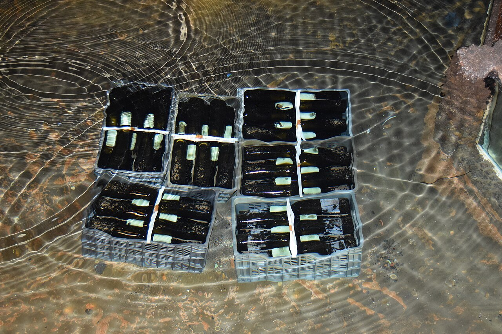
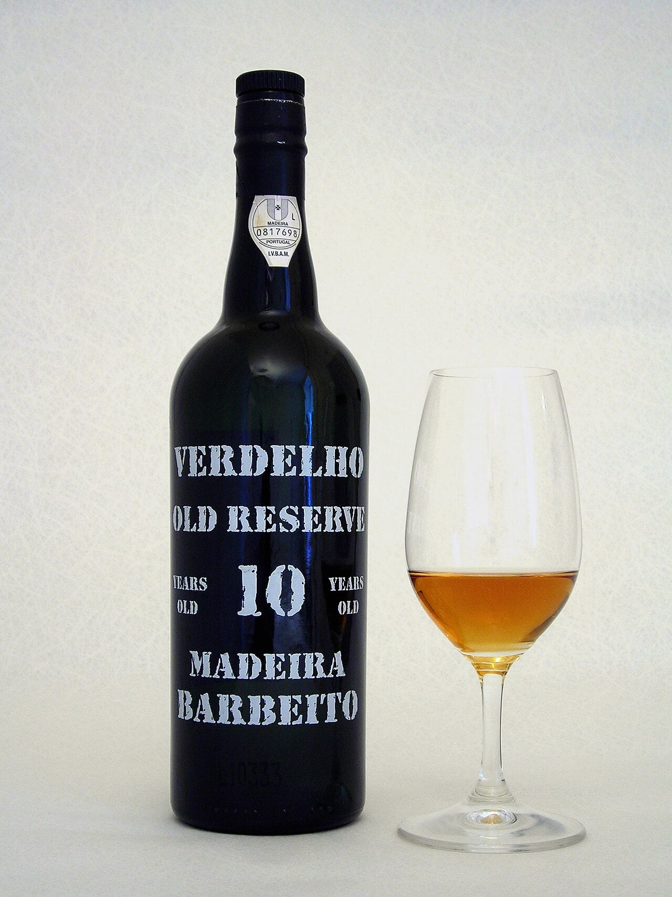

# 马德拉酒路线：丰沙尔市中心的两种酒商面孔

两站都在丰沙尔市中心，步行十来分钟：阿夫里加大道 28 号的布兰迪酒庄，与费拉兹街 28 号的恩里克斯与恩里克斯。一家把 17 世纪的修道院改成面向访客的酒窖，用导览讲 1811 年以来的家族史与 canteiro 阁楼；另一家是 1850 年创立、仍拥有 Quinta Grande 葡萄园的酒商，讲的是原料与熟成的控制权。两站合起来，能把“马德拉为什么耐放”讲成工艺问题，而不只是“甜酒”印象。

图：马德拉酒路线：丰沙尔市中心的两种酒商面孔。摄影：File:Madeira 2018. The São Vicente Caves Tour. Some wines have been stored in water since 2016 the temperature is 14 C. They are experimenting to find out if it improves the wine. (30527422747).jpg。署名：Anne and David from Kent, England UK，Public domain，来自 Wikimedia Commons（[来源](https://commons.wikimedia.org/w/index.php?curid=93605633)）。

## 一条穿过丰沙尔市中心的步行线

- 第一站：[布兰迪酒庄](ref:blandys)，Avenida Arriaga 28, 9000-064 Funchal, Madeira, Portugal。
- 第二站：[恩里克斯与恩里克斯](ref:henriques)，Rua de Ferraz 28, 9050-032 Funchal, Madeira, Portugal。
- 顺序：从海滨一侧的阿夫里加大道往北，再拐进费拉兹街。先看“面向访客的叙事”，再看“酒商与葡萄园”，顺序反过来也成立，但先建立品种与年龄的框架更省力。
- 步行：两站之间约 10–15 分钟，市中心人行道窄，部分路面是石板，雨天湿滑。
- 建议时长：半天。每站 1–1.5 小时，中间留出午餐或咖啡时间。

## 第一站：修道院里的布兰迪酒庄

布兰迪家族与马德拉的贸易关系可以追溯到 1807 年 John Blandy 到岛，商号通常以 1811 年为起点。酒庄现在使用的建筑是 17 世纪方济各会修道院的一部分，位于阿夫里加大道 28 号，离海滨与市政广场都很近。

看什么：canteiro 阁楼是重点。木桶在温暖的屋顶下分层堆放，几只桶架一直堆到四层高，空气里有酒液挥发后的甜香。导览会经过压榨与发酵区、桶陈空间与品鉴室，讲解马德拉的强化、加热与氧化；阁楼里的自然熟成与 estufagem 加热槽是两条不同路径，前者慢、后者快，风格目标不同。

喝什么：从 Sercial 到 Malvasia 的贵族品种序列，加上 3、5、10、15、20 年的年龄标示。Sercial 干、酸度高，带柑橘与杏仁；Verdelho 半干，带蜂蜜；Bual 中等甜，带焦糖与干果；Malvasia 最甜，带糖渍水果与咖啡。第一次来，用 Verdelho 与 Bual 对照，比从最甜的一端开始更容易理解酸度的作用。

注意：修道院只是容器，风味来自强化、加热与氧化，不要把建筑年代当成工艺年代。导览分档，含品鉴的酒款数量不同，按时段预订；邮轮靠港的白天，市中心与酒庄都会很挤。

## 第二站：费拉兹街的恩里克斯与恩里克斯

1850 年，João Gonçalves Henriques 创立商号；他去世后，两个儿子在 1912 年合伙，才有了“Henriques & Henriques”这个名字。与许多只做调配与装瓶的酒商不同，这家公司自己拥有葡萄园，其中 Quinta Grande 的园子是岛上最大的单一园之一，约十公顷。1925 年起，公司开始自行装瓶并出口，不再只把酒卖给其他酒商。

看什么：这一站的规模比布兰迪小，重点在“原料、熟成、装瓶”的连贯性。品鉴室不追求布景，桌上通常摆着不同年龄与不同品种的酒；工作人员会解释哪一款来自自家葡萄园、哪一款是外购果实，以及 canteiro 与 estufagem 的差异。

喝什么：10 年、15 年与 20 年的年龄标示是主线，单一年份（Colheita 或 Frasqueira）是另一条线。老年份马德拉的酸度仍然挺立，香气从柑橘皮、核桃走到咖啡与焦糖；开瓶后能放很久，这一点在品鉴时可以当场对比。

注意：1850 年是商号成立年份，不是岛上葡萄种植的起点。马德拉的葡萄种植可以追溯到 15 世纪，家族的根在 Câmara de Lobos 一带。把这些时间点分清，才不会把“老酒商”误读成“老葡萄园”。

## 步行强度、坡道与岛上交通

两站都在丰沙尔老城边缘，步行是最合理的方式。从阿夫里加大道到费拉兹街约 10–15 分钟，路面有石板与坡道，穿防滑、好走的鞋。中午日照强，带水与帽子；雨天石板滑，走慢一点。

岛上交通另说：从丰沙尔到 Quinta Grande 方向需要车，公交与出租都可以，具体班次与路线不写死，出发前查当地信息。缆车与山上的景点是另一条线，不要把酒庄与缆车排在同一小时里。

建议节奏：上午布兰迪，中午在市中心吃饭，下午恩里克斯与恩里克斯；如果当天有邮轮靠港，把顺序反过来，先去世人少的费拉兹街，再回到阿夫里加大道。傍晚沿海滨走一段，能把两条酒窖的差别再复盘一次。

## 预约、邮轮人流与季节

两家都按预约或时段接待。布兰迪的导览分 Lodge、Premium、Vintage 等档位，含品鉴；Premium 与 Vintage 不重复内容，通常按顺序参加。恩里克斯与恩里克斯规模小，旺季要提前订，团队要单独说明。预约时确认语言、人数、是否含品鉴与时长。

邮轮是丰沙尔人流的主要变量：靠港日的上午到午后，市中心与酒庄都会拥挤；想看安静的酒窖，避开这些时段或选在傍晚。新年烟花与狂欢节期间，住宿与交通都紧张。

季节上，春秋最舒服；夏季干燥炎热，葡萄园与市区都晒；冬季多雨但温和，室内品鉴不受影响。采收通常在夏末，酒庄是否开放参观要单独确认。

## 从干到甜：一条可以练习的品鉴顺序

把两站的酒放在一起练，顺序是从干到甜：Sercial、Verdelho、Bual、Malvasia。温度也要跟着走：Sercial 与 Verdelho 约 10–12 摄氏度，Bual 与 Malvasia 约 14–16 摄氏度。酸度是马德拉的骨架，甜度只是外衣；温度太低会把酸度藏起来，太高会让酒精冲出来。

配餐上，Sercial 配清汤、海鲜与橄榄，Verdelho 配烤鱼、火腿与菌菇，Bual 配坚果、干果与中等强度的奶酪，Malvasia 配巧克力与蓝纹奶酪。开瓶后马德拉能放很久，但仍要避光、阴凉，理想温度约 12–15 摄氏度。

## 与产区页、风格页的接口

马德拉产区页讲品种、熟成路径与 3、5、10、15、20 年的分级；马德拉风格页讲 estufagem 与 canteiro 的差别；加强酒页讲强化如何保留残糖；氧化与残糖两个词条，解释为什么马德拉可以又甜又清醒。把这几页连起来看，再回到酒窖，导览里的每个术语都会有落点。

这条路线不追求“打卡两家”，而是用两站对比同一座岛上的两种酒商：一家把历史做成面向公众的叙事，一家把历史收在葡萄园与桶里。两种都真实，合起来才接近马德拉的全貌。

补充阅读：[马德拉](ref:c-extra-1)、[葡萄牙](ref:c-extra-2)、[马德拉](ref:c-extra-3)。

相关条目：[布兰迪葡萄酒庄](ref:blandys)、[恩里克斯与恩里克斯酒庄](ref:henriques)、[马德拉](ref:c-extra-1)。

## 相关图像

图：葡萄牙类别配图。图片：John Hayes from San Antonio, Texas, USA，CC BY-SA 2.0，via Wikimedia Commons（[原图页面](https://commons.wikimedia.org/w/index.php?curid=151531010)）。关联图像：马德拉酒路线：丰沙尔市中心的两种酒商面孔。

图：一瓶 Barbeito Verdelho 10 年马德拉与一杯琥珀色酒液。。图片：Origenes.Adamantius，CC BY-SA 4.0，via Wikimedia Commons（[原图页面](https://commons.wikimedia.org/wiki/File:Madeira_Barbeito_Verdelho_Old_Reserva_-_Bottle_Glass.jpg)）。关联图像：马德拉酒路线：丰沙尔市中心的两种酒商面孔。
