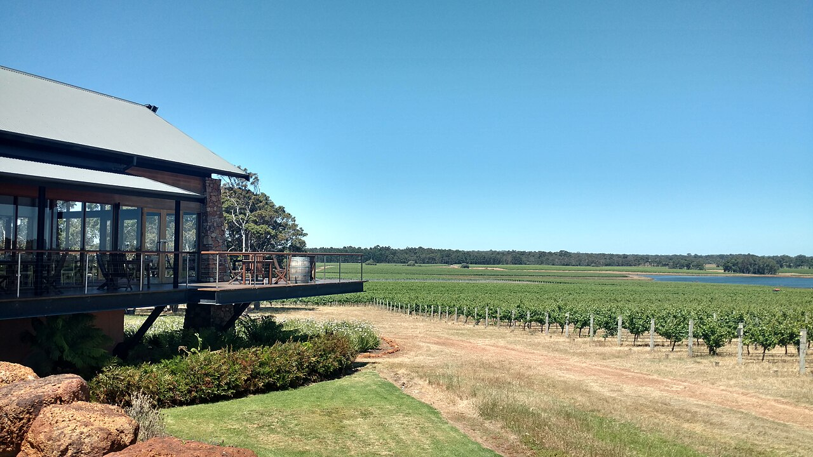

# 玛格丽特河葡萄酒路线

这条路线以法塞尔与露纹两座 1970 年代先锋酒庄为锚点，从珀斯南下约三小时，把“海洋性气候、砾石土、Art Series 酒标与露天音乐会”放进同一天。全程约 80 公里，适合住在玛格丽特河镇、用一整天慢慢走，而不是从珀斯当日往返。

图：Margaret River Wine Route：2016 Margaret River Australia. Watershed vineyard（Wikimedia Commons）。图片：Lasthib，CC BY-SA 4.0，via Wikimedia Commons（[原图页面](https://commons.wikimedia.org/wiki/File:2016_Margaret_River_Australia._Watershed_vineyard.jpg)）。

## 路线总览

建议前一晚住在玛格丽特河镇或 Cowaramup。9:30 从镇上出发，沿 Bussell Highway 向北约十五分钟到法塞尔，上午参观酒窖、美术馆与葡萄园，重点喝霞多丽与赤霞珠；12:00 在酒庄餐厅或回镇上吃午饭；14:00 沿 Bussell Highway 向南约二十分钟到露纹，下午品鉴 Art Series 与 Prelude，参观画廊；16:00 之后可以去 Cape Leeuwin 灯塔或 Prevelly 海滩，18:00 回镇上。

如果从珀斯当日往返，路上就要六小时，剩下只能匆匆看一家；这条路线不建议当天来回。玛格丽特河的好，不在“打卡两家”，而在上午的酒、下午的海、傍晚的桉树林，三件事需要时间。

## 产区背景

玛格丽特河在西澳西南角，三面靠海，是澳洲最典型的海洋性产区之一：夏天不太热，冬天不太冷，生长季长，成熟慢。产区沿着 Leeuwin-Naturaliste 山脊展开，土壤以砾石质 laterite、砂土与黏土为主，排水好、养分低，葡萄藤根系深，产量自然受控。

这里直到 1960 年代末才有现代酿酒葡萄种植，1970 年代一批医生、律师与农学家把“波尔多与勃艮第的品种”带进来，法塞尔与露纹就是那批先锋。今天产区以霞多丽、赤霞珠与西拉为主，白葡萄酒的酸度与质感、红葡萄酒的结构与陈年潜力，都比澳洲多数产区更接近欧洲。产区的葡萄园大多藏在小路尽头，Bussell Highway 两侧看起来只是桉树林与牧场，真正的酒庄要拐进去才看得到，第一次来最好用导航，不要只凭路牌。

## 第一站：法塞尔

法塞尔在 4357 Bussell Highway，Cowaramup 以南，从玛格丽特河镇向北约十五分钟。1967 年 Tom Cullity 在 Home 地块种下第一批葡萄，1972 年出第一个年份；1973 年、1979 年与 1985 年的奖项让法塞尔成为西澳最早被国际注意的酒庄之一。1987 年 Holmes à Court 家族接手，后来把 Home、Adams Road 等地块扩成今天的 estate。

法塞尔的酒单以霞多丽、赤霞珠与西拉为主：Premier 是入门，Filius 是中间层，Héritage 与 TOM CULLITY 是旗舰。参观时先喝 Premier 霞多丽建立基准，再喝 Héritage 霞多丽看桶与酒泥的差别；赤霞珠则从 Filius 喝到 TOM CULLITY，体会结构、单宁与陈年潜力的梯度。

酒庄的美术馆与餐厅值得留时间：美术馆收藏澳洲当代艺术，餐厅主打本地食材，旺季要订位。如果只选一个体验，选酒窖品鉴加美术馆；如果对葡萄园感兴趣，问清楚是否有 estate walk，别把时间全花在商品店。

## 第二站：露纹

露纹在 1379 Bussell Highway，从法塞尔向南约二十分钟。1969 年 Horgan 家族买下农场，1973 年正式建庄，1974 年建苗圃，1975 年开始种葡萄；1979 年出第一个商业年份，1980 年发布第一个 Art Series 年份。Block 20 的老藤来自 Gin Gin 克隆，是澳洲最著名的霞多丽地块之一；1985 年伦敦爱乐乐团在酒庄草坪演出，从此“露纹音乐会”成了酒庄的第二张名片。

露纹的酒单分三层：Art Series 是旗舰，Prelude 是更即饮的版本，Siblings 是日常款。Art Series 霞多丽带柠檬、白桃、榛子与湿石，酸度清晰，桶味克制；Art Series 赤霞珠则偏结构，黑醋栗、雪松与细单宁。品鉴时先喝 Siblings 或 Prelude，再喝 Art Series，差别主要在浓度、质地与陈年潜力。

酒庄的画廊与雕塑公园也值得看，露纹音乐会的舞台就在草坪上；如果赶上演出季，参观要避开下午彩排与交通管制。餐厅与品鉴都要预约，旺季名额紧；不带演出时，下午的草坪比酒窖更适合拍照。

## 午餐与第三站

午餐有三个选择：法塞尔的餐厅、露纹的餐厅、玛格丽特河镇。两家酒庄的餐厅都要提前订，镇上的选择更多、更随意；如果下午还要开车，午餐不要配太多酒。玛格丽特河镇有面包店、咖啡馆与小型食品店，适合想吃得快的人。

第三站可以按兴趣选：想看海，去 Prevelly 或 Gracetown，把车停在海滩停车场，走一段 Cape-to-Cape 步道；想看灯塔，去 Cape Leeuwin，澳洲大陆最西南角，风大但视野好；想再看一家酒庄，去 Cowaramup 或 Margaret River 镇附近的小型酒庄，不要再跨到 Augusta。

如果带小孩，建议把第三站换成海滩或灯塔，而不是继续品酒；酒庄的美术馆与草坪对小孩友好，但品鉴室通常要求安静。旺季的海滩风大，带外套与防晒。

## 季节与路况

玛格丽特河是地中海式海洋气候，夏天温暖干燥，冬天多雨；葡萄采收通常从二月到四月。夏季下午海风强，酒庄草坪很舒服，但海滩风大；冬季酒庄人少，餐厅与品鉴更容易订，但道路湿滑，开车要慢。

从珀斯到玛格丽特河约 280 公里、三小时；从镇到法塞尔约十五分钟，从法塞尔到露纹约二十分钟，从露纹到 Cape Leeuwin 约四十分钟。Bussell Highway 是双向单车道，周末与假期车多，超车要谨慎；晚上有袋鼠与野生动物上路，尽量不要夜间长途驾驶。

## 预约与礼仪

法塞尔与露纹的品鉴、餐厅与部分体验都要预约；旺季与演出季名额紧，最好提前一周以上。两家都不适合大型团体临时加入，超过六人先发邮件。品鉴时把酒吐进吐酒桶，开车的人只喝一两杯；酒庄的美术馆不要触摸展品，草坪音乐会不要踩进布景。

这条路线不画地图，也不提供实时价格；道路、营业时间与预约规则会变，出发前以两家酒庄官网与 Margaret River Wine 为准。如果遇到酒庄临时关闭，别硬闯，把镇上的替代酒庄或海滩写进行程，一天不会因此作废。

相关条目：[露纹酒庄](ref:leeuwin)。

## 延伸阅读与另见

- 相关条目：[vasse-felix](ref:vasse)、[leeuwin-estate](ref:leeuwin)、[margaret-river](ref:margaret)、[white-wine](ref:white)、[chardonnay](ref:chardonnay)。
- 想继续深入，可以把这条路线与巴罗萨谷对照：同样有西拉，玛格丽特河更靠海、更偏凉，巴罗萨更热、更浓。
- 如果只有半天，选法塞尔加镇，不要再去露纹；如果只有两小时，选一家，不要试图两家都到。

对照阅读：[法塞尔酒庄](ref:vasse)、[玛格丽特河](ref:margaret)。

**关键事实。**

| 项目 | 内容 |
| --- | --- |
| 一句话定位 | 从珀斯南下玛格丽特河，以法塞尔与露纹两座先锋酒庄为锚点；一天里看海洋性气候、1970 年代建园史、Art Series 酒标与露纹音乐会，以及 Bussell Highway 两侧的桉树林与葡萄园 |
| 站数 | 2 |
| 交通 | 自驾 |
| 停靠顺序 | 法塞尔酒庄、露纹酒庄 |
